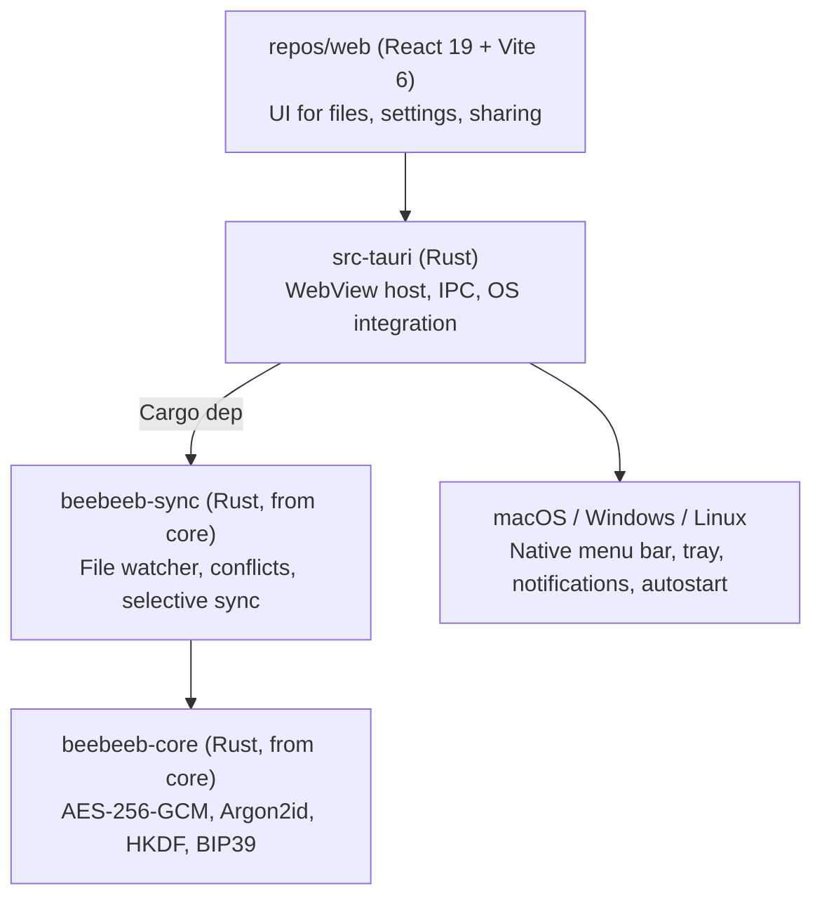

# beebeeb-io/desktop

Beebeeb desktop app. **Tauri v2** shell around the web client (`repos/web`) plus the Rust sync engine from `core`. One codebase, three OS targets (macOS, Windows, Linux).

> **Correction — 2026-09-29, task 1611:** shipping entrypoints are desktop-owned `src/main.tsx` and `src-tauri/src/lib.rs`; `runner.rs`, `engine_bridge.rs`, `state_db.rs` own scheduling/sync. macOS uses `BeebeebFileProvider/` (built by `scripts/build-fileprovider-extension.sh`), Windows uses `src-tauri/src/windows_cf` (CFAPI), Linux FUSE is an unmounted prototype. Legacy native-shell build recipes and Linux online-only claims are historical; spec 030 never authorizes raw keys in config — credentials belong in the OS store (Linux fails closed). See `docs/CAPABILITIES.md`.

## Release status (macOS, Windows, Linux released)

- `desktop-v0.8.5`+ published for all three platforms: MSI + NSIS for Windows, AppImage/.deb/.rpm for Linux, Developer ID signed + notarized `.dmg` for macOS (Apple Silicon only — Intel not built), each with a minisign `.sig` for the auto-updater.
- **Windows signing correction (2026-10-01):** every release through 0.8.7 shipped UNSIGNED; `desktop-v0.8.8` is the first Authenticode-signed Windows release (Azure Artifact Signing, `CN=Initlabs B.V.`, enforced by `scripts/windows/verify-authenticode.ps1`).
- **Windows updater manifests must preserve installer type:** publish `windows-x86_64-nsis` + generic fallback → NSIS asset; `windows-x86_64-msi` → MSI asset (crossing types creates a second Installed Apps entry).
- `release.yml` runs Windows + Linux only; **macOS builds locally, not in CI** (deliberate: Developer ID key never exported — task 1608). macOS release = `scripts/release-macos-local.sh <VERSION> <CHANNEL>` (one fail-closed command; see `docs/RELEASING.md` → "macOS: local build, then backfill the manifest"). Remaining CI gap: FileProvider build script's arch detection lacks `TAURI_ENV_ARCH=universal` (matters only for Intel).
- **Local verification (Linux):** `bun run tauri build --target x86_64-unknown-linux-gnu -- -- --locked` reproduces build + `.deb`/`.rpm` (needs webkit2gtk-4.1, libayatana-appindicator, patchelf, fuse2/3; throwaway `bunx tauri signer generate` key is fine). `.AppImage` bundling cannot be verified on Arch/WSL2 (vendored linuxdeploy `strip` too old) — CI is the source of truth for that step. Windows/macOS builds cannot be reproduced locally.
- Not yet verified: real install + close-to-tray smoke test on physical Windows hardware.

## Releases

Before cutting a desktop release, follow `docs/RELEASING.md`. The release workflow fails closed
unless the released commit contains a root `RELEASE_NOTES.md` whose contents mention the exact
semver value passed to the workflow; author and commit per-release notes before triggering it. It
also refuses while root `RELEASE_BLOCKERS.md` lists an item. For an `alpha`/`beta` initial channel
it refuses notes that promise automatic delivery to existing installs, and only a `stable` publish
marks the GitHub release Latest. `node scripts/release-channel-checks.mjs delivery` checks the live
stable manifest against GitHub Latest.

## Architecture



Why Tauri (not Electron): native OS WebView (~10MB vs ~150MB), Rust backend importing `beebeeb-core` directly, no Node runtime in production builds.

## Layout

```
desktop/
├── src-tauri/            Rust app (Tauri v2)
│   ├── tauri.conf.json   App config (window, bundle, identifier)
│   ├── capabilities/     Permission grants per window
│   └── src/              main.rs (entry) + lib.rs (Builder, command handlers)
├── src/                  Placeholder frontend (replaced by repos/web)
├── index.html            Vite entry
├── package.json          Dev/build scripts (bun)
├── vite.config.ts        Frontend bundler config
└── tsconfig.json
```

`linux/`, `macos/`, `windows/` are pre-Tauri scaffolds kept for reference; new work goes in `src-tauri/`.

## Build & run

Requires Rust stable, bun, Tauri prerequisites (https://tauri.app/start/prerequisites/).

```sh
bun install
bun run tauri:dev      # spawns vite on :5173, opens native window
bun run tauri:build    # produces .dmg / .msi / .deb / .AppImage
```

To develop against the real web client: run `repos/web` on :5173 — the Tauri window loads it automatically (`devUrl`). For production bundles the web client is built and copied to `../dist/` (or `tauri.conf.json` repointed at `../web/dist/`). `cargo check` from `src-tauri/` validates the Rust side without the frontend.

Desktop CI (`.github/workflows/ci.yml`): `cargo check --locked --all-targets` + `cargo test --locked` (Windows and macOS: the all-target check, then `cargo test --locked` checked by the count guard (macOS since 0.8.19); Linux: the tests). `scripts/assert-cargo-test-counts.py --self-test` (`python` on Windows, `python3` on macOS) proves the count guard rejects empty runs; each library/integration binary must execute tests (only the `src/main.rs` harness and doctests may be empty). CI uploads logs as `rust-Windows`/`rust-macOS`/`rust-test-linux`. A Windows cross-check on Linux is not a native test pass.

Test fixtures: `docs/NATIVE_PARITY_FIXTURES.md` (task 1612) — test-only `native_parity_tests::corpus` and `native_parity_tests::http_` filters exercise socket-free fixtures and loopback bridge requests; neither proves CFAPI/FUSE/File Provider execution; do not log fixture credentials.

## Key facts

- App bundle id `io.beebeeb.app`; File Provider extension id `io.beebeeb.app.FileProvider`; domain id `io.beebeeb.app.domain`; app group `R8352WDJJR.io.beebeeb.app.fileprovider`.
- `src-tauri/src/lib.rs` — `run()` builds the app and registers `#[tauri::command]` handlers (add commands here). `src-tauri/capabilities/default.json` — add explicit permissions before exposing new tauri APIs.
- Cross-platform logic stays in Rust (auth/session, crypto, sync, queueing, conflicts, cache policy, protocol) — not duplicated in the frontend.
- The Tauri warning that `io.beebeeb.app` ends in `.app` is known — keep the identifier unless Guus migrates the App Store Connect record.

## macOS File Provider rules

- **Logging:** the extension logs ONLY through `ExtensionLog` (`BeebeebFileProvider/ExtensionLog.swift`, one `os.Logger`, subsystem `io.beebeeb.app.FileProvider`) — never `NSLog` (on macOS 26 it reaches the unified log as `<private>`). New lines are functions in `ExtensionLog` whose public values are closed (fixed words, bitmasks, UUIDs, NSError domain+code) — never a path, file name or error text. `extension_log_pin` (src-tauri) enforces the vocabulary; details: `docs/IPC_PROTOCOL.md` → "Logging".
- **Finder blocker is provisioning:** both containing app and extension profiles must include the exact app group; fix signing/provisioning — never mask as a UI timeout or a fake local folder root.
- **Removing the Finder location keeps un-synced files (task 1882):** every `NSFileProviderManager` domain removal passes `NSFileProviderDomainRemovalModePreserveDirtyUserData`; never add plain `removeDomain:`/`remove(domain)`/`removeAllDomains`. Source pin `test_1882_every_domain_removal_in_the_repo_keeps_unsynced_files` (`src-tauri/src/finder_removal.rs`). macOS reports a folder even when it kept nothing — the bridge checks the returned URL (`BeebeebKeptFolderState`) and only surfaces a folder that exists and holds an entry (or is sandbox-blocked), via alert + Settings → Sync row (`kept_unsynced_folder`).
- **Config writes (task 1889):** `DesktopConfig` has no `save()`; the file is written in ONE place, `try_update_at_then`, which holds the one config-write lock in `config.rs` across read/change/write (not re-entrant — nothing inside an update closure calls another update). The ways in: `update_at` (+ `update`, `update_held`, `ensure_account_id`, which are `update_at`), `try_update_at`, `update_at_then`, and `update_at_durable_with` — the one save that flushes its write (the sign-out keep step's, task 1887). Held copies (`HeldConfig`) are read-only. Settings writes (`set_desktop_config`) are merge-only — send only what changed, never the whole object read on open. In-memory pause flag follows the file under the same lock. Pins: `test_1889_*`.
- **A sign-out keeps waiting Finder saves (task 1887, macOS):** `clear_session` gates on an ask snapshot (`sign_out_count`) and refuses with `unsent_changes:` while changes wait and the person was not asked; Settings › Account sends first (`sign_out_send_start`, ≤ 60 s), then asks. On "Sign out" the keep step copies every waiting save into `<container>/Data/Documents/Changes not sent/<date at time>/` with `clonefile` (never overwriting) and records it durably (`kept_unsent_folder`, `kept_unsent_unfinished`) BEFORE the purge, whose guard refuses any deletion unless every waiting write was kept. Windows and Linux unchanged. Spec `docs/specs/2026-10-10-macos-sign-out-waiting-writes.md`; detail: docs/runbook/desktop-task-history.md.
- **Finder setup reconciler** (`src-tauri/src/finder_setup/`, spec `docs/specs/2026-10-06-macos-finder-setup-reconciler.md`): nobody installs the Finder location on macOS any more; one Rust driver task keeps Beebeeb in Finder (pure core/policy/launch_location + bridge via `macos/FileProviderBridge.m`; NSError-domain+code classification; retries 0/5/15/45 s; triggers: launch, keys arriving, "Try again", userEnabled flip; sign-out removes + holds; Repair removes then checks; revoked session keeps; Lock cancels, never removes). Surfaces read `finder_setup_state` + `finder-setup-changed`; copy in `src/finderSetupCopy.ts`.
- **Launch rule:** `launch_location` classifies `/AppTranslocation/` → translocated; bundle at `/Volumes/<name>/` → disk_image; Applications folder → applications; else elsewhere. `translocated`/`disk_image` report `not_in_applications` and never call add.
- **Lifecycle log:** app view `~/Library/Logs/Beebeeb/lifecycle.log` (sandboxed: `~/Library/Containers/io.beebeeb.app/Data/Library/Logs/Beebeeb/lifecycle.log`), 1 MB × 3 files, closed vocabulary, redacted NSError text, not a `tracing` sink; holds no user content; "Copy details"/support bundle include the last 200 lines. Whether Console.app lists it is unverified (device check D0 records the answer).
- **"Open in Finder" (task 1885):** nothing a Mac compiles starts `/usr/bin/open` — the bridge keeps the security-scoped URL from `getUserVisibleURLForItemIdentifier` and opens in-process (`beebeeb_open_scoped_url` / `beebeeb_reveal_scoped_url`; GATED resolve then UNGATED open; the gate is never held across the open; scope stopped in the completion handler or 60 s timer). `beebeeb_open_url` opens System Settings (no gate). A Mac never asks the File Provider about a shared-with-me row (ruling 1701: webapp-only). (details: docs/runbook/desktop-task-history.md)
- **Sign-in:** first-run "Sign in with browser" opens `<APP_URL>/cli-auth`; the link carries NO code (person TYPES it — phishing defence); WS init frame adds `client: "desktop"`, version, `os`, hostname; copy in `src/browserLoginCopy.ts`.
- **Re-sign-in in place (R8):** "Sign in again" opens sign-in in place; the same account swaps only its session token (keys, cache, queue, Finder stay). Only an account switch purges (warning with pending-change count → full sign-out → fresh sign-in). A startup 401 drops only the revoked token on macOS/Linux; Windows keeps today's flow.
- **Local data belongs to one account (R10):** `state.db` records the owner; every engine start goes through `spawn_bound_engine` (`account_binding::bind_before_engine_start` first): same account keeps everything; another account's data or owner-less data resets before anything starts (Windows refuses instead); an incomparable owner stops the start; a failed reset/purge stops. Pin: `every_engine_start_is_bound_first`. On Windows a refusal over owner-less data (or an email-only owner) asks the server in the background (`own_data_proof.rs`, task 2267): it lists this account's whole tree once (snapshot + trash) and judges EVERY My Files row the server named, no sample (in the tree: own when its name decrypts under this session's key; not in the tree: gone only under an own ancestor); a row counts as made on this PC (not judged) only when its version columns are both 0 AND a queued create names it; a name that does not open under this key (unless the node says a file request or a collaborator sealed it; a node that says nothing is no evidence) or a row it cannot place blocks, and names that prove nothing never outnumber own ones. Proven, `StateDb::adopt_owner_holding` records the owner and, in the same transaction, holds every change it cannot tie to an own row, whatever its pause reason, as `found_while_paused` (later changes to those items too, `insert_operation_conn`): never sent or deleted until the person decides in Settings › Sync. A path proves only the create of a folder made here whose own path is an own server folder's (its twin, task 1888), never a new folder inside it; any other change, file content above all, needs one anchor tied to an own row by real parent links, never by a twin or by a folder at a path (also not on the walk up from a row gone from the tree). The card shows them by kind (`found_while_paused_review`: new folders, new files, edits, deletions, changes in folders shared with you; a change anywhere inside a shared folder counts there), and both choices act on exactly the ids it showed, never a change held after that read: "Upload to my Beebeeb" releases them; "Keep on this PC only" (`found_while_paused.rs`) MOVES the items made on this PC they act on out of the sync root into `Beebeeb - not uploaded\YYYY-MM-DD` next to it (same volume, rename only, never over a name, journaled, settled at the next engine start) and forgets their rows. It removes only the staged copies the journal names; one whose live file is gone is copied into the dated folder first, before the rows are forgotten (a restart after that copy does not make it twice). When OneDrive or Dropbox syncs the folder it is made in, the card says so (`synced_by`) instead of "on this PC". Sync starts through `spawn_bound_engine`. Two different user ids are never questioned.
- **Zombie domain correction (1698):** the `DOMAIN_IDENTIFIER` comment about `io.beebeeb.desktop.FileProvider` was wrong (folder is `Beebeeb-Beebeeb`; `getDomains` sees only the calling provider's domains); a pre-rename dev-Mac domain is cleared once by the one-off helper (spec §11), not by the app.

## macOS window rules (task 1683, spec `docs/specs/2026-10-24-macos-two-surface-app.md`)
- **One app window, `main`** (`src/MacApp.tsx`), declared alone in `tauri.macos.conf.json` (`create: false`): a Mac never builds `tray`/`windows-onboarding`/`main-app`/`onboarding`, Settings is a mode of `main` (System Settings style), `macos-settings` is retired. Until slice 3 the tray click shows the compact flyout (`settings`). 1887's sign-out flow owner is `main`.
- **Every opener calls `show_main_window(app, MainNav)`** (unhides the app, stores ONE request, emits `main:navigate`, pulled by `consume_main_navigation`); `src/mainWindowModel.ts` `navigate` is the only place a request becomes a view; under a sheet nothing navigates and `main_window_state` disables View › Home/Back, Settings…, Check for Updates…. macOS menu: `MACOS_MENU_SPECS` + `MACOS_MENU_LAYOUT` (Windows/Linux keep `DESKTOP_MENU_SPECS`).
- **Sign-in is the signed-out content of `main`** (slice 2; `src/macSignIn.tsx`, `signInModel.ts`, `accountViewCopy.ts`): no sidebar, one centred card at a time (sign in with the browser or email and password, the browser code, 2FA, Sign in again, the 1887 account switch, set up this Mac, the Finder status, then Home in the same window; nothing closes it). The flow lives in a module store (`signInFlowStore.ts`), not component state: `AccountSessionBoundary` remounts `main` on every session change and a sign-in is one. A step is the screen whatever the snapshot says (it is up to 5 s stale just after a sign-in); the flow is checked once, against the first snapshot a window reads (`normalizeFlow`, a sign-out always remounts). `desktop_login`, `desktop_login_2fa` and `start_browser_login` answer even when the revision moved while they ran (`ANSWER_STANDS_WHEN_THE_ACCOUNT_CHANGES`); every other command keeps the guard. The browser handoff is `browserSignIn.ts`, shared with the Windows wizard (their markup differs); a different account on that path becomes the password path's `SignInSettled` from the `account_mismatch` event (1887 pins that event; C-S1's Rust `LoginOutcome` is not done). Each handoff has an attempt id (the controller's, echoed in every `browser-login` event; events of another attempt are ignored). A sign-out's sentence that the window cannot show before a remount is HELD (`accountSession.ts`), never toasted: the switch step holds it, and a window that shows a sign-in card shows it above the card instead of leaving for Settings. A step Rust keeps for the process (`pending_setup`: a password sign-in that left the recovery phrase owed) lets a window reopened after ⌘W resume at Set up this Mac. `open_onboarding_window` and `open_reauth_window` show `main` on a Mac (`surfaces::policy::onboarding_surface`); `Onboarding.tsx` is Linux's window (and unreachable there while `native_credentials` is false), `HostOnboarding` renders nothing for macOS. The window's title follows the card's heading (`core:window:allow-set-title`, `macos-main.json` only). `quit_beebeeb` is the card's Quit.
- **Closing `main` destroys it and the app keeps running** (`keep_running_on_exit_request`); `RunEvent::Reopen` brings it back; Dock icon per `surfaces::policy::dock_icon_wanted`. No window-state plugin on a Mac: the frame is kept in logical points (`main-window-frame.json`, never full screen/zoomed) and placed by `surfaces::window_state`. A settings pause goes through `set_sync_paused`. (history: docs/runbook/desktop-task-history.md#two-surface-slice-1, #two-surface-slice-2)
- **Settings sections (slice 5):** General, Account, Sync, Security (`src/MacSecurity.tsx`, `macSecurityModel.ts`), About; the account-reading pieces (From your account, Storage details) are `src/MacSettingsExtras.tsx`. **A Mac never installs an update in place** (task 2176: the App Sandbox cannot): About offers "Download update" (words and address in `src/macUpdateCopy.ts`, shared with the popover), the channel row and a downgrade row that links; do not add an install or a "Restart to update" anywhere on a Mac (spec §0 ruling 5). Three layers hold it: the capability `update_format: "download"` and `canInstallUpdate` (false for `host_os === 'macos'`), `UpdateBanner`'s download branch, and `in_app_install_refusal` (`install_update` and `install_channel_downgrade` return `update_install_unsupported: …` first on a Mac); pins `tests/macNoInPlaceInstall.test.ts`, `tests/macUpdateBanner.test.tsx` and `mac_update_tests` (exactly two `download_and_install` call sites). The window wears the saved theme from `useSettingsConfig`, not from a section.
- **No developer word on a Mac (two-surface spec §10.1), enforced:** `tests/macCopyGuard.test.ts` scans every person-facing string of every module a Mac can mount (roots = what `main.tsx` imports less the three Windows windows; JSX text, copy attributes and properties, sentences) and the Rust sentences a command answers with (`Err("…")` text; "engine" is exempt, the refusal sentences keep it). A string another slice still owns goes in its `PENDING` ratchet with the owner; the entry must go when the string does. `tests/macCopySweep.test.ts` pins each §10.2 row. A command that is missing says "This isn’t available in this version of Beebeeb." and logs its name (`commandUnavailableLabel`).
- **When the window opens by itself is `surfaces::launch` + `policy::startup_surface(platform, no_sync_root, source)`** (task 1683 slice 6, spec §7.3): manual launch opens it, a login launch shows nothing, an updater relaunch shows what was open (the updater leaves `relaunch.json` through `note_updater_relaunch` before each `app.restart()`; every restart site must; pinned). How the app was launched is `launch_source_now()`: the relaunch flag, and `surfaces::launch::login_item_signal()`, the ONE seam for task 1845's login-item signal (answers `NoSignal` today, so no launch is a login launch yet). Never guess a login launch anywhere else, and the login item's registration (`tauri_plugin_autostart`, a LaunchAgent with no argument) is 1845's to change. Home's one-time hint is `MenuBarHint` (`menu_bar_hint_seen`, `get_`/`mark_menu_bar_hint_seen`).

## Adding commands (Rust → JS bridge)

1. Add a `#[tauri::command]` function in `src-tauri/src/lib.rs`.
2. Register it in the `invoke_handler!` macro.
3. Call from JS: `import { invoke } from "@tauri-apps/api/core"; await invoke("my_cmd", { arg })`.
4. If it touches an OS API, add the matching permission to `capabilities/default.json`.

## API client (`src-tauri/src/api_client.rs`)

Every request from the daemon `ApiClient` and every ad-hoc `reqwest::Client` in Tauri commands carries `X-Beebeeb-Client: desktop` + `X-Beebeeb-Client-Version` (`api_client::provenance_headers()`; mirrors CLI's `build_client`). Version sent is `BEEBEEB_RELEASE_VERSION` (release.yml), falling back to `CARGO_PKG_VERSION` — not raw Cargo's `0.1.0`.

**Direct S3 downloads (task 2173):** a whole-file hydrate (`EngineBridge::hydrate_whole_file`) fetches encrypted chunks straight from storage through grant windows when discovery offers `object-download-v1` (`src/direct_download.rs` drives core's `beebeeb_core::direct_transfer` planner; HTTP in `src/api_client/direct.rs`). Rules: discovery cache and storage client live in the `ApiClient` (one signed-in session); `X-Beebeeb-Capabilities` only on the grant POST; storage links through the separate storage client only (no default headers, no redirects, https only unless the API is loopback http); a storage failure is a status number, never reqwest's text (it holds the signed URL); chunk RANGES, thumbnails, versions and uploads stay on the API. `BB_TRANSPORT=api` (wins) or `desktop.toml` `transport = "api"` forces the API path.

**Version-bound downloads (task 1643):** a download takes `download_version` from the metadata it reads (`src-tauri/src/download_pin.rs`) and pins every chunk request to it (`?object_version_id=`), on the API path and the direct path alike; each chunk's wire size and the plaintext totals are checked against the manifest; a 409 or another version is `VersionGone`, one restart from fresh metadata, then an error (nothing written, row `Error`). A null `download_version` (legacy) keeps the unpinned download; never invent a pin. Not covered: Windows Cloud Files PARTIAL hydration across callbacks (task 2180).

## Sync engine

`src-tauri` owns the background Rust sync runtime; no protocol duplication in TypeScript. Conflicts: never silently drop a version — default `KeepBoth` (loser renamed `file (Device, HH:MM).ext`). Watcher debounce 100 ms.

**Upload resume:** `POST /uploads/init` persists the session (`upload_resume` table, keyed by `op_id`, fingerprinted by staged path + size + mtime); watermark advances on every 2xx chunk PUT; retry resumes from the watermark; changed payload / gone session / given-up op abandons (create's orphaned `is_uploading` row is trashed; a replace's never). Exception for macOS Finder writes (`write_id`): after `complete` answers, the completion is recorded first and the op is never abandoned/parked — it retries only local landing (one transaction). Windows local-create completion keeps a separate `upload_finalizations` journal. Advanced settings (`desktop.toml`): `theme` light/dark/system; `local_cache_limit_bytes` per-device cap (`0` = Unlimited; evict LRU non-pinned first, never auto-evict pinned).

## Auto-update signing

Tauri updater verifies with minisign (keypair generated 2026-05-07).

- Public key: `src-tauri/tauri.conf.json` `plugins.updater.pubkey` (safe to commit). Private key: `~/.tauri/beebeeb-desktop.key` on the build machine, mode 0600, **never commit**; generated without a password — before public release regenerate with a strong password and rotate the CI secret.
- CI secrets: `TAURI_SIGNING_PRIVATE_KEY` (key contents) + `TAURI_SIGNING_PRIVATE_KEY_PASSWORD` (unset for the current passwordless setup). Inspect: `cat ~/.tauri/beebeeb-desktop.key.pub` (fingerprint `545D7BA77EDEA7E1` at generation). Lost key ⇒ already-installed clients need a manual reinstall.

## Storage location (task 1919, by COUNTRY since task 2050)

A storage location is a COUNTRY, never a city (Guus, 2026-10-19; `docs/canon/data-residency.md` in the workspace). `europe` is the default; the rows are the API's (`GET /api/v1/me/region` `choices` = public `GET /api/v1/storage-regions`), rendered as sent — the desktop keeps NO list, city or country table; `account_set_region` sends the row's `id` verbatim with `regionStrict` stated. **No city is decoded at all** (`StorageChoice`/`RegionInfo` have no `city` field); guard `tests/noCityInCopy.test.ts` fails on a city name or a `city` read anywhere in `src/` and `src-tauri/src/`. Uploads send no region. Detail (older-server folding, "Only store in <country>", verify recipe): docs/runbook/desktop-task-history.md.

## Brand

- Icons: amber rounded square with lowercase `b` (`icons/icon.png`); production set via `bunx tauri icon path/to/source.png`.
- App name "Beebeeb"; identifier `io.beebeeb.app`.

## How we work (evidence, design, done, parallel agents)

The full rules live in the workspace `CLAUDE.md` → "How we work". The repo-specific instantiation:

- **The count-shaped truth line:** `cargo test` in `src-tauri/` → per-binary `test result: ok. N passed; 0 failed`; `bun run tauri build … -- --locked` asserts the exit code and bundle files on disk (`ls` them, paste the listing).
- **"Cannot be done here" is the normal state of this repo:** macOS signing/notary, Windows installers, Finder/File Provider need hardware + credentials the session may not have — route to `.claude/tasks/decisions/`; never fake a local folder root or UI timeout to pass a gate.
- **A release is verified by `RELEASE_NOTES.md` naming the version AND the workflow run being green AND the manifest resolving** — three counts, not one adjective.

## Graphify

This repo has a knowledge graph at graphify-out/. Read `graphify-out/GRAPH_REPORT.md` before exploring code; run `graphify update .` after modifying code and commit; `graphify query "<question>"`; `graphify path "<A>" "<B>"`.

## Keep shared docs in sync

When you add/change/remove endpoints, types, build commands, or dependencies: update the matching skill file in the workspace `.claude/skills/` directory (`/Users/guuslangelaar/Development/Beebeeb/beebeeb.io/.claude/skills/`). Other agents depend on these being accurate.

## Task history

Pre-distillation CLAUDE.md verbatim (release-status history, macOS bring-up, task 1611/1617/1882/1885/1889/1698 details, pin texts): docs/runbook/desktop-task-history.md
