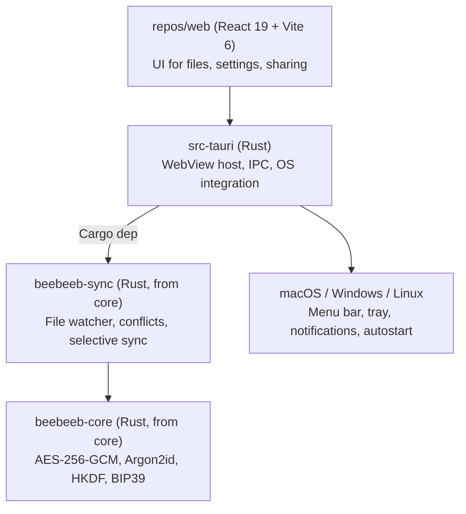

> **Correction — 2026-09-29, task 1611:** The historical architecture/build
> descriptions below are retained for provenance, not current instructions.
> Shipping entrypoints are desktop-owned `src/main.tsx` and `src-tauri/src/lib.rs`;
> `runner.rs`, `engine_bridge.rs`, and `state_db.rs` own scheduling and sync.
> `repos/web` is not this frontend; core provides shared primitives.
> Run `bun run tauri:dev` / `bun run tauri:build` from the desktop root.
> macOS uses the active ~~`macos/FileProviderExtension`~~ `BeebeebFileProvider/`
> (path corrected on resume, 2026-09-29; built by `scripts/build-fileprovider-extension.sh`), Windows
> uses `src-tauri/src/windows_cf` (CFAPI), and Linux FUSE is an unmounted prototype.
> The legacy native-shell build recipes and Linux online-only claims below are
> historical. Spec 030 is historical and never authorizes raw keys in config.
> Credentials belong in the OS store; Linux currently fails closed.
> See [the current capability contract](docs/CAPABILITIES.md) for shell reachability and limitations.

<p align="center">
  <a href="https://beebeeb.io"></a>
</p>
<h1 align="center">beebeeb desktop</h1>
<p align="center">Native desktop sync for macOS, Windows, and Linux — files encrypted before they leave your machine.</p>
<p align="center"><strong>We can't recover your data. Not even if we wanted to.</strong> That's the point.</p>
<p align="center">
  <a href="https://github.com/beebeeb-io/desktop/releases/latest"></a> &nbsp;
  <a href="LICENSE"></a> &nbsp;
   &nbsp;
  <a href="SECURITY.md"></a>
</p>
<p align="center"><a href="https://beebeeb.io">Website</a> &nbsp;·&nbsp; <a href="https://beebeeb.io/security">How it works</a> &nbsp;·&nbsp; <a href="SECURITY.md">Report a vulnerability</a></p>
<p align="center"><sub>End-to-end encrypted cloud storage, built in Europe. Operated by Initlabs B.V., Wijchen, Netherlands.</sub></p>

---

## Status — Windows, Linux and macOS (Apple Silicon) released

> The **[latest release](https://github.com/beebeeb-io/desktop/releases/latest)** has
> `.msi`/`.exe` (NSIS) for Windows, `.AppImage`/`.deb`/`.rpm` for Linux, and a notarized `.dmg`
> for macOS (Apple Silicon only — Intel is not built yet). Every Windows and Linux installer, and
> the macOS updater bundle `Beebeeb.app.tar.gz`, has a minisign `.sig` signed with key ID
> `C6FADFD59D732197` (see `docs/RELEASING.md` for the key-rotation history); the `.dmg` has none.
> **The Windows installers are Authenticode-signed by Initlabs B.V.** and timestamped; the release
> workflow refuses to publish a Windows installer without that signature. The Linux packages carry
> no OS-level signature: check them with their `.sig`. **macOS IS Developer ID signed and notarized by Apple** —
> Gatekeeper accepts it with no warning. macOS builds locally on a Mac holding the Developer ID
> keychain identity rather than in CI (see the matrix comment in
> `.github/workflows/release.yml`) — CI has no Developer ID credentials wired in, and the File
> Provider extension doesn't yet support a universal arm64+x86_64 build, so only Apple Silicon
> ships today. The site's [/download](https://beebeeb.io/download) page always links to
> whatever is current.


The [beebeeb](https://beebeeb.io) desktop client gives you a native sync folder on macOS, Windows, and Linux. Drop files into your beebeeb folder and they are encrypted on your machine and synced to the cloud — the server only ever sees ciphertext. The UI and the sync engine are shared with the rest of beebeeb: a [web](https://github.com/beebeeb-io/web) frontend in a native WebView, plus the Rust sync engine and cryptography from [core](https://github.com/beebeeb-io/core).

## Install

Download the installer for your system from the [latest release](https://github.com/beebeeb-io/desktop/releases/latest). Every Windows and Linux installer has a matching `.sig` file next to it — use it to [check your download](#verify-your-download) before you install. In the commands below, replace `<version>` with the version in the file name you downloaded.

### Windows (64-bit)

Two installers are published. Pick one and stay with it — updates follow the installer type you started with.

- **`Beebeeb_<version>_x64-setup.exe`** (recommended) — per-user installer, no administrator rights needed.
- **`Beebeeb_<version>_x64_en-US.msi`** — for managed machines and software-deployment tools.

Both installers are Authenticode-signed by **Initlabs B.V.**, the company behind beebeeb, so Windows names it as the publisher. Microsoft Defender SmartScreen can still show **"Windows protected your PC"** for a newly published release. If it does:

1. Click **More info**.
2. Check that the publisher reads **Initlabs B.V.**, then click **Run anyway**. If it says *Unknown publisher* or any other name, do not run the file: download it again from `github.com/beebeeb-io/desktop`.

To check the signature yourself, open the file's **Properties → Digital Signatures** (it lists Initlabs B.V.), or run `Get-AuthenticodeSignature .\Beebeeb_<version>_x64-setup.exe` in PowerShell, which prints `Valid`. You can also [check the minisign signature](#verify-your-download).

### Linux (x86_64)

- **Debian / Ubuntu (`.deb`):**
  ```sh
  sudo apt install ./Beebeeb_<version>_amd64.deb
  ```
- **Fedora / RHEL / openSUSE (`.rpm`):**
  ```sh
  sudo dnf install ./Beebeeb-<version>-1.x86_64.rpm      # openSUSE: sudo zypper install ./Beebeeb-<version>-1.x86_64.rpm
  ```
- **Any distribution (`.AppImage`):** no install step — make it executable and run it:
  ```sh
  chmod +x Beebeeb_<version>_amd64.AppImage
  ./Beebeeb_<version>_amd64.AppImage
  ```
  AppImages need FUSE 2. If it does not start, install it (Ubuntu 22.04: `sudo apt install libfuse2`; Ubuntu 24.04 and later: `sudo apt install libfuse2t64`).

**Linux is not ready for daily use yet.** The Linux build has no OS credential store backend, so it cannot keep you signed in (it fails closed rather than storing your session somewhere less safe), and it has no online-only files. See [docs/CAPABILITIES.md](docs/CAPABILITIES.md).

### macOS

Download **`Beebeeb_<version>_aarch64.dmg`** (Apple Silicon only; Intel Macs are not supported yet), open it and drag **Beebeeb** into **Applications**. The app is Developer ID signed and notarized by Apple, so macOS checks it when you first open it (see [Status](#status--windows-linux-and-macos-apple-silicon-released)). The `.dmg` has no minisign `.sig`. The app's own updates come as `Beebeeb.app.tar.gz`, which has one, and the app checks it before installing.

## Verify your download

Every Windows and Linux installer, and the macOS updater bundle `Beebeeb.app.tar.gz`, is signed with [minisign](https://jedisct1.github.io/minisign/). The macOS `.dmg` is not: macOS checks the app's Apple signature instead. Checking the signature proves the file is exactly what our release workflow built and has not been changed since.

Which key to use depends on the version you downloaded:

| Release | Key ID | Public key |
|---|---|---|
| **`0.8.4` and later** (current) | `C6FADFD59D732197` | `RWSXIXOd1d/6xmhr0T+FTeFjSnInaMvbhgL5vxbt51DFLwl2qIC8jU6Z` |
| `0.8.3` and earlier | `545D7BA77EDEA7E1` | `RWThp95+p3tdVI3intgGfThMBLsjCtlCF7eV0hTY478SM1BoLKwU4Fl4` |

The current key is the same one the app itself uses to check updates (it is in [`src-tauri/tauri.conf.json`](src-tauri/tauri.conf.json), `plugins.updater.pubkey`). The `.sig` files are in the auto-updater's format (a minisign signature, base64-encoded once more), so decode it first, then verify.

**Linux** (install minisign with `apt install minisign`, `dnf install minisign`, or `brew install minisign`):

```sh
base64 -d < Beebeeb_<version>_amd64.deb.sig > Beebeeb_<version>_amd64.deb.minisig
minisign -Vm Beebeeb_<version>_amd64.deb -P RWSXIXOd1d/6xmhr0T+FTeFjSnInaMvbhgL5vxbt51DFLwl2qIC8jU6Z
```

**Windows** (PowerShell; install minisign with `scoop install minisign`, or download it from the [minisign releases](https://github.com/jedisct1/minisign/releases)):

```powershell
[IO.File]::WriteAllBytes("$PWD\Beebeeb_<version>_x64-setup.exe.minisig", [Convert]::FromBase64String((Get-Content Beebeeb_<version>_x64-setup.exe.sig -Raw)))
minisign -Vm Beebeeb_<version>_x64-setup.exe -P RWSXIXOd1d/6xmhr0T+FTeFjSnInaMvbhgL5vxbt51DFLwl2qIC8jU6Z
```

A good file prints `Signature and comment signature verified`, followed by a trusted comment that names the file. Anything else — `Signature verification failed`, or a message that the key IDs do not match — means **do not install it**; download it again from the release page, and if it still fails, tell us at security@beebeeb.io.

The commands above use the current key. To check an older download (`0.8.3` or earlier), use the `RWThp95…` key from the table instead. If a release's signature does not match the key listed for its version, stop and ask us.

## Updating

**Installed `0.3.0` or later:** the app updates itself. Every build since `0.3.0` checks updates against key `C6FADFD59D732197`, and `0.8.4` is the first release signed with it, so these installs verify and install `0.8.4` and every later release from the update feed. (Releases `0.3.0` to `0.8.3` were signed with the old key `545D7BA77EDEA7E1`, so an install of one of those was offered no in-app update until `0.8.4`.)

**Installed a version older than `0.3.0`:** those builds only trust the old key, so they reject `0.8.4` and every later release. Update by reinstalling once. The key rotation plan is in [`docs/RELEASING.md`](docs/RELEASING.md).

To update by hand (any version): download the newest installer from the [latest release](https://github.com/beebeeb-io/desktop/releases/latest), [verify it](#verify-your-download), and install it over your current version — same installer type as before (setup.exe or .msi on Windows; your package manager on Linux; for the AppImage, replace the old file). Your settings (`desktop.toml` in your user config folder) and your sync folder are outside the install location and are not touched by the installer.

## Features

- **Automatic sync** — files in your beebeeb folder are encrypted and synced in the background
- **Selective sync** — choose which folders sync locally; the rest stay as online-only placeholders until you open them
- **Conflict resolution** — never silently drops a version: a conflict window lets you choose Keep Mine, Keep Theirs or Keep Both (see [Sync engine behavior](#sync-engine-behavior))
- **Online-only files** — native placeholders on macOS (File Provider) and Windows (Cloud Files); not on Linux yet (the FUSE prototype is not mounted)
- **Zero-knowledge encryption** — per-file keys derived via HKDF; the server stores only ciphertext
- **Native shell, not Electron** — Tauri uses the OS WebView (~10 MB binaries vs ~150 MB), with a Rust backend that imports `core` directly

## Architecture

The UI is the beebeeb web client running inside a native Tauri (Rust) shell. The same Rust sync engine and cryptography that power the other clients run in the background — no protocol or crypto logic is re-implemented in TypeScript.



## Platform support

| Platform | Shell | Integration | Status |
|---|---|---|---|
| **macOS** | Tauri + Swift File Provider | Menu bar, Finder File Provider location | [Released](https://github.com/beebeeb-io/desktop/releases/latest) — Apple Silicon only, Developer ID signed + notarized (built locally, not in CI — see Status above) |
| **Windows** | Tauri (WinUI WebView) | System tray, Explorer overlay icons | [Released](https://github.com/beebeeb-io/desktop/releases/latest), Authenticode-signed by Initlabs B.V. |
| **Linux** | Tauri (WebKitGTK) | Tray indicator; no online-only files (the FUSE prototype is not mounted) | [Published](https://github.com/beebeeb-io/desktop/releases/latest) (AppImage/.deb/.rpm), but sign-in needs an OS credential backend that is not built yet ([CAPABILITIES](docs/CAPABILITIES.md)) |

## Build & run

Requires [Rust](https://rustup.rs/) (stable, edition 2024), [bun](https://bun.sh/), and [Tauri's per-OS prerequisites](https://tauri.app/start/prerequisites/).

```sh
bun install
bun run tauri:dev      # spawns Vite on :5173, opens a native window
bun run tauri:build    # produces .dmg / .msi / .deb / .AppImage
```

To develop against the real web client instead of the placeholder, run `repos/web` separately (`cd ../web && bun dev`) — the Tauri window loads it automatically via `devUrl` in `tauri.conf.json`. `cargo check` from `src-tauri/` validates the Rust side without the frontend.

## Sync engine behavior

The sync engine (`beebeeb-sync`, from the [core](https://github.com/beebeeb-io/core) repo) handles:

- **File watching** — debounced at 100 ms; ignores `.DS_Store`, `Thumbs.db`, and temp files
- **Conflict resolution** — never silently drops data. When a sync tick finds a file changed both on this device and on the server since the last synced version, it marks the file as a conflict, opens the conflict window (with a line diff for text files, sizes for other files) and sends a notification. The file on disk is left as it is until the conflict is resolved:
  - **Keep Mine** uploads your local copy as the new server version.
  - **Keep Theirs** replaces your local copy with the server's version.
  - **Keep Both** renames *your local copy* to `name (conflict - <device name> - <YYYY-MM-DD>).ext` (date in UTC) and downloads the server's version under the original name.
  - **After 24 hours with no choice**, every sync tick checks for conflicts older than that and applies Keep Both automatically (`sweep_auto_resolutions` in `src-tauri/src/runner.rs`). If the download of the server's version fails, your renamed copy stays on disk and the next tick retries.
  - **On macOS, a save from Finder** that meets a newer version on the server is held instead of sent. The conflict window offers the same three choices; Keep Both adds your version beside the original as `name (<device name>, HH.MM).ext`.
- **Selective sync** — the vault stays remote by default. Folders marked locally available are hydrated and kept in sync; other items remain online-only placeholders until opened

## Contributing

Bug reports and pull requests are welcome — see [CONTRIBUTING.md](CONTRIBUTING.md) for the build, the test gate, and how pull requests are reviewed.

## Security

Found a vulnerability? Email **security@beebeeb.io** — see [SECURITY.md](SECURITY.md).

## Part of beebeeb

End-to-end encrypted, zero-knowledge cloud storage — made in Europe.
[core](https://github.com/beebeeb-io/core) · [cli](https://github.com/beebeeb-io/cli) · [web](https://github.com/beebeeb-io/web) · [mobile](https://github.com/beebeeb-io/mobile) · [desktop](https://github.com/beebeeb-io/desktop) · [website](https://beebeeb.io)

## License

[AGPL-3.0-or-later](LICENSE) — © Initlabs B.V. (KvK 95157565), Wijchen, Netherlands.
