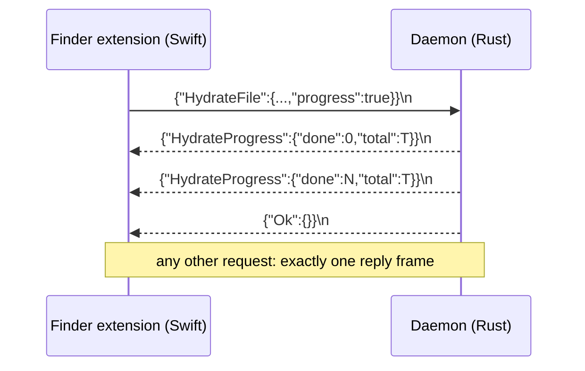
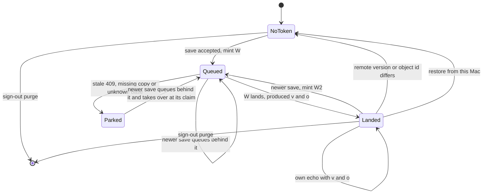
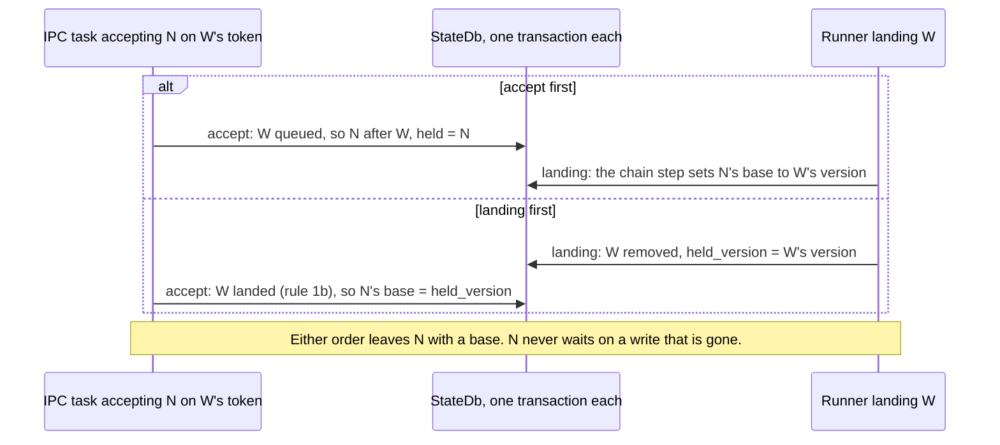
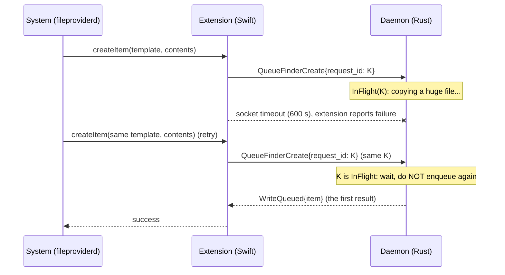

# Daemon IPC protocol (Unix socket)

Task 1670 issue 3. This is the contract between the desktop daemon
(`src-tauri/src/ipc_socket.rs`) and its socket clients: the macOS File Provider
extension (`BeebeebFileProvider/XPCBridge.swift`) and the Rust readiness probe
(`wait_for_file_provider_ipc_ready`). The Linux FUSE prototype (`src-tauri/src/linux_fuse`)
does not use this socket. Unix sockets do not exist on Windows, where Cloud Files runs
in-process.

Implementations that must stay in step:

| Half | File |
| --- | --- |
| Rust framing | `src-tauri/src/ipc_frame.rs` |
| Rust server | `src-tauri/src/ipc_socket.rs` (`handle_connection`, `hydrate_over_ipc`) |
| Swift framing + exchange | `BeebeebFileProvider/IPCFraming.swift` |
| Swift caller | `BeebeebFileProvider/XPCBridge.swift` |
| Write-queue idempotency (Rust) | `src-tauri/src/ipc_write_dedup.rs` (table), `dedup_write` in `ipc_socket.rs` |
| Write-queue idempotency (Swift) | `IPCWriteKey` / `IPCWriteRequest` in `BeebeebFileProvider/IPCFraming.swift` |
| Readiness probe (Rust client) | `wait_for_file_provider_ipc_ready` in `src-tauri/src/lib.rs` |

## Framing

A **frame** is one compact JSON value followed by a single `\n` (0x0A).

- Compact JSON escapes every control character inside a string (`\n`,
  `\u000a`), so a raw 0x0A byte can only be the delimiter. Both encoders assert
  this (`serde_json::to_vec` on the Rust side; `IPCFraming.encodeRequest`
  refuses to send a request containing one).
- One request per frame, client to server. Exactly one final reply frame per
  request, server to client. The connection stays open for further requests.
- Empty and whitespace-only lines are ignored.
- Requests are limited to 1 MiB (`MAX_REQUEST_BYTES`). A longer message gets an
  `Error` frame and the connection is closed (the stream cannot be
  resynchronised). Replies are limited to 32 MiB on the Swift side
  (`IPCFraming.maxReplyBytes`); over that the client reports an honest
  "reply larger than Finder can accept" error.



### Why (what was wrong before)

- The daemon treated one `read()` of at most 64 KiB as one whole request and
  wrote replies with no delimiter. On a `SOCK_STREAM` socket a request can arrive
  in several reads and a client cannot know where a reply ends.
- The Swift client did one unlooped `write()` and one `read()` of at most 65536
  bytes, then parsed. A reply over 64 KiB (a folder of a few hundred items) was
  always truncated.
- The daemon answered a successful hydrate with the bare JSON string `"Ok"`
  (a unit enum variant). `JSONSerialization` rejects a top-level string unless
  fragments are allowed, so **every successful hydrate surfaced as "daemon
  response was not valid JSON"** after the download had already finished. The
  success reply is now the object `{"Ok":{}}`.

## Hydrate progress

`HydrateFile` accepts an optional `"progress": true` (default false). When set,
the daemon sends zero or more `HydrateProgress` frames before the final reply:

```json
{"HydrateProgress":{"done":10485760,"total":31457280}}
```

`done` and `total` are plaintext bytes; `total` is 0 when the server did not
report a size. The first frame is `done: 0` as soon as the file's metadata and
key are known; then one per decrypted chunk. The final reply is `{"Ok":{}}` or
`{"Error":{"message":"..."}}`.

Clients that do not opt in (the 0.8.6 extension) receive no progress frames,
because they read exactly one reply and would mistake the first progress frame
for it.

### Cancellation

While a hydrate runs the daemon also watches the socket. If the client hangs up
(Finder cancelled the `Progress`; the Swift side calls `shutdown()` on the
socket) the daemon drops the download, writes nothing to disk, and restores the
file's status (`DownloadingStatusGuard` in `engine_bridge.rs`).

## Write contents on macOS (`contents_path` → App Group upload staging)

The system hands `createItem` / `modifyItem` a contents URL that only the
extension's sandbox can read. The app (the daemon) is a different sandboxed
process and cannot open it: before this section existed every Finder file
create ended in `"Upload source is not a file"` and a definitive -2005, while
folder creates (no contents) worked. So on macOS `contents_path` is never the
system's URL; it is a copy the extension makes in the shared App Group
container.

```mermaid
sequenceDiagram
    participant S as File Provider system
    participant X as Extension (XPCBridge + UploadStaging)
    participant D as Daemon (ipc_socket.rs)
    S->>X: createItem(template, contents URL)
    X->>X: refuse unless the source is a regular file (definitive)
    X->>X: copy into <group>/upload-staging/<uuid> (0600)
    X->>D: QueueFinderCreate{contents_path: <group>/upload-staging/<uuid>, request_id}
    D->>D: open upload-staging (O_NOFOLLOW, ours), openat the leaf (O_NOFOLLOW, O_NONBLOCK)
    D->>D: fstat the opened file: regular, one link, ours
    D->>D: StagedPayload::copy_from_file from that descriptor, enqueue
    D->>D: unlinkat the copy on the held directory (same device and inode only)
    D-->>X: WriteQueued / WriteRetryLater / Error
    X->>X: delete the copy (defer; already gone is fine)
    X-->>S: completion
```

| Rule | Where |
| --- | --- |
| Directory: `<App Group container>/upload-staging/`, owner-only `0700`, excluded from backups. Created by whichever side gets there first; the daemon forces the mode at startup. The daemon opens it once with `O_NOFOLLOW \| O_DIRECTORY` and refuses it unless it is a real directory owned by this user (`not_private`); the mode and the backup exclusion are set on that descriptor (`fchmod`, `fsetxattr`). A symlink in its place is never followed: not by the hardening, the reads, the deletions or the purges. | `UploadStaging.directory(in:)`, `StagingDir::open`, `macos_prepare_upload_staging_dir` |
| Only a regular file is staged. A package (a folder macOS shows as one file, such as `.rtfd`) arrives as a directory URL with kind `file`; it and any other non-regular item (a symlink) are refused before anything is copied, with the DEFINITIVE `daemonRejected` (`cannotSynchronize`, -2005), the same answer the daemon gives for such an item. The person sees the item fail to sync with "Beebeeb can only upload regular files, and this item is a package or another special item. It was not uploaded." | `UploadStaging.stage` |
| One file per request, named by a random UUID (never the user's file name), copied with `copyItem` (an APFS clone), then `0600` and mtime set to now. The `request_id` fingerprint is still taken from the system's file, so retries keep their key. | `UploadStaging.stage`, `XPCBridge.queueCreateItem/queueModifyItem` |
| A failed copy (or a source whose attributes cannot be read) is `uploadStagingFailed`, TRANSIENT (`serverUnreachable`): the system retries; nothing is left behind. | `BeebeebIPCError` |
| The daemon accepts `contents_path` only if it is absolute, has no `.`/`..` segment, and its parent is the held staging directory itself (same device and inode). The leaf is then opened relative to the held directory with `O_RDONLY \| O_NOFOLLOW \| O_NONBLOCK \| O_CLOEXEC`, so a symlink is refused at the open and a FIFO cannot block it, and the OPENED descriptor must be a regular file with exactly one link, owned by this user. Otherwise `Error {"Upload contents refused (<category>)"}` with `malformed_path`, `traversal`, `staging_unavailable`, `outside_staging`, `missing`, `symlink`, `not_a_file`, `hard_linked`, `foreign_owner` or `unreadable`. A refused path is never deleted. There is no size limit on this path. | `open_staged_contents`, `check_staged_contents_stat` |
| The engine reads the contents from the descriptor that passed those checks, never by path (`StagedPayload::copy_from_file`, an APFS clone via `fclonefileat` where possible). Swapping the entry after validation changes nothing the daemon reads. The path is only the journal's label. | `queue_finder_create_from` / `queue_finder_modify_from` |
| The daemon's own copy goes to its staging folder. On macOS that is `<container>/Library/Application Support/beebeeb/finder-writes` (owner-only `0700`, excluded from backups), never the cache or temp dir, which the system may purge: until the upload lands it can be the only copy of the save. Copies an earlier build staged in `Library/Caches/beebeeb/finder-writes` (or the temp dir) are still read, uploaded and removed by their journalled paths, and the sign-out purge sweeps all three folders. If the folder cannot be created or written to, nothing is staged or queued and the reply is `WriteRetryLater {"message"}`, a fixed reason with no path. The extension reports it as `uploadStagingFailed`, TRANSIENT (`serverUnreachable`), so the system keeps the change and retries the write; an `Error` would reach the system as `cannotSynchronize`, which it does not retry until the item changes again. | `durable_finder_staging_root`, `write_outcome_response`, `XPCBridge.decodeWriteResponse` |
| An accepted copy is deleted once the request is answered: queued, refused by the engine or the namespace guard, a bad `request_id`, or a repeat answered from the first attempt's result. The deletion is `unlinkat` on the held staging-directory descriptor, and only while the name still refers to the handed-over file (`fstatat` without following a link, same device and inode); a name that now refers to anything else is left for the purge. It rides in the dedup work closure, so a socket shutdown cannot delete a copy that detached work still reads. The extension deletes it after the reply too. | `StagedContents`, `handle_connection` |
| Orphans (a crash on either side) are purged at daemon startup and every 5 minutes once they have existed for 1 hour, measured from the entry's ctime: the kernel sets it when the copy is made (an APFS clone keeps the source's mtime) and no process can set it back. Age-bound, not "everything": the extension may be staging a copy at that moment. 1 hour is six times the 600 s write timeout. | `UPLOAD_STAGING_MAX_AGE`, `purge_stale_upload_staging`, `runner.rs` |
| Sign-out and Lock remove EVERY entry, but only once no engine can still be running (none was, or its stop is confirmed): the IPC listener runs inside the engine's task, and a listener still serving could take a request whose copy was just removed (`missing`, definitive). After a confirmed stop a request reaches no daemon, fails transiently, and the extension stages afresh for the system's retry; the system keeps its own file throughout. Sign-out's existing stop gate returns before the purge on an unconfirmed stop; Lock goes ahead on an unconfirmed stop (off Windows) and leaves the copies to the age-bound purge. Both run while the engine slot is held. | `stop_engine_for_sign_out`, `stop_engine_for_lock`, `purge_all_upload_staging_at` |
| Every purge works through the held directory descriptor: entries are inspected with `fstatat(AT_SYMLINK_NOFOLLOW)`, a file or symlink is `unlinkat`-ed (a symlink itself, never its target), and a stray tree is removed level by level with `O_NOFOLLOW` opens, each level first given back its search bit (`fchmod 0700`) so a tree an older extension left at `0600` can still go. | `purge_upload_staging_in`, `remove_tree_at` |
| Every refused create/modify/delete logs `warn!("Finder write refused", op, reason)` with a fixed category; never a name, path or contents. A refused purge logs its fixed category (`not_private`, ...), and the hardening's backup-exclusion warning logs the error kind only: neither logs the directory, which holds the home directory and so the account name. | `log_refused_write`, `write_outcome_response`, `log_upload_staging_purge` |

Linux keeps the unconfined behaviour (`WriteContentsPolicy::AnyPath`): the
daemon is not sandboxed and no client sends writes over its socket.

Plaintext at rest: the copy is plaintext, as is the system's own staged file
and the daemon's `StagedPayload` copy. It lives from the extension's copy until
the reply (both sides delete it), in an owner-only, backup-excluded directory.
A crash can leave it for at most about an hour plus one purge interval while
the daemon runs. Sign-out and Lock remove it (after a confirmed engine stop).
Across a restart while locked nothing purges it until the next unlock: the
startup purge runs when the vault is unlocked, and only removes copies that
have existed for an hour.

## Versions and queued writes

The extension hands an item's `contentVersion` back as the base of its next
write, and the daemon turns that into the `base_version_number` the server
checks: the server refuses a replacement whose base is not the file's current
version with 409. On macOS the daemon names the bytes of every content write it
accepts with a **write token**, and every surface keeps reporting that name until
the content changes elsewhere. So the daemon's own upload never looks like a
remote change to the system: no eviction, no re-download, no stale base.

This section describes the macOS File Provider path. Windows (Cloud Files) and
Linux are unchanged: their uploads carry no write id and keep the bases they had.
The design, with its reasons and its Apple citations, is
`docs/specs/2026-10-09-macos-finder-write-versions.md`; the section numbers below
are that spec's.

### Version identifiers

| Field | Format | Changes when |
| --- | --- | --- |
| `content_version` (the extension's `contentVersion`, the write base) | the write token `{b}:w{W}` while the row holds one (below); otherwise `{current_version}`, or `{current_version}:{content_hash}` when the row has a hash | a content write is accepted (a new token), or the content changes elsewhere (the token clears and the server version shows) |
| `version_identifier` (older extensions fall back to it) | `{current_version}:{modified_at}:{size_bytes}` | the server version, the row's time or its size change |
| `metadata_version` | `{modified_at}:{size_bytes}:{parent}:{name}:{status}` | any metadata change; never forces a re-download |
| no contract (the row's contract could not be read) | `content_version` `0`, `version_identifier` `0:{modified_at}:{size_bytes}` | no known server version, so no base |

`current_version` is the contract's server version. The wall clock never appears
in `content_version`: a finished upload and the `/sync/ops` echo of a change
re-stamp the row's `remote_updated_at`, and that is not a content change.
Builders: `item_content_version` and `item_version_identifier` in
`engine_bridge.rs`, the token in `write_token.rs`, used by
`file_entry_payload_for_db` in `ipc_socket.rs`.

Rollout: builds before the server-version format led both identifiers with
`max(current_version, remote_updated_at)`. Rows whose `remote_updated_at` is
above their server version (anything this device uploaded, or touched by an op
echo) get a different `content_version` once; for a materialized file the system
downloads it once more when it next reads the item.

### The write token (§5.1, §5.2)

`{b}:w{W}`, for example `2:w9f1c0e3a5b7d4f2e8a6c4b2d0e9f7a1c`.

- `b` is the server version the bytes derive from, in decimal: a replace's
  resolved base; for a write queued behind an earlier write that has not landed,
  that write's `b`; `0` for a create, and for writes queued behind a create that
  has not landed.
- `W` is 32 lowercase hex digits, a fresh v4 UUID without hyphens. One is minted
  for every content write accepted over `QueueFinderCreate` or
  `QueueFinderModify` with contents. It is never reused and never derived from a
  name or path. A rename or a move gets no token, and neither does an upload the
  watcher or Windows queues.
- At most 44 bytes (Apple allows 128 for a version component).
- It is matched by exact string equality with the row's held token, never by
  pattern. The parse is strict (`^\d+:w[0-9a-f]{32}$`), and the `w` keeps a
  token apart from `{v}`, `{v}:{hash}` and the older timestamp-led forms.
- Code that does not know tokens reads the first segment as the base
  (`parse_base_version_number`). `b` is an ancestor of the bytes, so the server
  either accepts that base (nothing in the chain has landed, and the bytes are a
  valid replacement) or refuses it with 409. The one exception is `0:wW` after a
  create landed, which older code reads as "no base" (see "Version skew").

What is stored. Every column is additive and nullable or defaulted, with no
backfill, and only dedicated `StateDb` functions write them. The token string
itself is derived (`{held_base}:w{held_write_id}`), never stored.

| Table | Column | Meaning |
| --- | --- | --- |
| `files` | `held_write_id`, `held_base` | the write whose bytes the system was last told about, and its `b`. Written together; a write id without its base is a read error, never a base of 0 |
| `files` | `held_version`, `held_object_version_id` | what that write produced on the server; NULL until it lands |
| `files` | `version_filled` | the version came from a snapshot fill, and nothing has touched the row since (rule 6a) |
| `operation_queue` | `write_id`, `write_origin` | the write this upload carries, and who queued it: `minted` (this build's accept) or `earlier_build` (marked at engine start, below) |
| `operation_queue` | `after_write_id` | this upload's base is the version that write produces; NULL once resolved |
| `operation_queue` | `base_pending` | ~~the base waits for a snapshot; counts the successful snapshots that gave none~~ 0 when the base is known; while the base waits for a snapshot, 1 plus the successful snapshots that gave none (it parks at 11, after the 10th) — lead, 2026-10-11 (Task 12, fix round 1) |
| `operation_queue` | `claim_id`, `claimed_at` | the runner's claim for one attempt; every claim is cleared at engine start |
| `upload_resume` | `completed_version`, `completed_object_version_id`, `completed_mime_type` | the landing the server confirmed, recorded before any local bookkeeping |
| `id_aliases` | `provisional_id`, `server_id`, `created_at` | a create's provisional id and the server id it landed as |

### What every surface reports (§5.3, §5.4)

`held_token` (`write_token.rs`) is the item's content version exactly when
`held_write_id` is set and one of these holds:

- an upload op with `write_id = held_write_id` is in the queue, in any state:
  queued, running, backing off, paused or parked; or
- `held_version = current_version`, and the held and the current object version
  ids are equal and not NULL: the server holds what this write produced.

Otherwise the item reports `{current_version}` (with its hash, when it has one).

- **One read.** The row and the queue facts come from one deferred read
  transaction (`StateDb::item_presentation`). A builder never sees a row from
  before a landing beside a queue from after it, which would report the old
  `{cv}`: a content change, for bytes that did not change.
- **One builder.** `file_entry_payload_for_db` serves enumeration, the change
  feed, item lookups, the dedup replay, the write replies and the item returned
  with a fetch.
- **The clear is housekeeping.** A builder that finds the predicate false clears
  the held columns with `… WHERE file_id = ? AND held_write_id = ?`, using the
  value it read, so it never clears a token that a concurrent save has just set.
- A presentation read that fails presents the item from its contract alone, as
  before tokens existed: never a spurious `"0"`, and the capabilities are kept.
  It is logged (see "Logging").



While `Queued`, `Landed` or `Parked`, every surface reports the token; in
`NoToken`, `{cv}`. What the system sees, event by event:

| Event | What the system sees |
| --- | --- |
| our own landing | the token, unchanged: nothing is evicted or downloaded because of it |
| our own echo (an op or snapshot row with the version we produced) | unchanged |
| a remote content change (another version or object id) while nothing of ours is queued | `{cv'}`: the system downloads the new bytes |
| a remote change while our write is queued | nothing until our write meets the server's 409 and parks; the disk keeps our bytes |
| a remote replace whose op carries no version (the legacy chunked complete) | a re-snapshot is requested; its node raises the version a pass later, the token clears and the system downloads |
| a restore from this Mac | the reply's version becomes current and the system downloads; the token clears only when no write of ours is queued |
| a restore from another device | nothing: the server emits no op. The next save meets 409 and parks |
| a rename, a move, a trash from Finder | the token, unchanged; a trashed item is never presented writable |
| a create landing (the id swap) | the server id carries the create's token; the provisional id is gone |
| a sign-out by choice | the held columns and aliases are cleared, and provisional rows without a contract deleted, in the purge transaction |

### The base the server gets (§6)

The decision is made inside the accept transaction that also mints the token
and queues the upload, from the row as it is before the write changes it: the
alias target, when there is one. The first matching rule wins. "The newest
write of the file's chain" is `held_write_id`.

| # | Incoming base | Condition | Base of the new upload |
| --- | --- | --- | --- |
| 1a | the row's held token | its write W is still queued, in any state | after W: W's successor (below) |
| 1b | the row's held token | W landed | `held_version` |
| 1c | | | split off to task 1879. A token that is not the held one (a reply lost to an IPC timeout) falls to rule 5; a stale `b` meets 409, and the write parks with its bytes |
| 2 | anything | the row is provisional: ~~no contract, its create queued~~ a create of the file is queued, the row has no server version yet (`current_version` 0), and its newest write is queued — lead, 2026-10-11 (Task 12, fix round 1) | after the newest write of the file's chain |
| 3 | `{v}` or `{v}:{hash}` | an upload this build minted, with resolved base `v`, is queued for the file | after the newest write of the file's chain |
| 4 | an identifier from an earlier build that exactly matches the old formula (below) | | `current_version`, then rule 3 with `v = current_version` |
| 5 | anything whose first segment is `v > 0`, an unknown or older token's `b` included | | `v`; the server decides |
| 6a | `0`, none or unparseable | server-known, `current_version > 0`, `version_filled = 1` | `current_version`; the server decides |
| 6a′ | `0`, none or unparseable | server-known, `current_version > 0`, `version_filled = 0` | queued and parked at once (`base_unknown`), bytes kept; nothing is sent |
| 6b | `0`, none or unparseable | server-known, `current_version = 0` | queued with `base_pending` |

- Rule 3 leaves out uploads from earlier builds: their bytes may not be on disk,
  so a later save may not contain them.
- A waiting upload (`after_write_id` or `base_pending`) stores its token's `b`
  as `base_version`. This code never sends it, because the claim skips the op; a
  build from before tokens would send a base the server refuses, never no base.
- **The `init` guard.** A File Provider upload that replaces a file is never sent
  without a base: a missing base, or one beyond the server's `i32`, parks it
  `base_unknown`. A create sends no base. Uploads without a write id keep
  today's bases.
- **Waiting for a snapshot (`base_pending`).** The base becomes the version a
  snapshot reports. A re-snapshot is requested by a `file_create` op that
  carries no version, by any content op without `version_number` (a content op
  is a `file_create`, or a `file_update` that carries `version_number` or
  `size_bytes`; the thumbnail-flag updates are not), by a server-known row at
  version 0 at engine start, and in every pass while a `base_pending` upload
  exists. The request is a counter: it is cleared only after a snapshot
  succeeds, and only if no newer request arrived meanwhile. A failed snapshot
  fails the whole tick, the first two times in a row; from the third failure in
  a row on, the tick goes on to the ops pull and the queue runs, and a
  `base_pending` upload still waits at the claim, so nothing runs on a guessed
  base. A successful snapshot resets the count (final review). The upload
  parks `base_unknown` only after 10 successful snapshots that gave it no base.
  Waiting is not an attempt.
- **The fill and the raise.** A snapshot node sets `current_version` on a row at
  version 0 (the fill: it also sets `version_filled` and resolves the row's
  `base_pending` uploads) or on a row below the node's version (the raise), in
  any status but `Trashing` and `Conflict`. On a row with a queued write only
  `current_version` changes. A node still uploading is skipped, and the request
  stays set.
- Deletes are unchanged: a delete's base is not sent to the server.

#### Identifiers from earlier builds (rule 4)

The system keeps the identifier it was given for an item until it reads the item
again, and sends it as the base of the next write, also when it re-sends a write
that failed before. After an upgrade that can be an old, timestamp-led identifier.

Rule (`modify_base_version`): a content modify whose base identifier is EXACTLY
what the old formula gives for the row as it is now (the old `content_version`
`{max(current_version, remote_updated_at)}`, with the row's hash when it has
one, or the old `version_identifier`
`{max(current_version, remote_updated_at)}:{modified_at}:{size_bytes}`)
describes the row's current content, so it is based on `current_version`. Every
other identifier goes through the rules above. An old identifier of older
content cannot equal the row's current one: a content change moves
`current_version`, and every re-stamp moves `remote_updated_at`. Limit: if an op
echo re-stamps the row after the upgrade but before the system has read the item
again, the old identifier no longer matches, and the write meets 409 and parks.

### Queue order, the chain and the hand-over (§8.1–§8.5)

- **Successor by write id.** A write whose base maps to "after W" is queued with
  `after_write_id = W`, whatever W's state. When W lands, the chain step, inside
  the landing transaction, gives every op with `after_write_id = W` the version
  and object version id W produced. Equal numbers are never compared. Uploads
  without a write id keep round 3's equal-base rebase among themselves, and
  nothing is rebased across the two kinds: ~~an op left without a base parks at
  the `init` guard~~ on macOS an earlier build's op left without a base parks at
  the `init` guard, which applies because engine start gave it a write id (an op
  with no write id is never guarded), and a stale one at the server's 409, both
  with their bytes. — lead, 2026-10-11 (Task 12, fix round 1)
- **No supersede.** A newer save never replaces a queued one. Every save is its
  own upload, in order, and the last one is the server's current version; every
  earlier one is a version in the file's history.
- **The claim** (`StateDb::claim_operation`, one transaction per attempt) skips
  the op when it is gone, parked or paused; while an earlier content op of its
  file can still run; while it waits for a snapshot (`base_pending`); and while
  its predecessor W is queued and has not parked. None of those skips is an
  attempt. If W has parked, the claim hands over (below); if no op carries W,
  it parks the op `predecessor_lost` with its bytes (only a bug can get there).
  Then it records a fresh `claim_id`. An op whose completion is recorded skips
  the base and predecessor checks: its attempt repeats the landing.
- **The hand-over, at the successor's claim.** W may park for any reason: a stale
  base, a missing copy, an unknown base, a permission refusal, or its attempts
  used up (a failure waiting does not cure, below). When W was
  minted by this build and has no recorded completion, the claim of its direct
  successor N gives N W's role, in the claim's transaction: W's resolved base, or
  W's own `after_write_id` or `base_pending`; and for a create, W's create (its
  kind, parent and provisional id). W's op is removed, and its staged copy is
  released after the commit. N's bytes contain W's: when the person saved N, the
  system held W's bytes. One line: `queued write took over a parked one`.
  - A successor that took over a W parked `base_unknown` parks `base_unknown` at
    the same claim, so no request goes out with that base.
  - A W from an earlier build is never handed over (its bytes may not be on
    disk), and N would park `predecessor_parked`. No production path makes such
    a W anyone's predecessor: `after_write_id` only ever names a minted write.
  - A W with a recorded completion never parks; N waits for its landing.
  - Cost: a successor that was not in the pass's list of due ops is claimed in
    the next pass, at most 30 s later.
  - After a parked W's fetch was served from the server (see "Fetches served from
    the queue"), N is built on the server's version but inherits W's older base,
    so it can meet 409 and park `stale_base`: a false park, with its bytes kept.
- **Immediate parks.** The 409 "stale base version for replacement upload" at
  `init` parks a File Provider upload at once: the server's version only grows.
  A staged copy that is gone (`NotFound`) parks it `payload_missing` at once. Any
  other error reading the copy retries, with a fixed text and no path.
- **A failure that waiting or the person can cure never parks a File Provider
  upload** (spec §8.4, final review). Decided by the error's type and kind
  (`finder_write_failure_is_transient`), never its text. Transient: `Locked`,
  `Quota`, and `Retryable` with an HTTP status of 408, 425, 429 or any 5xx, or
  with no status and a transport failure in its chain (a `reqwest::Error` that
  could not connect, timed out or failed while sending, or below one an I/O
  error of a connection kind), and a failure whose resumed upload session the
  server reaped (404 or 410 on a session resumed from its persisted row; the
  attempt abandons it and the next one starts a fresh upload). A 400, 404 or
  410 at a session opened in the same attempt, and a 400 at a resumed one,
  abandons the session too but is counted, so a server that refuses every new
  session still parks the write
  (fix rounds 5 and 6). A transient
  failure is recorded for the backoff (capped at 960 s), and the count stops at
  the attempt where the backoff stops growing (6 today, derived from
  `retry_delay_seconds`), so after an outage a failure waiting does not cure still
  has its remaining attempts; the save lands when the network, the lock or the
  space comes back; a quota refusal is never
  paused, and the item keeps presenting `uploading`. A quota refusal is also
  what the server's code says, read by type from the refusal's body (never its
  text): `413 quota_exceeded`, `403 object_budget_exceeded`, `403
  billing_read_only`, and the upload gate's `409 account_lapsed`, `409
  plan_required` and `409 trial_cancelled_read_only` (at init, a chunk or
  `complete`) are refusals the person cures, so the save lands afterwards (fix
  rounds 4 and 6; `trial_ended` is no upload refusal and is counted). Counted, as before: any other HTTP status
  (400, 404, another 413, ...) and a local error; at the cap the write
  parks `attempts used up`, read-only, with its bytes kept. `Permission` (a 403)
  parks at once as `permission_denied`, read-only, through the usual park
  (settle, change row, signal); `Auth` pauses until the next sign-in, as before.
  Uploads without a write id keep their rules: `Retryable` uses up the attempts,
  every other class pauses.
- **409 classes.** `init` keeps the server's message and classifies it:
  `stale_base` parks at once; `in_progress` ("upload is already in progress for
  this file") and `other` retry. A changed message falls back to retry. Uploads
  without a write id keep today's retries for every class.
- **What still waits:** a successor behind a predecessor that has not parked and
  failed transiently (network, 5xx, timeout); it would fail the same way. And,
  after a hand-over, the server session W left open: N's `init` meets
  `in_progress` until the server's upload lease expires (1 hour by default) and
  the next `init` takes the session over.
- **Order is insertion order** (`rowid`) on macOS, so a wall clock that steps back
  cannot run a newer save first; Windows and Linux keep `created_at`, then
  `rowid`. A restore and a File Provider upload of the same file wait for each
  other in that order. Two restores do not wait for each other, and neither do a
  restore and an upload without a write id. A parked op blocks nothing.

### The landing (§8.6)

1. When `complete` answers, fresh or `already_completed`, the resume row records
   what the server produced: the version, the object version id and the
   `mime_type`. An `already_completed` answer carries neither of the first two:
   the version is then the base + 1 (1 for a create), the object id the
   session's, and there is no `mime_type`. The next base comes from this record,
   never from the stored contract.
2. One transaction then applies the rest:
   - the row and the contract;
   - the held columns, only `WHERE held_write_id = W`, so a later save's token
     stays held;
   - the id swap, with the alias;
   - the chain step, and `version_filled = 0`;
   - the status: `Local` with the server's size when no later File Provider
     upload of the file is queued; `Error` when only parked ones remain; otherwise
     unchanged (the later write's `Uploading`, size and time). A `Trashing` row
     stays `Trashing`;
   - the removal of the op (`WHERE op_id = ? AND claim_id = ?`, exactly one row)
     and of its resume row, with the staged copy marked for release. Windows
     journals a create's local finalization in the same transaction.
3. The chain step never fails the landing: a successor that cannot be re-keyed
   parks `rekey_failed` with its bytes.
4. A retry that finds a recorded completion sends no upload request and repeats
   step 2. The post-commit thumbnail work still runs after it; the first landing
   failed before that work, so nothing repeats.
5. Split off to task 1879: a resumed session whose `complete` answers 404 is
   abandoned as before. For a create that trashes the server file the session
   made, and the retry uploads the same bytes as a new create; for a replace,
   the retry meets 409 if the lost `complete` had landed, and parks with its
   bytes.
6. A recorded completion is never abandoned, paused or parked, at give-up either.
   Its attempts stop one short of the cap, and it keeps retrying the landing on
   the normal backoff, with one line per attempt.

### Serialization (§8.7)

The daemon has one `StateDb` connection behind one mutex, and each method below
is one transaction, so it is atomic against every other reader and writer in the
process. Two calls are not, which is why each decision is one call.

- **S1.** Every decision that writes is one `StateDb` method that opens
  `BEGIN IMMEDIATE`, reads its preconditions inside, decides, writes and
  commits, with no network in between: the accept (alias lookup, base decision,
  mint, held columns, then the enqueue or the at-once park), the landing, a
  park, the claim with the hand-over, a snapshot fill or raise, and the
  restore's reply. The guarded clear is one guarded `UPDATE`, which SQLite runs
  as its own transaction. The two read-only decisions, the predicate's inputs
  and a fetch's source, take one deferred read.
- **S2.** After the enqueue an op is addressed by `(op_id, write_id)` outside the
  runner, and by `(op_id, claim_id)` in the runner's writes after its claim.
  Each guarded write asserts one row. No path rewrites an op from an in-memory
  copy, and File Provider ops are never deleted by `file_id`.
- **S3.** The claim replaces the old read-then-check with one transaction; engine
  start clears every claim, because no runner survives a restart.
- **S4.** The runner's copy of the op serves the network work only. Every later
  write is guarded by the claim. A write that matches nothing means a purge
  removed the op during the attempt: the runner writes nothing more for it,
  never re-inserts it, and logs `queue state moved` once.
- **S5.** The accept and the landing are serialized, so either the accept sees W
  queued and the chain step resolves N, or it sees W landed and uses rule 1b. An
  op whose predecessor no op carries can only come from a bug; it parks
  `predecessor_lost` with its bytes.
- **S6.** A staged copy is unlinked only after the transaction that removed its
  last reference has committed: the transaction records it in the release
  journal (`staged_payloads`). Engine start unlinks every released copy that no
  op references, in the current staging folder and the old ones. On macOS it
  then removes every copy nothing will upload, before the IPC server serves a
  write: a `completed = 0` row no op, resume row or finalization names (an
  accept that never committed) goes with its copy, and a regular file in any of
  the three staging folders that no row of the four tables names (a copy whose
  row an older build's sign-out deleted) is unlinked. It never follows a link,
  touches only regular files directly in a folder this user owns, and counts a
  file as named by its file name. The revoked-share purge releases its ops'
  copies in its own transaction, and a copy that fails partway removes itself.
  An accept still running when the sweep runs (a stopping engine's handler) is
  covered by its own transaction: it requires its copy's journal row,
  unfinished, and the sweep deletes that row, guarded, before it unlinks the
  copy, so the accept either committed first (the sweep keeps its copy) or
  queues nothing and replies `WriteRetryLater`. Each folder is listed before
  the rows are read (fix round 4).



### Provisional ids (§7)

A create runs under a provisional id, a random v4 UUID; the server mints the
file's id. When the create lands, the landing transaction re-keys every op still
queued for the file to the server id S (an encrypted name an op carries is
re-encrypted under S, because the name key derives from the file id) and writes
an alias P → S. The alias is kept 30 days, swept at engine start and once a day,
and deleted by the sign-out purge.

| A request under P, after its create landed as S | What the daemon does |
| --- | --- |
| content modify | resolved to S, its base by the rules above on S's row (P's create token is S's held token); the reply is S's item **presented under identifier P**, with the new token |
| rename or move | resolved to S; the name is encrypted for S |
| delete | resolved to S, and S is trashed, **only when the delete's base is S's held token**, the token P's reply named. Any other base keeps the idempotent success, with a warn line |
| hydrate, item lookup, thumbnail | resolved to S; an item lookup presents S as P |
| create with `deletion_conflicted` | the template identifier resolved through the alias, or a live row with that id; below |
| a repeat of a modify (the same `request_id`) | answered from S's row as it is now, presented under P; nothing is queued again |
| a repeat of a create after it landed | unchanged, split off to task 1879: the create runs again, and a second server file appears |
| enumeration and change feed | unchanged: S, plus P's deletion |

**The deletion-conflicted create.** When the system cannot apply our delete of P
because the person edited the file, it re-creates the edited item with
`NSFileProviderCreateItemDeletionConflicted` and the template identifier P. The
extension passes that as `deletion_conflicted` with `template_identifier` and
`template_content_version` (see "Write-queue idempotency"). A template that
resolves to a live file row that is not `Trashing`, with a file template,
becomes a content modify of that row: its base from the template's content
version, in one accept transaction, and the reply under identifier S, the
provider's, so the system replaces item S on disk with the edited file. One file,
one new version. Otherwise it is an ordinary create: with no alias and no row
(the file was deleted elsewhere, so the edit becomes a new file), for a
`Trashing` row (the edit must not follow it to the trash), and for a folder,
which has no content to modify, so a second server folder appears.

**Unknown ids.**
- A modify, content or metadata, of an id with no row and no alias answers
  `Error`, logs `Finder write refused` with `reason="unknown_item"`, and queues
  nothing. The extension reports `cannotSynchronize`: the system shows an error,
  keeps the edit on disk and backs off. It is never `NoSuchItem`, which would
  make the system delete the item on disk.
- A name Finder writes for itself (`.DS_Store`, `~$…`, `….tmp` and the like) is
  answered `Ignored` before that check, whatever its id.
- A delete of an unknown id stays an idempotent success (see "Trash semantics").
- No create or modify reply carries `item: None` unless the write was ignored. A
  queued create or modify whose row cannot be read back answers `Error`
  (`row_unreadable`). The write stays queued and uploads; the message says the
  change will upload and that Finder shows an error on the item until the file
  changes again, because the system does not retry `cannotSynchronize` before
  that. A delete's reply item is never read, so a delete is not refused this way.
- The extension turns a queued reply without an item into the transient
  `serverUnreachable`, so even a daemon from another build can never make the
  system delete a file through that branch.

#### Fetches served from the queue (§7.4)

A `HydrateFile` of an item whose held write is still queued is served from that
write's staged copy, the bytes its token names, and never reaches the server
while that write has not parked. The returned item names the token.

- The copy's path and the predicate come from one read. If the landing unlinked
  the copy before the open, the fetch decides once more and goes to the server:
  the write has landed.
- A still-queued write whose copy is gone fails the fetch with `Error`
  (`queued_copy_missing`), with no server request, which holds only the previous
  version. The system retries a failed fetch, and the same missing copy parks the
  write `payload_missing` at its next attempt.
- A parked write whose copy is gone is fetched from the server for the current
  version, and the item keeps its parked status: a stale but real version rather
  than an endless retry. The item still names the parked write's token until the
  write is resolved.
- A hydrate never changes the status of a row that has a File Provider upload of
  its own, live or parked: no `Downloading`, `Local` or `Error`.
- Every fetch the daemon serves logs `Finder hydrate served`, with `source`
  `queue` or `server`: the device plan counts fetches with it. A failed fetch
  logs `Finder hydrate failed` instead.

### Status follows the queue (§9)

- While a file has a File Provider upload that has not parked (queued, running,
  backing off, paused, or waiting for a base or a predecessor), its item presents
  `uploading`: `isUploaded` false, so the system does not evict it, and full write
  capabilities. A `Trashing` row is the exception: it keeps its trash
  presentation and never becomes writable.
- A parked upload presents `error`: read-only, and still not evictable. A
  successor waiting to take over a parked predecessor keeps the item `uploading`.
- Who writes the row's status. The accept sets `Uploading`. An attempt sets it
  only if the row is not `Trashing`, and a failed attempt leaves the row alone.
  A park, and the attempt that uses up the op's attempts, set `Error`, but only
  on an `Uploading` row with no other unparked File Provider upload: a `Trashing`
  row stays in the trash, and a `Conflict` row keeps its own status. The landing
  settles the row as in its step 2. Engine start keeps `Uploading` for a row with
  an unparked File Provider upload and resets every other in-flight row.
- How the system hears about it. The extension re-reads items only after a
  working-set signal, and the runner sends one per tick. Every queue outcome that
  changes how an item is presented puts the item's id in that signal, once its
  transaction committed: a landing; a park (at the claim, by the runner, or the
  stale-base 409); a hand-over (the successor's id); the attempt that uses up an
  op's attempts; and the snapshot count's park (through the tick's applied ids). A
  park whose guarded write matched no row puts nothing. The accept's own park
  answers the system's call with the item, so it needs no signal. ~~Engine start
  records each row it resets as a change, and the first tick's signal carries
  those ids.~~ Engine start records one change per row it resets, `downloading`
  → `cloud_only` included, and the first tick carries those ids as its opening
  debt. A tick that fails still pays that debt with one signal (the signal is
  local). The rule is spec §9.2's last bullet. — lead, 2026-10-11 (device fix round)
- The size and modification time are the newest bytes'. The accept records the
  staged copy's; the landing writes the server's size and "now" only when no
  later write is queued. Finder's date stays `max(modified_at,
  remote_updated_at)`; showing the save time instead is split off to task 1879.
- The name and parent are the newest save's (spec §7.2). A save that also
  renames or moves its file applies the new name and parent in its accept, so
  the reply and every enumeration after it describe the item as the person left
  it; the upload sends both to the server before its bytes. A landing applies its
  op's name and parent only when no later Finder save of the file is queued,
  parked or not; a save that parks for good keeps them. — lead, 2026-10-11
  (final review)
- (fix round 10) Placement is the row's parent alone (spec §7.2): a folder lists
  its children by `parent_id`, the root lists the rows with none, and every
  reply names the row's parent. A create stores the template's parent in its
  accept, so a file created inside a folder is in that folder from its reply on,
  never at the top level while it is queued or parked. Every Finder writer (the
  create and modify accepts, the landing and its id swap, a folder create) keeps
  the path the full relative path under that parent. ~~A save whose template names
  the trash container as its parent keeps the row's parent.~~ (fix round 12) A
  content save whose row is `Trashing`, or whose template names the trash
  container as its parent, is refused: `Error` "Beebeeb cannot change items
  inside the Trash.", nothing queued, the item stays in the trash. The path
  sweeps (`prune_absent`'s descendant sweep, `delete_file_subtree`) never delete
  a row with a queued or parked Finder write~~; its upload parks when it meets the
  missing folder~~. — lead, 2026-10-11 (final review)
- (fix round 13) What happens to such a row: when its folder is gone (all three
  sweeps, `delete_orphaned_children_of_absent_folder` included), it is
  re-homed at the top level in the sweep's transaction (no parent, its name as
  the path, a `reparented` change, its writes' parent cleared, a save marked
  `parent_changed`), so it stays listed at the root and its create lands there.
  When the file itself was deleted for good elsewhere, the row is kept and the
  save re-creates the file under its id: the edit wins. — lead, 2026-10-11
  (final review)
- (fix round 11) The parent a metadata update (`PATCH /files/{id}`) sends has
  three states (`ParentChange`): omitted (leave it alone), `null` (the top
  level), an id (that folder). A rename op omits it; a move op, chosen when the
  new parent differs from the row's, names its target, the top level included.
  A save's upload sends its parent only when the save moved the file, or follows
  a queued save that did (`parent_changed` in the op's metadata); other uploads
  send their parent when they have one, as before. A `file_move` echo with a
  `null` `new_parent_id` clears the row's parent (spec §7.2). — lead,
  2026-10-11 (final review)
- (fix round 12) A row and its contract (parent, namespace, kind) are written
  in one transaction by every writer that inserts a row from the server or a
  create (`StateDb::upsert_file_with_contract`), so no listing sees a new nested
  row without its parent, or a new shared row in the person's own namespace. A
  move echo's explicit `new_parent_id` decides the parent for files and folders,
  the server's restore re-home included. — lead, 2026-10-11 (final review)
- (fix round 13) A move echo with no `new_parent_id` key keeps both the row's
  parent and its path. — lead, 2026-10-11 (final review)
- Uploads without a write id (Windows, the watcher, Keep Mine) keep today's
  status writers.

### Queued creates and modifies never ask the system to fetch

`createItem` and `modifyItem` complete a queued write with
`shouldFetchContent: false` in every branch (`FileProviderExtension.queuedWriteCompletion`).
Apple reserves that flag for a provider that changed the content: the system then
fetches the provider's copy and writes it to disk. The daemon uploads exactly the
bytes the system handed over, so a fetch could only write the server's previous
version over the user's edit (and, after a create, fetch an identifier the server
never knew).

| Branch | Item returned | `shouldFetchContent` |
| --- | --- | --- |
| queued, with an item | the item as the daemon describes it: its content version is the write's token | false |
| ignored (a temporary Finder item the daemon does not sync) | none | false |
| queued, but the daemon sent no item | never a nil item: the transient `serverUnreachable` error, so the system retries and keeps the item on disk. The daemon itself answers `Error` (`row_unreadable`) instead of such a reply | n/a |

~~The item in a reply describes the bytes the system holds: its content version is
the write's token, and the daemon records the staged copy's size and modification
time on the row, with the `Uploading` status, in the accept transaction.~~
The item in a reply describes the bytes the system holds, under the name and in
the folder the person left them: its content version is the write's token, and
the daemon records the staged copy's size and modification time on the row, with
the `Uploading` status, and for a modify the save's name and parent, in the
accept transaction (spec §7.2). — lead, 2026-10-11 (final review)

**Still-pending fields (spec §7.2).** `modifyItem` reports a changed filename or
parent as still pending when a modify with contents gets back an item that does
not describe it (`FileProviderExtension.modifyStillPendingFields`). Apple writes
to disk every field of the returned item that differs from the template and is
not still pending, so an old name in the reply would undo the rename; pending,
the system sends the field again. The daemon applies both in the accept, so with
the app this extension ships in the set is empty; the rule covers an app from
another build still running across an update. A modify without contents reports
nothing pending, as before: its reply is built from the row as it was until the
server's echo of the rename or move arrives (a known gap, spec §12). — lead,
2026-10-11 (final review)

### Logging (§11)

~~Every line carries ids and fixed categories only. No name, path, URL or error
text reaches a line: errors are classified, never printed.~~
Every line in the table below carries ids and fixed categories only. No name,
path, URL or error text reaches these lines: errors are classified, never
printed. Older lines outside this table are not covered by this rule, and ~~two of
them are known exceptions~~ one of them is a known exception, tracked with the
write-versions follow-ups (task 1879): ~~`upload-time thumbnail generation/upload
skipped` logs the error's text (`error = %e`), on the landing path of a Finder
write; and~~ `purge did not sweep a staging directory that is not this user's`
logs the directory's path, which holds the home directory. It predates the
write-versions work and is unchanged by it. — lead, 2026-10-11 (Task 12, fix
round 1). `upload-time thumbnail generation/upload skipped` now logs the error's
category (`reason`), not its text. — lead, 2026-10-11 (final review)

A line about a failed
step logs the error's category, from closed codes only (SQLite's result code, the
I/O error kind): `not_found`, `permission_denied`, `disk_full`, `read_only`,
`io`, `network`, `database_busy`, `database_full`, `database_corrupt`,
`database_read_only`, `database_cannot_open`, `database_io`,
`database_constraint`, `database_schema` (a statement the schema does not match:
a missing table or column, a statement SQLite rejects at prepare, a value of the
wrong type), `database` and `other`. An id that comes from the wire is logged
only when it is a UUID; any other id logs no id and `id_kind="non_uuid"`. A
parked op stops logging.

| Event | Line (`warn!` unless noted) | Fields |
| --- | --- | --- |
| a create, modify or delete the daemon refused | `Finder write refused` | `op`, `reason`: a staging category (`malformed_path`, `traversal`, `outside_staging`, …), `contents_not_a_file`, `engine_stopping`, `write_policy`, `malformed_request`, `io`, `database`, `other`; `unknown_item` (with `id`, or `id_kind`); `staging_root_unavailable` (the reply is `WriteRetryLater`); `staged_copy_gone` (an engine-start sweep removed the accept's staged copy before it committed; nothing queued, the reply is `WriteRetryLater`); `row_unreadable` (a queued create or modify whose row cannot be read back; added during implementation, beyond the spec's original table); (fix round 12) `in_trash` (a content save of an item in the trash; nothing queued, the reply is `Error`) — lead, 2026-10-11 (final review) |
| an `init` refused with 409, retried | `upload refused by the server (409 Conflict); will retry` | `op_id`, `file_id`, `attempt`, `max_attempts`, `base_version`, `class` (`stale_base`, `in_progress`, `other`) |
| a stale-base 409 that parks a File Provider upload at once | `upload refused by the server (409 Conflict); its base is stale, parked with its bytes kept in the queue` | the same, with `class` and `reason` `stale_base`; `attempt` is the attempt that was made (1 for a first try) |
| a 409 that uses up an op's attempts | `upload refused by the server (409 Conflict); attempts used up, parked with its bytes kept in the queue` | the same; `reason="stale_base"` only for that class |
| any other park | `upload parked with its bytes kept in the queue` | `op_id`, `file_id`, `reason` (`base_unknown`, `payload_missing`, `predecessor_parked`, `predecessor_lost`, `rekey_failed`, `permission_denied`; and `attempts_used_up`, once, when a failure that is not transient and not a 409 used up a File Provider write's attempts: a log reason only, `file_id` by M5) |
| a successor took over a parked predecessor | `queued write took over a parked one` | `op_id`, `file_id`, `parked_op_id` |
| a request reached the server id through an alias | `provisional id resolved to the server id` | `request` (`modify`, also for a rename or move; `delete`, `hydrate`, `item`, `thumbnail`, `deletion_conflicted_create`), `provisional_id` (or `id_kind`), `file_id` |
| a delete under a provisional id that does not name S's held token | `delete of a provisional id not applied to the server file` | `provisional_id` (or `id_kind`), `file_id` |
| a queued write took its base from a snapshot | `queued write based on the version the snapshot reported` | `op_id`, `file_id`, `base_version` |
| a snapshot raised a row's version | `file version raised from the snapshot` | `file_id`, `old_version`, `new_version` |
| a guarded queue write matched no row | `queue state moved` | `op_id`, `step` (`resume`, `completion`, `landing`, `park`, `attempt`, `pause`) |
| a completed upload whose local landing failed | `upload completed on the server; local landing will be retried` | `op_id`, `file_id`, `attempt` |
| every fetch the daemon serves (`info!`) | `Finder hydrate served` | `file_id` (or `id_kind`), `source` (`queue`, `server`) |
| a fetch answered with an error | `Finder hydrate failed` | `file_id` (or `id_kind`), `reason` (`not_found`, `unauthorized`, `forbidden`, `conflict`, `server_error`, `http_other`, `network`, `io`, `database`, `other`, `queued_copy_missing`); a refused identifier logs `reason="invalid_identifier"` only |
| a presentation read that failed (the item is built from its contract) | `item presented from its contract alone` | `file_id`, `category="presentation_read_failed"`, `kind` (the category), `held_back` (failures of this item and kind not logged since the last line). At most one line per item and kind per 10 minutes, for at most 1024 items; a clean read ends the interval |
| a restore the server made whose local record failed | `restore done on the server; its local record failed, a snapshot will repair it` | `file_id`, `category="restore_bookkeeping_failed"`; if the snapshot request fails too, `restore done on the server; a snapshot could not be requested` with `category="resnapshot_request_failed"` |
| engine start (`info!` for the counts) | `engine start: queue claims cleared, released upload copies removed`; `engine start: uploads from an earlier build marked; their bases are unchanged`; `engine start: stale in-flight rows from a previous engine session reset` | `claims_cleared`, `released`; `marked`; `reset` (the rows it changed). A failed step: `engine start repair failed`, `engine start: marking earlier-build uploads failed`, `could not reconcile stale in-flight state rows on startup`, each with `reason` |
| engine start, the staged copies nothing will upload (macOS) | `engine start: staged copies no queue row names removed` (`info!`); `engine start: staged copies no queue row names kept; removal is retried at the next start`; `engine start: removing staged copies no queue row names failed` | `unfinished`, `unjournalled`; `kept`, `reason`; `reason` |
| a staged copy that could not be removed | `staged payload cleanup deferred; journal retained`; `staged upload cleanup deferred; journal retained`; `released upload copy kept; removal is retried at the next start` | `reason`; the journal row stays, so a later start or sign-out still finds the copy |
| the daily alias sweep failed | `daily alias sweep failed` | `reason="database"` |
| ~~the extension saw write options that are not empty (`NSLog`)~~ | ~~`BeebeebFileProvider: write options`~~ | ~~`call` (`create`, `modify`), `options` (the raw bitmask), `item`~~ |
| the extension saw write options that are not empty (its `os.Logger`, `.notice`) — lead, 2026-10-11 (device fix round) | `BeebeebFileProvider: write options` | `call` (`create`, `modify`) and `options` (the raw bitmask), public; `item`, public, only when it is a UUID, else `id_kind=non_uuid` |

The `IPC client went away …` lines and `finder delete: unknown item — idempotent
success` (`info!`) log their id the same way. A staged copy that exists but
cannot be read retries with the fixed text `staged upload payload could not be
read`, which the diagnostics bundle files under its own code,
`payload_unreadable`.

**The extension's lines** go through its one `os.Logger`
(`BeebeebFileProvider/ExtensionLog.swift`): subsystem `io.beebeeb.app.FileProvider`
(the extension's bundle id), category `extension`, so
`log show --predicate 'subsystem == "io.beebeeb.app.FileProvider"'` lists them.
`NSLog` is not used: on macOS 26 every `NSLog` line of the extension reached the
unified log as `<private>`. Informational lines are `.notice`, failures `.error`.
Only closed values are public (a fixed word, a bitmask, a UUID, the App Group
id, an `NSError` domain and code; the first 12 hex digits of a `request_id` are
logged `.private` since the final review, because the key is a hash over the
item's name, size and modification time); a
path, a file name or an error's text is never logged. ~~`extension_log_pin`
(`src-tauri/src`) fails on any other log call in the extension and on a public
value outside that set.~~ — lead, 2026-10-11 (device fix round)

What the pin checks, exactly: `extension_log_pin` (`src-tauri/src`) reads every
`BeebeebFileProvider/*.swift`, skipping lines that begin with `//`, and fails
when: any file calls `NSLog`, `NSLogv`, `os_log`, `print` or `debugPrint`, bare
or qualified by a module (`Foundation.`, `Swift.`, `os.`, `OSLog.`); a file
other than `ExtensionLog.swift` builds a `Logger` or an `OSLog` (bare, through
`.init`, or qualified by a module) or uses a name `logger.`;
`ExtensionLog.swift` builds a `Logger` other than exactly once, or its subsystem
is not the build script's `BUNDLE_ID`; or an interpolation in
`ExtensionLog.swift` does not say `.public` or `.private`, or a `.public` one is
not one of eight names (`line.call`, `line.options`, `id`, `call.rawValue`,
`fields.domain`, `fields.code`, `cause`, `XPCBridge.appGroupID`). It
matches text, so it cannot see what a public name is bound to (the Swift harness
tests those bindings), a call with a space or a line break before its
parenthesis, a log function passed by reference, or output that is not a log
call (`FileHandle`, `fputs`). — lead, 2026-10-11 (device fix round)

## Timeouts (Swift client)

Applied as `SO_RCVTIMEO`/`SO_SNDTIMEO`, i.e. per `read()`/`write()` call:

| Call | Timeout | Reason |
| --- | --- | --- |
| list / item / queue delete / queue create+modify without contents | 30 s | Database work in the daemon; answers in milliseconds. |
| queue create / modify WITH contents | 600 s | The daemon copies the whole file into staging (`StagedPayload::copy_from_file`, synchronous) before replying and sends nothing meanwhile. A timeout here is a duplicate hazard: the extension reports failure, the daemon still queues the upload, Finder retries and queues it again under a fresh id. 600 s covers 15 GB at 25 MB/s (a same-volume APFS copy is a clone, near-instant). A copy longer than that still times out; task 1684 closes that with a stable `request_id` the daemon dedups on (next section). |
| hydrate | 600 s idle | Each progress frame restarts it. The daemon's HTTP client allows 30 s per request (`api_client.rs`) and a hydrate makes one metadata request plus one per chunk; an older daemon sends no progress and is silent for the whole download. 20x the per-request ceiling also covers `download_kbps_limit` pacing sleeps. |
| thumbnail | 60 s | One small encrypted variant + decrypt + atomic staging (`IPCFraming.thumbnailTimeoutSeconds`, task 1699). 2x the metadata ceiling; far below hydrate because it is never a whole-file download. |

A timeout surfaces as `BeebeebIPCError.timedOut(seconds:)`
("Beebeeb's sync engine did not answer within N seconds..."), never as a JSON
error. No error message ever contains raw reply bytes.

## Write-queue idempotency (`request_id`, task 1684)

`QueueFinderCreate` and `QueueFinderModify` accept an optional `"request_id"` string.

`QueueFinderCreate` also carries three fields for a deletion-conflicted create (see
"Versions and queued writes", "Provisional ids"):

| Field | Type | Meaning |
| --- | --- | --- |
| `deletion_conflicted` | bool, default `false` | the system passed `NSFileProviderCreateItemDeletionConflicted`: it re-creates an item whose deletion it could not apply because the person edited it |
| `template_identifier` | string, optional | the template's `itemIdentifier`, the item the deletion was for; sent only when `deletion_conflicted` is true |
| `template_content_version` | string, optional | the template's `itemVersion.contentVersion`, decoded as a modify's base is; sent only when `deletion_conflicted` is true |

All three are `#[serde(default)]`: an older daemon ignores them and keeps the
ordinary create. An older extension never sends them, and the new daemon then
treats the request as an ordinary create.

**Why it has to be derived, not random.** When the extension's socket call times out, the
system retries `createItem` / `modifyItem`. That retry is a NEW invocation, so it cannot know a
per-call UUID the first attempt generated. A random id per call would be different every time
and deduplicate nothing. The key is therefore computed from the stable inputs of the logical
operation, so the retry recomputes the same value.



### The key

`request_id` = lowercase hex SHA-256 (64 characters) of this canonical byte string. Every
field is `s<utf8 byte count>:<bytes>;` for a string, `n;` for an absent string, `i<decimal>;`
for an integer; the fields are concatenated in this order (length prefixes make `("ab","c")`
and `("a","bc")` different):

| Operation | Fields, in order |
| --- | --- |
| create | `"bb-write-v1"`, `"create"`, parent item identifier, filename, kind (`file`/`folder`), content type, content size in bytes, content mtime in nanoseconds |
| modify | `"bb-write-v1"`, `"modify"`, item identifier, base version identifier, parent item identifier, filename, kind, content type, changed-fields bitmask (`NSFileProviderItemFields.rawValue`), content size, content mtime in nanoseconds |

"Content size / mtime" come from `stat()` on the file the system staged for the write.

- **Only requests that carry contents get a key.** A folder create, a rename or a move is
  answered from the database in milliseconds under the 30 s timeout; there is nothing to
  deduplicate and the request is sent without one. A request whose staged file cannot be
  `stat()`ed is also sent without one (never a made-up one).
- **The staged file's path is not an input** (it may differ between attempts) and neither is its
  inode: if the system re-stages a retry into a new file, an inode in the key would make every
  retry a different key. Size + nanosecond mtime survive a metadata-preserving clone/copy.
  Whether the system really hands the retry the same size and mtime is **not verified on a
  device** (see "Device rung" below); the extension logs the first 12 characters of each key so
  that rung has evidence.
- The Swift half is pinned by a test vector computed independently in Python
  (`BeebeebFileProviderTests/main.swift`).

### The daemon table

`WriteDedup` (`ipc_write_dedup.rs`) is an in-memory map `request_id -> InFlight | Done`,
shared by all connections, bounded to 4096 entries and a 30 minute TTL.

| A request with key K arrives while... | The daemon... |
| --- | --- |
| K unknown | runs the work (on the blocking pool, detached from the connection, so the copy finishes and is recorded even though the client hung up) |
| K `InFlight` | waits for the first run and returns **its** reply; never enqueues a second upload |
| K `Done` within the TTL and the result is still true | returns the stored reply without enqueueing, **refreshed from the row as it is now** (current `version_identifier` and `status`, see below) |
| K `Done` for a modify under a provisional id whose create has since landed (macOS) | refreshes the stored reply from the server file's row, through the alias, and presents it under the provisional id; nothing is queued again. A create's stored reply has no such path: its row is gone, so it runs again (split off to task 1879) |
| K `Done`, but the row it created is gone, renamed, parked `Trashing`, or has a queued `TrashFile` op; or the user deleted that item through this socket since | treats it as a NEW operation (see below) and runs it |
| K `Done` past the TTL | forgets it and runs the work |
| K was used for a different (operation, parent or item, filename, kind) | does not merge them; runs the work and leaves the original entry alone |
| the first run panicked | the waiters are released and one of them runs its own work |
| the table is full of in-flight work | runs the work without deduplication rather than refuse a user write |
| no `request_id` (0.8.6 extension) | exactly the pre-1684 path: the work runs inline, nothing is remembered |
| `request_id` empty, over 128 bytes or containing a control character | `Error{"request_id must be 1 to 128 printable bytes"}`; nothing is queued |

Only `WriteQueued` replies are remembered. An `Error` or `WriteRetryLater` is delivered to requests that were
already waiting on that run, but a later retry runs the work again (a failed attempt must not
poison the key).

### False-dedup risk (two genuinely different operations, one key) and how it is bounded

1. **Different file, same key:** needs parent, name, size and nanosecond mtime all equal, which
   is the same file going into the same folder (a name collision regardless). Plus the daemon
   refuses to merge across a different operation/parent-or-item/filename/kind.
2. **The same inputs recurring as a genuinely new operation inside the TTL:** create `a.txt`,
   delete it (here or on another device), copy the identical file back with its mtime preserved.
   Without a guard the second create would be answered with the first, and the file would
   silently never upload. **A Finder delete does not remove the `files` row** (the IPC delete
   queues a `TrashFile` op and leaves the row in place; after the server trash succeeds the op is
   dropped and the row stays until the snapshot prune or the op echo removes it), so "the row
   still exists" alone proves nothing. The daemon guards this in three independent layers:
   1. `QueueFinderDelete` **forgets every stored reply describing that item** before it queues the
      trash, so a create carrying the same key after a delete through this socket always runs
      (`a_create_after_the_trash_op_finished_still_uploads_the_new_file` pins this against the
      state after the trash op finished, where nothing else in the row or queue says "deleted").
   2. A stored reply is refused while its row has a queued `TrashFile` op (any retry state) or is
      parked `Trashing` (the watcher's delete path), which covers a delete that did not come
      through this socket (`a_cached_create_is_not_returned_while_a_trash_op_is_pending_for_its_row`,
      `a_cached_create_is_not_returned_for_a_row_parked_trashing`).
   3. A stored reply is refused when its row is gone or has a different filename (another device
      trashed it and the row was pruned, or the user renamed it).

   `a_real_finder_delete_then_the_same_create_uploads_the_new_file` drives the real
   `QueueFinderDelete` request end to end. (The earlier test that faked a delete with
   `delete_file` exercised a state the real delete path never produces.) A remote trash from
   another device leaves a row that is either pruned (layer 3) or has no queued op and a normal
   status until the `file_trash` echo deletes it; in the short window between a remote trash and
   its echo a same-key retry can still be answered with the stored reply. That window needs the
   same file to be copied back within seconds of a delete on another device and is unmeasured.
   A stored reply that passes is **refreshed**: it is rebuilt from the current row rather than
   served as first built, because finalizing the upload changes the item's `version_identifier`
   and `status`, and handing the system the old pair would make the next edit send a stale base
   version (`a_cached_reply_reports_the_row_as_it_is_now_not_as_it_was`).
3. **Accepted residual risk:** if the user renames the created item and a timed-out create of
   the same name is retried afterwards inside the TTL, the validation sees a renamed row, calls
   the stored reply stale and runs the retry as a new create (one duplicate, the pre-1684
   behaviour). That needs a retry to arrive after the user has already acted on the result, which
   the File Provider retry loop does not do in practice; it is unmeasured.
4. **Daemon restart forgets the table.** A retry that arrives after the daemon restarted is
   treated as new and can queue a second upload. Persisting keys would need a schema change;
   the window is the copy time plus a restart, and the pre-1684 behaviour was a duplicate every
   time.

### Device rung (not proven on this branch)

CI proves the framing, the key derivation, the request shape and the daemon table. It does not
prove that the real File Provider system retries with the same staged size and mtime, or that
the retry happens within 30 minutes. The next macOS alpha must force a write-queue timeout on a
large file (or lower `stagedCopyTimeoutSeconds` for a test build) and check the unified log for
the same `request_id=<12 hex>` on both attempts and exactly one queued upload. The prefix is
logged `.private`, so that check needs the log's private data shown on the test Mac.

## Change feed + sync anchor (task 1697)

The replica (`NSFileProviderReplicatedExtension`) needs a daemon-side change
cursor to answer `enumerateChanges(for:from:)` and `currentSyncAnchor`. Three
requests serve it; all state lives in the daemon's state.db (tables
`fp_changes`, `fp_sync_anchor`, `fp_materialized`), so it survives extension
process death and daemon restarts.

### `ListChanges { since_anchor?, limit? }`

Returns `FileProviderChanges { changes: [...], next_anchor: string|null }`.
Each change row: `{ file_id, kind, old_parent_id, new_parent_id, item? }` —
`kind` is `created | modified | deleted | reparented`; `item` is the FULL
`FileProviderItemPayload` for live rows (the replica can call `didUpdateItems`
without a second round-trip), absent for deletions and for rows that vanished
since the change was recorded. Paged: at most `limit` (clamped 1..100,
default 100) changes per reply; `next_anchor` doubles as the resume token
while more remain and as the up-to-date marker when the batch completed the
window. The anchor is the change-log rowid in decimal ASCII — strictly
ascending, ≤ 500 bytes for any realistic history (Apple caps anchors and page
tokens at 500 bytes).

An unparseable `since_anchor` (a cursor the log no longer contains) is an
`Error` reply — the replica answers with `NSFileProviderError.syncAnchorExpired`
so the SYSTEM drops its caches and does a full re-enumeration; it never
silently restarts at 0, which would double-deliver.

### `GetSyncAnchor` → `FileProviderSyncAnchor { anchor: string|null }`

The daemon's persistent cursor, served to `currentSyncAnchor`. The Swift side
persists it in the App Group (`fileprovider-state.json`) for crash recovery
and falls back to that copy when the daemon is unreachable.

### `ReportMaterialized { container_ids: [...] }` → `{"Ok":{}}`

The extension publishes the materialized DIRECTORIES the system reported (via
`materializedItemsDidChange` + the system's `enumeratorForMaterializedItems`).
The daemon's working-set signal filter (runner) fails OPEN against an
empty/unknown set: signals fire for any batch until the set arrives, because
Apple's documented fallback is "the working set is the entire dataset".

### What records a change

`upsert_file` (created/modified/reparented — a re-upsert whose row did not
change records nothing, so the metadata sweeps produce no churn),
`delete_file` / `delete_file_subtree` / `prune_absent` (deleted, with the
parent captured before the delete), `set_status` / `set_size_bytes` /
`set_file_contract_state` (modified; a contract parent change is
`reparented`), and `reconcile_stale_in_flight_on_startup` (modified, one per
row it resets). Windows-only reconciliation writes (`reconcile_os_state`,
`finish_windows_signout`) are deliberately NOT wired — the change log is FPFS
machinery and Windows refreshes placeholders natively.

## Trash semantics (task 1698 — ruling: full trash sync)

Ruling: `.claude/tasks/decisions/finder-trash-full-sync.md` (recorded BEFORE
the code). Trash is a SYSTEM container outside the 1701 single-root ruling;
`supportsSyncingTrash` stays ON (default YES, now also set explicitly when the
domain is registered).

### Containers

`ListFileProviderItems` accepts three container families now:

| container | listing |
| --- | --- |
| root (`NSFileProviderRootContainerItemIdentifier` / `__fp_root__` / empty / `rootContainer`) | ~~the real top-level tree, EXCLUDING `Trashing` rows~~ the rows with no parent (`parent_id` NULL) and a name, in the person's own namespace, EXCLUDING `Trashing` rows. The path does not decide it (spec §7.2, placement) — lead, 2026-10-11 (final review) |
| the trash container (`NSFileProviderTrashContainerItemIdentifier` / `trashContainer`) | the trash view: `Trashing` rows that are TOP of trash |
| a real folder id | children by contract parent; `Trashing` children only when the folder ITSELF is trashed (trash-view content) |

A `Trashing` row is TOP of trash when its parent row is not itself
`Trashing`; such rows are parented at the trash container in EVERY payload
(enumeration, `GetFileStatus`, and change-feed ride-alongs), so the working
set moves them into macOS Trash without a content re-download (metadataVersion
covers the status flip).

### Finder-side trash (ruling step 2)

The user moving a synced item to macOS Trash arrives as a `modifyItem` whose
new parent is the trash container. The extension maps that reparent to
`QueueFinderDelete` (the server's existing trash operation), and the daemon
parks the row `Trashing` right after queueing the op — so the item leaves
"Beebeeb" and appears in the trash view immediately, matching what the system
just did in its own replica. Creating inside the trash container is refused.

### Server-side trash (ruling step 3)

A remote `file_trash` op (another device trashed the item) flips the mirror
subtree to `Trashing` (`StateDb::mark_subtree_trashing`) instead of deleting
the rows; on-disk placeholders are still removed (the item is hidden locally —
that part of 0802 stands). The rows ARE the trash view now, so:

- `prune_absent` no longer treats a snapshot-absent `Trashing` row as
  convergence (the snapshot NEVER lists trashed files — absence is their
  steady state). Rows whose parent row is `Trashing` (trash-view folder
  content) are equally protected, and the descendant/orphan sweeps skip
  `Trashing` rows.
- `file_restore` flips a held `Trashing` row straight back to `CloudOnly`
  (un-trashing = reparent back out of the trash container, mapped to the
  server's existing restore path) and still schedules the re-snapshot.
- Removal converges through the server's `file_delete` op — the PERMANENT
  delete (password-confirmed in the app/web, or the retention janitor). A
  `file_delete` for a `Trashing` row deletes it and records a `deleted`
  change, which drops it from the macOS Trash view.
- A successful hydrate of a `Trashing` row keeps the marker
  (`hydrate_final_status`) — viewing a file from the Trash view must not
  un-trash it in the replica.

### `deleteItem` (ruling step 4)

Fires only for items already in the Trash. The extension rejects a
non-recursive delete of a non-empty folder with
`NSFileProviderError.directoryNotEmpty` (child count provable from the
payload; an absent count fails open). Unknown items report success
(idempotent) — decided DAEMON-side: `QueueFinderDelete` for an unknown id
returns `WriteQueued { ignored: true }` instead of queueing a doomed op. On
macOS a provisional id whose create has landed is resolved through its alias,
and trashes the server file only when the delete's base is that file's held
write token; any other base keeps this idempotent success (see "Versions and
queued writes", "Provisional ids").

## Pin state on the payload (`pinned`, task 1698 — deviation 1)

Every `FileProviderItemPayload` carries `pinned` (`#[serde(default)]`): the
row's EFFECTIVE pin state (`pin_state`, else `inherited_pin_state`). Swift
maps it to `contentPolicy`: the root reports `.downloadLazily`, an effectively
pinned item reports `.downloadEagerlyAndKeepDownloaded` (a pinned folder's
children inherit it), everything else `.inherited`. The pin SET is this
device's own today (`files.pin_state`; the cross-device pin backend is task
1683's slice — see the task's numbered deviation).

## Retired RPC: `SetRecursivePin` (task 1698)

Removed with no replacement RPC: it had no caller (audit G13). The pinning
surface is the Tauri `set_recursive_pin` command (Onboarding / Mac Settings),
which calls `EngineBridge::set_recursive_pin` directly; the File Provider side
consumes pin state through the payload's `pinned` field. The `PinUpdated`
response variant went with it.

## Retired RPCs: `SetFileStatus`, `RecordOpenedFile`, `EnforceSmartCache` (task 1699)

Removed with no replacement RPC (audit G13 re-audit):

- `SetFileStatus` was a no-op stub (`=> Ok {}`): the extension never sent it
  and the daemon never recorded anything. Status now flows one way, daemon →
  extension, through `FileStatus`/`FileProviderItems` payloads and the change
  feed.
- `RecordOpenedFile` fed `mark_cached` + a cache-limit enforcement pass, but
  the extension never reported opens and nothing else called the RPC. The
  daemon enforces the configured cache limit on its own schedule
  (`enforce_configured_cache_limit`) and still does.
- `EnforceSmartCache` duplicated that internal enforcement over the socket.
  The engine-side `enforce_smart_cache` machinery stays (used by
  `enforce_local_cache_limit` / `enforce_configured_cache_limit`); only the
  RPC surface went.
- The `CacheCleanup` response variant existed solely for the two retired
  arms and went with them.

The framing test that previously used `SetFileStatus` as a
success-shape probe now uses `ReportMaterialized` with an empty list.
`retired_rpcs_are_refused_and_the_connection_survives` proves the retirement
on the wire: an unknown variant gets an `Error` reply and the connection
survives for the next request.

## Thumbnails (`FetchThumbnail`, task 1699)

`{"FetchThumbnail":{"file_id","dest_path","max_dimension"}}` →
`{"ThumbnailWritten":{"size_bytes"}}` on success, `{"Error":{"message"}}` on
failure. The extension asks for a decrypted thumbnail variant; the daemon
downloads the encrypted variant from the server (`download_thumbnail`, same
per-file key path as hydrate), decrypts in memory
(`EngineBridge::fetch_thumbnail_to_memory`) and stages the plaintext at
`dest_path` (`.part` write + atomic rename, 0600). The extension reads the
staged file back into memory and deletes it — same hand-off shape as hydrate,
so no plaintext ever crosses the socket.

- `dest_path` must be under an allowed root: the sync root, the system
  temporary directory, or (macOS) the hydrate cache directory. Anything else
  is refused before the fetch ("not under an allowed root"), mirroring the
  hydrate destination check.
- `max_dimension` selects the variant the same way the Windows Cloud Files
  provider picks thumbnails (`windows_cf/thumbnail_provider.rs`): ≤96 px
  `small`, ≤256 px `medium`, else `large`. The Swift side clamps its request
  to 1024 px (2x scale on the requested size, rounded up).
- Failure semantics: any daemon-side failure (unreachable server, 404,
  decrypt error) surfaces as one `Error` frame and the extension reports a
  per-thumbnail error to the system. "This item has no thumbnail" is NOT
  signalled over the socket — the extension filters folders and
  non-image/non-video content types locally and reports `(nil, nil)`
  (honest "no thumbnail") without calling the daemon.
- No `contentVersion` bump: thumbnails do not change item content, and the
  system keys its thumbnail cache on `itemVersion.contentVersion`.
- A queued write's thumbnail (macOS, write-versions spec §5.6). While an item's
  held write is queued, `FetchThumbnail` answers `Error` and asks the server
  nothing. The server holds only the previous version's thumbnail, and an answer
  is cached under the write token until the next content change, which our own
  landing no longer is; "no thumbnail" would be cached the same way. The refusal
  lasts past the landing until that version's thumbnails are uploaded (the
  post-complete thumbnail work runs after the landing transaction), and after a
  failed thumbnail upload until a later landing uploads them. That mark is kept
  in memory, so a restart inside the window drops it. This is the safe default:
  rendering the thumbnail from the staged bytes is split off to task 1879.
  Whether the system asks again after the per-item error is a device question
  (spec §16 Q3). A provisional id is resolved through its alias first.

## Version skew (app update in progress)

| Extension | Daemon | Behaviour |
| --- | --- | --- |
| new | old | The old daemon replies with no delimiter and keeps the connection open, and answers a hydrate with the bare string `"Ok"`. `IPCFrameReader` accepts a buffer that is already one complete JSON value without waiting for a newline, and `IPCFraming.decodeReply` maps a bare `"Ok"` to `{"Ok":{}}`. The old daemon ignores the unknown `progress` field, so no progress is shown. |
| new | old (before 1684) | The old daemon's `serde` ignores the unknown `request_id` field, so the request works and is simply not deduplicated (the pre-1684 behaviour). |
| new | old (before 1697) | The old daemon answers `ListChanges` with `unknown variant` — an `Error` reply the replica surfaces as `finishEnumeratingWithError`, and `currentSyncAnchor` falls back to the persisted App Group copy. The old daemon ignores the new payload fields (`created_at`, `modified_at`, `child_item_count`, `content_version`, `metadata_version`), so listings work with no dates/counts. |
| new | old (before 1698) | The old daemon ignores the `pinned` field (`#[serde(default)]`). It has no trash-container arm: a `ListFileProviderItems` for the trash container falls through to the real-folder branch (empty), `Trashing` rows still enumerate at the root (pre-1698 shape), and `QueueFinderDelete` for an unknown id queues a doomed op. The extension treats an unknown trash container as an empty listing — honest degradation, no crash. |
| new | old (before 1699) | The old daemon replies `unknown variant` to `FetchThumbnail`; the extension surfaces a per-thumbnail error and Finder falls back to generic icons. Browsing, hydrate and writes are unaffected. The old extension never sends `FetchThumbnail` and never sent the now-retired `SetFileStatus`/`RecordOpenedFile`/`EnforceSmartCache`, so a new daemon plus old extension is a no-change pair for 1699. |
| new | old (before upload staging) | The extension sends an App Group copy. The App Group is shared with the app, so the old daemon can read it by construction (not device-tested); the old daemon does not delete the copy, the extension's `defer` does. |
| old (before upload staging) | new | The old extension sends the system's contents URL; the daemon refuses it (`outside_staging`, logged) instead of failing to read it. Same user-visible failure as before; both halves ship in one app bundle, so this only lasts until the update completes. |
| new (server-version identifiers) | old | The old daemon keeps sending timestamp-led identifiers and parsing them as bases: the refusals this section describes continue until the update completes. The new extension no longer asks for a fetch after a queued write, so the user's bytes stay on disk. Not device-tested. |
| old (fetches after a queued write) | new | The old extension still completes queued writes with `shouldFetchContent: true`, so the system writes the server's current version over the edit; the new daemon queues the edit with the right base, and the system shows the edit again once the upload lands (inferred, not device-tested). Both halves ship in one app bundle. |
| any | new, system holds an identifier from an earlier build | Rule 4 above (identifiers from earlier builds): an old identifier of the row's current content is based on `current_version`; any other is parsed as before. |
| old (before write tokens) | new (write tokens) | The token is opaque to the extension: it builds the item version from `contentVersion` and sends that back as the base (`FileProviderItem.swift`, `FileProviderExtension.swift`), so it carries the token unchanged. It sends no deletion-conflicted fields, which gives an ordinary create, as before. It does not know `WriteRetryLater` and reads it as an invalid reply, which it also reports as the transient `serverUnreachable`: the same retry. Its "queued, no item" branch is never reached for a create or a modify: the new daemon answers `Error` instead. Both halves ship in one app bundle. |
| old | old, after a downgrade from a build with write tokens | The old daemon reads a token's first segment as the base. `b` is an ancestor of the bytes, so the server accepts it or refuses it with 409, except `0:wW` after a create landed, which reads as no base: the first save of such a file on the older build, before the system re-reads the item, is a replace without a base. A row whose save is still queued reports `{cv}` there, which the system takes as a content change, so until that save lands the older build can download the server's bytes over it. Both go in the release notes if the updater can install an older build (write-versions spec §16 Q4; unverified). |
| any | new, uploads an earlier build queued | Engine start gives each a write id and marks it `earlier_build`, after clearing the held columns of its file (a re-upgrade must not revive a token the system no longer holds); its base is left as it is. A timestamp-led base meets 409 and parks with its bytes, a missing base parks `base_unknown`, and none is ever handed over to a newer save. |
| old | new | The old extension writes its request with no delimiter and does not close: `FrameReader` accepts a buffer that is already one complete JSON value. It requests no progress, so it gets one reply, now `{"Ok":{}}\n` (which its parser accepts). It sends no `request_id`, so its write-queue requests take the pre-1684 path. |

## Tests

| What | Where | Truth line |
| --- | --- | --- |
| Rust framing units | `ipc_frame.rs` `mod tests` | `cargo test` counts |
| Rust socket end-to-end (>64 KiB reply, split request, several requests per connection, unframed legacy request, oversize, bad line, `Ok` shape) | `src/ipc_socket_framing_tests.rs` | `cargo test` counts |
| Change feed over the real socket (anchor, paging/resume tokens, deletes with parents, reparents, ride-along item payloads) | `src/ipc_socket_framing_tests.rs` (`list_changes_*`) | `cargo test` counts |
| Retired RPCs refused on the wire + connection survives; thumbnail destination containment (wire + unit), variant buckets, atomic persist, daemon failure leaves no dest file | `src/ipc_socket_framing_tests.rs` (`retired_rpcs_are_refused_...`, `thumbnail_*`, `persist_thumbnail_plaintext_*`, `fetch_thumbnail_*`) | `cargo test` counts |
| Hydrate progress + cancellation | `engine_bridge.rs` tests `ipc_hydrate_*` | `cargo test` counts |
| Swift framing + exchange over a real `socketpair` | `BeebeebFileProviderTests/main.swift` via `scripts/test-ipc-framing.sh` (macOS CI job "File Provider Swift (macOS)") | `ipc-framing: N passed, 0 failed`, N asserted |
| Swift key derivation (same inputs same key, any input differs, pinned vectors), request shape (`request_id` on BOTH create and modify, absent without contents) and file fingerprint | same file (10 of its tests) | same |
| Swift badge mapping (status→decoration identifier, one badge per item, unknown status → none), thumbnail variant/max-dimension/eligibility helpers, `FetchThumbnail` request shape + reply decoding, thumbnail timeout constant, `pendingItemsDidChange` completes | same file (`1699-D*`, `1699-T*`, `1699-P1`) | same |
| Daemon table: concurrent same key runs once, repeat after completion, different keys, TTL expiry, key reused for another request shape, stale result, refreshed cache hit, `forget_where`, failed result not remembered, panicking leader, capacity | `ipc_write_dedup_tests.rs` | `cargo test` counts |
| Daemon over the real socket, counting REAL queued operations in the state DB | `ipc_socket_framing_tests.rs` (`concurrent_creates_with_one_request_id_...`, `a_repeat_after_completion_...`, `different_request_ids_...`, `a_request_without_a_request_id_...`, `a_cached_create_is_not_returned_...`, `concurrent_modifies_...`, real-delete-then-recreate, trash op finished, trash op pending, `Trashing` row, refreshed reply). The two concurrency tests hold the state DB lock so the leader is parked and every request provably overlaps it; with a tiny source file they would otherwise finish serially and exercise the cached path instead of the in-flight wait | `cargo test` counts |
| XPCBridge call sites still use the builder and pass the key inputs, stage the contents, send the staged path and discard the copy | `scripts/check-ipc-timeouts.py` (+ `--self-test`, 20 mutations) | `ipc-timeout guard: 3/3 call sites correct` |
| Upload staging, daemon: contents validation (inside / outside / `..` / `.` / symlink / missing / not a file / FIFO without blocking / hard link / malformed / staging dir missing, a symlink, or another user's), the checks on the opened descriptor, the engine reading the validated file after the entry was swapped for a symlink, the copy deleted on success and on every refusal (through the held directory, never through a swapped-in symlink, never a file that took its name), never for a refused path, kept while detached work still reads it at socket shutdown, the age-bound purge by ctime (an old mtime never makes a copy stale), the purge refusing a symlinked staging dir, removing trees without following links and `0600` trees, refusal and hardening logging (category only, no path) | `ipc_socket.rs` tests (`staged_contents_*`, `upload_staging_*`, `a_staging_dir_*`, `a_hard_link_*`, `a_fifo_*`, `the_checks_on_the_opened_file_*`, `dropping_*`, `a_fresh_copy_*`, `a_copy_is_purged_*`, `a_refused_upload_staging_purge_*`, `a_failed_backup_exclusion_*`, `macos_prepare_upload_staging_dir_*`, `every_refused_write_*`), `staged_payload.rs` (`copy_from_file_*`), `ipc_socket_framing_tests.rs` (`staged_*`, `contents_not_directly_*`, `a_write_refused_*`, `concurrent_staged_*`, `a_create_still_in_flight_*`, `a_staged_copy_swapped_*`) | `cargo test` counts |
| Upload staging, sign-out and Lock: every copy removed after a confirmed stop or with no engine; nothing removed on an unconfirmed stop (sign-out refuses, also on the retry; Lock goes ahead); the real App Group directory is never resolved under test | `lib.rs` `signout_teardown_tests` (`sign_out_*_upload_staging`, `lock_*_upload_staging`, `the_session_purge_never_targets_*`) | `cargo test` counts |
| Upload staging, extension: directory path and `0700`, UUID names, exact bytes + `0600` + fresh mtime, a failed copy is transient with no file left and no path in the text, discard, a package or symlink refused definitively before anything is copied | `BeebeebFileProviderTests/main.swift` (`upload-staging-S1`..`S6`) | `ipc-framing: N passed, 0 failed` |
| Queued writes never ask for a fetch (the queued and the ignored branches; a queued reply without an item is T20 below) | `BeebeebFileProviderTests/main.swift` ("a queued create or modify never asks the system to re-fetch its own bytes") | `ipc-framing: N passed, 0 failed` |
| A save that also renames or moves: the reply and the row carry the new name and parent from the accept on, through the landing, and when the save parks; a landing keeps a later save's name and parent; the server gets each save's parent in order; the extension leaves pending a changed name or parent its reply does not describe (spec §7.2) — lead, 2026-10-11 (final review) | `engine_bridge.rs` (`a_save_that_renames_and_moves_*`, `a_landing_keeps_the_name_and_parent_*`, `a_parked_save_keeps_the_name_and_parent_*`), `BeebeebFileProviderTests/main.swift` ("a save that renames or moves leaves pending the fields its reply does not describe") | `cargo test` counts; `ipc-framing: N passed, 0 failed` |
| (fix round 10) Placement by parent: a nested create's row, reply and listings place it in its folder while queued and after it lands (the id swap); a nested folder create; a nested contents-only save is never listed at the top level and records no move; a save that renames a queued create keeps the name through the swap; a save under the trash container keeps the row's parent; the root lists the rows without a parent whatever their path (spec §7.2) — lead, 2026-10-11 (final review) | `engine_bridge.rs` (`a_nested_create_stays_in_its_folder_*`, `a_nested_folder_create_*`, `a_nested_save_is_never_listed_*`, `a_save_that_renames_a_queued_create_*`, `a_save_under_the_trash_container_*`), `ipc_socket.rs` (`the_root_lists_the_rows_without_a_parent_*`) | `cargo test` counts |
| (fix round 11) The parent a metadata update sends: the body for each of the three states; a Finder move to the top level is a move op whose `PATCH` carries `"parent_id": null`, and its echo leaves the row at the top level; a rename in place sends no `parent_id`; a save sends a parent only when it moved the file (`null` for the top level); a save after a parked move still sends the move (spec §7.2) — lead, 2026-10-11 (final review) | `api_client.rs` (`a_metadata_update_body_names_each_parent_state`), `engine_bridge.rs` (`a_finder_move_to_the_top_level_*`, `a_rename_in_place_sends_no_parent`, `a_save_sends_a_parent_only_when_*`, `a_save_after_a_parked_move_*`) | `cargo test` counts |
| (fix round 12) A remote move to the top level clears the parent (a `Local` and a `CloudOnly` file, a folder, the restore re-home); ingestion writes a new row with its parent and namespace in one call, and the two-call shape is gone; a save of an item in the trash is refused; the path sweeps keep a row with a queued Finder write (spec §7.2) — lead, 2026-10-11 (final review) | `engine_bridge.rs` (`a_remote_move_to_the_top_level_*`, `ingestion_writes_a_new_row_*`, `ingestion_writers_use_the_single_transaction_api`, `a_save_of_an_item_in_the_trash_is_refused`, ~~`a_queued_create_survives_its_folder_*`, `a_permanent_delete_keeps_a_row_*`~~ (replaced in fix round 13, next row)) | `cargo test` counts |
| (fix round 13) A watcher rename under a folder it cannot resolve stays a rename with no `parent_id`, and a rename into the sync root is a move with `null`; a queued create whose folder is deleted elsewhere (a `file_delete`, a snapshot's absence, the orphan sweep) is re-homed at the top level and lands there; a re-homed save sends the move; a save of a file deleted for good re-creates it (spec §7.2) — lead, 2026-10-11 (final review) | `engine_bridge.rs` (`a_watcher_rename_under_an_unknown_folder_*`, `a_queued_create_lands_at_the_top_level_*`, `a_save_re_homed_by_a_sweep_*`, `a_save_of_a_file_deleted_elsewhere_*`) | `cargo test` counts |
| (fix round 13) A move echo with no `new_parent_id` key keeps the parent and the path; the shared-root refresh writes its row with its namespace; the `in_trash` category and its log line (no name, no path); the census reads each writer's whole body and counts one call per row it inserts, each clause seen failing on its own (spec §7.2) — lead, 2026-10-11 (final review) | `engine_bridge.rs` (`a_move_echo_without_a_parent_key_*`, `the_shared_root_refresh_writes_*`, `a_save_of_an_item_in_the_trash_is_refused`, `ingestion_writers_use_the_single_transaction_api`), `ipc_socket.rs` (`write_refusal_categories_classify_*`) | `cargo test` counts |
| Version identifiers lead with the server version; an op echo leaves `content_version` unchanged; no contract carries no base; a cached reply carries the current version | `ipc_socket.rs` tests (`version_identifiers_lead_with_*`, `an_op_echo_leaves_*`, `the_payload_without_a_contract_*`), `ipc_socket_framing_tests.rs` (`a_cached_reply_reports_*`) | `cargo test` counts |
| A modify after a desktop upload sends the server version as its base, against a server mock that refuses a wrong base with 409 | `engine_bridge.rs` (`a_modify_after_a_desktop_upload_*`, `VersionedServerMock`) | `cargo test` counts |
| Legacy identifiers: the current content's old identifier is based on `current_version`; older content stays a stale base (also refused by the mock); new-format identifiers parse as before | `engine_bridge.rs` (`a_legacy_identifier_*`, `a_current_format_identifier_*`) | `cargo test` counts |
| A queued modify's reply carries the staged size and time | `ipc_socket_framing_tests.rs` (`a_queued_modify_replies_with_the_size_*`) | `cargo test` counts |
| The chain: a second save is based on what the first produced; a later save waits for an earlier one in backoff; a modify queued while its create uploads lands on the one created file, with its name encrypted under the server id | `engine_bridge.rs` (`a_second_queued_save_*`, `a_later_save_waits_*`, `a_modify_queued_while_its_create_*`) | `cargo test` counts |
| Logging: 409 refusals worded by why the op left the queue (retry, stale base parked at once, attempts used up) and the two pinned server messages, failed hydrates by category, no name, path or URL | `engine_bridge.rs` (`a_refused_upload_line_is_worded_by_why_it_parked`, `the_409_messages_are_pinned`), `ipc_socket.rs` (`a_failed_hydrate_is_logged_*`) | `cargo test` counts |

### Write versions (write-versions spec §13)

One row per T-number of the spec's test plan. Each was seen failing on its intended assertion, before its code existed or, for a guard that passed from the start, under its mutation. "unix" and "macOS" are the test's `cfg` gate; T35 was dropped with the timestamp re-base (spec revision 4b). Truth lines: `cargo test` counts (Rust), `ipc-framing: N passed, 0 failed (expected N)` (Swift).

| T | Test | File | Runs on |
| --- | --- | --- | --- |
| T1 | `a_landing_keeps_the_content_version_the_reply_named` | `engine_bridge.rs` | unix |
| T2 | `a_remote_change_replaces_the_token` | `engine_bridge.rs` | unix |
| T3 | `our_own_echo_keeps_the_token` | `engine_bridge.rs` | unix |
| T4 | `a_restore_from_this_mac_replaces_the_token` | `engine_bridge.rs` | macOS |
| T5 | `the_token_survives_rename_move_and_trash` | `engine_bridge.rs` | unix |
| T6 | `sign_out_clears_tokens_and_aliases` | `engine_bridge.rs` | unix |
| T7 | `token_format_and_older_parse` | `write_token.rs` | every target |
| T8 | `c1_a_save_after_the_first_landed_is_based_on_what_it_produced` | `engine_bridge.rs` | unix |
| T9 | `c1_three_saves_in_one_pass` | `engine_bridge.rs` | every target |
| T10 | the earlier-build identifier tests: `a_legacy_identifier_of_the_current_content_is_based_on_the_server_version`, `a_legacy_identifier_of_older_content_stays_a_stale_base`, `a_legacy_identifier_of_older_content_is_refused_by_the_server`, `a_current_format_identifier_is_parsed_as_before` | `engine_bridge.rs` | every target |
| T11 | `i2_a_row_without_a_version_never_uploads_without_a_base` | `engine_bridge.rs` | macOS |
| T12 | `i2_a_zero_base_on_a_versioned_row_parks` | `engine_bridge.rs` | every target |
| T13 | `a_versionless_create_op_requests_a_snapshot_that_fills_local_rows` | `engine_bridge.rs` | macOS |
| T14 | `the_init_guard_refuses_a_finder_replace_without_a_base` | `engine_bridge.rs` | every target |
| T15 | `i3_create_lands_then_a_modify_under_the_provisional_id` | `engine_bridge.rs` | unix |
| T16 | `a_delete_of_the_provisional_id_after_landing_trashes_the_server_file` | `engine_bridge.rs` | every target |
| T17 | `an_unknown_id_is_refused_never_answered_without_an_item` | `engine_bridge.rs` | unix |
| T18 | `r2a_a_fetch_during_the_creates_queue_wait_is_served_locally` | `engine_bridge.rs` | every target |
| T19 | `a_failed_hydrate_never_changes_a_row_with_a_live_upload` | `engine_bridge.rs` | every target |
| T20 | "a queued write without an item is an error, never a nil item" | `BeebeebFileProviderTests/main.swift` | macOS (Swift harness) |
| T21 | `a_newer_save_queues_behind_a_write_without_a_session_and_both_land` | `engine_bridge.rs` | every target |
| T22 | `a_newer_save_waits_behind_a_live_session` | `engine_bridge.rs` | every target |
| T23 | `i4_a_doomed_earlier_write_never_blocks_hours` | `engine_bridge.rs` | every target |
| T24 | `a_stale_base_409_parks_at_once` | `engine_bridge.rs` | every target |
| T25 | `an_in_progress_409_is_retried` | `engine_bridge.rs` | every target |
| T26 | `an_earlier_builds_op_is_never_handed_over` | `engine_bridge.rs` | every target |
| T27 | `m1_a_chain_failure_after_complete_never_duplicates` | `engine_bridge.rs` | every target |
| T28 | moved to task 1879 (with the recovery of a swept session after a lost `complete`) |  |  |
| T29 | `m2_order_is_insertion_order_when_the_clock_steps_back` | `engine_bridge.rs` | macOS |
| T30 | `i1_a_landing_with_a_later_write_queued_keeps_it_uploading` | `engine_bridge.rs` | unix |
| T31 | `startup_keeps_a_row_with_a_live_upload_uploading` | `state_db.rs` | every target |
| T32 | moved to task 1879 (with showing the save time in Finder) |  |  |
| T33 | `a_retrying_upload_keeps_the_item_writable` | `engine_bridge.rs` | unix |
| T34 | `an_old_timestamp_base_parks_at_its_first_attempt` | `engine_bridge.rs` | every target |
| T36 | `the_migration_is_additive_and_idempotent` | `state_db.rs` | every target |
| T37 | one capture test per new line: `log_finder_write_refused_unknown_item`, `log_upload_refused_with_its_class`, `log_parked_with_its_reason`, `log_took_over`, `log_alias_resolved`, `log_alias_delete_kept`, `log_base_from_snapshot`, `log_version_raised`, `log_queue_state_moved`, `log_completed_landing_retried`, `log_hydrate_served` | `engine_bridge.rs` | every target, except `log_finder_write_refused_unknown_item` (unix) and `log_base_from_snapshot`, `log_version_raised` (macOS) |
| T38 | `m5_a_non_uuid_wire_id_is_never_logged` | `engine_bridge.rs` | unix |
| T39 | `enqueue_vs_runner_a_save_accepted_while_its_predecessor_lands_is_never_orphaned` | `engine_bridge.rs` | every target |
| T40 | `landing_vs_new_save_the_chain_step_sees_every_successor` | `engine_bridge.rs` | unix |
| T41 | `handover_vs_new_save_the_newest_bytes_land_last` | `engine_bridge.rs` | every target |
| T42 | `the_runners_copy_never_resurrects_or_drops_a_save` | `engine_bridge.rs` | every target |
| T43 | `a_deletion_conflicted_create_of_the_provisional_id_modifies_the_server_file` | `engine_bridge.rs` | every target |
| T44 | "createItem passes deletionConflicted, the template id and its content version" | `BeebeebFileProviderTests/main.swift` | macOS (Swift harness) |
| T45 | `i2_a_zero_base_save_after_the_fill_lands_on_the_filled_version` | `engine_bridge.rs` | macOS |
| T46 | `i2_a_failed_snapshot_keeps_the_request_and_base_pending_resolves_on_the_next_success` | `engine_bridge.rs` | macOS |
| T47 | `i2_the_fill_reaches_an_uploading_row` | `engine_bridge.rs` | macOS |
| T48 | `i3_a_versionless_replace_from_another_device_reaches_the_disk` | `engine_bridge.rs` | macOS |
| T49 | `a_numeric_base_while_a_minted_write_is_queued_follows_the_newest_write` | `engine_bridge.rs` | every target |
| T50 | `an_unknown_token_is_sent_as_its_b` | `engine_bridge.rs` | every target |
| T51 | moved to task 1879 (with rule 1c, a reply lost to an IPC timeout) |  |  |
| T52 | `engine_start_requests_a_snapshot_for_version_zero_rows` | `state_db.rs` | macOS |
| T53 | `base_pending_parks_after_ten_successful_snapshots_without_the_file` | `engine_bridge.rs` | macOS |
| T54 | `the_alias_resolves_rename_move_item_thumbnail_and_hydrate` | `engine_bridge.rs` | unix |
| T55 | `aliases_older_than_30_days_are_swept` | `engine_bridge.rs` | every target |
| T56 | moved to task 1879 (with rendering a queued write's thumbnail from its staged bytes) |  |  |
| T56′ | `the_thumbnail_of_a_queued_write_is_an_error_without_a_server_request` | `engine_bridge.rs` | every target |
| T57 | `a_restore_with_a_queued_write_runs_after_it_and_keeps_both_versions` | `engine_bridge.rs` | macOS |
| T58 | `a_delete_through_the_alias_needs_the_held_token_as_base` | `engine_bridge.rs` | every target |
| T59 | moved to task 1879 (with a create's dedup replay through the alias) |  |  |
| T60 | `a_trashing_row_is_never_presented_uploading` | `engine_bridge.rs` | unix |
| T61 | `a_completed_session_is_never_abandoned_at_give_up` | `engine_bridge.rs` | every target |
| T62 | `sign_out_purges_provisional_rows_without_a_contract` | `engine_bridge.rs` | every target |
| T63 | moved to task 1879 (with hydrates pinned to the held object version) |  |  |
| T64 | `a_builder_clears_held_columns_only_for_the_write_it_read` | `engine_bridge.rs` | unix |
| T65 | `the_predicate_reads_row_and_queue_together` | `engine_bridge.rs` | unix |
| T66 | `a_re_upgrade_clears_stale_held_columns_and_waiting_ops_store_b` | `state_db.rs` | every target |
| T67 | `a_stale_base_predecessor_hands_over_and_the_successor_parks_with_the_newest_bytes` | `engine_bridge.rs` | every target |
