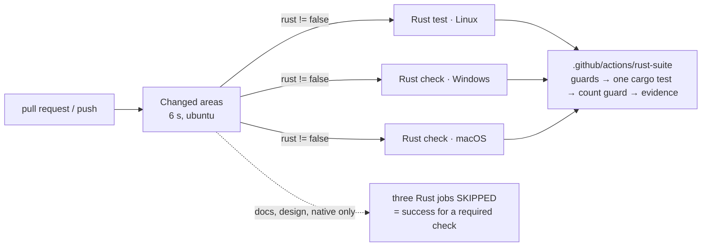

# Rust CI speed: measurements and changes (2026-11-11)

Lane C1. Goal (Guus, 2026-11-11): the Rust CI jobs "more efficient and faster … SUPER FAST".
Every number here is a measured count or a measured second; the instrument is named next to it.

## 1. Baseline

### 1.1 GitHub-hosted runners (run of PR #275, measured by the lead)

| Job | Total | Setup + cache | Cargo check | Run Rust tests | libtest line |
|---|---|---|---|---|---|
| Rust test (Linux) | 295 s | ~50 s | – | 237 s | `2668 passed; 6 failed; 7 ignored; finished in 165.17s` |
| Rust check (Windows) | 661 s | ~70 s | 101 s | 482 s | `finished in 320.73s` |
| Rust check (macOS) | 666 s | ~40 s | 80 s | 538 s | `finished in 365.50s` |

### 1.2 The Legion (WSL2, Ryzen 9 9955HX3D, 16 logical CPUs), `v2-next` at `3d39dc9b`

Instrument: `cargo test --locked` with libtest's `--report-time` (per-test seconds), `XDG_CONFIG_HOME`
and `TMPDIR` on the ext4 disk as in CI; `cargo --timings`; `/usr/bin/time`; a timing wrapper around the linker.

| What | Measured |
|---|---|
| Library suite, truth line | `test result: FAILED. 2668 passed; 6 failed; 7 ignored; 0 measured; 0 filtered out; finished in 72.46s` |
| Tests timed | 2674 (2668 passed + 6 failed; the 6 are the known red pin tests PR #279 fixes) |
| Sum of per-test seconds | 914.0 s (16 threads turn that into 72 s of wall time) |
| Top 50 tests | 517.3 s; the other 2624 tests: 396.7 s |
| Tests over 1 s | 103 tests, 596.2 s |
| CPU actually used by a run | user 118 s + sys 56 s for 660 test-seconds (the run in §2.1 row 3): the suite mostly WAITS |
| Clean compile of every test target (`cargo test --no-run`) | 58.5 s wall, 345 s user + 111 s sys, 560 crates |
| The crate's own two compiles inside that | library for tests 49.0 s, library (non-test) 28.5 s, in parallel |
| Incremental rebuild after a one-line change in `src/` | 11.7 s |
| Link of the library test binary | 1.1 s (`rust-lld`, rustc's default linker on x86_64 Linux since 1.90); `libbeebeeb_desktop_lib.so` 2.8 s |
| Size of the library test binary | 771 MB (`debuginfo=2`) |

Distribution of the 2674 per-test times:

| Seconds | Tests | Sum |
|---|---|---|
| ≥ 10 | 12 | 338.4 s |
| 5 – 10 | 15 | 100.2 s |
| 1 – 5 | 76 | 157.7 s |
| 0.5 – 1 | 154 | 98.6 s |
| 0.1 – 0.5 | 850 | 209.1 s |
| 0.01 – 0.1 | 154 | 9.2 s |
| < 0.01 | 1413 | 0.9 s |

By module: `engine_bridge::tests` 236.4 s (563 tests), `recovery_phrase_unlock_tests` 126.5 s (4),
`state_db::tests` 94.6 s (186), `direct_download::tests` 87.7 s (25), `owner_keys::tests` 66.2 s (82),
`auth_v2::password` 43.1 s (3), `own_data_proof::tests` 36.9 s (51), `signout_teardown_tests` 36.5 s (16).

### 1.3 Why the top 20 are slow (each test read)

| # | s | Test | Cause |
|---|---|---|---|
| 1 | 67.2 | `direct_download::tests::ld0105_s0_a_chunk_slower_than_a_minute_…` | **Real time by design**: an 8 MiB chunk trickled at 128 KiB/s over a real socket; asserts `took > 60 s` (Windows' fixed 60 s callback limit). No CPU. |
| 2 | 43.2 | `owner_keys::tests::move_adopt::review_p2_7_a_move_of_more_than_ten_thousand_…` | **fsync**: 10 001 rows seeded, one SQLite commit each (4.3 ms per commit on disk; 7.8 s on tmpfs) |
| 3–5 | 34.9 ×3 | `recovery_phrase_unlock_tests::*` (3 tests) | **KDF in a debug build**: Argon2id (core's production parameters) compiled at `opt-level 0` |
| 6 | 28.4 | `auth_v2::password::tests::the_password_legs_run_cores_sign_in` | **KDF in a debug build**: three OPAQUE logins (Argon2id + curve arithmetic) |
| 7 | 21.9 | `recovery_phrase_unlock_tests::account_without_stored_check_…` | KDF in a debug build |
| 8 | 21.4 | `own_data_proof::tests::stranding::a_five_percent_mixed_database_…` | **fsync**: 25 rounds × 100 rows, one commit each |
| 9 | 16.8 | `state_db::tests::open_and_cache::every_concurrent_first_open_…` | 50 rounds × 8 threads opening one fresh database: migration + fsync, serialised by SQLite's write lock |
| 10 | 14.7 | `auth_v2::password::tests::the_second_factor_leg_…` | KDF in a debug build |
| 11 | 10.0 | `signout_teardown_tests::clear_session_retry_after_unconfirmed_engine_stop_…` | **Real time by design**: an engine that cannot stop; waits the product's 3 s graceful + 2 s force abort windows, then the runtime waits for the stand-in thread's 10 s deadline |
| 12 | 10.0 | `runner::tests::abort::abort_returns_task_unconfirmed_…` | Same (a thread that spins until a 10 s deadline) |
| 13 | 9.9 | `ipc_socket::framing_tests::framing_protocol::a_reply_larger_than_64_kib_…` | fsync: 400 rows seeded one commit each |
| 14 | 7.5 | `state_db::tests::startup_and_accepts::an_accept_already_running_…` | 50 rounds, each: two database opens + a 20 ms sleep that makes the race window |
| 15–18 | 7.0 ×4 | `signout_teardown_tests::{sign_out,lock}_with_an_unconfirmed_engine_stop_…`, `finder_setup_wiring_tests::{the_stop_helper,repairs_engine_stop}_…` | Real time by design: 3 s + 2 s abort windows, stand-in deadline 7 s |
| 19 | 6.9 | `own_data_proof::tests::stranding::every_row_the_server_named_…` | fsync: 3 × 300 rows |
| 20 | 6.3 | `state_db::tests::startup_and_accepts::an_accept_waiting_behind_the_close_…` | 50 rounds of open + commit (fsync) |

Three causes cover the list: **real time by design** (1, 11, 12, 15–18: 115 s), **KDF at opt-level 0**
(3–7, 10: 170 s), **one fsync per SQLite commit** (2, 8, 9, 13, 14, 19, 20: 112 s).

**Test #1 is a floor.** It needs 65–67 s of real time whatever the machine, so no configuration of the
library suite finishes in under ~66 s while it runs on every PR. The Legion's 72 s is that one test plus 5 s.
Shortening it would change what it proves (a chunk "slower than a minute"); it is left as it is and reported
to the lead as a decision (§8).

## 2. Test execution: what was tried, what it gained

Old base `3d39dc9b`, library suite, every run `2668 passed; 6 failed; 7 ignored` (the count never moved).
"Sum" is the sum of the per-test seconds: the work, whatever the thread count.

### 2.1 Legion, 16 logical CPUs, 16 libtest threads

| # | Configuration | `finished in` | Sum of test seconds | Rebuild cost |
|---|---|---|---|---|
| 1 | Baseline (temp files on disk) | 72.46 s | 914.0 s | – |
| 2 | Every dependency at `opt-level 3` | 68.14 s | 678.8 s | 190.9 s wall, **1733 s CPU** (5x the 345 s baseline): dropped |
| 3 | 36 named crates at `opt-level 3` (incl. `beebeeb-core`, `rusqlite`) | 68.08 s | 660.3 s | 117.7 s wall |
| 4 | **34 named crates** (without `beebeeb-core`, `rusqlite`) — kept | 69.49 s | 657.9 s | see §3 |
| 5 | #2 + temp files on tmpfs | 67.68 s | 597.0 s | – |

The 6 KDF tests: 169.6 s → 16.0 s (`recovery_phrase_unlock_tests` 126.5 → 12.2 s, `auth_v2::password` 43.1 → 3.8 s).
`beebeeb-core` optimised adds nothing measurable (660.3 vs 657.9 s) and sits on the serial compile path, so it is
not in the list. On tmpfs the 10 001-row test goes 43.2 → 7.8 s and the 25×100-row test 21.4 → 6.5 s.
On 16 CPUs the wall time barely moves (72 → 68 s) because test #1 alone is 65 s.

### 2.2 Four cores (`taskset -c 0,2,4,6` on the Legion): the hosted runner's shape

The instrument first: the baseline on four cores finishes in 160.75 s; GitHub's Linux runner measured 165.17 s.

| # | Configuration | `finished in` | CPU (user + sys) |
|---|---|---|---|
| 1 | Baseline, 4 threads, disk | 160.75 s | 288 + 24 s |
| 2 | 34 crates optimised, 4 threads, disk | 116.64 s | 113 + 22 s |
| 3 | + tmpfs, 4 threads | 73.53 s | 107 + 14 s |
| 4 | + tmpfs, 8 threads | 69.85 s | 101 + 14 s |
| 5 | + tmpfs, 16 threads — kept (Linux) | 69.03 s | 89 + 14 s |
| 6 | disk, 8 threads | 76.65 s | 115 + 24 s |
| 7 | disk, 16 threads — kept (Windows, macOS) | 69.14 s | 106 + 24 s |
| 8 | #4 **without test #1** (measurement only, `1 filtered out`) | 36.88 s | 98 + 14 s |

More threads than cores is right for this suite: it uses ~110 CPU-seconds for ~600 test-seconds, the rest is
waiting on sockets, SQLite and timers. Rows 5 and 7 are within 4 s of the 65 s floor.

### 2.3 cargo-nextest: measured, not adopted

| Runner | 16 CPUs | 4 cores |
|---|---|---|
| libtest (rows above) | 68–69 s | 69.03 s |
| `cargo nextest run` 0.9.151 (2720 tests: library + the 3 integration binaries; same 6 failed, 7 skipped) | 68.29 s | **84.64 s** |

nextest starts one process per test; the test binary is 780 MB and links GTK/WebKit, so 2720 process starts cost
more than libtest's threads on four cores, and neither can beat the 65 s floor. It would also need a second mode
in the count guard. No test needed process isolation to pass: nextest's own run failed the same 6 tests and no
other, so no test group was needed and none was written. Dropped.

### 2.4 Sleeps, poll loops, test databases: listed, not changed

- **Real time by design** (left as they are): `ld0105_s0_a_chunk_slower_than_a_minute_…` (65 s);
  the seven "engine that cannot stop" tests (`signout_teardown_tests` ×3, `finder_setup_wiring_tests` ×2,
  `runner::tests::abort` ×1, `sign_out_revoke_tests::the_revoke_gives_up_after_three_seconds`): they wait the
  product's own 3 s + 2 s abort windows against a thread that cannot be cancelled, which tokio's paused clock
  cannot drive. With the floor at 65 s none of them is on the critical path: removing every one of them would
  not make the suite one second faster today. They become the next floor (about 10 s) only if test #1 leaves.
- **Test databases**: the engine has no in-memory or `synchronous=OFF` mode for tests and none was added
  (production durability untouched, as the brief requires). The fsync cost is removed on Linux by putting the
  tests' temporary directory on tmpfs instead: same code, same SQL, same counts.
- 170 `sleep` call sites in 78 files (tests and code) were counted and the 25 files with most of them read; the ones over 100 ms are race windows (`sleep(20 ms)` × 50
  rounds) or the abort windows above. None was rewritten: no measured wall-time gain while the floor stands.

## 3. Compile

Legion, fresh target directory each time, `cargo test --locked --no-run` (other lanes were building on the same
machine, so wall seconds carry noise; CPU seconds are steadier).

| Configuration | Wall | CPU (user) | Library test binary | Target dir | of which dependencies |
|---|---|---|---|---|---|
| 34 crates optimised, full debuginfo, incremental (cargo's default) | 117.1 s | 452 s | 781 MB | 10.3 GB | 4.5 GB |
| + `CARGO_INCREMENTAL=0`, `debug=line-tables-only` | 94.9 s | 380 s | 291 MB | 4.6 GB | 3.2 GB |
| + `CARGO_INCREMENTAL=0`, `debug=0` — kept on hosted runners | 79.4 s | 332 s | 141 MB | 3.0 GB | 2.2 GB |
| 34 crates at `opt-level 0`, `CARGO_INCREMENTAL=0`, `debug=line-tables-only` | 71.2 s | 326 s | 281 MB | 4.5 GB | 3.2 GB |

- The 34 optimised crates cost **54 CPU-seconds** on a clean build (380 vs 326 s, rows 2 and 4), paid once per
  dependency cache. They save ~155 CPU-seconds on every test run.
- No debuginfo: 48 CPU-seconds less than line tables and a third smaller dependency cache to restore. CI never set
  `RUST_BACKTRACE`, so nothing read the debuginfo; a failing test still prints its file and line (the panic
  location is not debuginfo). No test in the tree uses `std::backtrace` (0 matches).
- **Linker: nothing to gain.** rustc 1.99 already links with `rust-lld` on x86_64 Linux: the 771 MB test binary
  links in 1.1 s. `mold` was not installed and not tried further.
- **The double compile was real, and a second one was hiding behind it.** `cargo check --all-targets` and
  `cargo test` compile the same 8 units (measured: `in check but not in the test build: 0`, and the reverse 0),
  so the check step is gone and `scripts/assert-test-build-covers-all-targets.py` fails the job if a bench
  target (the one kind the test build leaves out) ever appears. Then this pull request's first run showed the
  crate compiling AGAIN in the test step after a `--no-run` build (Linux 55 s, macOS 47 s, Windows 88 s).
  Reproduced on the Legion with `cargo -v`: `Dirty beebeeb-desktop: the file …/out/tauri-codegen-assets/<hash>.html
  has changed (… 663995254ns after last build …)` — Tauri's `generate_context!` rewrites an embedded asset
  while the library's two units compile, so the NEXT cargo invocation after any fresh build recompiles the crate.
  The old workflow paid this in its test step on every run. One cargo invocation per job avoids it.
- **Cache:** `Swatinem/rust-cache` stays (dependencies only; the crate itself is always compiled). It is now
  keyed per OS with a shared key, saved only by pushes to `main`, `v2-next`, `v2-native` (`ci.yml` now runs on
  those pushes) and restored by every pull request against them; `cache-on-failure` so a red run on the base
  branch still leaves the dependencies. Before, a cache was saved only by a GREEN pull-request run, and the base
  was red, so the runs of 2026-11-11 restored stale caches (the baseline's "Post Cache cargo [skipped]").
  `cache-all-crates` stays off (it would add registry crates nothing here builds). `sccache` was **not
  measured**: with one crate per job, dependency-level caching already skips every unchanged dependency; it is
  the tool for the self-hosted runners once several crates share them (`self-hosted-runners.md`).

## 4. CI shape



- **Job names are unchanged** (`Rust test (Linux)`, `Rust check (Windows)`, `Rust check (macOS)`): the
  `release/*` ruleset requires them by name. Windows and macOS are two jobs instead of a matrix because a skipped
  matrix job reports under its unexpanded name.
- **Skipping:** `scripts/ci-changed-areas.py` (18 self-test cases, run in CI before it is trusted) turns the
  Rust suite off only for paths it positively knows cannot reach it: `docs/**`, `design/**`, `native/**`,
  `*.md` and licence files outside `src-tauri`. Everything else, an empty list, a failed classifier and every push
  run the suite. **Frontend-only changes are NOT skipped**: Rust tests pin TypeScript sources
  (at least 4 files under `src/` are read by Rust tests today: `DesktopQuickSearch.tsx`, `DesktopVersionHistory.tsx`,
  `MacSecurity.tsx`, `finderSetupCopy.ts`), so skipping
  would hide red pins. When the TSX is deleted, add `src/` to the list in one line.
- **Proof of the skip:** pull request #282 (a throwaway, one file under `docs/`, base = this branch): `Changed
  areas` passed in 6 s; `Rust test (Linux)`, `Rust check (Windows)`, `Rust check (macOS)` report **skipped**; see §6.
- **Kept guards:** the count guard and its self-test (13 cases), the evidence upload (`cargo-test.log`,
  `cargo-test.exit`, now also `rust-suite-timing.txt`), `--locked` (the core pin in `Cargo.lock`). New guards:
  the classifier's self-test and the target-coverage guard with its self-test (8 cases).
  `cargo-check.log` / `cargo-check.exit` no longer exist: there is no check step; a compile error is in
  `cargo-test.log` and leaves no result line, which the count guard reports as red.
- **Runner selection:** `runs-on` reads `vars.RUST_LINUX_RUNNER` / `RUST_WINDOWS_RUNNER` / `RUST_MACOS_RUNNER`
  (unset = GitHub-hosted). `self-hosted-runners.md` has the procedure and the security conditions.

### Adding a crate (the native UI crates on `v2-native`)

One job per crate and OS, each a checkout plus the shared action:

```yaml
  native-rune-linux:
    name: Native UI (Linux)
    needs: changes
    if: ${{ !cancelled() && needs.changes.outputs.native != 'false' }}
    runs-on: ${{ (github.event.pull_request.head.repo.fork && 'ubuntu-latest') || vars.RUST_LINUX_RUNNER || 'ubuntu-latest' }}
    steps:
      - uses: actions/checkout@<sha>
        with: { persist-credentials: false }
      - uses: ./.github/actions/rust-suite
        with: { crate-dir: native/beebeeb-drive-rune, evidence-name: native-rune-linux, cache-key: native-rune-linux }
```

plus a `native` output in `scripts/ci-changed-areas.py` (the `rust` rule already ignores `native/**`; `native`
is the mirror: on for `native/**`, the toolchain file and the workflow). Three things to check when doing it:
the count guard requires a `src/lib.rs` harness with tests (a binary-only crate needs a flag for that), the
engine crate that both the Tauri app and the native UI depend on must turn BOTH areas on, and the new job names
become required checks only when Guus adds them to the ruleset.

## 5. Legion: before and after (merged base, head `83870abd`, library + 3 integration binaries)

| | Truth line (library) | Count guard |
|---|---|---|
| Before (this PR's profile switched off, temp files on disk, full debuginfo) | `test result: ok. 2732 passed; 0 failed; 7 ignored; 0 measured; 0 filtered out; finished in 72.86s` | `Total: 6 harnesses; 2778 executed tests; cargo exit 0` |
| After, run 1 of 3 | `test result: ok. 2732 passed; 0 failed; 7 ignored; 0 measured; 0 filtered out; finished in 69.18s` | `Total: 6 harnesses; 2778 executed tests; cargo exit 0` |
| After, run 2 of 3 | `… 2732 passed; 0 failed; 7 ignored; … finished in 69.22s` | same |
| After, run 3 of 3 | `… 2732 passed; 0 failed; 7 ignored; … finished in 69.26s` | same |
| After, 4-core simulation | `… 2732 passed; 0 failed; 7 ignored; … finished in 79.32s` | same |

"After" is exactly what the action runs on a hosted Linux runner: `CARGO_PROFILE_DEV_DEBUG=0 CARGO_INCREMENTAL=0
cargo test --locked`, temp files on `/dev/shm`, libtest's default threads. 3 of 3 runs: same counts, 0.08 s
spread. On 16 CPUs the suite was already at the 65 s floor, so the Legion gains 3.6 s; the gain is on small
machines. Three earlier runs with 16 threads and line-table debuginfo on the same head: 68.93 s, 69.21 s, 69.25 s,
same counts.

## 6. GitHub-hosted runners: before and after

**Before** — two runs of the old workflow. A is the lead's baseline; B has the same tests as "after" (PR #277's
head, run 42993261171: 58 more tests than A, several of them KDF-heavy, and the 6 pin tests still red).

| Job | Run | Total | Cache restore | `cargo check` | Compile in the test step | Test execution | Truth line |
|---|---|---|---|---|---|---|---|
| Rust test (Linux) | A | 295 s | 24 s | – | 72 s | 165.17 s | `2668 passed; 6 failed; 7 ignored` |
| | B | 436 s | 17 s | – | 103 s | 280.82 s | `2726 passed; 6 failed; 7 ignored` |
| Rust check (Windows) | A | 661 s | 51 s | 101 s | 161 s | 320.73 s | – |
| | B | 799 s | 38 s | 114 s | 205 s | 414.66 s | `2591 passed; 6 failed; 7 ignored` |
| Rust check (macOS) | A | 666 s | 32 s | 80 s | 172 s | 365.50 s | – |
| | B | 841 s | 53 s | 119 s | 262 s | 388.20 s | `3071 passed; 6 failed; 9 ignored` |

**After** — this pull request, final configuration.

| Job | Run | Total | Compile | Test execution | Truth line (library) | Count guard |
|---|---|---|---|---|---|---|
| Rust test (Linux) | cold cache, 43001294259 | 318 s | 199 s | 82.15 s | `test result: ok. 2732 passed; 0 failed; 7 ignored; 0 measured; 0 filtered out; finished in 82.15s` | `6 harnesses; 2778 executed tests; cargo exit 0` |
| | warm cache, 43004717263 (head `f98f1ac8`) | **187 s** | 51.65 s | 82.50 s | `test result: ok. 2732 passed; 0 failed; 7 ignored; 0 measured; 0 filtered out; finished in 82.50s` | `6 harnesses; 2778 executed tests; cargo exit 0` |
| Rust check (Windows) | cold cache | 587 s | 350 s | 198.45 s | `test result: ok. 2597 passed; 0 failed; 7 ignored; 0 measured; 0 filtered out; finished in 198.45s` | `6 harnesses; 2643 executed tests; cargo exit 0` |
| | warm cache | **439 s** | 129 s | 242.00 s | `test result: ok. 2597 passed; 0 failed; 7 ignored; 0 measured; 0 filtered out; finished in 242.00s` | `6 harnesses; 2643 executed tests; cargo exit 0` |
| Rust check (macOS) | cold cache | 496 s | 238 s | 229.49 s | `test result: ok. 3077 passed; 0 failed; 9 ignored; 0 measured; 0 filtered out; finished in 229.49s` | `6 harnesses; 3123 executed tests; cargo exit 0` |
| | warm cache | **381 s** | 131 s | 213.58 s | `test result: ok. 3077 passed; 0 failed; 9 ignored; 0 measured; 0 filtered out; finished in 213.58s` | `6 harnesses; 3123 executed tests; cargo exit 0` |

Compile and test seconds come from the action's own lines in each job log (`rust-suite compile line`,
`rust-suite truth line`); totals from `gh run view <id> --json jobs`. "Cold" = the dependency cache missed
(`No cache found.`), so every dependency was compiled: that is the worst case, and after the merge only the
first run on each base branch pays it.

**Job totals, B → after with a warm cache: Linux 436 → 187 s, Windows 799 → 439 s, macOS 841 → 381 s**
(against A: 295 → 187, 661 → 439, 666 → 381). In the warm run the cache restore took 14 s (Linux, 698 MB),
33 s (Windows, 733 MB) and 17 s (macOS); what is compiled after it is the crate itself (52 s, 129 s, 131 s),
once instead of two or three times. Hosted runners differ from run to run: Windows executed the same tests in
198.45 s in the cold run and 242.00 s in the warm one, macOS in 229.49 s and 213.58 s (and 137.56 s in run
43002780533).

Test execution, same tests, B → after (cold run): **Linux 280.82 → 82.15 s, Windows 414.66 → 198.45 s, macOS 388.20 →
229.49 s.** The pass counts are B's plus its 6 red pins, which the base fixed meanwhile (Linux 2726 + 6 = 2732,
Windows 2591 + 6 = 2597, macOS 3071 + 6 = 3077); ignored counts are unchanged (7, 7, 9).

The other runs of this pull request (kept because they decided things):

| Run | Configuration | Linux | Windows | macOS |
|---|---|---|---|---|
| 42997083889 | 8 threads, two cargo invocations, cold | 72.44 s, 2732 passed | 177.52 s, 2597 passed | 122.52 s, 3077 passed |
| 42999581214 | **16 threads**, one invocation, cold | 79.07 s, 2732 passed | 187.63 s, **3 failed** | 98.30 s, **1 failed** |
| 43001294259 | default threads (final), cold | 82.15 s | 198.45 s | 229.49 s |

16 threads went red on the small runners. macOS (3 cores): `ld0105_s0_…` saw a 15.19 s stall against its 10 s
limit (not a known flake). Windows: `round7_signout_retries_completed_identity_without_reupload` and
`ld0105_f2b_native_a_buffered_robocopy_…` (both are the known runner flakes of workspace task 2425) and
`ld0113_protect_native_tests::new_version_updates_read_only_placeholder` (not listed there): three in one run,
and no faster (187.6 s vs 177.5 s with 8). The 4-core simulation on the Legion did not predict any of it (its
16-thread runs passed), so the simulation is trusted for CPU and I/O, not for scheduling on a 3-core VM.
**8 threads passed once on each OS and is faster on macOS (122.5 s) and a little on Windows (177.5 vs 198.5 s),
but one green run is not evidence that it does not flake, so the default stays at libtest's own.** It is one
input (`test-threads`) away; see §8.

**A known flake showed up once, with the final configuration:** run 43002780533 (the cache-saving run), macOS:
`finder_lock_and_sign_out_tests::a_sign_out_leaves_no_account_row_and_no_owner` failed at
`finder_lock_and_sign_out_tests.rs:742:13` ("Finder accepts are open…"), `3076 passed; 1 failed; 9 ignored`,
137.56 s. That is workspace task LD-0075, word for word (first seen 2026-11-05 on a docs-only pull request,
again on 2026-11-08). The same job passed in runs 43001294259 and 43004717263 with the same configuration. What this
pull request does to that flake's RATE is not known: 1 red in 3 macOS runs of the final configuration is too
few runs to tell, and the test's race (a shared scratch state directory) is sensitive to timing, which this
pull request changes. It is reported, not fixed (the file belongs to the sign-out lane).

**Docs-only pull request (#282, one file under `docs/`, run 42999479700):** `Changed areas` success in 6 s;
`Rust test (Linux)`, `Rust check (Windows)`, `Rust check (macOS)` each **skipped**; the other 5 jobs ran
(4 success; `Frontend` fails there as it does on the base, unrelated). Not proven: that GitHub's ruleset
counts these three skipped checks as passed on a protected `release/*` branch. GitHub documents that a job
skipped by `if:` reports success to a required check; `v2-next` has no required checks to test it on, and
creating a `release/*` branch is admin-only.

## 7. What is still slow, and why

After the change the library suite's sum of test seconds on the Legion is about 600 s; wall time is the 65 s
floor plus 4 s.

| Test(s) | Seconds | Why it stays |
|---|---|---|
| `direct_download::tests::ld0105_s0_a_chunk_slower_than_a_minute_reports_its_bytes_as_they_arrive` | 65.4 | Real time by design (§1.3 #1). **The floor of every job.** |
| 2 "engine that cannot stop" tests (`clear_session_retry_…`, `abort_returns_task_unconfirmed_…`) | 10.0 each | Product abort windows 3 s + 2 s, stand-in thread deadline 10 s |
| `state_db::tests::open_and_cache::every_concurrent_first_open_…` | 9.8 | 50 rounds × 8 racing opens; the rounds are the test |
| `owner_keys::…::review_p2_7_a_move_of_more_than_ten_thousand_…` | 7.8 (tmpfs) / 39 (disk) | 10 001 single-row commits: the bound is the test |
| 4 more "cannot stop" tests | 7.0 each | Same as above, 7 s deadline |
| `own_data_proof::…::a_five_percent_mixed_database_…` | 6.5 (tmpfs) | 25 rounds × 100 rows |
| 5 sign-out tests (`signout_teardown_tests`, `sign_out_revoke_tests`, `sign_out_unchanged_elsewhere_tests`) | 4.8–6.1 each | Wait the product's stop and revoke timeouts |
| ~850 tests of 0.1–0.5 s (`engine_bridge::tests` 563 of them) | ~230 total | Each opens one or two real state databases (schema + migrations; the median `state_db` test takes 0.12 s on tmpfs) and often a mock HTTP server. The next lever is `StateDb::open`'s cost, which is production code and was not touched. |

On Windows and macOS the temp directory is still a disk: Windows has no built-in RAM disk; a macOS RAM disk
(`hdiutil`) was **not tried** (a second volume can change the behaviour of tests that copy or clone files between the temp directory
and the home volume; not investigated, it needs its own measured pull request).

## 8. Decisions for the lead

1. **The 65 s test.** `ld0105_s0_a_chunk_slower_than_a_minute_…` puts a 65 s floor under every Rust job on every
   machine; without it the 4-core suite is 36.9 s (measured, §2.2 row 8) and a warm self-hosted job about 55 s
   instead of about 85 s. Options: (a) leave it (this PR); (b) run it in its own parallel job, which needs a new
   required check on the `release/*` ruleset (Guus) or accepts that the per-PR required checks no longer cover
   it; (c) rework its fixture onto a virtual clock so it proves "longer than 60 s, bytes at least every 10 s"
   without waiting (a test rewrite in `direct_download`, owner's call). Recommended: (c), else (b).
2. **8 test threads on macOS/Windows** would cut macOS test execution from 229 to about 122 s. It passed once
   per OS. Recommended: try it in its own pull request and re-run the job ten times before keeping it.
3. **Self-hosted runners**: `self-hosted-runners.md`. Recommended order: the repository setting (control 1)
   now; a Linux runner on the testrig first.

## 9. Not done

- No runner registered, no repository variable or setting changed (Guus's actions).
- `sccache`, `mold`, a macOS RAM disk, `cache-all-crates`: not measured (reasons in §3 and §7).
- No sleep or poll loop rewritten, no test database switched to memory, no test touched at all: 0 `.rs` files
  changed. The pass/fail/ignored counts are the base's on all three OSes.
- cargo-nextest not adopted (§2.3).
- `native/**`, `src/**`, the session/keychain/auth Rust files: untouched. The Frontend job is unchanged.
- The `apt-get` step on the hosted Linux job (24–42 s) was left alone.
- Windows and macOS self-hosted timings: not measured (no runner exists).

### 1.4 The 50 slowest tests (baseline, Legion, seconds)

| # | s | test |
|---|---|---|
| 1 | 67.2 | `direct_download::tests::ld0105_s0_a_chunk_slower_than_a_minute_reports_its_bytes_as_they_arrive` |
| 2 | 43.2 | `owner_keys::tests::move_adopt::review_p2_7_a_move_of_more_than_ten_thousand_foreign_items_is_refused` |
| 3 | 34.9 | `recovery_phrase_unlock_tests::verifier_failure_fails_closed` |
| 4 | 34.9 | `recovery_phrase_unlock_tests::account_phrase_is_verified_with_session_then_persisted` |
| 5 | 34.9 | `recovery_phrase_unlock_tests::wrong_but_valid_phrase_is_rejected_and_never_persisted` |
| 6 | 28.4 | `auth_v2::password::tests::the_password_legs_run_cores_sign_in` |
| 7 | 21.9 | `recovery_phrase_unlock_tests::account_without_stored_check_is_refused_like_web` |
| 8 | 21.4 | `own_data_proof::tests::stranding::a_five_percent_mixed_database_is_refused_every_time` |
| 9 | 16.8 | `state_db::tests::open_and_cache::every_concurrent_first_open_of_a_fresh_database_succeeds` |
| 10 | 14.7 | `auth_v2::password::tests::the_second_factor_leg_keeps_the_challenge_after_a_wrong_code` |
| 11 | 10.0 | `signout_teardown_tests::clear_session_retry_after_unconfirmed_engine_stop_cannot_skip_the_stop_gate` |
| 12 | 10.0 | `runner::tests::abort::abort_returns_task_unconfirmed_when_the_task_cannot_be_aborted` |
| 13 | 9.9 | `ipc_socket::framing_tests::framing_protocol::a_reply_larger_than_64_kib_arrives_intact_and_delimited` |
| 14 | 7.5 | `state_db::tests::startup_and_accepts::an_accept_already_running_commits_before_the_close` |
| 15 | 7.0 | `signout_teardown_tests::sign_out_with_an_unconfirmed_engine_stop_purges_no_upload_staging` |
| 16 | 7.0 | `signout_teardown_tests::lock_with_an_unconfirmed_engine_stop_does_not_purge_upload_staging` |
| 17 | 7.0 | `finder_setup_wiring_tests::the_stop_helper_records_an_unconfirmed_stop_and_only_that` |
| 18 | 7.0 | `finder_setup_wiring_tests::repairs_engine_stop_reports_an_unconfirmed_stop_whoever_made_it` |
| 19 | 6.9 | `own_data_proof::tests::stranding::every_row_the_server_named_is_judged_not_a_sample` |
| 20 | 6.3 | `state_db::tests::startup_and_accepts::an_accept_waiting_behind_the_close_queues_nothing` |
| 21 | 6.3 | `ipc_socket::framing_tests::changes_and_thumbnail::list_changes_pages_with_resume_tokens_without_losing_or_repeating` |
| 22 | 6.2 | `engine_bridge::tests::finder_queue_5::a_finder_write_refused_for_a_lapsed_account_lands_once_subscribed` |
| 23 | 6.1 | `engine_bridge::tests::finder_queue_5::a_finder_write_refused_for_no_plan_lands_once_subscribed` |
| 24 | 6.1 | `engine_bridge::tests::finder_queue_5::a_finder_write_refused_after_a_cancelled_trial_lands_once_subscribed` |
| 25 | 6.0 | `state_db::tests::startup_and_accepts::a_finder_change_waiting_behind_the_close_queues_nothing` |
| 26 | 5.7 | `sign_out_revoke_tests::the_server_hears_the_logout_only_after_the_local_clear_with_the_engine_slot_free` |
| 27 | 5.2 | `direct_download::tests::the_pinned_route_rides_out_a_rate_limit_and_a_server_hiccup` |
| 28 | 4.9 | `api_client::direct::tests::ld0105_s0_both_api_chunk_routes_report_each_piece_of_the_body_as_it_arrives` |
| 29 | 4.7 | `signout_teardown_tests::clear_session_when_already_signed_out_skips_the_engine_and_succeeds` |
| 30 | 4.7 | `sign_out_unchanged_elsewhere_tests::the_unsent_gate_is_macos_only` |
| 31 | 4.7 | `state_db::tests::open_and_cache::task_2240_the_cache_is_refitted_when_the_db_grows` |
| 32 | 4.6 | `signout_teardown_tests::a_sign_out_empties_upload_staging_and_the_staged_copies_in_every_staging_root` |
| 33 | 4.0 | `direct_download::tests::no_url_or_signature_reaches_a_log_line_or_an_error` |
| 34 | 3.8 | `engine_bridge::tests::ipc::ipc_hydrate_is_cancelled_and_status_restored_when_the_client_hangs_up` |
| 35 | 3.6 | `engine_bridge::tests::sf2237d::sf2237d_t5_whole_and_range_open` |
| 36 | 3.4 | `engine_bridge::tests::sync::test_sync_tick_ops_429_backs_off_and_preserves_cursor` |
| 37 | 3.3 | `engine_bridge::tests::versions_3::twenty_rapid_saves_land_in_order_and_the_last_wins` |
| 38 | 3.3 | `runner::tests::tick::the_real_pulse_emits_syncing_with_progress_then_idle_and_resets_the_batch` |
| 39 | 3.2 | `signout_teardown_tests::sign_out_clears_the_storage_summary` |
| 40 | 3.1 | `sign_out_revoke_tests::a_revoke_that_fails_or_never_answers_changes_nothing_of_the_sign_out_and_logs_no_token` |
| 41 | 3.0 | `sign_out_revoke_tests::a_sign_out_with_no_token_anywhere_sends_nothing` |
| 42 | 3.0 | `sign_out_revoke_tests::the_revoke_gives_up_after_three_seconds` |
| 43 | 2.9 | `config_write_pin_tests::test_1889_the_real_writers_land_next_to_a_save_that_was_in_flight` |
| 44 | 2.9 | `engine_bridge::tests::refusals_2::a_404_on_every_new_session_parks_the_write` |
| 45 | 2.8 | `engine_bridge::tests::refusals_2::a_server_that_refuses_every_session_with_400_parks_the_write` |
| 46 | 2.7 | `engine_bridge::tests::finder_queue_5::a_finder_write_over_quota_at_complete_lands_once_space_is_free` |
| 47 | 2.7 | `engine_bridge::tests::finder_queue_5::a_finder_write_over_the_object_budget_lands_once_objects_are_freed` |
| 48 | 2.6 | `engine_bridge::tests::finder_queue_5::a_finder_write_over_quota_at_a_chunk_lands_once_space_is_free` |
| 49 | 2.5 | `engine_bridge::tests::backup_uploads::backup_upload_leaves_source_byte_identical` |
| 50 | 2.4 | `engine_bridge::tests::refusals_2::a_session_reaped_during_an_outage_lands_on_a_fresh_upload` |
