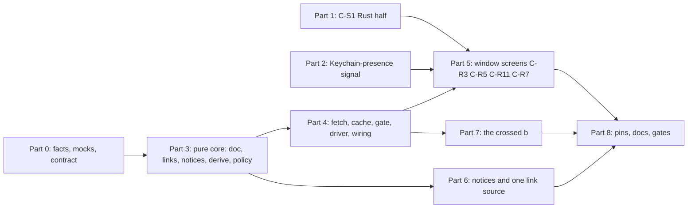

# 1747 — the account view on a Mac: the remaining work

**Status:** plan for the lead's review; D2, D3, O1 accepted and P3-5 added on 25 Oct (§8). Docs only: no code, no spec text is changed here. Code for these parts starts after PR #143 merges (the lead's merge order is #140, #143, #142, #139).
**Date:** 25 Oct 2026, 10:00 CET
**Task:** 1747 (macOS), epic 1725, with the macOS fleet task 1683 (the two-surface app)
**Repo:** desktop (public). Server facts were read, not changed.
**Written against:** desktop `origin/main` `57f92d3f`, PR #143 at `ec7e7a1c` (slice 2, sign-in in the Beebeeb window, CI 6/6 green, not merged), server `repos/server` at `7705c043`.
**Spec:** `docs/specs/2026-10-07-desktop-first-run-sign-in.md` (spec C) and `docs/specs/2026-10-24-macos-two-surface-app.md` (the two-surface spec). Where they disagree, the two-surface spec's amendments already win (spec C's own `— two-surface design, 2026-10-24` lines).
**Replaces for planning purposes:** the *sequencing* of `docs/superpowers/plans/2026-10-07-desktop-first-run-sign-in.md` (the 25-task plan). That plan's step-by-step code stays the detail reference for the Rust units. This plan says which of its tasks are done, superseded or still to do, and what changed since it was written.

How to read the evidence tags: **[server]** read in `repos/server` at `7705c043`; **[repo]** read in the desktop tree named above; **[spec]** read in the spec text; **[not checked]** a claim I could not check from here.

---

## Summary

- **Eight parts** after a Part 0 of facts, mocks and the contract: C-S1's Rust half (1), the Keychain-presence signal and the interrupted first run (2), the pure account-view core (3), fetch, cache, gate and driver (4), the window screens for C-R3, C-R5, C-R11 and offline (5), the notices and one link source (6), the crossed b (7), pins, docs and gates (8). Parts 1 and 2 start the moment #143 merges. Two lanes: Rust takes 1, 3, 4, 7; TypeScript takes 2, 5, 6.
- **Findings that change the work** (§2): the billing endpoint has no `frozen`, and `last_trial` is not in the onboarding document, so the document stays the source and the notices need no "charged" line (F1, F2); the old plan's C-S1 design would break source pins it never mentions (F4); macOS cannot install an update in place, which contradicts C-R3's "Update now" (F5); the popover is not on `main` (F6).
- **Decisions recorded** (§4): D1 to D10. The lead accepted D2 and D3 and O1 on 25 Oct (§8) and amends the launch Verification line (V10) himself, because the launch rungs are two-surface slice 6 (D8). Part 1 also carries review item P3-5 from #143, the switch snapshot's owner label.
- **Every Verification line** is classified in §7 as reachable without a device or a device rung for the lead.

---

## 1. What is left, in one table

The 25-task plan was written on 7 Oct, before spec A merged, before the two-surface app, and before slice 2. Each of its tasks, as of today:

| Old task | What it was | Now | Where it lands in this plan |
|---|---|---|---|
| 0 | precondition: spec A on `main`, record the interfaces | holds: `finder_setup/`, `lifecycle_log.rs`, `account_binding.rs`, `reauth.rs`, `SessionGeneration` (`account.rs:112`), `AuthHealth::is_expired` / `note_result` (`runner.rs:79`, `:92`), `SESSION_TRANSITION` (`lib.rs:124`), `probe_startup_session` (`lib.rs:884`) all exist [repo] | Part 0 re-records them with names |
| 1 | design: mocks, icon assets | partly drawn: the hi-fi `design/hifi/macos-two-surface.html` has Checking, No plan yet and Update required as **popover** cards, sign-in, session ended, offline, switch, set up, Finder as window cards, and a notice line in Settings › Account [repo]. Variant B template PNGs and SVG exist in the workspace `design/desktop-first-run/tray-icon/` (commit `39494ebcf`) [repo]. **Not drawn:** the three account states as *window* screens, the notices in the popover header, the colour `.ico` | Part 0 |
| 2 | vendor the contract, parse the document | the vendoring is open PR #115 (27 files, waits for the server PR it names); the parser is not started | Part 0 (take #115), Part 3 |
| 3–6 | links, notices, derive, policy | not started | Part 3 |
| 7–11 | cache, fetch, gate, driver, wiring | not started | Part 4 |
| 12 | C-S1: one sign-in outcome | not started on the Rust side; #143 does the frontend half in the controller | Part 1 (amended: see F4) |
| 13 | launch policy | **two-surface slice 6** owns it and depends on task 1845 [spec §12 row 6] | not in this plan (D8) |
| 14 | crossed b, tooltips, clicks | not started | Part 7 |
| 15 | frontend contract, copy, links | `src/accountViewCopy.ts` exists with slice 2's strings; `AccountView` types and the link module do not | Parts 3, 5 |
| 16 | shared sign-in | **done in #143** (`macSignIn.tsx`, `browserSignIn.ts`), apart from the offline line (a prop with no producer) and the server's create-account link (a built-in constant today) | Part 5 |
| 17 | account window | **superseded**: the account window is the Beebeeb window `main` (spec C C-W8 as amended); #143 builds the sign-in side. C-R3, C-R5, C-R11 screens are not built | Part 5 |
| 18 | notices in Settings, one billing-link source | not started; location amended to the popover header and Settings › Account | Part 6 |
| 19 | Windows C-R3 / C-R5 | task 1748, not this plan | out |
| 20 | no Drive status page in the compact window | the two-surface app replaces the compact window on macOS (slice 3, not merged) [spec §12]; **not re-checked here** | Part 0 checks it; no work assumed |
| 21–24 | pins, docs, gates, verification | | Part 8 and §7 |

Parts 1 and 2 depend on nothing but #143 and can start the moment it merges. At most two dev lanes run at once (workspace rule 4): a **Rust lane** takes Parts 1, 3, 4, 7 in that order, a **TypeScript lane** takes Part 2's TypeScript, then Parts 5 and 6 once Part 3's JSON fixtures exist.

---

## 2. Facts checked for this plan

These change the work. Each is a finding with its evidence; none is a ruling.

**F1. `GET /billing/subscription` cannot be the source of the notices; it has no `frozen`.** [server] The handler (`routes/billing.rs:459`) returns `plan`, `effective_plan`, `status`, `billing_state`, `past_due_since`, `trial_ends_at`, `account_state`, `data_deletion_at`, `lapse_kind`, `uploads_blocked_at`, `access_until`, `confirm_payment_by`, `last_trial` and more (`:748` to `:794`), and no field for `users.frozen_at`. The onboarding document derives `frozen` from `users.frozen_at` or `billing_state` suspended/terminated (`onboarding/derive.rs:270`). So a desktop that read only the billing endpoint could not draw the frozen notice. This agrees with spec C C-D1, which already names the onboarding document as the one source. The billing fields are used here as a **cross-check** (§3), not as an input.

**F2. `last_trial {kind, ended_at, charged}` is not in the onboarding document.** [server] `trial::last_ended_trial` (`trial.rs:1508`) feeds only `GET /billing/subscription` (`routes/billing.rs:513`, `:774`). The document's `trial_ended` copy (`onboarding/mod.rs:362`) says the files above the allowance are read-only and when they are deleted; it never says what was charged. None of the approved notice lines (spec C §7.5) needs `charged`. A "Nothing was charged" line on the desktop would be new copy with a source the document does not carry (see D2).

**F3. The document and the billing endpoint agree by construction on the legacy state.** [server] `AccountFacts.legacy` is documented as "the very value `GET /billing/subscription` returns as `account_state`" (`onboarding/derive.rs`, the field's doc comment). The `trial_cancelling` dates also match: the document's `read_only_since` is `canceled_at`, which the billing endpoint returns as `uploads_blocked_at`, and both `data_deletion_at` values are `trial_ends_at` plus the retention days (`onboarding/load.rs:77-86`, `routes/billing.rs:712` onward). §3 has the full mapping.

**F4. The 25-task plan's Task 12 design would break source pins that it does not mention.** [repo] It moves the browser handoff's settlement arms out of `browser_login.rs` into a `browser_settlement` helper in `lib.rs`. Four tests besides the one the lead named read `browser_login.rs` as text, and none of them is in that plan: `every_arm_that_does_not_sign_in_revokes_the_new_session_and_changes_nothing` finds the `SignInSettlement::AccountMismatch {` and `SignInSettlement::Unconfirmed` arms in `browser_source()` and asserts each revokes and touches nothing local; `a_handed_over_key_that_differs_is_installed_and_the_comparison_reads_every_byte` asserts the `Some(crate::SignInSettlement::Reauthenticated { vault_unlocked: true, .. }) => {` arm is in the same text; `every_sign_in_method_is_checked_before_it_stores_anything_and_windows_never_reaches_the_check` asserts `crate::settle_sign_in(` precedes `crate::apply_session(` within a cfg window; and `every_sign_in_names_the_session_by_the_servers_email` asserts the profile fetch. With the arms moved, the first two would go red and the other two would need re-checking. The plan below keeps the arms where they are and changes only what they return (D6), so the one pin whose text must change is the one the lead named, and the other four must pass unedited.

**F5. On macOS an update is downloaded, never installed in place.** [repo] After PR #140, `src/macUpdateCopy.ts` says "The App Sandbox denies the in-app install, so on macOS an update is downloaded, never installed in place: there is no 'Restart to update' and no command that would try one." Its strings are `Download update` and "Drag Beebeeb into Applications to replace this version.", and it opens `MACOS_DOWNLOAD_URL`. Spec C §7.3 (C-R3) says "Update now" runs `check_for_updates_now` then `install_update`, and the hi-fi draws "Update now". On a sandboxed Mac that path fails ("Failed to move the new app into place", spike `docs/specs/2026-10-25-macos-sandboxed-updater.md` §1). This is a spec contradiction (workspace honesty trigger 2); D3 proposes the resolution.

**F6. The popover is not on `main`.** [repo] `compact_window_label` still says the compact window is "on a Mac the tray flyout until slice 3 builds the popover" (`surfaces/policy.rs`), and the open PRs are #139, #140, #142, #143, #144. The popover's Checking, No plan yet, Update required and notice rows (two-surface spec §6.3) therefore have no consumer yet. This plan produces the `AccountView` they will read and builds the window side; the popover side belongs to slice 3 (open item O1).

**F7. The vendored `account.needs_plan.ios.json` is `blocking: true` through a required `verify_email` step, with upload reason `email_unverified`.** [server] fixture. Its `account.state` is `needs_plan`, so C-R5 applies to it (C-R15 is for non-`needs_plan` blocking). The task-1844 desktop fixture (`account.needs_plan.desktop.json`) does not exist yet; 1844 is still in `backlog/`. Until it ships every `fallback` is null and the built-in addresses are used (spec C §9).

**F8. `blocking` is exactly `state == needs_plan` or any required step not done.** [server] `onboarding/derive.rs:719`. `allowance` is not blocking. So an `allowance` account (verified, within the entry allowance) is Ready with no notice, as spec C §7.5 says.

**F9. `read_only` carries no dates in the document, though the billing endpoint has `storage_grace_deadline`.** [server] `derive.rs:549` gives `read_only_since: None, data_deletion_at: None` for `read_only`; the billing row has `storage_grace_deadline`. The approved line for `read_only` is "Read-only. Choose a plan to upload again." (spec C §7.5). Nothing to do on the desktop; noted so nobody reads the billing field into the notice.

**F10. State of the names the old plan relies on.** [repo] `state_db.rs:35` has `ACCOUNT_TABLES` (11 tables) and `DEVICE_TABLES`; the old plan's third list `ACCOUNT_BOUND_TABLES` (old plan issue 9) does not exist yet and is created in Part 4. `LifecycleEvent` (`lifecycle_log.rs:31`) has `Launch`, `Trigger`, `Transition`, `SignedIn`, `SignedOut`, `UpdateDownloaded`, `UpdateInstalled`; spec C's three new events are not there yet. `tauri` has only `image-png` (`src-tauri/Cargo.toml:16`, `:317`). The hard-coded link constants are `BILLING_URL` and `CREATE_ACCOUNT_URL` (`src/desktopApi.ts:189`, `:194`), `HELP_URL` (`src/macSettingsModel.ts:337`), an inline literal at `src/WindowsApp.tsx:1779` and `BILLING_URL` at `src/windows/views/AccountView.tsx:34`.

---

## 3. The notices, grounded in the server's real fields

The document is the source (F1). This table is what each `account.state` rests on in the server, what the billing endpoint shows for the same account, and the line the desktop draws. It is the table Part 3's notice tests are written from, and Part 0 keeps it honest by re-reading the server at the SHA in force.

| `account.state` | Server fact (`derive.rs`) | Same account in `GET /billing/subscription` | Desktop line and link |
|---|---|---|---|
| `trialing_no_card` | entitled `trialing`, trial kind `no_card` | `status: "trialing"`, `trial_ends_at`, `trial_auto_converts: false` | "Free trial until {trial.ends_at}." or the server's `trial_end_*` copy verbatim; "Manage plan" |
| `trialing` | entitled `trialing`, mandated, never paid | `status: "trialing"`, `trial_auto_converts: true`, `confirm_payment_by` when the bank asked to confirm | the same trial line; "Manage plan" |
| `trial_ended` | plan-less, `trial_ended` facts (never paid, back on the allowance, over it) | `account_state: "lapsed"` (`legacy_state` maps `TrialEnded` to `Lapsed`), `data_deletion_at`, `last_trial.charged: false` | read-only variant with both dates (or `copy.trial_ended_over_allowance` verbatim); "Choose a plan" |
| `trial_cancelling` | never-paid mandated trial cancelled before the first charge | `status: "cancelling"`, `uploads_blocked_at` (the doc's `read_only_since`), `access_until`, `data_deletion_at` | read-only variant; either date may be null and its clause drops; "Choose a plan" |
| `lapsed` | plan-less and `legacy == Lapsed` | `account_state: "lapsed"`, `data_deletion_at` (the doc's `lapsed_data_deletion_at`), `lapse_kind` `gift` or `trial` | "Read-only. Files are deleted on {data_deletion_at} unless you choose a plan." or "Read-only. Choose a plan to upload again."; "Choose a plan". The words never say "trial", so a gift recipient reads a true line |
| `read_only` | `billing_state == read_only` | `billing_state: "read_only"` (F9) | "Read-only. Choose a plan to upload again."; "Choose a plan" |
| `frozen` | `users.frozen_at`, or `billing_state` suspended/terminated | **no key** (F1) | "This account is frozen."; "Contact support" (server link when 1844 ships, else the built-in address) |
| `past_due` | entitled `past_due`, or `billing_state == grace` | `status: "past_due"`, `billing_state: "grace"`, `past_due_since` | "Payment failed. Update your payment details on beebeeb.io."; "Update payment details" to web billing (C7) |
| `needs_plan` | plan-less, and not trial-ended, not lapsed, and not (an allowance and a verified email) | `account_state: "needs_plan"` | not a notice: the C-R5 screen |
| `active`, `legacy_free` | entitled paid plan; grandfathered free plan | `account_state: "ok"` | nothing |
| `allowance` | plan-less, an entry allowance and a verified email | `account_state: "needs_plan"` (the legacy label for "no plan"; `legacy_state` maps `Allowance` to `NeedsPlan`); not blocking (F8) | nothing |

Golden fixtures that ground each row: `account.trialing_no_card.desktop`, `account.trialing.desktop`, `account.trial_ended.ios`, `account.trial_cancelling.web`, `account.lapsed.ios`, `account.read_only.web`, `account.frozen.desktop`, `account.past_due.web`, `account.needs_plan.ios`, `account.active.web`, `account.legacy_free.web`, `account.allowance.desktop` [server, `contracts/onboarding/fixtures/`]. Read directly this session: `frozen` (lifecycle null, upload `account_frozen`, no fallback), `past_due` (upload allowed, no fallback, no copy), `trial_cancelling` (dates 6 Oct and 1 Nov, `trial: null`), `trial_ended` (both dates, `copy.trial_ended_over_allowance`), `lapsed` (`data_deletion_at` only), `trialing` (mandated, ends 18 Oct).

---

## 4. Decisions taken in this plan

Recorded so the lane does not stop for them. Each names its reason and what reversing it costs. None is a Guus-only matter (money, legal, external accounts, irreversible actions).

- **D1. The onboarding document is the source of state and notices; `GET /billing/subscription` is a cross-check only.** Reason: F1 (no `frozen` in billing) and spec C C-D1. Reversing it would need a second fetch and a merge of two documents; not recommended.
- **D2. No "Nothing was charged" line; the desktop does not read `last_trial`.** Reason: F2; no approved line uses it, and `lapsed` is gift-safe because it never says "trial". If the lead wants parity with the web's one-time notice, it needs new approved copy and a source: either the server adds `charged` to the document (a server task) or the desktop makes a second call. If the lead wants it, it is planned as a Part 6b.
- **D3. On macOS the C-R3 screen uses #140's update copy, not "Update now".** Title "Update Beebeeb" and the sentence "This version of Beebeeb is too old to connect. Update to continue." stay as approved; the button becomes `Download update` and the hint "Drag Beebeeb into Applications to replace this version." sits under it, both read from `macUpdateCopy.ts` so they cannot drift. Reason: F5; the in-place install fails in the sandbox. Windows keeps "Update now" (1748); Linux has no C-R3 screen (spec C §7.8). Same-change amendments, written when Part 5 starts and approved by the lead first (design before code): spec C §7.3, the hi-fi "Update required" card, and the two-surface spec §6.3 row, which says "Update now" and "Restart to update" today.
- **D4. A signed-in, locked Mac with no vault key anywhere opens on "Set up this Mac" by state, not only after a click.** Reason: spec C C-W4 names `manual_launch_locked_without_key_opens_recovery_phrase`, and without it an interrupted first run lands on a Home that can only say "Vault locked". With the key in the Keychain the window shows Home with the locked card and "Unlock vault" (two-surface spec §7.6).
- **D5. The Keychain-presence answer is a command read at the point of action, not a field of the 1 Hz `sync_status`.** Reason: `AccountSessionBoundary` polls `sync_status` every second, and a Keychain attribute read in each poll, across two layouts, is cost and noise for an answer needed once per click and once per locked window. It is the same philosophy as C-R10 (enforce at the point of action).
- **D6. The browser handoff's arms stay in `run_handoff`; only their return changes** (F4). `start_browser_login` and `run_handoff` return `Result<LoginOutcome, String>`.
- **D7. The window's screen order follows C-R8, with the flow's steps ranked where their state ranks.** Update required beats everything (the flow stays in its store and resumes). The `switch` and `unlock` steps beat Checking and No plan, because those account states cannot hold while the switch question or the recovery phrase is open. The `finder` and `settling` steps yield to Checking and No plan, so a no-plan account never sees "Adding Beebeeb to Finder…". Part 5 pins this as a literal table.
- **D8. The launch policy is not built here.** C-W1 (login-item detection), C-W2 (`RunEvent::Reopen`), C-W4 (the 5 s settle) and the `startup_surface` macOS row are two-surface slice 6, which depends on task 1845 (a working login item) [spec §12 row 6]. 1747's Verification line "a manual launch shows the centred window; a login-item launch shows only the icon" therefore cannot close with this plan; §7 says what to do about the line.
- **D9. PR #115 is the one vendoring of the contract.** Part 3 starts from `contracts/onboarding/` as #115 has it (27 files, byte-identical to the server's). If #115 is still open when Part 3 starts, Part 3's branch carries #115's commit rather than a second copy.
- **D10. Windows and Linux get the Rust account view for free and no screens here.** The document client, derive, gate and icon are platform-neutral (spec C C-R14); the gate never holds the engine on Linux. C-R3 and C-R5 screens on Windows are 1748.

---

## 5. Parts

Conventions for every part, taken from the workspace rules and the 25-task plan's Global Constraints, which still apply:

- Worktree per lane from `origin/main`; commits with an explicit pathspec and the `Co-Authored-By` trailer of the model that wrote them; no `git stash`, `reset`, `checkout --`, `restore`, `clean`, `switch` in a tree the lane did not allocate; never signal a process by name.
- Every cargo build or test: `scripts/coord/with-lock.sh cargo-build-desktop -- <cmd>`, output to a file, then read the file. One full `cargo test --locked` per gate, Rust mutations batched into one lock hold by script, no edits to files cargo reads while a cargo run is queued.
- **Every new test is seen to fail first** by a deliberate mutation of the code it covers; the failing lines go into the task's Notes, the mutation is reverted, the green run is pasted beneath. A part's test list below is the list of names that must exist and must have been red.
- Truth lines: per-binary `test result: ok. N passed; 0 failed` from `cargo test --locked`, and `bun test`'s `N pass` / `0 fail`. A run that reports 0 tests, or a filter that matched nothing, is red. Counts quoted in a part are the length of its list; the baseline `B_lib` and `B_bun` are measured on the merged base at Part 0, not guessed.
- Public repo: commit messages and comments describe behaviour and never an open weakness.
- Each part is one PR, and the lead gates it in a fresh tree at HEAD.

### Part 0 — before any code (lead, plus a design lane)

**Goal.** The facts, the mocks and the contract are in hand, so no code part has to guess.

1. **Record the interface facts** in `.claude/tasks/_qa-evidence/1747/p0-record.md` (the lead commits it): the exact names and shapes of `SessionGeneration` (`account.rs:112`) and where a session transition increments it; `AuthHealth::{is_expired, note_result}`; whether `SESSION_TRANSITION` covers every platform; the `finder_setup` hooks Part 4 needs (`Op::AddDomain`, `Trigger::KeysArrived`, `on_trigger`'s `held` flag); the `authorize_engine_start` permit enum and its six callers of `spawn_bound_engine`; `StateDb::owner()`; `account_binding::same_account`; `reauth::LocalTraces`; `ACCOUNT_TABLES`. Each as `file:line` from the merged base, since this plan's lines are `57f92d3f`'s.
2. **Measure the baselines** `B_lib` (`cargo test --lib` count on macOS) and `B_bun`, and the clippy warning count against `origin/main`, for the gates.
3. **Check what the old Task 20 assumed:** that `src/pages/Status.tsx`, `src/compactNavigation.ts` and `src/App.tsx`'s landing default are or are not already gone on macOS after slices 1 to 5. No work is assumed.
4. **Draw the missing mocks** into the hi-fi (light and dark), for approval before Part 5 (spec C §12 says Guus approves mocks; the 25-task plan's Task 1 gave that to the lead, and the lead decides whether to relay it): Update required, Choose a plan before and after the click, and Checking as **window** screens; offline on each; the notice line in the popover header; and the colour `.ico` of the crossed b (variant B, 45° slash, 2.6 pt stroke, round caps, 1 pt knockout; spec C C4b). Where an approved mock and spec C disagree, the mock wins and the spec is amended in the same change.
5. **Rule on D3** (the update button) and **D2** (a charged line), or accept them as written.
6. **Take #115** (D9) and note whether the server PR it waits for has landed.

**Verification.** Reachable without a device: all of it (documents, greps, a clean `git diff`). Nothing here claims a feature works.

### Part 1 — C-S1, the Rust half (and the frontend half it lets #143 delete)

**Goal.** `start_browser_login` returns the password path's `LoginOutcome`. A different account reaches the switch warning through that outcome, not through an event plus a raw error string. A fresh browser sign-in carries `vault_unlocked: true`.

**Depends on.** #143 merged. **Lane.** Rust, then one small TypeScript commit. **Size.** S.

**Today** [repo]. `start_browser_login` returns `Result<(), String>` (`browser_login.rs:246`). On another account `run_handoff` revokes the new session, emits the event `account_mismatch` with `pending_changes`, `unsent`, `unsent_error`, and returns `Err("account_mismatch")` (`:508`, `:509`); `start_browser_login`'s error arm then emits an `error` event with the same string. #143's `browserSignIn.ts` swallows both raw signals and waits `MISMATCH_GRACE_MS` (750 ms) for the event, because the event and the `Err` travel separately.

**Changes.**
- `run_handoff` and `start_browser_login` return `Result<LoginOutcome, String>`; the arms stay where they are (D6):
  - `Reauthenticated { vault_unlocked: true }` returns `Ok(LoginOutcome::reauthenticated(true, false))` at once;
  - `AccountMismatch { .. }` revokes the new session, then returns `Ok(LoginOutcome::account_mismatch(pending_changes, unsent, unsent_error))`, the call `desktop_login` makes (`lib.rs`, the line the existing pin quotes);
  - `Unconfirmed` and a failure before the token reached the Keychain stay `Err(SIGN_IN_ACCOUNT_UNKNOWN)` / `Err(failure.message)` with their `error` event;
  - the install path ends in `Ok(browser_installed_outcome(reauthenticated))`, a small pure function: a fresh sign-in is `LoginOutcome::signed_in()` with `vault_unlocked: true` (the constructor has no such case today: `signed_in()` is `vault_unlocked: false`), the same account is `reauthenticated(true, false)`; `requires_2fa` is always false and `key_replaced` is false (the handed-over key is installed silently, so there is no recovery step to explain).
- The `account_mismatch` event and the raw string leave `browser_login.rs`. `connecting`, `waiting`, `authorized`, `done` and `error` stay as progress.
- **The pin edit the lead asked to be named:** `the_switch_count_reaches_the_sign_in_window` (`lib.rs:37272` on `origin/main`; `:37303` on #143's tree). Its first half (the settlement carries the snapshot) is unchanged. Its second half reads `browser_login.rs` for the payload steps and `emit(app, "account_mismatch", payload);`. That half becomes: the browser handoff is a third text beside `desktop_login` and `desktop_login_2fa` in the `for login in [...]` loop, each asserting `return Ok(LoginOutcome::account_mismatch(pending_changes, unsent, unsent_error));`, plus an assertion that `browser_login.rs` no longer contains `"account_mismatch"` as an event or an error string. Its doc comment ("the browser sign-in puts each in its `account_mismatch` event") is rewritten. The edit **tightens** the pin: the browser path is held to the same hand-off as the password paths. The PR names the pin in its description and shows the before and after of that one hunk.
- **The snapshot owner (review item P3-5 on #143, deferred here by the lead).** `switch_snapshot` (`lib.rs`, the W11 switch count) records the ask snapshot under the owner label `"onboarding"` (`count_ask("onboarding")`), the sign-in window's label before the two-surface app. On a Mac the sign-in window is `main` (`surfaces::policy::main_window_label`), so a close of `main` leaves a switch snapshot that nothing owns, and a close of the `onboarding` window (which a Mac no longer builds) is what would drop it. Part 1 changes the owner to the window the switch step runs in, read from `main_window_label(Platform::current())` rather than a literal. This edits 1887 pins that hold `"onboarding"` as that owner, so they are named in the PR like the first one: `the_switch_carries_a_snapshot_on_macos_only` (asserts `drop_owned_by("onboarding")`, "owned by the window the switch step runs in") and the flow-window close pin whose clauses (d) and (g) pair `main` with `onboarding` (`ask(&state, "onboarding")`). The edit is a re-point of the owner, not a loosening: the pins gain the case that a close of `main` drops the switch snapshot and a close of any other window leaves it. Tests (Rust, red first): `the_switch_snapshot_is_owned_by_the_window_the_step_runs_in` (the owner equals `main_window_label` on each platform that builds the switch), `closing_main_drops_the_switch_snapshot`, `closing_another_window_leaves_the_switch_snapshot`; mutation: restore the literal `"onboarding"`, and the first two go red.
- TypeScript (same part, second commit): `browserSignIn.ts` settles from the command's returned outcome through `settledFrom`, the strict parser the password path uses, so both paths reach `AccountSwitchStep` through one parser (spec C §14, TypeScript list). `MISMATCH_GRACE_MS`, the event-or-`Err` race and the swallowed `error` all go. `WindowsFirstRun.tsx` (which uses `useBrowserSignIn`) routes on the returned outcome as well; Windows still refuses a second session, so its mismatch arm is compiled out and its outcome is always fresh.

**Tests (red first).**

Rust:
1. `a_browser_sign_in_reports_the_vault_unlocked`: `browser_installed_outcome(false)` and `(true)` serialize to the five-field JSON with `vault_unlocked: true` and `key_replaced: false`.
2. `the_browser_handoff_returns_a_login_outcome`: source pin on the signatures of `start_browser_login` and `run_handoff` (`-> Result<LoginOutcome, String>`).
3. `no_raw_account_mismatch_code_leaves_the_browser_handoff`: `browser_login.rs` has no `"account_mismatch"` literal, and every `emit(` phase is one of `connecting`, `waiting`, `authorized`, `done`, `error`.
4. `the_switch_count_reaches_the_sign_in_window` (edited, above): red against the old `browser_login.rs` text, green against the new.
5. `an_unconfirmed_browser_sign_in_stays_a_retryable_error`: the `Unconfirmed` arm returns `Err(SIGN_IN_ACCOUNT_UNKNOWN)` and still emits `error`.
6. `login_outcome_json_is_the_frontends_contract`: unchanged and green (the shape did not move).
7. **The four other pins in F4 pass unedited.** The PR shows that the diff of the test modules is the one hunk of item 4; if another pin has to change, the lane stops and reports. (They are the proof that D6 was the smaller change.)

TypeScript (`tests/browserSignIn.test.ts`, `tests/windowsFirstRun*.test.ts`):
8. a returned fresh outcome settles as `fresh {vaultUnlocked: true}`; a returned same-account outcome as `reauthenticated`.
9. a returned mismatch outcome settles as `account_mismatch` with the count, the ask snapshot and the E3 line, deep-equal to what `settledFrom` gives the same JSON on the password path.
10. `Err(SIGN_IN_ACCOUNT_UNKNOWN)` ends in the error phase with that sentence on screen; no raw code is ever shown.
11. a malformed outcome ends in `SIGN_IN_OUTCOME_UNREADABLE`.
12. the controller never schedules a timer (the grace is gone): a stub `setTimer` that throws.
13. Windows first run routes on the returned outcome (fresh; error).
14. Render (`tests/render-mac-app.mjs`): the scenario "browser sign-in, another account" resolves the stub command with the mismatch outcome and the switch card appears with the count; the page text contains no `account_mismatch`.
Removed with the grace: the event-ordering tests in `browserSignIn.test.ts`. The PR lists each by title and states removed N, added M, net.

**Mutations.** (M1) put the `emit` and `Err("account_mismatch")` back in the mismatch arm: items 3, 4, 9, 14 go red. (M2) `vault_unlocked: true` to `false` in `browser_installed_outcome`: item 1 red. (M3) drop `unsent` from the hand-off: item 4 red. (M4) settle on the `done` event again: item 8 red.

**Verification.** Reachable without a device: items 1 to 14, M1 to M4, and the cargo and bun counts. Device rung (lead): a real browser handoff signing in as *another* account shows the switch step with the right count (needs a browser and two accounts on the local API).

### Part 2 — the Keychain-presence signal, and the interrupted first run

**Goal.** The app can answer "is there a vault key in this Mac's Keychain?" for the active account, and uses the answer to choose between the Keychain unlock and "Set up this Mac".

**Depends on.** #143 merged. Independent of Part 1. **Lane.** Rust (small) then TypeScript. **Size.** S to M.

**The gap.** [repo] `keychain_vault_key_present` is private to `lib.rs` (`:5759`, not Windows). It reads the item's attributes only, never the key, in the id-keyed and the legacy layout, and fails closed. Today it serves the sign-in traces (`gather_local_facts`). No UI can ask it. The consequence is the interrupted first run: a password sign-in on a Mac with no key leaves a session in the Keychain and a flow in `signInFlowStore` (module memory); close the window or quit before typing the phrase and, on the next open, `windowScreen` reads `logged_in && !auth_expired` and returns `home`: a Home whose locked card calls `unlock_vault` (`MacApp.tsx:116` on #143), which has no key to read (D4). The Rust half of that picture, that a first password sign-in without a key leaves the token stored, is from `reauth_swap_token_without_key`'s contract and the sign-in flow; it is **[not checked on a device]**, which is why the first TypeScript test below reproduces the routing half red before any fix and the Part 2 device rung reproduces the whole. The same ambiguity decides the popover's "Unlock vault" (two-surface spec §6.3: the Keychain unlock when the key is in the Keychain, otherwise the window on "Set up this Mac"); slice 3 will need this command.

**Changes.**
- `#[cfg(target_os = "macos")] #[tauri::command] vault_unlock_route(state) -> VaultUnlockRoute` with `Keychain` and `RecoveryPhrase`. It calls `keychain_vault_key_present(active account)`. A Keychain read error maps to `Keychain` (the existing helper's fail-closed answer): the existing unlock error then reaches the person, rather than a path that would overwrite a key. Not part of `sync_status` (D5). It is an answer about the active account, so it keeps the guard and stays out of `ANSWER_STANDS_WHEN_THE_ACCOUNT_CHANGES` (`desktopApi.ts`, the set #143 extends): an answer that arrives after the session revision moved is refused as "Account changed", never applied to the next account. A test pins that (item 15 below). `account_view_state` (Part 4) keeps the guard for the same reason.
- TypeScript: the Beebeeb window reads the route once when the account is signed in and locked, and again at the click on "Unlock vault". `windowScreen` gains the locked-without-key case (D4) and a `settling` result while the route is unknown, so there is no flash of Home.
  - Home's locked card "Unlock vault": `Keychain` runs `unlock_vault` in place; `RecoveryPhrase` sets the flow step `unlock`.
  - Settings › Account's Vault row "Unlock" (`MacSettings.tsx`, `unlock_vault`) uses the same route, so it never fails with a Keychain error on a Mac with no key (an inference from D4: confirm with the lead when the part starts).

**Tests (red first).**

Rust:
1. `the_route_is_keychain_when_the_key_is_there` (a fake store holding the key).
2. `the_route_is_recovery_phrase_when_neither_layout_holds_a_key`.
3. `the_route_reads_the_legacy_layout_too` (only the legacy store holds it: `Keychain`).
4. `an_unreadable_keychain_routes_to_the_keychain_unlock` (the fail-closed answer, pinned so nobody "fixes" it).
5. `the_route_never_reads_the_key`: source pin that the command's body reaches only `keychain_vault_key_present` (the existing `the_vault_key_probe_asks_both_layouts_and_never_unlocks` holds the helper to both Keychain layouts and no unlock; the new pin holds the command to the helper).
6. `sync_status_does_not_read_the_keychain`: source pin on `sync_status`'s body, so the 1 Hz poll never reaches the Keychain (D5).

TypeScript:
7. `windowScreen`, logged in, not expired, locked, route `RecoveryPhrase`, idle flow: `unlock` (**red first**: today `home` — the interrupted first run reproduced as a failing test before any fix).
8. the same with route `Keychain`: `home`.
9. route not yet known: `settling`, never `home`.
10. a flow step still wins over the route (`switch`, `finder`).
11. Home's "Unlock vault": route `Keychain` invokes `unlock_vault` and sets no step; route `RecoveryPhrase` sets step `unlock` and invokes nothing.
12. the click re-reads the route (a key that appeared or vanished since the window opened is honoured).
13. Settings › Account's row follows the same route.
14. Render: the locked-without-key window shows the "Set up this Mac" card; the locked-with-key window shows Home's locked card.
15. `vault_unlock_route` is not in `ANSWER_STANDS_WHEN_THE_ACCOUNT_CHANGES`: a route answer that arrives after the revision moved is "Account changed" (so a window never routes the next account by the previous one's Keychain).

**Mutations.** (M1) route always `Keychain`: items 2, 7 red. (M2) route read inside `sync_status`: item 6 red. (M3) skip the re-read at the click: item 12 red. (M4) add the command to the set: item 15 red.

**Verification.** Reachable without a device: items 1 to 15 and the render. Device rung (lead): the real interrupted first run (password sign-in on a Mac with no Keychain key, quit before the phrase, relaunch: "Set up this Mac"); and "Unlock vault" unlocking in place when the key is in the Keychain.

### Part 3 — the account view core (pure Rust): document, links, notices, state, schedule

**Goal.** One pure function turns the session, the keys, the document and connectivity into an `AccountView`, with every link resolved and every notice formatted. No app wiring: the new items carry `#[allow(dead_code)]` until Part 4 removes it, as in the old plan.

**Depends on.** Part 0 (contract from #115, record). **Lane.** Rust. **Size.** L (the old plan's Tasks 2 to 6, 66 tests). **Detail reference.** old plan Tasks 2 to 6; this part changes what they say only where noted.

**Units** (`src-tauri/src/account_view/`): `doc` (tolerant v1 parse, `AccountPart`), `links` (§5.1 checks and resolution; the one module that owns the built-in addresses), `notice` (§7.5 lines and `day_month`), `derive` (the §4.2 table, C-R8, `AccountView`, the gate value), `policy` (schedule, bounds, offline debounce, the Checking limit).

**Amendments to the old plan.**
- The `AccountView` carries no Keychain-route field: the route is Part 2's command (D5). It also drops spec C §13's `screen` field: the window computes its screen from the view, the flow and the route in TypeScript (`windowScreen`, Part 5), and the view keeps `state`, `session`, `offline`, `busy`, `links` and `notice`.
- The Ready notice is also needed by the popover header (F6): `notice` is part of the view for any consumer.
- C-R3 on macOS carries the update download address from `macUpdateCopy` only on the frontend; Rust holds no copy (D3).

**Tests (red first), by requirement.**

`doc`:
1. every vendored fixture parses; the count asserted equals the number of files in `contracts/onboarding/fixtures/` (and is above 0), so a fixture added later is parsed or the test is red.
2. a document without `client` is unreadable (old plan issue 22); an unknown `schema` is `Unavailable::UnknownSchema`.
3. an unknown `account.state` and an unknown step parse (forward compatibility); `forward_compat.unknown_step.ios.json` is a `pre_account` document, so the unknown-step case uses a derived account document (old plan issue 1).
4. `AccountPart` never contains `client.status` (C-D5: update-required comes only from a fresh document).
5. the document body is not in `Debug` or `Display` (C-D6).
6. only `signup.web_url`, `fallback` and `client.status` are read from `pre_account`; `steps` and `policy` never are (C-D3).

`links` (C-D1 §5.1):
7. scheme `https` only; a host; no user-info; the host is `beebeeb.io` or a subdomain; `http://localhost` is accepted in debug builds only.
8. each destination takes the server link when it passes, else its built-in address; the unknown-required-step rule picks the first required step's link, else the document's, else web billing.
9. a lookalike host (`beebeeb.io.example.com`, `evilbeebeeb.io`) is refused.

`notice` (C-R6, spec C §7.5, §3 above):
10. one test per row of the table in §3, over the real fixtures, asserting the exact line and the link kind.
11. each read-only variant, including a null date dropping its clause and `lapsed` never inventing `read_only_since`.
12. server `copy` wins verbatim (`trial_end_*`, `trial_ended_over_allowance`); `locale`, `region_line`, `plans_managed_on_web`, `trial_terms` and unknown keys never become a notice.
13. `day_month` equals the server's: "18 Oct", "1 Nov" (no zero pad), UTC, English abbreviations, checked against the examples in the fixtures.
14. an unknown state is decided from `capabilities`: a plan reason gives the read-only variants, another reason gives "Read-only." alone with no link, upload allowed gives nothing.
15. a trial with no `ends_at` and no server copy gives no notice (old plan issue 7).

`derive` (C-R1 to C-R15):
16. the §4.2 table row by row (one test each for C-R1, C-R2, C-R3, C-R4, C-R11, C-R5, C-R6), plus C-R8 precedence as pairs (C-R3 over C-R2 over C-R1 over C-R4 over C-R11 over C-R5 over C-R6).
17. C-R2 from the auth-expired state **and** from no token beside a recorded owner, with and without local data; C-R1 needs both no token and no owner.
18. every Checking entry in C-R11 derives Checking; Checking ends on the first fresh document or an unavailable one.
19. C-R15: blocking through `verify_email` or an unknown required step is Ready with the gate open, with the lifecycle token `blocking_verify_email` / `blocking_unknown_step`.
20. the gate value per state: closed in Checking, C-R3, C-R5 while the session is valid, open otherwise, always open on Linux; `epoch` increments on every change.
21. C-R7 overlays the winner and never changes the state.

`policy` (C-D4, §10), all on a fake clock:
22. fetch at launch, at sign-in, every `ttl_seconds` (60 s account, 300 s pre_account); focus fetch when older than `poll_seconds`.
23. the 3 s plan poll for 15 minutes after the click, then back to the schedule; paused while offline and resumed if the 15 minutes remain.
24. bounds: `ttl` clamped to 30 to 900 s, `poll` to 2 to 30 s, absent or 0 takes the built-in.
25. the 10 s retry after a first failure; Offline after exactly 2 network failures at least 10 s apart, never after 1, never after an HTTP 5xx; cleared by 1 success of any HTTP exchange (old plan issue 6); the 30 s re-probe.
26. 429 waits `Retry-After`, else `ttl_seconds`, capped at 300 s, and ends Checking as "unavailable".
27. Checking ends at the latest 15 s after it began (old plan issue 19).

**Mutations.** One per module, run in one lock hold by script: flip one `derive` row; swap two precedence entries; change `https` to `http` in `links`; drop the user-info check; change a notice string; shift a date by a day; change the offline count from 2 to 1; lengthen the Checking limit.

**Verification.** Reachable without a device: everything. This part ships no behaviour a person can see; its evidence is the fixture-driven tests.

### Part 4 — fetch, cache, gate, driver and wiring (C-R10 to C-R12, C-R7, C-R11)

**Goal.** The app fetches the document, binds it to its account, derives the view, holds the gate, emits `account-view-changed`, and the reconciler and the engine obey the gate at the point of action.

**Depends on.** Part 3. **Lane.** Rust. **Size.** L (the old plan's Tasks 7 to 11, 76 tests by its running totals). **Detail reference.** old plan Tasks 7 to 11.

**Changes** (headline).
- `fetch`: `GET {BB_API_BASE}/api/v1/onboarding` with the provenance headers plus `X-Beebeeb-Onboarding-Schema: 1` and `X-Beebeeb-Client-OS` (`macos`, `windows` or `linux`); the Bearer only while signed in; a 401 goes to `AuthHealth::note_result`; the classifier is `link_health::classify_reqwest` minus its HTTP-status arm.
- `cache`: one row in `state.db` (account part, fetch time, `account_binding::Identity`), used only when `same_account` says so, deleted on a sign-out by choice, an account switch and R10's reset, kept after a session ended, counted in `reauth::LocalTraces`, and listed in a new `ACCOUNT_BOUND_TABLES` rather than in `ACCOUNT_TABLES` (old plan issue 9: `ACCOUNT_TABLES` feeds `has_account_data`, and the row is written between a sign-in and the first engine start, so listing it there would change R10's binding decision on every first sign-in).
- `gate`: `AccountGate { open, epoch }`; `Op::AddDomain` reads it immediately before it acts and again against its starting epoch; `authorize_engine_start` returns the new permit `AccountBlocked`; the six `spawn_bound_engine` callers treat it as held, never as a failure; blocking never removes Finder.
- `driver`: one task; events launch, restore finished, sign-in completed (with its `LoginOutcome`), sign-out, switch, lock, unlock, focus, plan opened, try again, timer; `account_ready` fires on **every** edge into Ready (one test per incoming edge); results from a stale `SessionGeneration` are dropped.
- Commands `account_view_state`, `account_view_retry`, `account_view_plan_opened`; event `account-view-changed`; the three lifecycle events (`account_state`, `engine_held`, `onboarding_document`), once per change, closed tokens, no email, id or URL (macOS lifecycle log; `tracing` elsewhere).
- Production ports; `#[allow(dead_code)]` removed.
- The popover seam (F6): `popover_snapshot`'s phase computation takes the `AccountView` as an input so slice 3 can rank update/plan/checking above its own phases (two-surface spec §6.3). Part 4 adds the input and a pin for the order; it draws nothing.

**Tests (red first).** The old plan's lists for Tasks 7 to 11 stand. The ones this plan names because the lead asked for them:
1. C-R11: `checking_is_entered_on_each_of_the_five_entries` (restore period; session and key with no usable cache; after a browser sign-in; after an unlock with no cache; after the same account signs in again), `checking_holds_the_gate_closed_throughout`, `checking_ends_on_a_fresh_or_unavailable_document`.
2. C-R5: `a_blocking_needs_plan_document_closes_the_gate`, `no_finder_add_and_no_engine_start_while_the_gate_is_closed` (a fake reconciler and a fake engine slot), `a_reconcile_in_flight_when_the_document_turns_blocking_adds_nothing`, `blocking_never_removes_finder`, `a_running_engine_stops_through_stop_engine_in_slot`, `the_reused_engine_path_of_start_check_engine_checks_the_gate`, `every_spawn_bound_engine_caller_handles_account_blocked_as_held`, `unlocking_a_no_plan_account_starts_nothing` (old Review Focus 1).
3. C-R3: `update_required_comes_only_from_a_fresh_document` (never from the cache), `update_required_with_a_valid_session_closes_the_gate`, `update_required_while_signed_out_leaves_spec_a_untouched` (the Finder removal owed after a sign-out can still run).
4. C-R7: `offline_after_exactly_two_network_failures_at_least_ten_seconds_apart`, `an_http_error_is_never_offline`, `a_cached_blocking_part_keeps_its_gate_offline` (old Review Focus 4), `launching_with_no_connection_and_no_cache_proceeds_as_today` (Review Focus 2), `the_plan_poll_pauses_offline`.
5. C-R12: `account_ready_fires_on_every_edge_into_ready` (from Checking, C-R5, C-R4, C-R3, C-R2, and at launch from the cache), `account_ready_fires_on_no_other_edge`, `account_ready_clears_the_reconcilers_held_flag`, `account_ready_starts_the_engine_only_when_none_runs` (Windows and Linux; old Review Focus 3).
6. Bindings: `a_result_for_an_old_session_generation_is_dropped`, `an_unidentified_sessions_document_stays_in_memory`, `cannot_compare_keeps_the_row`, `the_row_is_purged_on_sign_out_by_choice_and_on_a_switch`, `the_row_is_kept_after_a_session_ended`, `the_row_is_counted_as_a_trace`.
7. Headers: `the_request_sends_both_onboarding_headers_for_every_os` (including `linux`); `the_bearer_is_sent_only_while_signed_in`.
8. Lifecycle: each of the three events is written once per change and never carries an email, an account id or a URL; the document body reaches no log.
9. Linux: `the_gate_never_holds_the_engine_on_linux`.

**Mutations.** Batched, one lock hold: gate read removed from `AddDomain`; `AccountBlocked` treated as a failure in one caller; `account_ready` missing on one edge; cache not purged on a switch; generation check removed; the 15 s limit removed.

**Verification.** Reachable without a device: the whole list (fake ports and fake clock), plus a Rust integration test against `localhost:3001` that fetches `GET /api/v1/onboarding` for a seeded account in each state and feeds the bytes to `parse` and `derive`. Device rung (lead): the lifecycle log of a real run shows `engine_held reason=account_blocking` and no Finder add for a `needs_plan` account, and Finder is set up by itself after the plan is made active locally.

### Part 5 — the window screens: Update required, Choose a plan, Checking, and Offline

**Goal.** The Beebeeb window draws C-R3, C-R5, C-R11 and the C-R7 overlay on the sign-in card, from `AccountView`, in the order D7 fixes.

**Depends on.** Parts 1, 2, 4 (the view's JSON contract exists from Part 3's fixtures; the commands from Part 4), the Part 0 mocks and the D3 ruling. **Lane.** TypeScript. **Size.** M.

**Changes.**
- `src/accountView.ts`: the view's types and a strict reader for `account_view_state` and the `account-view-changed` event, with a store like `signInFlowStore.ts` (a module store read through `useSyncExternalStore`, so the session-revision remount never drops it).
- `windowScreen(view, flow, route)` replaces `windowScreen(account, flow)` (D7). The matrix is a literal table in the test.
- Screens, all strings in `accountViewCopy.ts` and pinned: C-R3 "Update Beebeeb" / "This version of Beebeeb is too old to connect. Update to continue." / the D3 button and hint; C-R5 "Choose a plan" / "Your account is ready. Choose a plan on beebeeb.io, including the free trial. Beebeeb continues here by itself." / amber "Choose a plan on beebeeb.io", then "Waiting for your plan. This window updates by itself." and a quiet "Sign out"; C-R11 the window's busy indicator with no words.
- "Choose a plan on beebeeb.io" calls `account_view_plan_opened` **first**, then opens the resolved link, so a failed open still starts the 15-minute re-check (old plan issue 17). When the state becomes Ready the open window continues as after a sign-in (spec C §7.6, amended).
- `SignInWindow offline` is wired from `view.offline`: the buttons become "Can’t reach Beebeeb. Check your connection." and "Try again" (`account_view_retry`); "Create account" stays.
- "Create account" and "Choose a plan on beebeeb.io" open exactly `view.links.*`, with `CREATE_ACCOUNT_URL` becoming the built-in fallback inside the one link module (Part 6), and the "Copy link" fallback when the open fails.
- When C-R3 shows with no session, the sign-in card does not appear (C-R3 outranks C-R1); the crossed b is Part 7.

**Tests (red first).**
1. `windowScreen` matrix: every `view.state` (signed_out, session_ended, update_required, locked with each route, checking, no_plan, ready) against every flow step (none, switch, unlock, finder, settling): one expected screen each, written as a literal table first and seen red against the old function. Includes: update_required beats every step and the flow survives; `switch` and `unlock` beat checking and no_plan; `finder` and `settling` yield to checking and no_plan.
2. C-R3: copy pinned word for word; the button's label and address come from `macUpdateCopy` (not a string in the screen); on a window with no session it shows the update screen, not the sign-in card.
3. C-R5: copy pinned; the click order (`account_view_plan_opened` before the open); a failed open shows the address and "Copy link"; the "Waiting for your plan." line after the click; "Sign out" starts the standard sign-out flow.
4. C-R11: the busy screen shows the indicator and no visible words (spec C C-R11); any accessible label it carries is pinned in the same test.
5. Offline: buttons replaced by the line and "Try again"; "Create account" stays; "Try again" calls `account_view_retry`; the C-R3 and C-R5 screens swap their primary button for the same line when offline (spec C §7).
6. Ready after No plan: the open window continues as after a sign-in (settling, then Home), not closed.
7. Every string in `accountViewCopy.ts` is pinned, and the hi-fi is held to the same strings (the existing pattern in `tests/accountViewCopy.test.ts`).
8. The copy guard from slice 5 (§10.1 word list) still passes on every new string.
9. Render (`tests/render-mac-app.mjs`): one scenario per screen at 760×520 and at the default size, light and dark; each is looked at, not only counted (slice 2's render run found two bugs no unit test could).
10. "Create account" opens exactly `view.links.create_account` (an `openUrl` stub receives the view's string, not a constant), and when the open fails the address shows with "Copy link".

**Mutations.** Matrix row swapped; the click order reversed; `Create account` hard-coded back to the constant; the D3 label replaced by "Update now".

**Verification.** Reachable without a device: items 1 to 10 (render captures are pre-evidence, with stubbed IPC). Device rung (lead): each screen captured on the real app against a local API account in that state (`needs_plan`, an update-required client version, offline by cutting the network), and "Download update" opening `MACOS_DOWNLOAD_URL` from the sandboxed bundle.

### Part 6 — the notices, and one source for every web link

**Goal.** The Ready notices (trial, read-only, lapsed, frozen, payment failed) show where the two-surface spec puts them, and every web link comes from one module.

**Depends on.** Parts 3 and 4. The popover header half depends on slice 3. **Lane.** TypeScript. **Size.** M.

**Changes.**
- Settings › Account: the notice line under the plan line (the hi-fi's `.notice-line`), with its link; while a notice shows, its link replaces the plan button ("Upgrade" / "Manage plan"); with no notice the button stays and opens the resolved web-billing link. Dates are formatted in Rust (Part 3) and arrive as strings.
- The popover header's notice line is slice 3's to draw; this part supplies `view.notice` and a pin that the popover reads it from there (O1).
- One link module (`src/accountLinks.ts`) owns the destinations in spec C §5.1, takes the resolved addresses from the view, and keeps the built-in addresses only as the fallback when no view exists. It replaces `BILLING_URL` and `CREATE_ACCOUNT_URL` (`desktopApi.ts:189`, `:194`), `HELP_URL` (`macSettingsModel.ts:337`), the literal at `WindowsApp.tsx:1779` and `BILLING_URL` at `windows/views/AccountView.tsx:34`. Windows files change only to import the module (their behaviour is 1748's).
- The Windows `FrozenRow` text replacement (spec C §7.5) is 1748's.

**Tests (red first).**
1. Settings › Account renders each §3 row's line and link from a view built from the matching fixture (12 cases), and nothing for `active`, `legacy_free`, `allowance`.
2. The plan button is replaced by the notice link while a notice shows and restored with none.
3. Server `copy` text is shown verbatim, including legal dates.
4. "Update payment details" resolves to web billing (C7); "Contact support" to the support link; with a server link present each equals the view's string, byte for byte.
5. A source pin: no literal `app.beebeeb.io/billing`, `beebeeb.io/support` or `app.beebeeb.io/signup` outside `accountLinks.ts` (in `src/`, excluding tests), red against today's five literals.
6. The copy guard (§10.1) passes on the notice strings; no emoji.
7. Render: Settings › Account for the trial, read-only (both date forms), lapsed, frozen and payment-failed fixtures, light and dark.

**Mutations.** A notice line changed; the link kind swapped; the plan button not restored; a literal reintroduced.

**Verification.** Reachable without a device: items 1 to 7. Device rung (lead): the real Settings window against local API accounts in the read-only, lapsed, frozen and payment-failed states, with dates and links (one or two sampled; the render captures are pre-evidence, not a substitute). The links equal the document's `fallback.url` only after task 1844 ships (spec C §16, "Server links"); until then the rung runs against the built-in addresses and is re-run.

### Part 7 — the crossed b (variant B)

**Goal.** The menu-bar icon is the crossed b whenever the session is none or ended, or the Mac is offline, with the right tooltip, the right click and the right menu.

**Depends on.** Part 4 (the view). **Lane.** Rust with assets. **Size.** M.

**Changes.**
- `tray_presentation`, one pure function `present(&AccountView, platform) -> TrayPresentation { icon, tooltip, click, menu_attached }` (C-I1, C-I2, C-W10, C-W11); the tooltip follows the session and connectivity, never the winning state, and "Offline" wins when it applies with another.
- Assets: `src-tauri/icons/tray-template-disconnected@2x.png` (44×44, black and alpha only, byte-identical to today's b outside the stroke) from the workspace's approved variant B files; today's `tray-template@2x.png` embedded too so the app can swap back; the colour `tray-disconnected.ico` for Windows and Linux (drawn in Part 0).
- `Cargo.toml`: tauri gains `image-ico`; `Cargo.lock` must add no `[[package]]` (a before and after count).
- Runtime swap through `TrayIcon::set_icon` then `set_icon_as_template(true)` on macOS, only when the presentation changes, never on an engine tick (C-I5); leaving the crossed b re-applies the last engine tooltip at once.
- Clicks: with no valid session (C-R1, C-R2, and C-R3 signed out or ended) the tray menu is detached and both buttons act as the click; in Ready the click follows the surface rule of the two-surface spec (§6.2). The handler in `setup_tray` is in motion until slice 3 lands, so this part re-reads it at its start and changes only the not-Ready branches (O1).

**Tests (red first).**
1. `present` for every state: icon, tooltip, click, menu, including a C-R3 with an ended session ("Beebeeb: Sign in again", menu detached, click opens the update screen) and a C-R3 signed out ("Beebeeb: Signed out").
2. Tooltips word for word: "Beebeeb: Signed out", "Beebeeb: Sign in again", "Beebeeb: Offline".
3. `offline_wins_the_tooltip_over_signed_out`.
4. The engine tooltip is not overwritten while crossed, and is re-applied on leaving the crossed b.
5. The swap runs only on a presentation change (a fake tray counts `set_icon` calls over a run of engine ticks).
6. Assets: the template PNG decodes as 44×44, every pixel black with alpha, and equals today's template outside a stroke mask; the `.ico` decodes and contains the sizes the platforms need.
7. `Cargo.lock` adds no package after `image-ico`.
8. Named click tests (spec C §14): `click_signed_out_opens_sign_in`, `click_session_ended_opens_sign_in_again`, `click_update_required_opens_update` (also with an ended session), `click_checking_opens_busy`, `click_no_plan_opens_choose_a_plan`, `click_locked_with_keychain_key_unlocks_in_place` (amended by the two-surface spec §6.3), `click_locked_without_key_opens_set_up_this_mac`, `click_ready_toggles_the_popover` (the last two lean on Part 2 and slice 3).

**Mutations.** Swap the signed-out and ended tooltips; make the template non-black; add a swap on every tick; attach the menu while signed out.

**Verification.** Reachable without a device: items 1 to 8 and a Chromium composite of the template on light and dark menu-bar colours (pre-evidence). Device rung (lead): the real menu bar signed out, after a session ended, and offline, on light and dark menu bars, plus each click; the real hover tooltip.

### Part 8 — pins, docs, gates (lead)

- Re-check every cross-language pin between `accountViewCopy.ts`, the notice strings and the Rust `notice.rs` / `tray_presentation.rs` strings (the three tooltips live in Rust, old plan issue 10).
- Docs in the same change as the code, per workspace rule: `CLAUDE.md` of the desktop repo; spec C §7.3 (D3) and any §7.5 touch-ups; the two-surface spec §6.3 update rows; `docs/runbook/desktop-task-history.md`; the task 1747 file's Verification (§7); `docs/CAPABILITIES.md` if a capability changes; the skills under `.claude/skills/` in the workspace if an endpoint note changes (none expected: the desktop adds no endpoint).
- Gates per spec C §14: `cargo test --locked` with per-binary counts, `bun test`, `bunx tsc --noEmit`, eslint, clippy against the Part 0 baseline, `Cargo.lock` diff for `image-ico`.
- Re-run the link rungs when task 1844 ships.

---

## 6. Dependencies and risks

- **Merge order.** Part 1 edits `lib.rs` (a pin) and `browser_login.rs`; #142, #139 and #144 also touch `lib.rs`. The lead names the base SHA for each part's branch; a part rebases only when no cargo run is queued in its tree.
- **#115 and the server PR it waits for.** If that PR does not land, Part 3 cannot take the contract (D9); the fallback is to vendor from the server's tree at `7705c043` with the contract check script, as #115 did.
- **Task 1844.** Not on the critical path (spec C §9). Until it ships, `fallback` is null for every account state and the built-in addresses are used; each link rung re-runs after it.
- **Task 1845 (login item).** Blocks the launch half of 1747's Verification (D8), not any part here.
- **Slice 3 (popover).** Parts 2, 4, 6 and 7 each supply one thing the popover consumes (the route command, the view in the phase input, `view.notice`, the click rule). If slice 3 lands first, those parts shrink; if it lands last, nothing here waits for it. The lead owns the seam (O1).
- **Updates (2176).** D3 rests on #140: macOS downloads and never installs in place. If the spike's recommendation later brings an in-place installer, the button changes back in one place, because Part 5 reads `macUpdateCopy` and holds no update copy of its own.
- **Machine load.** Parts 3 and 4 are compile-heavy; one full gate per part, mutations in one lock hold.

## 7. The 1747 Verification, line by line

"Reachable without a device" means it runs on this Mac's or the Legion's toolchain with no Mac account of Guus's, no signed build, no OS login and no human at a physical screen: cargo and bun tests, the Chromium render script with stubbed IPC, `curl` or a Rust test against a local API on `localhost:3001`, source pins, byte checks of assets. "Device rung" means the debug `.app` bundle running on macOS with the real WebView, tray, Keychain, File Provider and browser; those rungs are the lead's, and a simulator or a render never answers one.

Lines are the task file's amended list, with spec C §15's extra lines marked **(spec)**.

| # | Verification line | Reachable without a device | Device rung for the lead |
|---|---|---|---|
| V1 | A debug `.app` bundle, `BB_API_BASE=http://localhost:3001`, `HOME=<scratch>` for every login | the build command and the scratch-HOME recipe | the whole line: it is the environment every device rung below runs in |
| V2 | Sign in by browser handoff, by password, and by password + 2FA; each reaches Ready, with a capture | the `LoginOutcome` contract (Rust and TypeScript), `afterSignIn` routing, the three screens in the render script | three real sign-ins against the local API, each to Ready; the browser handoff needs a real browser |
| V3 **(spec)** | The browser sign-in on a Mac with no key never shows the recovery phrase | Part 1 items 1, 8 and the routing test (`vault_unlocked: true` never reaches `unlock`) | a real handoff on a Mac with no Keychain key |
| V4 **(spec)** | A relaunch after a revoked session shows Session ended with spec A's wording, the crossed b and "Beebeeb: Sign in again"; a relaunch after a sign-out by choice shows Signed out | Part 3 items 16, 17 (no token + owner is C-R2, neither is C-R1); Part 7 items 1, 2 (icon and tooltip) | the real relaunch after revoking the session on the local API, and after a sign-out; the capture |
| V5 | "Create account" opens exactly the address the server document names | Part 3 items 7, 8; Part 5 item 10 (the open receives the view's string verbatim); a recorded `curl` of the anonymous `GET /api/v1/onboarding` with the two headers, whose `signup.web_url` equals the string the view serves | the system browser actually opening it from the sandboxed bundle |
| V6 | A `needs_plan` account shows "Choose a plan"; no Finder location is added and the engine does not start (lifecycle log); with the plan set active locally the app continues by itself and spec A sets up Finder | Part 4 items 1 to 3 (derive, gate, reconciler, engine with fakes), Part 5 items 1, 3 and the render, the fixture-driven integration test against the local API | the real lifecycle log (`engine_held reason=account_blocking`, no `AddDomain`), the screen on the real app, and Finder being set up by itself after the plan flips |
| V7 | The read-only, lapsed, frozen and payment-failed notices are captured, with dates and links; **(spec)** the trial notice too | Part 3 items 10 to 15, Part 6 items 1 to 7 and the render captures | captures on the real window against local API accounts in each state (the lead may sample frozen and payment-failed); the link equality rung re-runs after 1844 |
| V8a **(spec)** | The update-required screen | Part 5 item 2 and the render | the real screen with a client version below the minimum on the local API; "Download update" opening `MACOS_DOWNLOAD_URL` (D3) |
| V8b **(spec)** | The sign-in-again window | built in #143; Part 5 matrix rows; render | the capture after a revoked session (shares V4's run) |
| V8c **(spec)** | An icon click in each state other than Ready (C-W3) | Part 7 item 8, the named click tests | real clicks on the real icon; the popover half is slice 3's |
| V8d **(spec)** | A reopen from Spotlight (C-W2) | none: the launch policy is slice 6 (D8) | the reopen, once slice 6 lands |
| V8e **(spec)** | A failed first Finder add after sign-in (§7.6) | built in #143 and spec A; the render with a fake port | inducing a failed add (the extension off in System Settings), on the real app |
| V8f **(spec)** | "Browser won't open" | #143's "Copy link" test and Part 5 items 3, 10 | forcing the open to fail on the real app |
| V9 | The crossed b (variant B) is captured signed out, after a session ended, and offline, on light and dark menu bars | Part 7 items 1 to 7 and the Chromium composite | the real menu bar in both appearances, offline by cutting the network, and the real tooltip |
| V10 | A manual launch shows the centred window; a login-item launch shows only the icon | none | both, on the signed, sandboxed build (and spec C §16: the login half is a named open rung while autostart cannot start that build, task 1845). **This line cannot close with this plan (D8).** Amend it in place (strike the original, sign and date the replacement, `.claude/tasks/README.md` "Amending a verification line") to move the launch rungs to 1683 slice 6, or hold 1747 in `in-review/` with this rung named |
| V11 | `cargo test` per-binary counts and `bun test` counts | the whole line, per part, in the Part 0 baseline's terms | none |
| V12 | A clean-machine first run of a notarized, Gatekeeper-checked build is recorded or left as a named open rung | none | a clean physical Mac and a notarized build; a VM or CI never answers it. Left as the named open rung unless the lead schedules it |
| V13 | Struck: native signup, allowance→trial start, Mollie checkout in the app, the phrase-window capture, the ticket expiry | not applicable | not applicable |

Counting, 18 rows (V8 is six): V11 is fully reachable; V13 is struck; V1 is the environment itself; V10, V12 and V8d have nothing reachable; the other 12 (V2 to V7, V8a to V8c, V8e, V8f, V9) have reachable pre-evidence and a device rung for the final evidence. No device rung in this table is answered by a render or a test.

## 8. Rulings and open items

**Rulings (lead, 25 Oct 2026, on PR #145).** **D3** accepted: on macOS the C-R3 button is "Download update" with the `macUpdateCopy` hint; the title and sentence stay. Spec C §7.3, the hi-fi card and the two-surface §6.3 row are amended in Part 5's commit, **and the lead sees the hi-fi change before the code that renders it** (Part 5 starts with the mock, as Part 0 item 4 says). **D2** accepted: no "Nothing was charged" line. **V10:** the lead amends 1747's launch Verification line in place (struck, moved to 1683 slice 6, signed and dated). **O1** accepted: the popover consumes the pieces in slice 3. **P3-5** is added to Part 1 (above).

**Kept for the record.**

- **O1. The popover seam** (accepted; kept for the record). Slice 3 is not on `main`. Parts 2, 4, 6 and 7 each hand it one piece (the route command, the view as a phase input, `view.notice`, the not-Ready click rule). Whether those pieces are built in these parts and consumed by slice 3, or built by slice 3 and these parts shrink, is the lead's call; this plan assumes the first.
- **O4. Settings › Account's Unlock row** following the route (Part 2, item 13) is an inference from D4; confirm when the part starts.

## 9. What this plan does not do

It changes no spec text, no code and no task file. It does not build the launch policy, the popover, native signup, an in-app plan chooser or checkout (spec C ruling C1), the Windows screens, or anything for Linux beyond the shared Rust. It does not touch the server. It does not decide anything that is Guus's alone.
