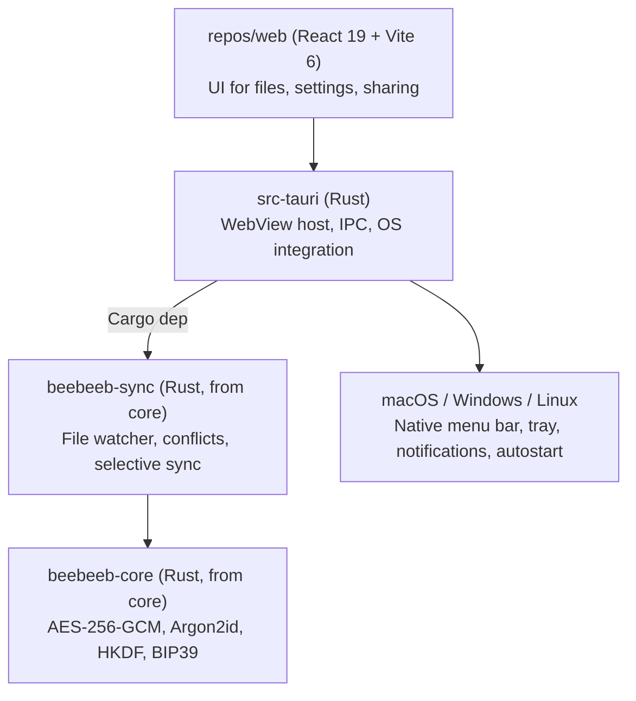

# beebeeb-io/desktop — task history archive

Created 2026-10-24 when `repos/desktop/CLAUDE.md` was distilled to evergreen rules only
(≤150 lines). This file is the pre-distillation `CLAUDE.md` preserved verbatim so that
nothing was deleted: every rule, ruling, incident narrative, proof reference and command
history survives here. `CLAUDE.md` now holds the evergreen distillation and points here
for the details of moved content.

---

> **Correction — 2026-09-29, task 1611:** The historical architecture/build
> descriptions below are retained for provenance, not current instructions.
> Shipping entrypoints are desktop-owned `src/main.tsx` and `src-tauri/src/lib.rs`;
> `runner.rs`, `engine_bridge.rs`, and `state_db.rs` own scheduling and sync.
> `repos/web` is not this frontend; core provides shared primitives.
> Run `bun run tauri:dev` / `bun run tauri:build` from the desktop root.
> macOS uses the active ~~`macos/FileProviderExtension`~~ `BeebeebFileProvider/`
> (path corrected on resume, 2026-09-29; built by `scripts/build-fileprovider-extension.sh`), Windows
> uses `src-tauri/src/windows_cf` (CFAPI), and Linux FUSE is an unmounted prototype.
> The legacy native-shell build recipes and Linux online-only claims below are
> historical. Spec 030 is historical and never authorizes raw keys in config.
> Credentials belong in the OS store; Linux currently fails closed.
> See [the current capability contract](docs/CAPABILITIES.md) for shell reachability and limitations.

# beebeeb-io/desktop

Beebeeb desktop app. **Tauri v2** shell around the web client (`repos/web`) plus the Rust sync engine from `core`. One codebase, three OS targets (macOS, Windows, Linux).

## Release status — Windows, Linux and macOS (Apple Silicon) released

**`desktop-v0.8.5`** (or later — check
https://github.com/beebeeb-io/desktop/releases/latest) **is published** for all three
platforms: MSI + NSIS installer for Windows (Authenticode-signed from `desktop-v0.8.8` onward),
AppImage/.deb/.rpm for Linux, and a
Developer ID signed + notarized `.dmg` for macOS (Apple Silicon only — Intel is not built),
each with a minisign `.sig` for the auto-updater.

> **Correction — 2026-10-01 (decision 1499, task 1617):** earlier revisions of this section said
> "signed MSI + NSIS installer for Windows". That was wrong: every Windows release through 0.8.7
> shipped **unsigned** (minisign updater `.sig` files are not Authenticode). `desktop-v0.8.8` is
> the first Authenticode-signed Windows release — Azure Artifact Signing, publisher
> `CN=Initlabs B.V.`, timestamped, enforced by `scripts/windows/verify-authenticode.ps1` in
> `release.yml`. See `docs/RELEASING.md` → "Windows Authenticode signing".

Windows updater manifests must preserve installer type. Fresh Windows installs are documented as
NSIS `setup.exe` installs, so publish `windows-x86_64-nsis` and the generic `windows-x86_64`
fallback to the NSIS asset, and publish `windows-x86_64-msi` to the MSI asset for MSI-installed
clients. Sending an NSIS-installed client to an MSI update creates a second Windows Installed Apps
entry instead of updating the existing NSIS entry.

`release.yml`'s build matrix still runs Windows and Linux only — **macOS builds locally, not in
CI** (commented out, not deleted). This is a deliberate route (task 1608), not a blocker: Developer
ID signing needs the private key in the `Developer ID Application: Devidee B.V. (R8352WDJJR)`
keychain identity, and that key is never exported to a CI secret. The remaining CI gap
(`scripts/build-fileprovider-extension.sh`'s arch-detection doesn't support
`TAURI_ENV_ARCH=universal`, needed for a real Intel+Apple Silicon universal build) only matters
once Intel support is undertaken. See `docs/RELEASING.md` → "macOS: local build, then backfill the
manifest": the procedure is ONE fail-closed command on the Mac,
`scripts/release-macos-local.sh <VERSION> <CHANNEL>` (build, notarize, staple, rebuild the dmg from
the stapled app, upload to the release the Windows/Linux build already created, run
`.github/workflows/sign-macos-updater-artifact.yml` for the one step that needs CI's
`TAURI_SIGNING_PRIVATE_KEY` secret, re-run `release.yml` with `publish_existing=true` to backfill
the manifest's `darwin-aarch64` entry, assert the manifest). The manual steps stay in that doc as
reference; `scripts/test-release-macos-local.sh` is its Linux-runnable test.

**Not yet verified:** a real install + close-to-tray smoke test on physical Windows hardware
(only build/sign/publish has been confirmed, from CI + local Linux verification — see below).

**Local verification:** on Linux, `bun run tauri build --target x86_64-unknown-linux-gnu --
--locked` reproduces the real build + `.deb`/`.rpm` bundling (needs `webkit2gtk-4.1`,
`libayatana-appindicator`, `patchelf`, `fuse2`, `fuse3`, and a `TAURI_SIGNING_PRIVATE_KEY` — a
throwaway local key via `bunx tauri signer generate` is fine for this, no need for the real prod
key). `.AppImage` bundling specifically cannot be verified on Arch/WSL2: the vendored
`linuxdeploy` tool's bundled `strip` binary is too old to parse the `.relr.dyn` ELF section
modern Arch shared libraries use, and ignores the `STRIP` env override — this does not reproduce
on GitHub's `ubuntu-latest` runners, so CI remains the source of truth for that one step. Windows
and macOS builds cannot be reproduced locally at all (no cross-compile path from Linux).

## Releases

Before cutting a desktop release, follow `docs/RELEASING.md`. The release workflow fails closed
unless the released commit contains a root `RELEASE_NOTES.md` whose contents mention the exact
semver value passed to the workflow; author and commit per-release notes before triggering it.
It (and `scripts/release-macos-local.sh`) also refuses while the root `RELEASE_BLOCKERS.md` lists an
item: one list item per thing that must be fixed before any release, removed by the change that fixes
it (`docs/RELEASING.md`, "Release blockers").

## Architecture



Why Tauri (not Electron): native OS WebView (~10MB binaries vs ~150MB), Rust backend that imports `beebeeb-core` directly, no Node runtime in production builds.

## Layout

```
desktop/
├── src-tauri/            Rust app (Tauri v2)
│   ├── Cargo.toml
│   ├── build.rs
│   ├── tauri.conf.json   App config (window, bundle, identifier)
│   ├── capabilities/     Permission grants per window
│   ├── icons/            Bundle icons (PNG, ICNS, ICO)
│   └── src/
│       ├── main.rs       Entry — calls into lib::run()
│       └── lib.rs        Tauri Builder, command handlers
├── src/                  Placeholder frontend (replaced by repos/web)
├── index.html            Vite entry
├── package.json          Dev/build scripts (bun)
├── vite.config.ts        Frontend bundler config
└── tsconfig.json
```

The `linux/`, `macos/`, `windows/` folders are pre-Tauri scaffolds (separate native shells per OS). They are kept for reference but the Tauri shell supersedes them — new work goes in `src-tauri/`.

## Build & run

Requires Rust stable, bun, and Tauri's per-OS prerequisites (https://tauri.app/start/prerequisites/).

```sh
bun install
bun run tauri:dev      # spawns vite on :5173, opens native window
bun run tauri:build    # produces .dmg / .msi / .deb / .AppImage
```

To develop against the real web client instead of the placeholder:
- Run `repos/web` separately (`cd ../web && bun dev`) on :5173.
- The Tauri window will load it automatically (`devUrl` in `tauri.conf.json`).
- For production bundles, the web client is built and copied to `../dist/` (or `tauri.conf.json` is repointed at `../web/dist/`).

`cargo check` from `src-tauri/` validates the Rust side without the frontend.

`Desktop CI` (`.github/workflows/ci.yml`) keeps the stable `Rust check (Windows)`
job name, but now runs both `cargo check --locked --all-targets` and
`cargo test --locked`. macOS retains its all-target check; Linux runs tests.
`python scripts/assert-cargo-test-counts.py --self-test` proves the count guard
rejects empty runs. To validate saved output, pass its path and
`--cargo-exit-code <actual exit code>`: each library/integration binary must
execute tests; only the entry-point `src/main.rs` harness and doctests may be
empty. CI uploads logs and exit codes as `rust-Windows`, `rust-macOS`, and
`rust-test-linux`. A Windows cross-check on Linux is not a native test pass.

## Key files

Task 1612's reusable test API and deterministic native-parity corpus are described
in [docs/NATIVE_PARITY_FIXTURES.md](docs/NATIVE_PARITY_FIXTURES.md). The test-only
`native_parity_tests::corpus` and `native_parity_tests::http_` filters respectively
exercise the socket-free fixtures and real loopback bridge requests. Neither is
proof of CFAPI/FUSE/File Provider execution; do not log fixture credentials.

- `src-tauri/tauri.conf.json` — identifier `io.beebeeb.app`, 1200×800 default window.
- `src-tauri/src/lib.rs` — `run()` builds the Tauri app and registers `#[tauri::command]` handlers. Add new commands here.
- `src-tauri/capabilities/default.json` — permissions the frontend can invoke. Add explicit permissions before exposing new tauri APIs.

## Current macOS integration state

**`docs/MACOS_BRINGUP_BRIEF.md`** is the historical bring-up plan written 2026-07-30, before any
credentials existed — every blocker it lists (Developer ID cert, provisioning profiles, the macOS
peer-credential IPC check) is now resolved; task 1608 (2026-09-29) shipped the first public macOS
release on top of it. Still worth reading for the Finder/File Provider deep-dive and the "what NOT
to do" list (still true); for the actual release procedure use `docs/RELEASING.md` instead.

macOS is the first desktop product target. Keep cross-platform logic in Rust
where possible: auth/session handling, crypto, sync, queueing, conflict/version
logic, cache policy, and API protocol code belong in `src-tauri` or shared Rust
crates rather than being duplicated in the frontend.

Current release identifiers:

- App bundle id: `io.beebeeb.app`
- File Provider extension id: `io.beebeeb.app.FileProvider`
- File Provider domain id: `io.beebeeb.app.domain`
- App group: `R8352WDJJR.io.beebeeb.app.fileprovider`

**The extension logs only through `ExtensionLog`** (`BeebeebFileProvider/ExtensionLog.swift`, one
`os.Logger`, subsystem `io.beebeeb.app.FileProvider`). Never `NSLog`: on macOS 26 every `NSLog` line
of the extension reaches the unified log as `<private>`. A new line is a function in `ExtensionLog`
whose public values are closed (a fixed word, a bitmask, a UUID, an `NSError` domain and code), never
a path, a file name or an error's text; ~~`extension_log_pin` (`src-tauri/src`) fails otherwise~~. Rule:
`docs/IPC_PROTOCOL.md`, "Logging". What `extension_log_pin` (`src-tauri/src`) checks, in every
`BeebeebFileProvider/*.swift` (lines that begin with `//` skipped): no call of `NSLog`, `NSLogv`, `os_log`,
`print` or `debugPrint`, bare or qualified by `Foundation.`, `Swift.`, `os.` or `OSLog.`; no `Logger` or `OSLog`
built (bare, `.init`, module-qualified) and no `logger.` outside `ExtensionLog.swift`; exactly one `Logger` in
`ExtensionLog.swift`, its subsystem equal to the build script's `BUNDLE_ID`; every interpolation there says
`.public` or `.private`, and a `.public` one is one of ~~nine~~ eight listed names (a write's `request_id` prefix is
`.private` since the final review). It matches text, so it cannot see what a
public name is bound to, a call with a space or line break before its parenthesis, a log function passed by
reference, or output that is not a log call. — lead, 2026-10-11 (device fix round)

The active Finder/File Provider blocker is Apple provisioning/profile
entitlement mismatch. Both the containing app and extension profiles must
include the exact app group above. Do not mask this as a UI timeout or switch to
a fake local folder root; fix signing/provisioning first.

The Tauri warning that `io.beebeeb.app` ends in `.app` is known. Keep this
identifier unless Guus creates a new macOS App Store Connect record and chooses
to migrate. Expo is unrelated to desktop builds; it only applies to mobile.

**Removing the Finder location keeps un-synced files (task 1882, P0).** Every
`NSFileProviderManager` domain removal (sign-out, Repair, ~~the Add-to-Finder
rollback,~~ every other removal the Finder reconciler makes, the app-start sweep,
`BeebeebFileProviderCtl remove`) passes
`NSFileProviderDomainRemovalModePreserveDirtyUserData`; never add a plain
`removeDomain:`/`remove(domain)` or `removeAllDomains`. The source pin
`test_1882_every_domain_removal_in_the_repo_keeps_unsynced_files`
(`src-tauri/src/finder_removal.rs`) scans every `.m`/`.swift` file and fails on
one. macOS reports a folder even when it kept nothing (device, 2026-10-10), so
the bridge checks it on the returned URL (`BeebeebKeptFolderState`): only a folder
that exists and holds at least one entry (or that the sandbox will not let it
list) reaches the person, and never the logs: an alert (sign-out, ~~add rollback,~~
a reconciler removal nobody waits for, sweep; drawn by macOS's UserNotificationCenter, not a
Beebeeb window) plus a row in
Settings → Sync until dismissed (`kept_unsynced_folder` in `desktop.toml`; commands
`kept_unsynced_folder` / `dismiss_kept_unsynced_folder`, which returns
`{ cleared, current }`). Writes to `desktop.toml` take the one config-write lock in
`config.rs`. Task 1889: `DesktopConfig` has no `save()`; the file is written in one place,
`try_update_at_then`, which holds the lock across the read, the change and the write, so a writer cannot put
back a copy it loaded earlier. The ways in are `update_at` (or `update`, `update_held`, `ensure_account_id`,
which are `update_at`), `try_update_at`, `update_at_then`, and `update_at_durable_with`, the one save that
flushes its write (the keep step's, task 1887). A flow
that keeps a copy to READ across slow work (the Windows and Linux install and Repair commands) writes through
`copy.update_held(|held| …)`, which applies the change to the file as it is now and then refreshes the copy.
A settings write (`set_desktop_config`) is merge-only: the six speed, pause and notification fields are options like
`sync_mode`, and a field the window leaves out keeps its value on the file, so a Settings window never sends back the
whole object it read on open (it would undo a pause made from the tray meanwhile). Every sender writes only what changed
(`tests/settingsWriteOnlyChangedFields.test.tsx`). The in-memory pause flag follows the file under the same lock
(`persist_sync_paused_at`, `rehydrate_sync_paused`). A flow that holds a copy holds a `HeldConfig`, which is read-only
(no `DerefMut`).
Nothing inside an update closure may call another update (the lock is not re-entrant). The pins are
`test_1889_*` in `config.rs`, `finder_removal.rs` and `lib.rs` (`config_write_pin_tests`). The 1882 source pins
read through `lf()`/`slash()` in `finder_removal.rs`, so they run on a Windows checkout
(CRLF text, `\` paths). Spec: `docs/specs/2026-10-09-macos-removal-keeps-unsynced-files.md`.
Correction: a Mac has no Add-to-Finder rollback. Since spec A (R5) the reconciler adds Beebeeb and
never removes a domain it added. Windows and Linux keep `install_finder_location`'s rollback, where
there is no File Provider and nothing is kept. — lead ruling, 2026-10-10 (rebase onto spec A, Q1)

**A sign-out keeps waiting Finder saves (task 1887).** On macOS `clear_session` gates on an ask snapshot
(`sign_out_count`), and refuses with `unsent_changes:` while changes wait and the person was not asked. Settings ›
Account sends first (`sign_out_send_start`, at most 60 s, Rust-owned, a third wake in the runner's loop), then asks.
On "Sign out" the keep step closes Finder accepts, copies every waiting save into
`<container>/Data/Documents/Changes not sent/<date at time>/` with `clonefile` (never overwriting), and records it
durably in `desktop.toml` (`kept_unsent_folder`, `kept_unsent_unfinished`) before the purge, whose guard refuses
before any deletion unless every waiting write was kept. One alert names our folder and macOS's; Settings › Sync
shows our row with Show in Finder and Dismiss. Closing Settings ends the flow; a late result is shown in the native
dialog. Windows and Linux are unchanged. Spec: `docs/specs/2026-10-10-macos-sign-out-waiting-writes.md`.

### Finder setup reconciler (spec `docs/specs/2026-10-06-macos-finder-setup-reconciler.md`)

On macOS nobody installs the Finder location any more: there is no install button, and no macOS code
path calls `install_finder_location`, `continue_without_finder_location` or `finder_domain_user_enabled`
(they stay registered for Windows and Linux). One Rust task in `src-tauri/src/finder_setup/`
keeps Beebeeb in Finder: a pure `core` (the state machine of spec §5), a pure `policy`
(classification by NSError domain + code only; retries at 0/5/15/45 s), a pure `launch_location`,
and one `driver` task that runs one `NSFileProviderManager` call at a time through
`macos/FileProviderBridge.m`, which returns structured `(domain, code, message, underlying)` errors.
Triggers: launch (after the startup restore), keys arriving (`apply_session`,
`desktop_unlock_with_recovery_phrase`, `unlock_vault`, and `reauth_in_place`: a same-account re-sign-in
that loads the key from the Keychain), "Try again", and the userEnabled flip.
Sign-out removes the domain and holds until the next sign-in. Repair removes, then checks once, so a
signed-in Mac ends with Beebeeb back in Finder. A revoked session keeps Beebeeb in Finder (R2).
Lock cancels a running check and never removes. Surfaces read `finder_setup_state` (through
`src/finderSetup.ts`) and listen to `finder-setup-changed`; the same hook reads `sync_status.engine_refusal`
on load and on every event, so a refused engine start names its own cause. A loaded `Missing` is a quiet
row (no pill, no activity, one sentence). All copy lives in `src/finderSetupCopy.ts`.

**Launch rule.** `launch_location` classifies where the app runs from: a path containing
`/AppTranslocation/` is `translocated`; a bundle directly at `/Volumes/<name>/` is `disk_image`; an
Applications folder anywhere, including one on another disk, is `applications`; anything else is
`elsewhere`. `translocated` and `disk_image` report `not_in_applications` and never call add;
`applications` and `elsewhere` proceed and macOS decides (a -2002 is still classified). The result is
in `finder_setup_state` before anyone signs in.

**Lifecycle log.** From the app's point of view it is `~/Library/Logs/Beebeeb/lifecycle.log`. The app is
sandboxed, so on disk it is `~/Library/Containers/io.beebeeb.app/Data/Library/Logs/Beebeeb/lifecycle.log`:
1 MB × 3 files, a closed vocabulary of typed events, redacted NSError text, and **not** a `tracing`
sink. It holds no user content, so it survives sign-out. "Copy details" and the support bundle include
its last 200 lines. Whether Console.app lists this file is not verified yet: device check D0 records
the answer, so do not tell anyone to look for it there.

**Correction — 1698.** The `DOMAIN_IDENTIFIER` comment in `macos_file_provider.rs` claimed the zombie
`io.beebeeb.desktop.FileProvider` domain owned `Beebeeb-Drive` and that a signed context could sweep it.
Both claims were wrong. Its folder is `Beebeeb-Beebeeb`, and `getDomains` returns only the calling
provider's domains, so our stale-domain sweep cannot see another provider's domains. Renaming our
domain to "Beebeeb" made it collide with that folder. A pre-rename `io.beebeeb.desktop` domain on a dev
Mac (any Mac that ran a build from before 18 May) is cleared once by a one-off helper (spec §11), not
by the app.

### Opening Finder from the sandboxed app (task 1885)

Nothing a Mac compiles starts `/usr/bin/open`. A child process inherits the App Sandbox but not the extension on
the URL macOS handed the app, so LaunchServices refused `~/Library/CloudStorage/Beebeeb-Beebeeb` with -54 while
`spawn()` had already answered `Ok`: "Open in Finder" did nothing and reported success. The bridge now keeps the
security-scoped URL from `getUserVisibleURLForItemIdentifier` (NSFileProviderManager.h:103-128, :120-121 for the
scope) and opens it in this process. The work is two halves: a GATED resolve (`beebeeb_fp_resolve_location` /
`beebeeb_fp_resolve_item`, under the shared bridge gate) returns the URL as a retained handle; Rust drops the gate
(`finder_setup::macos_ports::resolve_then`); then an UNGATED call takes the handle: `beebeeb_open_scoped_url` (Open in
Finder) waits for `NSWorkspace openURL:configuration:completionHandler:` (NSWorkspace.h:39-40) and returns its error,
`beebeeb_reveal_scoped_url` (Show in Finder; the item's File Provider identifier is its state-db file id) selects the
item with `activateFileViewerSelectingURLs:` (NSWorkspace.h:53, `void`: the bridge proves the item resolved and
exists, not that Finder drew a window). The gate is not held across the open because a sign-out's removal waits only
3 s for it and is never retried. The scope is stopped once, in the completion handler or by a 60 s safety timer.
`beebeeb_open_url` opens System Settings (no gate: it must work when the File Provider is stuck). Each answer is the
command's result (`finder_open::finder_open_outcome`, domain and code only), so a failure is the existing one-sentence
toast; the menu's "Open in Finder" shows the same sentence in a native alert (`show_menu_open_failure`, there is no
window to put a toast in). A Mac never asks the File Provider about a shared-with-me row (ruling 1701: webapp-only):
`open_in_finder` refuses it by namespace before any bridge call, and quick search results carry `shared_with_me` and
drop those rows on a Mac. The commands are `async` on the blocking pool (the resolve waits up to 3 s for the gate and 2 s
for macOS, the open up to 5 s for LaunchServices); the upload and new-folder fallbacks open in the background. A
success that arrives after the 5 s limit still opens the window after the caller was told it failed (no API cancels an
open). The pins are `test_1885_*` in `src/finder_open.rs`, `macos_workspace.rs`, `macos_file_provider.rs` and
`finder_setup/macos_ports.rs`; the two tests that ask the real `NSWorkspace` are `#[ignore]` (they need a GUI session;
run `cargo test --lib -- --ignored test_1885`). Windows and Linux keep `explorer` and `xdg-open`. The device rung (5 of 5
opens, button and menu, during the Ready poll, on a signed QA build) is the lead's.

### Re-sign-in in place (ruling R8)

"Sign in again" on macOS opens sign-in in place (`open_reauth_window`); nothing is cleared first.
`desktop_login`, `desktop_login_2fa` and the browser handoff compare the account signing in with
the recorded owner of the local data (`src-tauri/src/reauth.rs`, R10). The same account swaps only its
session token: keys, cache, queue and Finder stay, and the queue uploads afterwards. Only an account
switch purges: another account gets the switch warning (with the pending-change count), then a full
sign-out, then a fresh sign-in. A startup 401 drops only the revoked token on macOS/Linux. Windows
keeps today's flow.

### Local data belongs to one account (R10)

Local data is bound to the account that created it; a different account never reuses it. `state.db`
records the owner (`owner_user_id`, `owner_email` in `sync_state`). Every engine start goes through
`spawn_bound_engine`, which runs `account_binding::bind_before_engine_start` first: the same account
keeps everything; another account's data, or data with no recorded owner, is reset before anything
starts (Windows refuses instead); an owner that cannot be compared stops the start. A failed reset or
sign-out purge stops. Keep every engine start behind `spawn_bound_engine`:
`every_engine_start_is_bound_first` counts them.

## Browser sign-in (`src-tauri/src/browser_login.rs`, task 1734)

The first-run "Sign in with browser" handoff opens `<APP_URL>/cli-auth` and shows the device code in the app. The link carries NO code: the person TYPES the code on the page and confirms with their password, so a link someone else sends them has nothing to approve (security review 2026-10-04, finding 9). The WS init frame (`init_frame`) adds `client: "desktop"`, the release version, `os` and the hostname for the page to show as "reported by the device"; the screen copy lives in `src/browserLoginCopy.ts` (tested by `tests/browserLoginCopy.test.ts`). The decrypt path is unchanged.

## Adding commands (Rust → JS bridge)

1. Add a `#[tauri::command]` function in `src-tauri/src/lib.rs`.
2. Register it in the `invoke_handler!` macro.
3. Call from JS: `import { invoke } from "@tauri-apps/api/core"; await invoke("my_cmd", { arg })`.
4. If it touches an OS API (fs, dialog, notification…), add the matching permission to `capabilities/default.json`.

## API client (`src-tauri/src/api_client.rs`)

Every request the daemon's `ApiClient` sends — and every ad-hoc `reqwest::Client`
the Tauri commands in `lib.rs` build for one-off auth calls (`desktop_login`,
`desktop_login_2fa`, `desktop_confirm_action`, `desktop_storage_summary`) —
carries `X-Beebeeb-Client: desktop` and `X-Beebeeb-Client-Version: <version>`,
set as `default_headers` via `api_client::provenance_headers()` (task 1436, the
desktop half of 1392; mirrors the CLI's `build_client` from cli PR #14). The
server records both on every `object_versions` row (server PR #23 / task 1369)
for writer-provenance queries.

The version sent is `BEEBEEB_RELEASE_VERSION` (set by release.yml; same string
`real_app_version()` shows in Settings and compares against update manifests),
falling back to `CARGO_PKG_VERSION` for local/dev builds — **not** the raw Cargo
package version alone, since Cargo.toml's `version` is pinned at `0.1.0` and
never bumped for releases (unlike the CLI, which has no separate
release-version indirection and sends `CARGO_PKG_VERSION` directly).

## Sync engine

`src-tauri` is expected to own the background Rust sync runtime and call shared
core/sync logic instead of duplicating protocol behavior in TypeScript.
Conflict resolution policy: never silently drop a version — default `KeepBoth`
(rename loser as `file (Device, HH:MM).ext`). File watcher debounce: 100ms.
The backend must create a new server version for Finder writes when the server
versioning contract supports it.

Uploads resume instead of restarting (flow 7): when `POST /uploads/init` returns, the op's
session (`upload_session_id`, server `file_id`, chunk plan) is persisted in the `upload_resume`
table (keyed by `op_id`, fingerprinted by staged-payload path + size + mtime) and the
acknowledged-chunk watermark advances after every 2xx chunk PUT. A retry resumes from that
watermark; a changed payload, a gone session (400/404/410), or a given-up op abandons it —
a create's orphaned `is_uploading` server row is trashed, a replace's never is. Snapshot rows
still `is_uploading` and unknown locally are not materialised as placeholders.

One exception, for macOS Finder writes (uploads with a `write_id`): once `complete` has
answered, the op records the server's completion in `upload_resume` (`completed_version`,
`completed_object_version_id`, `completed_mime_type`) before any local bookkeeping, and from
then on it is never abandoned, paused or parked, at give-up either. It retries only its local
landing, which is one transaction (spec `docs/specs/2026-10-09-macos-finder-write-versions.md`
§8.6). Those writes also carry a write token as their content version, are claimed and landed
under `StateDb`'s one-transaction rules, and hand over to the next save when they park: see
`docs/IPC_PROTOCOL.md`, "Versions and queued writes". Windows and the watcher are unchanged.

Windows local-create completion keeps a separate `upload_finalizations` journal
(local/server identity, target, completed payload, stamped acknowledgement).
The queue/resume rows stop owning uploads once this journal is committed; native
sharing/identity failures retain the payload and retry locally on watcher events,
periodic ticks and before sign-out preflight. The completed proof is removed only
after identity stamping succeeds. `scripts/test-recovery-transition.py` exercises
the exact recovery command with a held verifier and queued installation race;
Cargo also tests the real auth-attempt cancellation and source wiring.

Advanced desktop settings live in `DesktopConfig` (`desktop.toml`). `theme` is
`light` / `dark` / `system` and is applied in the WebView through CSS variables.
`local_cache_limit_bytes` is a per-device file-content cap over pinned plus
unpinned cached bytes; `0` means Unlimited. Cache enforcement derives the
evictable budget as `cap - pinned_bytes`, evicts least-recently-accessed
non-pinned cache entries first, and never auto-evicts pinned content.

## Auto-update signing

Tauri's updater verifies update bundles with minisign. The keypair was
generated with `bunx tauri signer generate -w ~/.tauri/beebeeb-desktop.key`
on 2026-05-07.

- **Public key** lives in `src-tauri/tauri.conf.json` under
  `plugins.updater.pubkey`. Safe to commit; it's the verification key.
- **Private key** lives at `~/.tauri/beebeeb-desktop.key` on the build
  machine, mode `0600`. **Never commit it.** It's not in any `.gitignore`
  because it's not in the repo — it sits in the user's home dir.
- The key was generated **without a password** for initial pre-launch
  setup (the `-p ""` flag). Before public release, regenerate with a
  strong password, update the pubkey in tauri.conf.json, and rotate the
  CI secret. Track this work in `.claude/tasks/` if not already.

**For CI** (GitHub Actions, EAS, etc.) building signed updates:

- `TAURI_SIGNING_PRIVATE_KEY` — the *contents* of `~/.tauri/beebeeb-desktop.key`,
  set as a repository secret (not the file path)
- `TAURI_SIGNING_PRIVATE_KEY_PASSWORD` — the password if the key has one;
  unset for the current passwordless setup

To inspect the public key locally: `cat ~/.tauri/beebeeb-desktop.key.pub`.
The fingerprint at time of generation is `545D7BA77EDEA7E1`.

If the key is lost, no clients with already-installed builds can verify
new updates — they'll need a manual reinstall to onboard the new pubkey.

## Storage location (task 1919, by COUNTRY since task 2050)

Guus, 2026-10-19: a storage location is a COUNTRY, never a city (cities together identify the hosting
provider; `docs/canon/data-residency.md` in the workspace). "Europe" is the default: any of our European
data centers, the server places the data. Below it the person can pick one live country (Germany,
Finland); a coming-soon country (the Netherlands) is listed and cannot be picked. While a country is
chosen, "Only store in <country>" is a switch (task 1952): when that country cannot take a new file the
upload stops instead of going to another EU country. The switch carries to another country and ends on Europe.

The rows are the API's: `GET /api/v1/me/region` returns `choices` (the same array as the public
`GET /api/v1/storage-regions`: ids `europe` / `de` / `fi` / `nl`, `kind` `region` or `country`, `name` the
country) and `region_strict`. `account_region` carries them to the UI and `account_set_region` sends the row's
`id` verbatim with `regionStrict` stated. The desktop keeps NO list, city or country table; it renders `name`,
`status` and `selectable` as sent, so a country the server adds or retires changes the rows with no desktop
release. **No city is decoded at all**: `StorageChoice` and `RegionInfo` (Rust) have no `city` field, the
server's deprecated `city` / `example_city` keys are ignored by serde and absent from the IPC, and
`tests/noCityInCopy.test.ts` fails on a city name or a read of a `city` field anywhere in `src/` and
`src-tauri/src/` (comments and `#[cfg(test)]` items excepted; it is proven red on the code before 2050 with
`GUARD_ROOT`). An OLDER server (task 1919) sends one `kind: 'datacenter'` row per datacenter: the model folds
those into one row per country (`foldChoices`; a datacenter with no country is dropped) and a stored `fsn1`
still selects the Germany row. A server without `choices` falls back to its one-entry-per-continent list.
Uploads send no region (the server reads the stored preference). One hook, `src/windows/useDataResidency.ts`,
serves both the Windows/Linux Settings panel and the macOS Settings window (Account tab).
Not built: a dedicated desktop message for the 409 `region_unavailable_strict` upload refusal (the engine
keeps its generic refused-upload handling; the server's own message names the country).
Verify against a local API built from server PR #251: `cargo test --lib real_api_region -- --ignored --nocapture --test-threads=1` with
`BB_REAL_API_BASE`/`BB_REAL_API_TOKEN` (scratch HOME), and `tests/render-region-live-api.mjs` for the UI. The
mocked-IPC browser run is `tests/render-location-by-country.mjs`.

## Brand

- Icons: amber rounded square with lowercase `b` (`icons/icon.png`). Replace with the production icon set via `bunx tauri icon path/to/source.png` once ready.
- App name: "Beebeeb". Identifier: `io.beebeeb.app`.

## How we work (evidence, design, done, parallel agents)

The full rules live in the workspace `CLAUDE.md` → "How we work" (also summarised in the workspace `AGENTS.md`). Read them; they apply here. The repo-specific instantiation:

- **The count-shaped truth line:** `cargo test` in `src-tauri/` → per-binary
  `test result: ok. N passed; 0 failed`; `bun run tauri build … -- --locked` asserts the exit code
  and the bundle files on disk (`ls` them, paste the listing).
- **"Cannot be done here" is the normal state of this repo:** macOS signing/notary, Windows
  installers, and Finder/File Provider need hardware and credentials this session may not have.
  Route each to `.claude/tasks/decisions/` with the specific question; never fake a local folder
  root or a UI timeout to make a gate pass (rule already above).
- **A release is verified by `RELEASE_NOTES.md` naming the version AND the workflow run being
  green AND the manifest resolving** — three counts, not one adjective.

## Graphify

This repo has a knowledge graph at graphify-out/.
- Before exploring code, read graphify-out/GRAPH_REPORT.md for module structure and relationships.
- After modifying code, run `graphify update .` and commit the updated graphify-out/.
- The graph tracks modules, functions, types, and their relationships.
- `graphify query "<question>"` to ask questions about the codebase.
- `graphify path "<A>" "<B>"` to find connections between two concepts.

## Keep shared docs in sync

When you add/change/remove endpoints, types, build commands, or dependencies: update the relevant skill file in `/Users/guuslangelaar/Development/Beebeeb/beebeeb.io/.claude/skills/` (beebeeb-api.md, beebeeb-designs.md, beebeeb-stack.md, beebeeb-dev.md). Other agents depend on these being accurate.

---

<a id="two-surface-slice-1"></a>

## Two-surface slice 1: the Beebeeb window (task 1683, PR #134)

Added 2026-10-25 when PR #134 merged main's distillation. `CLAUDE.md` keeps the evergreen rules ("macOS window
rules"); this is the slice's narrative as it stood in `CLAUDE.md` on the branch.

A Mac builds one app window, label `main` (`src/MacApp.tsx`, `?window=main&platform=macos`), declared alone in
`tauri.macos.conf.json` (`create: false`, 920 × 620, minimum 760 × 520, overlay title bar); the macOS file replaces the
shared window list, so `tray`, `windows-onboarding` and `main-app` are never built on a Mac, and the old
`macos-settings` window is gone everywhere. Settings is a mode of `main` in System Settings style: the gear, ⌘, and the
menus swap the one sidebar for the Settings list (back control, account row, General, Sync, About; Security is slice 5),
and the pane hosts the section bodies of `src/MacSettings.tsx` unchanged. Every opener goes through
`show_main_window(app, MainNav)` in `lib.rs`: it stores ONE pending request, emits `main:navigate`, and the window pulls
it with `consume_main_navigation` (also once when it mounts). `src/mainWindowModel.ts` `navigate` is the only place a
request becomes a view; while a sheet is open nothing navigates, and the window's `main_window_state` makes Rust disable
View › Home, View › Back, Settings… and Check for Updates… (§8.2). Closing `main` destroys it
(`surfaces::policy::close_policy`) and the app keeps running (`keep_running_on_exit_request` in the run loop); opening
the app again (`RunEvent::Reopen`) brings it back, and every opener unhides the app first; every
other label still hides. A Mac does not run the window-state plugin (it stores physical numbers without their scale,
wrong on a mixed-DPI desk): `save_main_window_frame` keeps `main`'s frame in logical points in
`main-window-frame.json` (never a full-screen or zoomed one), and `place_main_window` plans from it, centring on the
menu-bar icon's display and re-centring a frame less than half on screen (`surfaces::window_state`). The Dock
icon follows `surfaces::policy::dock_icon_wanted` (`main` while it exists; onboarding and conflict windows while shown).
The macOS menu is `MACOS_MENU_SPECS` + `MACOS_MENU_LAYOUT` (Windows and Linux keep `DESKTOP_MENU_SPECS`). 1887's sign-out
flow owner is `main`. Until slice 3 the tray click still shows the compact flyout (label `settings`,
`surfaces::policy::compact_window_label`); until slice 2 sign-in is still the `onboarding` window, which the signed-out
card in `main` opens. Tests: `tests/mainWindowModel.test.ts`, `tests/macApp.test.tsx`, `surfaces::{policy, registry,
window_state, config_tests}`, `main_window_tests` in `lib.rs`; Chromium: `tests/render-mac-app.mjs`.
