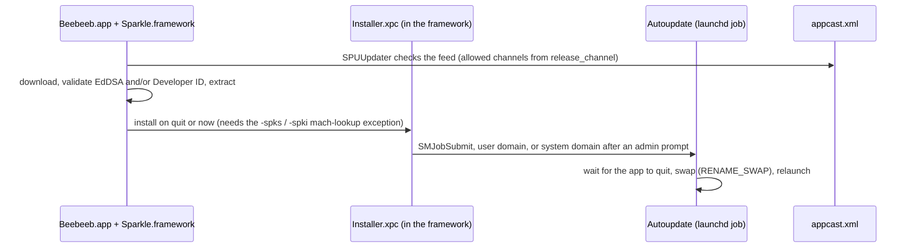

# 2026-10-25 — macOS: how a sandboxed Beebeeb updates itself (task 2176, research spike)

**Status:** research for the lead's decision. No product code. It ends in one recommendation (§9); the lead decides from it.
**Date:** 25 Oct 2026
**Repo:** desktop. macOS only. Windows and Linux keep `tauri-plugin-updater` unchanged.
**Task:** 2176 (P1). Decision of 24 Oct 2026 22:47 (task file, "Decision (lead)"): option 3 ("Download update") now, then this spike,
"read-only, no code", comparing (1) a non-sandboxed install helper shipped in the app with (2) Sparkle 2's sandboxed installer
launcher wired into Tauri. The comparison covers notarization and entitlements, signing keys, release-script changes, failure
modes and effort in days.
**Read at:** desktop `origin/main` `41a7da18` (25 Oct 2026), plus the `macUpdateCopy.ts` module of PR #140. Third-party code was read
on its `2.x` branch the same day.

How to read the evidence. Every claim is tagged: **[src]** read in a primary source (listed in §10, with what each one was used for),
**[repo]** read in this repository, **[inferred]** my reasoning from those, **[device]** something only a real Mac can answer (§8
turns each one into a small experiment). Quoted lines were returned by a page-fetch tool that summarises pages; re-read the linked
page before relying on any single line. Nothing in this document was run on a Mac.

## 1. What fails today, and why

**What a person sees** (task 2176, on this Mac, 24 Oct 2026, 0.8.11 → 0.8.12): the offer works ("Version 0.8.12 is available"),
"Restart to update" downloads 12,521,406 bytes and then says "Update install failed. Install failed: Failed to move the new app
into place." The bundle stays 0.8.11 and verifies. The kernel log shows two denials [repo, task file]:

- `Sandbox: beebeeb-desktop(74725) deny(1) file-write-unlink /Applications/Beebeeb.app`
- `Sandbox: beebeeb-desktop(74725) deny(1) authorization-right-obtain system.privilege.admin`

**Why, in code** [src, `tauri-plugin-updater-2.10.1/src/updater.rs`, the macOS `install_inner`, lines 1217–1307]:

1. The tarball is extracted into a temp dir (1217–1245). The signature was already verified over the whole download, before any
   extraction (`download()` calls `verify_signature` at line 712, minisign).
2. The running bundle is `rename`d into a second temp dir (1255). On `PermissionDenied` the code falls back to AppleScript
   `do shell script "rm -rf '{src}' && mv -f '{new}' '{src}'" with administrator privileges` (1274).
3. Otherwise it removes whatever is left at the destination and `rename`s the new bundle in (1296–1302), then runs `touch` on it.

The App Sandbox (`com.apple.security.app-sandbox`, `src-tauri/entitlements.plist` [repo]) blocks both the rename of
`/Applications/Beebeeb.app` and the admin authorization. It fails for every sandboxed build wherever it is installed (the QA debug build
failed the same way from `/Users/Shared`) [repo, task file].

Two things about this code matter later:

- **It has no rollback.** Both temp dirs are `tempfile` directories that are deleted when they are dropped. If the second `rename` failed
  after the first had succeeded, the function would return the error and both copies would go with it [inferred from the code and from
  `TempDir`'s drop behaviour; never seen].
- **It swaps while the app runs** and relies on the caller to restart straight away (`install_update` calls `app.restart()` [repo]).
  That is acceptable for the Tauri updater's unsandboxed users and is what option A below would copy (§4.2).

**What still works:** the check. The stable manifest's `darwin-aarch64` entry drives "is there an update" correctly on a real 0.8.11
[repo, task file]. After PR #140 and the follow-up that finishes option 3, every Mac surface says "Download update" and no code path
tries an in-place install [repo, PR #140 and branch `feat/2176-mac-update-download`].

## 2. What any mechanism must satisfy

Each requirement is a fact about this app, with where it comes from.

| # | Requirement | From |
| --- | --- | --- |
| R1 | Works under the App Sandbox: the host app is sandboxed, with `application-groups` (`R8352WDJJR.io.beebeeb.app.fileprovider`), `files.user-selected.read-write`, `network.client`, `network.server` | `src-tauri/entitlements.plist` [repo] |
| R2 | Developer ID signed and notarized; every nested executable signed with the hardened runtime and a timestamp | `scripts/build-fileprovider-extension.sh` 165–193, `scripts/macos-release-preflight.sh` 176–200, `docs/RELEASING.md` steps 3–8 [repo] |
| R3 | The File Provider extension (`PlugIns/BeebeebFileProvider.appex`), its helper (`MacOS/BeebeebFileProviderCtl`) and `embedded.provisionprofile` arrive intact | `src-tauri/tauri.conf.json` 99–103 [repo] |
| R4 | A failure is explainable: no silent "Failed to move the new app into place"; on any refusal the person gets "Download update" | task 2176; PR #140 [repo] |
| R5 | No third window: updates are shown on the two surfaces (popover row, Settings › About), not in a framework's own window | two-surface spec §1 item 1, §6.3, §7.8 [repo] |
| R6 | Never swap or relaunch while Finder saves wait or a sign-out is in flight | specs 2026-10-10 (1887), 2026-10-09 (1882) [repo] |
| R7 | Keep the stable / beta / alpha channels, and keep a path to a channel downgrade (spec E27) | `desktop.toml` `release_channel`, `install_channel_downgrade` [repo] |
| R8 | macOS 14 and later, Apple Silicon | `tauri.conf.json` `minimumSystemVersion` 108; docs/RELEASING.md [repo] |
| R9 | The Mac release stays one command on a Mac, and no private key is exported: the minisign updater key has lived only as a CI secret since 2026-09-25 | `docs/RELEASING.md` 175–245, `sign-macos-updater-artifact.yml` [repo] |
| R10 | The bundle identifier `io.beebeeb.app` ends in `.app` | `tauri.conf.json` identifier [repo]; matters for Sparkle, §5.7 |

A requirement the task file implies and nobody has written down: the data a person cares about lives in the container
(`~/Library/Containers/io.beebeeb.app/Data/…`: the lifecycle log, and the 1887 "Changes not sent" folders) [repo, `CLAUDE.md`]. This is
why §6 rejects "drop the host's sandbox".

## 3. The mechanisms both options stand on

**Apple**

- A sandboxed app cannot do what the sandbox forbids, and a child process it starts inherits the sandbox [inferred, standard; the
  evidence here is the denial lines above]. Apple's own answer for a directly distributed app is a **non-sandboxed XPC service**: "move
  that code to a non-sandboxed XPC service, then have the main app request that the XPC service perform the operation on its behalf" (Quinn, Apple DTS, "The Case for Sandboxing a Directly Distributed App", March 2025) [src S8]. The same post says temporary exception
  entitlements are fine in a directly distributed app: "Using them in a directly distributed app is not a problem."
- An XPC service is a bundle in the app's `Contents/XPCServices`; "XPC services are managed by `launchd`, which launches them on demand,
  restarts them if they crash, and terminates them (by sending `SIGKILL`) when they are idle"; "an XPC service is private, and is available
  only to the main application that contains it"; "Elevating a service's privileges to root is not supported" [src S7].
- Mach services a sandboxed app may look up: either a `com.apple.security.temporary-exception.mach-lookup.global-name` entitlement for each
  name [src S6], or a service whose name is a child of an app group the app holds, which Quinn calls "the canonically correct way to manage Mach service names … in a sandboxed app"
  (thread 808940; he recommends it over an exception for an App Store app, and calls exceptions "a reasonable option" when "you're not targeting the Mac App Store")
  [src S10]. This app already holds the group `R8352WDJJR.io.beebeeb.app.fileprovider` [repo], so a named service
  `R8352WDJJR.io.beebeeb.app.fileprovider.<name>` would qualify without a new entitlement [inferred from S9/S10; **[device]**].
- `SMAppService` (macOS 13+) registers helpers that live inside the app: plists in `Contents/Library/LaunchAgents` or
  `Contents/Library/LaunchDaemons`, with `BundleProgram` pointing at the executable. "Launch daemons require authentication by the
  user because the user is authorizing a system level-process"; each helper has a switch in System Settings › Login Items [src S4, S5].
- launchd: "When a job dies, launchd kills any remaining processes with the same process group ID as the job" unless
  `AbandonProcessGroup` is set [src S11]. So a process an XPC service starts does not reliably outlive the service.
- `SMJobSubmit` is deprecated since macOS 10.10 [src S12].
- `NSXPCConnection.setCodeSigningRequirement(_:)` lets a service accept only a client with a named signature; macOS 13+
  (the reference page is thin; the version comes from Apple forum posts) [src S24].

**Sparkle 2** (2.10.0, 13 Sep 2026; requires macOS 12 or later; GitHub reports the licence as "Other" and about 9,900 stars) [src S19, S20]

- Sandboxed apps: Sparkle 2 ships `Installer.xpc` (required) and `Downloader.xpc` (only if the app has no network client entitlement)
  inside `Sparkle.framework`. Info.plist `SUEnableInstallerLauncherService = YES`. Entitlement
  `com.apple.security.temporary-exception.mach-lookup.global-name` with `$(PRODUCT_BUNDLE_IDENTIFIER)-spks` and
  `$(PRODUCT_BUNDLE_IDENTIFIER)-spki` [src S13]. Sparkle checks that its XPC services sit "in the Sparkle framework, not in the
  application bundle" [src S18, `SPUUpdater.m`].
- How the installer leaves the sandbox: `SUInstallerLauncher` starts `Autoupdate` as a launchd job with `SMJobSubmit` ("the only way to
  submit a non-permanent helper and allows us to submit to user domain without requiring authorization"), in the user domain when
  the bundle and its parent are writable by the user, otherwise in the system domain after an administrator prompt
  (`AuthorizationCopyRights` with `kAuthorizationRuleAuthenticateAsAdmin`) [src S18, `SUInstallerLauncher.m`].
- The swap: `SUPlainInstaller` stages the new app on the destination volume, then `swapItemAtURL:withItemAtURL:` (`renamex_np` with
  `RENAME_SWAP`); if that is skipped or fails it falls back to two moves (not atomic: the old app is out of the way before the new one arrives)
  and, on failure, tries to put the old app back (the code comment: "Attempt to restore our old app back the way it was on failure"),
  ignoring errors from the restore [src S18, `SUPlainInstaller.m`, `SUFileManager.m`].
- Validation: the archive's EdDSA signature is checked against the **installed** app's public key; "Either DSA must be valid, or Apple
  Code Signing must be valid"; a host with no EdDSA key is validated by Apple code signing alone; a code-signed host refuses an update
  that is not code signed [src S18, `SUUpdateValidator.m`].
- Downgrades: "Prevent malicious downgrades": an update whose version is not newer returns `SUDowngradeError` [src S18,
  `SUPlainInstaller.m`].
- Updates are an RSS appcast (`SUFeedURL`); items may carry `<sparkle:channel>`; an app opts into channels through the delegate's
  `allowedChannelsForUpdater:`; archives may be `.dmg`, `.zip`, `.tar.*`; `generate_appcast` signs and builds deltas [src S14–S17].
- UI: the standard driver draws Sparkle's own windows; a fully custom UI is a class conforming to `SPUUserDriver` ("This protocol is
  not used in a way that eliminates UI or installs updates silently"); with automatic downloads the delegate method
  `updater:willInstallUpdateOnQuit:immediateInstallationBlock:` hands the host a block that installs on demand [src S16, S17, S21].

**Tauri**

- `bundle.macOS.frameworks` embeds a framework by path; `bundle.macOS.files` copies arbitrary files "relative to the Contents directory"
  [src S22]; this app already uses `files` for the appex and the helper [repo].
- A macOS terminate request does not pass through our exit guard. `tao` registers only `applicationWillTerminate:`
  (`tao-0.35.3/src/platform_impl/macos/app_delegate.rs` 63, 132), and `ExitRequested { code: None }` is produced only when the last
  window is destroyed (`tauri-runtime-wry-2.11.4/src/lib.rs` 4316). Our `keep_running_on_exit_request` therefore cannot swallow an
  installer's quit request [src S3, repo `lib.rs` `run()`]. **[device]**

## 4. Option A: a non-sandboxed XPC service that swaps the bundle

This is the lead's option 1, narrowed. Tauri's updater keeps doing what it does well (check the manifest, download, verify the minisign
signature before touching anything). Only the last step changes: instead of the plugin's `Update::install` (whose macOS `install_inner` does the `rename`), the app extracts the verified bytes itself and asks a service
that is not sandboxed to swap the staged bundle in.

### 4.1 Shape

```mermaid
sequenceDiagram
    participant App as Beebeeb.app (sandboxed)
    participant Svc as BeebeebUpdater.xpc (not sandboxed)
    participant FS as /Applications
    App->>App: download Beebeeb.app.tar.gz, verify minisign, extract into its container
    App->>Svc: install(stagedPath, version) over NSXPCConnection
    Svc->>Svc: accept the call only from a client signed as Beebeeb
    Svc->>FS: copy the staged bundle to a private sibling directory
    Svc->>Svc: validate the COPY: Developer ID, Team R8352WDJJR, id io.beebeeb.app, newer
    Svc->>FS: renamex_np(RENAME_SWAP) new with current
    Svc-->>App: ok, or a typed refusal (not_writable, invalid_signature, not_newer, ...)
    App->>App: relaunch the new bundle; the service removes the old one
```

### 4.2 What the service does, and why each step exists

- **Who may call it.** `setCodeSigningRequirement` on the listener side, pinned to this app's identifier and Team ID [src S24]. A bundled
  XPC service is "private, and … available only to the main application that contains it" [src S7], so no named Mach service, no
  `mach-lookup` exception and no SMAppService registration are needed [inferred; **[device]** P1].
- **What it trusts.** Not the app. The app process is a WebView host that parses network data; the service treats it as untrusted. It
  trusts only the Developer ID signature of the bundle it is asked to install, checked with Security.framework against a hard-coded
  requirement (Developer ID, Team `R8352WDJJR`, identifier `io.beebeeb.app`; the exact requirement text is written from Apple TN3127 in
  the first task and tested with a wrong-team, wrong-id, unsigned, ad-hoc and tampered bundle). The minisign check stays in the app as a
  first gate and the existing channel semantics.
- **No time-of-check to time-of-use gap.** The service copies the staged bundle into a directory it creates beside the destination
  (same volume) and validates the copy, never the app-writable original. Sparkle stages the same way [src S18].
- **An atomic swap.** `renamex_np(..., RENAME_SWAP)` on the same APFS volume, as Sparkle's `SUFileManager` does [src S18]. The old bundle is
  then at the staging path, so a failed validation or swap leaves the installed app untouched, which `install_inner` cannot promise (§1).
  The old copy is deleted only after the new one launches.
- **No elevation, ever.** It runs as the logged-in user. If the user cannot write `/Applications/Beebeeb.app` or its parent, the service
  refuses with `not_writable` and the app shows "Download update" (PR #140). That covers a non-admin user and an app run from a
  disk image or an App Translocation path (`launch_location` already detects both [repo, `finder_setup/launch_location.rs`]).
- **When it swaps.** First choice, copying the Tauri updater's order: swap while the app runs and relaunch at once. A running process keeps the
  old files' inodes, but anything it loads **by path** after the swap sees the new files; this bundle has no `Contents/Frameworks`
  (`frameworks: []` [repo]) and embeds its web assets, so the exposure is the helper `BeebeebFileProviderCtl` being started by an old
  host in the seconds before relaunch **[device]** P3. Better, if the device test allows it: the service holds an XPC transaction, the
  app quits, the service swaps and starts the new app. launchd terminates services "when they are idle" [src S7]; whether an open
  transaction keeps one alive past its client's exit is the question P3 answers. If it does not, the choice is swap-while-running, or the
  heavier §4.8.
- **Downgrades** are possible here (the policy is ours): installing an older, correctly signed build is a rollback attack, so the
  service refuses `not_newer` unless the call carries an explicit downgrade flag that the app only sends after the person confirms
  (the confirm sheet E27 had to give up, restored). Whether to allow that at all is §8 question Q3.

### 4.3 Notarization and entitlements

- The service is a nested bundle in `Contents/XPCServices/BeebeebUpdater.xpc`, signed like the appex and the Ctl helper already are:
  `codesign --force --sign "$ID" --options runtime --timestamp` [repo, `build-fileprovider-extension.sh` 165–193], inside the app that
  step 4 of the release script notarizes. Nested code signed with the hardened runtime and a timestamp is what the notary service
  needs [src S13 for the same rule on Sparkle's nested code; repo practice].
- Entitlements: **none** on the service. Its being not sandboxed is the absence of `com.apple.security.app-sandbox`. No entitlement is
  added to the app, so the provisioning profile and the app group are untouched [inferred; the preflight should assert both].
- Build: `xcrun swiftc` as for `DomainControlTool.swift` (line 175), packaged as an `.xpc` bundle (`Info.plist` with
  `CFBundlePackageType` `XPC!` and an `XPCService` dictionary), copied by a new `bundle.macOS.files` entry.

### 4.4 Signing and keys

No new key and no change to the manifest. Windows, Linux and macOS keep one pipeline: the minisign signature over `Beebeeb.app.tar.gz`,
made by `sign-macos-updater-artifact.yml`, verified in the app before extraction [repo, src S2]. The Developer ID identity that already signs
the app is also what the service checks, so there is nothing new to custody or rotate.

### 4.5 Release-script changes

Small and additive [repo]: build and sign the service next to the extension (`build-fileprovider-extension.sh`); one `files` entry in
`tauri.conf.json`; preflight asserts the service is present, hardened, timestamped, and carries no `app-sandbox` entitlement; the shim test
`scripts/test-release-macos-local.sh` gains those assertions. Steps 9–13 (updater tarball, minisign, manifest) are unchanged.

### 4.6 Failure modes

| Case | What happens |
| --- | --- |
| Not writable (non-admin user, protected location) | Typed refusal `not_writable`; "Download update". No prompt, no elevation. |
| Run from a disk image or a translocated path | Existing launch-location check refuses before any download; the Finder reconciler already says "move to Applications". |
| Archive tampered or wrong key | Minisign fails in the app (`updater.rs` 712); nothing is staged. |
| Bundle valid but wrong team, wrong id, unsigned, not newer | The service refuses on its own copy; the installed app is untouched. |
| Power loss or crash mid-copy | Only the private sibling directory is partial; the installed app is intact; the next launch removes stale `.beebeeb-update-*` directories. |
| Power loss between the swap and the cleanup | New app is in place (swap is atomic); the old copy is a leftover to delete. |
| File Provider extension running during the swap | The extension keeps its old inode; `fileproviderd` starts the new appex on its next activation, so host and extension may differ for seconds. The host and extension IPC already keeps fallback fields for older extensions (`docs/IPC_PROTOCOL.md`, "Version identifiers"). **[device]** P4. |
| A sign-out or Finder saves in flight (R6) | The app does not call the service while the 1887/1882 gates say work is waiting; the same hold the sign-out flow uses. |
| New build fails to launch | No rollback after relaunch in either option; the old copy is deleted only after the new process reports ready, so a failed first launch leaves a recoverable copy until then [inferred]. |
| macOS tightens non-sandboxed XPC services for sandboxed apps in a future release | The pattern is Apple DTS's own recommendation today [src S8]; if it broke, every sandboxed updater would break with it. Fall back to "Download update". |

### 4.7 Effort (engineer-days, one engineer, tests and device rung included, notarization queue time excluded)

| Work package | Days |
| --- | --- |
| A1 Proof on a device: P1–P4 of §8 (service launched from the sandboxed app, write access, swap-and-relaunch, File Provider) | 1.5–3 |
| A2 The service: staging copy, requirement check, version policy, `RENAME_SWAP`, rollback, typed errors, tests with fixture bundles (wrong team, unsigned, symlink and `..` entries, TOCTOU) | 3–4 |
| A3 Client in the app: `NSXPCConnection` bridge (the repo already compiles an Objective-C bridge in `build.rs`), keep `Update::download` (it verifies) and replace the call to `Update::install` on macOS with "extract into the container, ask the service"; capability `update_format` returns to an installable value when the service is bundled and answers, refusal logic of PR #140 becomes "refuse unless the service is present" | 2–3 |
| A4 Build, sign, package, preflight, shim tests, `RELEASING.md` | 2 |
| A5 The Mac update state machine in the popover row and About, the 1887/1882 hold, copy, tests | 1.5–2 |
| A6 Security review of the service (the repo's crypto-security-reviewer plus a second reader) and hardening tests | 1–1.5 |
| A7 Device rung with evidence: N → N+1 on a signed build, non-writable case, relaunch, File Provider | 2 |
| **Total** | **13–17.5** |

Confidence: medium. The service itself is small (hundreds of lines) but security-critical, and A1 can move the total by a day or two in
either direction.

### 4.8 The `SMAppService` variant, and when it is needed

Only if the swap must happen after the app has quit and an XPC transaction cannot keep the service alive (P3). Then the service writes
nothing itself; it asks an `SMAppService.agent` registered from `Contents/Library/LaunchAgents` (macOS 13+) to do the swap and relaunch
[src S4, S5]. Costs: a one-time approval in System Settings › Login Items (the status `requiresApproval` must be handled and explained),
a second executable and interface, and a plist whose `BundleProgram` and `AssociatedBundleIdentifiers` must stay correct across updates.
A daemon (root) is only needed to update for users who cannot write `/Applications`; it requires administrator authentication to register
[src S5], adds a privileged interface, and is not recommended: those users get "Download update".

## 5. Option B: Sparkle 2

### 5.1 Shape



### 5.2 Integration

- Embed `Sparkle.framework` through `bundle.macOS.frameworks` [src S22]; add the Info.plist keys (`SUFeedURL`, `SUPublicEDKey` if used,
  `SUEnableInstallerLauncherService`) and the two `mach-lookup` names to `entitlements.plist` [src S13].
  Your bundle id yields `io.beebeeb.app-spks` and `io.beebeeb.app-spki`.
- Rust glue: either our own Objective-C bridge over `SPUUpdater` (the repo already builds one for the File Provider, `build.rs`) or the community
  crate `tauri-plugin-sparkle-updater` (MIT, 29 stars, 73 commits, Sparkle 2.9.6, README silent on sandboxing) [src S21]. A plugin that
  young is a dependency to read, not to trust.
- UI (R5): the standard controller opens Sparkle's own windows, a third surface. The alternatives are a custom `SPUUserDriver` (we own
  every state: found, downloading, ready, needs authorization, error; Sparkle says the driver must show UI and cannot be silent) or
  automatic downloads plus `willInstallUpdateOnQuit:immediateInstallationBlock:`, which lets our popover row own "Restart to update" [src S17,
  S21].
- The macOS check path must move to Sparkle: `check_for_update`, `check_for_updates_now`, the `update-available` event and the About
  row's states now come from Sparkle, not from the Tauri manifest [repo].

### 5.3 Notarization and entitlements

Sign Sparkle's nested code with the hardened runtime in Sparkle's order, "Installer.xpc, Downloader.xpc, Autoupdate, Updater.app, then
Sparkle.framework", and "Don't add `--deep`" [src S13]. The repo's preflight today asserts the app, the appex and the helper
[repo]; it would learn about five more signed items. Entitlements: the two `mach-lookup` temporary exceptions (allowed in a directly
distributed app [src S8]). Minimum OS: Sparkle 2.10.0 needs macOS 12; this app needs 14 [src S19, repo].

### 5.4 Signing and keys

Sparkle verifies an update by EdDSA (against the installed app's key) or by Apple code signing; "Either DSA must be valid, or Apple Code
Signing must be valid" [src S18]. Two ways to run it:

- **EdDSA and Developer ID** (Sparkle's documented default): a second signing key. `generate_keys` puts the private key in the login
  keychain; for CI it can be exported to a file [src S14, S15]. Custody must be decided like the minisign key was. One key may be
  rotated per release, not both [src S14].
- **Developer ID only:** no `SUPublicEDKey`; a code-signed host is validated by code signing alone [src S18]. No new key, but the single
  secret that signs updates is the Developer ID identity on the release Mac, where today an attacker would also need the CI-only minisign
  key. That is weaker than today [inferred].

### 5.5 Release-script changes

A second update pipeline for macOS only: an appcast per channel (items with `<sparkle:channel>`, the app's `release_channel` mapped
to `allowedChannelsForUpdater:`; "an updater cannot exclude itself from the default channel" matches the stable-for-everyone
semantics we have) [src S15]; reuse the existing `Beebeeb.app.tar.gz` (Sparkle accepts `.tar.*`) [src S15]; a signing step (EdDSA) in the
CI workflow or on the release Mac; publish the appcast next to `latest.json` in the releases repo; new steps in `release-macos-local.sh`
(after step 9, and step 13 reads both feeds), shim tests, preflight for the nested code, `RELEASING.md`. Windows and Linux keep `latest.json`.

### 5.6 Failure modes

| Case | What happens |
| --- | --- |
| Not writable | The installer asks for administrator credentials (`AuthorizationCopyRights`); a user who has none cannot update, as in option A. [src S18] |
| Swap fails | Falls back to two moves ("not atomic"), restore attempted and its error ignored. [src S18] |
| Downgrade | Refused by `SUPlainInstaller` ("Prevent malicious downgrades"). E27's downgrade stays a link on a Mac for good. [src S18] |
| The app is slow to quit | The installer waits (8 s to find the process, then listens for termination); our exit guard does not intercept a terminate request (§3). **[device]** P5 |
| Relaunch while 1887 work is waiting (R6) | Only through the delegate and the immediate-install block; the host chooses when to call it [src S21]. |
| Sparkle bugs | Fixed in releases we must track: 2.9.5 and 2.9.6 (2026-08) shipped a symlink fix and "a privilege escalation fix affecting processes running as root"; 2.9.3 fixed "updating not working the first time if the app's bundle ID ends with `.app`", which is `io.beebeeb.app` (R10). [src S19] |
| `SMJobSubmit` removed or restricted in a future macOS | Sparkle's launcher uses it today; Apple deprecated it in 10.10 [src S12, S18]. Sparkle's maintainers carry that risk; we inherit it. |

### 5.7 Effort

| Work package | Days |
| --- | --- |
| B1 Proof on a device: embed, sign in order, notarize a test build, sandbox plus the exception, File Provider | 2–3 |
| B2 Bridge, delegate-driven install on quit (no Sparkle window), channel mapping | 3–4 |
| B3 Our own states in the popover and About, authorization and error states, the 1887/1882 hold | 2–3 |
| B4 Pipeline: key custody, appcast generation and signing, release script and CI changes, preflight for the nested code, shim tests, docs | 3–4 |
| B5 Move the macOS check path to Sparkle (events, About, capability), tests | 1.5–2 |
| B6 Dependency review (licence file, update runbook for Sparkle releases) | 0.5 |
| B7 Device rung with evidence, including the administrator prompt | 2–2.5 |
| **Total** | **14–19** |

Confidence: medium-low on B1 and B2, because no one has shown this combination (Tauri, sandbox, File Provider extension) end to end in a
source I could read.

## 6. Alternatives set aside

- **Drop the sandbox from the host app and keep Tauri's updater.** It would make the existing `install_inner` work. Rejected: Apple DTS
  recommends sandboxing a directly distributed app ("In many cases it makes sense") [src S8]; the lifecycle log, config and the 1887 keep
  folders live in the container, so it is a data migration under rules that forbid losing a waiting write [repo]; and it changes the File
  Provider host profile, which this repo treats as the hard part (`CLAUDE.md`, "Finder blocker is provisioning").
- **Keep "Download update" for good** (PR #140). Honest and shipped, but "Mac users get no fixes, security fixes included, unless they
  reinstall the .dmg by hand" stays true (task 2176). It is the fallback of both options, not a plan.
- **Use the community Sparkle plugin as it is.** See §5.2.
- **Admin prompt through AppleScript from the sandbox.** This is the second denial in the log; no entitlement allows it.

## 7. Side by side

| | A: XPC swap service | B: Sparkle 2 |
| --- | --- | --- |
| Works for a sandboxed app | By Apple DTS's own pattern; needs P1–P4 on a device | Documented for sandboxed apps; needs B1 on a device |
| New code we own | The service: hundreds of lines, security-critical | Glue and UI; the installer is third-party |
| New entitlements | None | Two `mach-lookup` temporary exceptions |
| New nested code to sign | One `.xpc` | Framework plus four items, in a stated order |
| New signing key | None | EdDSA key, or Developer-ID-only (weaker than today) |
| Update pipeline | Unchanged (minisign, `latest.json`, all channels) | A second pipeline for macOS (appcast, key, script steps) |
| UI fits two surfaces (R5) | Yes, it is already ours | Only with a custom driver or delegate-driven install (B3) |
| Channels and downgrade (R7) | Unchanged; downgrade possible behind a confirm | Channels yes; downgrade never |
| Non-admin user | "Download update" | Admin prompt; no credentials means no update |
| Atomic swap, rollback | `RENAME_SWAP`, old app untouched on failure | `RENAME_SWAP`, non-atomic fallback with a best-effort restore |
| Third-party risk | None new | Releases to track (six between 8 Jun and 13 Sep 2026), deprecated `SMJobSubmit`, a licence file nobody here has read |
| Effort | 13–17.5 days | 14–19 days |

## 8. What this spike could not determine, and the experiments that would

Everything below needs a signed build on a real Mac. Each is small, has a pass line, and is the first work of whichever option is chosen.

| # | Question | Experiment | Pass |
| --- | --- | --- | --- |
| P1 | Can the sandboxed host start and call a bundled non-sandboxed XPC service, with no new entitlement? | A stub `.xpc` in `Contents/XPCServices`, signed hardened, no `app-sandbox`; the app calls it and the service writes a file outside the container | The write succeeds; `log stream` shows no sandbox denial for the app or the service |
| P2 | Can it write `/Applications/Beebeeb.app` as an admin user, and is the refusal clean for a standard user? | Run P1's service against `/Applications` as an admin and as a standard user | Admin: swap works. Standard: typed `not_writable`, nothing changed |
| P3 | Does swap-and-relaunch work while the app runs, and does an open transaction keep the service alive after the app quits? | Swap N → N+1 while running; then quit first and let the service swap | N+1 launches signed and stapled; no crash; either order identified, or both fail and §4.8 is needed |
| P4 | Does the File Provider extension survive the swap (domain, Finder icons, an upload in flight)? | Swap during an upload; check the domain, a fresh upload and Finder after relaunch | No lost write, the domain stays registered, the new appex is the one loaded |
| P5 | Does an external terminate request quit the app (our exit guard, a menu-bar app with no window)? | `osascript -e 'tell application "Beebeeb" to quit'` with and without the window | The process exits |
| P6 | For B only: does Sparkle's launcher run from the sandbox with the exception, and does the build notarize? | B1 | Update installs from a sandboxed signed build; `notarytool` says Accepted |

Open questions for the lead (not facts a Mac can answer):

- **Q1** Do you want non-admin Macs to update in place? Option B can (with an administrator's credentials); option A says "Download update" for them.
- **Q2** Is a second signing key acceptable? Option A needs none.
- **Q3** Should the Mac get its channel downgrade back (E27)? Only option A can offer it, behind a confirm sheet.

## 9. Recommendation

**Build option A, narrowly: a bundled non-sandboxed XPC service that validates and swaps a staged bundle, with the rest of the
update path unchanged.**

Reasons, in order of weight:

1. **It is the smallest change to what already works and is already verified.** The check, the channels, the minisign signature, the
   `latest.json` manifest, the CI signing workflow, the 13-step release script and the update UI all stay; one function's last step
   changes. Option B replaces the macOS check path, the key story, the release pipeline and the UI states at once: 14–19 days
   against 13–17.5 on paper, and in practice a larger blast radius.
2. **It is Apple's own answer for this situation**, from an Apple engineer, for a directly distributed sandboxed app [S8], and it is
   the first step Sparkle takes to leave the sandbox too (an XPC service; Sparkle then starts a launchd job with the deprecated `SMJobSubmit`, which option A needs only if P3 fails) [S12, S13, S18].
3. **It builds on machinery this repo already trusts**: a Swift helper compiled and signed beside the extension, packaged through
   `bundle.macOS.files`, asserted by the preflight, tested by the shim.
4. **It keeps what option B cannot give**: no second key, a downgrade path, and every update state drawn on our two surfaces.

What it costs: we own a few hundred lines of security-critical code. The mitigations are in the design (§4.2: the service trusts only the Developer
ID signature of its own staged copy, never the app, never elevates, swaps atomically, and refuses on any doubt), in the review budget (A6), and in
the fallback: every refusal ends in "Download update", which is what a Mac does today.

**What would change this recommendation to option B:** P1 or P3 fails on a real Mac in a way the §4.8 agent does not fix; or P4 shows the
File Provider extension cannot survive a swap that Sparkle's quit-then-swap order would avoid; or the product decides that Macs without an
administrator in the room must update in place (Q1).

**First step if approved:** one day, A1 only (P1–P5 on a signed throwaway build), before any production code. Its result either confirms
this document's estimate or sends the work to option B with a day spent and nothing merged.

## 10. Sources

Repo (desktop `origin/main` 41a7da18 unless noted): `src-tauri/entitlements.plist`; `src-tauri/tauri.conf.json` 68–109;
`docs/RELEASING.md` 175–245; `scripts/release-macos-local.sh`; `scripts/build-fileprovider-extension.sh` 116–193;
`scripts/macos-release-preflight.sh` 150–200; `docs/IPC_PROTOCOL.md` ("Versions and queued writes"); `src-tauri/src/lib.rs`
(`install_update`, `install_channel_downgrade`, `run()` exit handler); `src-tauri/src/finder_setup/launch_location.rs`; workspace task
`2176-p1-desktop-macos-in-app-update-cannot-install-in-app-sandbox.md`. Local registry crates: `tauri-plugin-updater-2.10.1/src/updater.rs`,
`tao-0.35.3/src/platform_impl/macos/app_delegate.rs`, `tauri-runtime-wry-2.11.4/src/lib.rs`.

| Tag | Source | Used for |
| --- | --- | --- |
| S2 | `tauri-plugin-updater` 2.10.1, `src/updater.rs` (local registry) | the macOS install and the verification order (§1) |
| S3 | `tao` 0.35.3 and `tauri-runtime-wry` 2.11.4 (local registry) | terminate requests vs `ExitRequested` (§3) |
| S4 | Apple, [SMAppService](https://developer.apple.com/documentation/servicemanagement/smappservice) | macOS 13+, agents and daemons (§3, §4.8) |
| S5 | Apple, [Updating helper executables from earlier versions of macOS](https://developer.apple.com/documentation/servicemanagement/updating-helper-executables-from-earlier-versions-of-macos) | plist locations, `BundleProgram`, daemon authentication |
| S6 | Apple, [App Sandbox temporary exception entitlements](https://developer.apple.com/library/archive/documentation/Miscellaneous/Reference/EntitlementKeyReference/Chapters/AppSandboxTemporaryExceptionEntitlements.html) | `mach-lookup.global-name` |
| S7 | Apple, [Creating XPC services](https://developer.apple.com/library/archive/documentation/MacOSX/Conceptual/BPSystemStartup/Chapters/CreatingXPCServices.html) | location, launchd lifecycle, privilege |
| S8 | Apple Developer Forums, Quinn, [The Case for Sandboxing a Directly Distributed App](https://developer.apple.com/forums/thread/776609) | non-sandboxed XPC services; temporary exceptions are fine |
| S9 | Apple Developer Forums, [Sandboxed app extensions connecting to not sandboxed XPC service](https://developer.apple.com/forums/thread/703702) | app-group prefix for service names |
| S10 | Apple Developer Forums, [App Sandbox denies mach-register for Developer ID signed app…](https://developer.apple.com/forums/thread/808940) | "canonically correct" naming |
| S11 | Apple, [launchd.plist(5)](https://keith.github.io/xcode-man-pages/launchd.plist.5.html) (a mirror of the man page) | `AbandonProcessGroup` |
| S12 | Apple, [SMJobSubmit](https://developer.apple.com/documentation/servicemanagement/smjobsubmit(_:_:_:_:)) | deprecated since 10.10 |
| S13 | Sparkle, [Sandboxing](https://sparkle-project.org/documentation/sandboxing/) | keys, entitlements, signing order |
| S14 | Sparkle, [Basic setup](https://sparkle-project.org/documentation/) | EdDSA vs code signing, feed, flow |
| S15 | Sparkle, [Publishing an update](https://sparkle-project.org/documentation/publishing/) | appcast items, channels, archive types |
| S16 | Sparkle, [Customization](https://sparkle-project.org/documentation/customization/) | Info.plist keys |
| S17 | Sparkle, [Custom user interfaces](https://sparkle-project.org/documentation/custom-user-interfaces/), [Gentle reminders](https://sparkle-project.org/documentation/gentle-reminders/), [SPUUpdaterDelegate](https://sparkle-project.org/documentation/api-reference/Protocols/SPUUpdaterDelegate.html) | user drivers, delegate hooks |
| S18 | Sparkle source, `2.x`: [`SUFileManager.m`](https://raw.githubusercontent.com/sparkle-project/Sparkle/2.x/Sparkle/SUFileManager.m), [`SUPlainInstaller.m`](https://raw.githubusercontent.com/sparkle-project/Sparkle/2.x/Autoupdate/SUPlainInstaller.m), [`SUUpdateValidator.m`](https://raw.githubusercontent.com/sparkle-project/Sparkle/2.x/Sparkle/SUUpdateValidator.m), [`AppInstaller.m`](https://raw.githubusercontent.com/sparkle-project/Sparkle/2.x/Autoupdate/AppInstaller.m), [`SUInstallerLauncher.m`](https://raw.githubusercontent.com/sparkle-project/Sparkle/2.x/InstallerLauncher/SUInstallerLauncher.m), [`SPUUpdater.m`](https://raw.githubusercontent.com/sparkle-project/Sparkle/2.x/Sparkle/SPUUpdater.m) | the swap, validation, launcher, downgrade refusal |
| S19 | [Sparkle releases](https://github.com/sparkle-project/Sparkle/releases) (2.9.3 to 2.10.0) | versions, minimum OS, fixes |
| S20 | [Sparkle repository](https://github.com/sparkle-project/Sparkle) metadata | licence field, activity |
| S21 | [tauri-plugin-sparkle-updater](https://github.com/ahonn/tauri-plugin-sparkle-updater), its [author's post](https://yuexunj.com/native-macos-updates-in-tauri/), and [a fork's PR](https://github.com/Cassidy321/tauri-plugin-sparkle-updater/pull/1) | what exists for Tauri, install on quit |
| S22 | `@tauri-apps/cli` `config.schema.json` (`bundle.macOS.frameworks`, `files`) | what Tauri can embed |
| S24 | Apple, [setCodeSigningRequirement(_:)](https://developer.apple.com/documentation/foundation/nsxpcconnection/setcodesigningrequirement(_:)) and forum posts | client validation, macOS 13+ |

Not read, and worth reading before the first task: Apple TN3127 ("Inside Code Signing: Requirements") for the exact Developer ID requirement
text; the Sparkle `LICENSE` file (GitHub does not identify it); `xpc_transaction_begin(3)` for P3.
