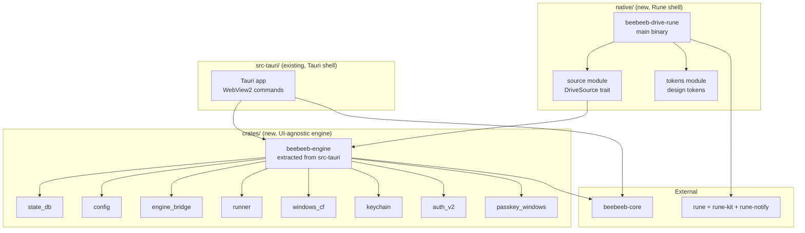

# Desktop v2: Native Rust UI with Rune — Design Spec

Filed: 2026-11-11 by the Rune spike lane (task 2445).
Rune rev: `c92e462e` (dev branch, 2026-11-11, MIT, Anomaly).
Repo: `github.com/anomalyco/rune` — pre-release, "we don't take pull requests", file issues.

## 1. Verdict: GO-WITH-CONDITIONS

Rune can replace the Tauri WebView2 layer for Beebeeb Drive on Windows. The spike proves it compiles, the API covers every surface the app needs, and the engine layer separates cleanly. Conditions below.

### Evidence the verdict rests on

| Capability | Status | Source |
|---|---|---|
| Custom titlebar + Windows caption buttons + snap layouts | Works today | `crates/rune/README.md` "Window chrome" section; `crates/rune/examples/custom_titlebar.rs`; verified in the spike |
| Virtual rows (5,000+ items) | Works today | `crates/rune/src/el/virtual_rows.rs`; spike uses it; README measured perf section |
| Accessibility (UIA via AccessKit) | Works today | `crates/rune/src/a11y/windows.rs`; uses `accesskit_windows::Adapter` + `WM_GETOBJECT` subclassing |
| Text fields + IME + password fields | Works today | README "Text fields" section; `TextEdit::secure()` hides text, blocks undo/copy/IME; macOS Secure Event Input; model buffers wipe on drop |
| Issue 586 (secure fields + accessibility) | NOT a blocker | Secure fields expose no text to the accessibility tree (`secure text (never exposed)` in README Accessibility section); the field reports only its role, label, and selection/caret positions |
| Dark mode + system theme | Works today | `crates/rune/src/platform/win32/dark_mode.rs`; uses uxtheme ordinals 135/136 (Windows 10 1903+); menus follow; `cx.system_dark()` in views |
| DPI + multi-monitor | Works today | `crates/rune/src/platform/win32/dpi_drag.rs`; handles `WM_DPICHANGED` during move/size loops |
| Context menus (native) | Works today | `tx.popup_menu()` uses `TrackPopupMenuEx` on Windows; keeps drawing while menu tracks |
| File drop IN | Works today | `on_drop_files()` works on macOS, Windows, X11; pointer sampling on Windows via `GetCursorPos` |
| File drag OUT | macOS only; Windows NOT implemented | README: "macOS only for now. Elsewhere `drag_out` is ignored" — file as Rune issue |
| File dialogs (open/save/folder) | Works today | `native-file-dialog` feature; rfd on macOS/Windows, XDG portal on Linux |
| Notifications (Windows toast) | Works today | `rune-notify`: `register` + `post` + `on_click` + activation scheme for click-after-quit |
| Multiple windows | Works today | `run_windows()`, `App::window()`, mixed state types; `--window KEY` for headless |
| Single-instance + deep links | Works today | `rune::single_instance("com.example.app")` uses named pipe on Windows; `App::on_open_url` |
| Tray/system tray | App-owned, not Rune-built | Rune provides `keep_running()`, `windowless()`, `AppHandle` hide/show/position; the tray icon itself is the app's (D-Bus `StatusNotifierItem` on Linux; Windows: app handles the tray) |
| Pop-up/overlay windows | Works today | `App::overlay()` with `OverlaySpec`; `always_on_top`, `borderless`, positioning |
| Headless PNG + element tree | Works today | `--snap`, `--tree`, `--script`, `--video`; `Runtime::new()` for tests |
| Clipboard (text, rich, secret) | Works today | `tx.copy_secret()` with 30s expiry + platform history-exclusion; rich clipboard (HTML/RTF/image) |
| Smooth scrolling | Works today | Scroll costs no commit; `virtual_rows` mounts only visible rows |
| Springs/animation | Works today | `rune-motion`; `motion::SNAPPY`, `motion::SNAP`; reduced-motion support; motion-audit |
| Fonts bundled (Inter) | Works today | Rune bundles 3 Inter faces (Regular, Medium, SemiBold) by default; `AppSpec::fonts` for custom |
| Issue 430 (memory ~180 MB for hello on DX12) | Monitor; NOT a blocker now | README Measured section shows 10.9 MB binary, 70 MB idle (settings example); hello on DX12 memory depends on GPU backend; wgpu is the Windows path |
| Installer/updater | NOT in Rune; we build our own | Tauri provides NSIS + updater today; Rune doesn't bundle apps or update them; need a separate solution |
| Autostart | NOT in Rune; app's responsibility | Registry key `HKCU\Software\Microsoft\Windows\CurrentVersion\Run`; trivial |
| Stability (3-week-old pre-release) | Risk; mitigated by pinning | Pin a rev of `dev`; `dev` is never rewritten; we can file issues |

### Conditions

1. **Rust 1.99.1**: Rune's workspace needs edition 2024. The spike crate pins `rust-toolchain.toml` to 1.99.1. The Tauri crate pins to "stable" (1.98.1). Both build side by side.
2. **Drag-out on Windows**: File drag-out is macOS-only today. Must file a Rune issue. Workaround: use the Windows `DoDragDrop` API ourselves (OLE, straightforward) or defer until Rune ships it.
3. **Installer + updater**: Tauri ships NSIS + auto-updater. The native shell needs its own. Options: (a) keep the NSIS installer (it's an exe, not Tauri-specific), (b) use `windows-installer` crate, (c) WiX. The updater: a simple HTTP check + download + restart, or Squirrel-style.
4. **Tray icon on Windows**: Rune doesn't draw the system tray icon. The app must create the `NOTIFYICONDATA` + `Shell_NotifyIcon` window message loop itself (or use `tray-icon` crate, same underlying API Tauri uses).
5. **Disk space**: The build machine has 28 GB free (below the 40 GB threshold). A full Rune debug build may need 10-15 GB. Use release/incremental builds.

## 2. What cannot be native and what we do instead

| Surface | Current implementation | Recommendation |
|---|---|---|
| Office editor (Word/Excel/PPT) | WebView2 loading a web bundle (`office_v2/`) | Keep a WebView2 child window for this surface only. A native editor is out of scope. `wry` or `webview2-com` crate for the host, no Tauri. |
| PDF preview | WebView2 + pdf.js (`src/v2/sections/files/preview/`) | Option A: Rust crate `pdf-render` or `pdfium-render` (native, no web view). Option B: Small WebView2 child with pdf.js. Recommend A for consistency. |
| Markdown/code editor | WebView2 today (Monaco/CodeMirror) | Rune's `TextEdit` + `rune-highlights` for syntax highlighting. The kit's `TextArea` handles multi-line. Fully native. |
| Video/photo viewer | WebView2 today | Rune has `Player` (video/audio) and `ImageCache` (images incl. AVIF, SVG via resvg). Fully native. |
| Passkeys (WebAuthn) | `webauthn.dll` directly from Rust (`passkey_windows.rs`) | Already native. No web view needed. Uses `beebeeb_core::passkey` + Windows Security dialog over HWND. |
| QR code (sign-in approval) | SVG from Rust | Already native. Render as an `image()` in Rune from the SVG bytes. |
| Windows Hello | `webauthn.dll` (same as passkeys) | Already native. |

**No US systems in the data path.** Rune is MIT, runs locally, no network calls. wgpu (GPU abstraction) is Apache-2.0/MIT, also local. No jurisdiction issue.

## 3. Architecture

### Crate layout



### Separation from Tauri

The engine layer is already clean:
- **0 Tauri dependencies**: `state_db`, `state_db/`, `engine_bridge/`, `config/`, `config.rs`, `runner/`, `runner.rs`, `windows_cf/`, `keychain/`, `passkey_windows.rs`, `account_binding.rs`, `own_data_proof/`, `name_alias.rs`.
- **Tauri-dependent (command wiring only)**: `drive_v2/commands.rs` (11 `#[tauri::command]`), `drive_v2/events.rs` (emit via `tauri::Emitter`), `drive_v2/status_cmds.rs` (8 commands), `lib.rs` (the `invoke_handler!` registration).
- **What Tauri provides that we replace**: `tauri::AppHandle` (window management) -> `rune::AppHandle`; `tauri::State<AppState>` (DI) -> direct ownership; `tauri::Emitter` (events to webview) -> Rune's `AppHandle::update()` callbacks; `tauri_plugin_dialog` -> `rune::FileDialogs`; `tauri_plugin_opener` -> `std::process::Command` / `open` crate.

**Migration pattern**: Extract a `beebeeb-engine` crate that owns `StateDb`, `DesktopConfig`, `Runner`, `EngineBridge`, `WindowsCF`, `Keychain`, `Auth`, `Passkey`. Both shells depend on it. The Tauri shell's commands become thin wrappers. The Rune shell calls the engine directly (no IPC, no serialization).

### What moves into beebeeb-core

Candidates currently in desktop Rust or TSX that belong in core ("using core as much as possible"):
- **View models**: `drive_v2::model` (listing, sorting, search filtering) — pure over `StateDb`, no Tauri
- **Formatters**: `format_bytes`, `iso()`, `leaf_name()`, MIME detection — used by web and desktop
- **Sort logic**: `drive_v2::model::Sort` and its comparators
- **Sign-in state machine**: `auth_v2` flow states (the ceremony is already in core)
- **Storage meter calculation**: `StorageSummary` computation from DB rows

### State management in Rune

Rune uses `fn view(s: &State, cx: &mut Cx<State>) -> El` — the state is the single source of truth. For async engine events:

1. **`AppHandle::update(|s, tx| ..)`** from background threads (engine sync events, network results) — wakes the UI thread, commits on the next frame.
2. **`rune::machine` pattern** for modes (sign-in flow, sync states, upload progress): one `enum State` with variants carrying valid data, one `fn step(state, event) -> Effects`.
3. **`rune::Latest`** for search/filter: one answer per keystroke, only the newest result lands.

### Threading

- **UI thread**: Rune's event loop, view builds, layout, GPU render. Cheap: the Settings example averages 0.13 ms/frame.
- **Engine runtime**: `engine_bridge::Runner` on its own thread (already is). Communicates via `AppHandle::update()`.
- **Blocking pool**: `tokio::task::spawn_blocking` for heavy ops (the engine already does this). The Rune shell can use its own `tokio::Runtime` or `std::thread::spawn`.

## 4. Design fidelity method

### Token generation
The spike's `tokens.rs` derives from the board. Production: parse `board.html`'s CSS variables into a `Theme::from_json` data file that both the board and the app consume, so a token change is one edit.

### Headless golden-PNG check
Every frame has a headless `--snap` command:
```sh
cargo run --release -p beebeeb-drive-rune -- --snap evidence/DW-0401-rune.png --size 1280x800 --scale 2 --theme dark
```
Compare against the board's drawing (screenshot from `board.html` at the same size). Difference list: manually look at both images side by side and document deviations. Rune's `--tree` dumps the element tree for structural assertions.

### Batch plan (339 Windows frames into buildable groups)

**Phase 1 — Shared chrome and components** (the shell every frame uses):
1. Custom caption bar (DW-0401 top band)
2. Sidebar (sections, storage meter, drive mark)
3. Toolbar (search, view toggle, sort)
4. File list component (virtual rows, icons, columns)
5. Status footer
6. Context menus
7. Modal dialogs (rename, new folder, move picker)

**Phase 2 — Usable app (sign-in through Files)**:
1. Sign-in window (DW-A01 through A03)
2. Continue-as / biometric (DW-A04 through A06)
3. Another-device flow (DW-A07 through A10)
4. Approval flow (DW-A11 through A17)
5. Email + password (DW-A18 through A23)
6. Onboarding (DW-0380, DW-0301-0305)
7. Files window (DW-0401) — the spike
8. File actions (DW-0402-0406)

**Phase 3 — Sidebar sections**:
1. Shared (DW-0501-0507)
2. Recent
3. Starred
4. Trash (DW-0601-0603)

**Phase 4 — Settings** (DW-0701-0720):
All settings surfaces.

**Phase 5 — Tray** (DW-1201-1234):
The system tray icon, flyout, menus.

**Phase 6 — Preview, editor, versioning**:
Photo/video viewer, PDF preview, office editor (WebView2 child), markdown editor, versioning (DW-0413).

**Which frames make a usable app soonest**: Sign-in -> Files -> tray (monitor status) -> Settings (plan, sync, account). That covers DW-A01-A23, DW-0401-0406, DW-1201-1205, DW-0701.

## 5. Plan

### Ordered slices (first 15)

| # | Slice | Files | Check | Done means |
|---|---|---|---|---|
| 1 | Extract `beebeeb-engine` crate (state_db, config, runner, engine_bridge) | New `crates/beebeeb-engine/`, refactor `src-tauri/` imports | `cargo check` for both Tauri and engine crate; `cargo test -p beebeeb-engine` passes existing tests | The engine builds without Tauri; Tauri shell still compiles |
| 2 | Caption bar + window chrome | `native/src/chrome.rs` | Headless PNG matches board's title bar; `--tree` shows Minimize/Maximize/Close buttons | Caption buttons visible, drag works, snap layouts work (Windows native test) |
| 3 | Sidebar (static sections, storage meter) | `native/src/sidebar.rs` | Headless PNG; meter width = used_bytes/quota_bytes * bar width | Sidebar matches board DW-0401 |
| 4 | File list with virtual_rows (fixture data) | `native/src/file_list.rs` | 5,000 rows: mounted < 100, frame time < 1ms headless; keyboard nav passes | Large folder scrolls smoothly; arrow keys + Enter work |
| 5 | File list with real data (EngineSource over StateDb) | `native/src/source/engine.rs` | `cargo test` with a test database; listing matches `drive_v2::model::list` output | Real file names from the DB appear in the list |
| 6 | Toolbar (search, sort, new folder, upload buttons) | `native/src/toolbar.rs` | Headless PNG; search field focuses; type filters the list | Toolbar matches board; search works |
| 7 | Context menu (right-click on file) | `native/src/file_list.rs` additions | `--tree` shows `popupMenu` with correct items when scripted right-click | Native Windows context menu appears with file actions |
| 8 | File dialogs (upload, new folder, move) | `native/src/actions.rs` | Scripted `file-dialog` in headless; `cargo test` | Upload file dialog opens; new folder creates |
| 9 | Sign-in window (email + password) | `native/src/auth/sign_in.rs` | Headless PNG of DW-A02; password field secure; `--tree` shows no password text | Sign-in screen renders; password hidden from accessibility |
| 10 | Sign-in: vault unlock + error states | `native/src/auth/` | Headless PNGs of DW-A18-A22; state machine test | All sign-in error states render correctly |
| 11 | Session management + keep_running | `native/src/app.rs` | Quit while signed in: session persists; relaunch: signed in | App survives close; session in keychain |
| 12 | Tray icon (Windows Shell_NotifyIcon) | `native/src/tray.rs` | Windows native: tray icon visible; click shows flyout | Tray icon appears; click opens flyout window |
| 13 | Tray flyout (DW-1201-1205 states) | `native/src/tray/flyout.rs` | Headless PNGs of each state | Flyout shows sync status; matches board |
| 14 | Settings window (appearance, general, sync) | `native/src/settings.rs` | Headless PNGs of DW-0701-0704 | Settings window opens; toggles work |
| 15 | Notifications (sync conflicts, quota warnings) | `native/src/notifications.rs` | `cargo test`: notification posts and click callback fires | Toast notifications appear; clicking opens the app |

### Total estimate
- **~60 slices** to reach feature parity with the 339 Windows frames.
- **~15 slices** for the minimum usable app (sign-in + Files + tray + settings).
- **Parallelism**: Slices 2-4 (chrome components) can run in parallel. Slices 9-10 (sign-in) can run in parallel with 6-8 (file actions). After slice 1, up to 3 lanes.

### Cut-over rule
The Tauri v2 shell keeps building (its branch stays active for fixes) until the native shell reaches:
- Sign-in with all paths (email, passkey, another-device, approval)
- Files window with all actions (open, rename, delete, move, upload, download, share)
- Tray with all states
- Settings (basic: appearance, sync, account, about)
- Single-instance + autostart + deep links
- Installer + updater

At that point, `v2-next` switches its default binary from Tauri to Rune. The Tauri shell becomes a fallback for surfaces not yet ported.

### Risk list

| Risk | Impact | Fallback |
|---|---|---|
| Rune breaks or stalls (pre-release, no PRs accepted) | Blocked on upstream | Pin the working rev; fork if necessary (MIT); the Tauri shell is still building |
| Memory too high on Windows (DX12 + wgpu overhead) | User complaints, > 200 MB idle | Profile with `procwatch`; switch GPU backend; use `release_gpu_when_closed` for closed windows |
| `drag_out` never ships for Windows | Upload-only workflow | Implement ourselves with OLE `DoDragDrop`; or use `clipboard_win` + manual drag detection |
| Installer complexity (no Tauri NSIS) | Slower release cycle | Reuse the existing NSIS script (it runs cargo build output through NSIS, not Tauri-specific); or WiX |
| Edition 2024 / Rust 1.99.1 conflict with core/server | Build complexity | The native crate has its own `rust-toolchain.toml`; core and server keep their own pins |
| Disk space on build machines | Can't build | Use release+incremental; separate `CARGO_TARGET_DIR`; clean old targets |

## 6. Cost honesty

### What is thrown away

| Layer | Lines | Tests |
|---|---|---|
| `src/v2/` (TSX/TS, the WebView2 UI) | 24,715 | ~39,575 lines in `tests/` |
| `src/v2/source/desktop.ts` (IPC bridge) | ~200 | — |
| `src/v2/dev/` (fixture host) | ~400 | — |
| Total TSX/TS discarded | **~25,315** | **~39,575** |

### What is kept

| Layer | Lines | Note |
|---|---|---|
| `src-tauri/src/` (Rust engine, sync, crypto, state) | 217,276 | All kept; extracted into `beebeeb-engine` |
| `beebeeb-core` (crypto, sync engine) | ~external | All kept; already a separate crate |
| Design (339 frames, tokens, board.html) | ~external | All kept; drives the native UI |

### Estimate in agent-slices
- 60 slices total, each ~2-4 hours of cheap-model agent time.
- 15 slices to minimum usable app (~30-60 agent-hours).
- 60 slices to full parity (~120-240 agent-hours).

### If the verdict were no-go
Keep Tauri, fix conformance (the current lane B approach from task 2445). Cost: similar slice count to fix 339 frames in React+Tailwind, with the ongoing WebView2 breakage and IPC overhead. The native path is recommended because:
1. No IPC serialization (direct Rust calls, zero-copy)
2. No WebView2 dependency (removes the #1 source of v2 breakage)
3. One language (Rust end to end, no TSX/React/Tailwind layer)
4. Smaller binary (10.9 MB stripped Rune vs ~50 MB Tauri+WebView2+React)
5. Faster startup (300 ms Rune vs ~1-2 s Tauri+WebView2)
6. GPU-rendered at 120 Hz natively
