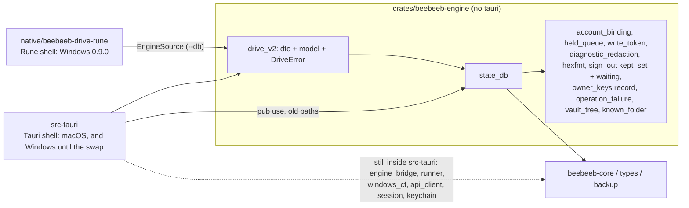

# Desktop 0.9.0: the engine without Tauri (boundary, measurements, plan)

Lane E, 2026-11-11. Ruling (Guus, 2026-11-11): "for 0.9.0 we go full rust, one big bang, one shot". Companion to
`2026-11-11-desktop-v2-native-rune-design.md`, whose §3 claims are checked here against `v2-native` at `b9e73441`.
Every number is measured; §1 says how.

## 1. Headline numbers

How they are counted: `scripts/measure-engine-boundary.py <dir>` (its header states the method). Lines are newline
characters in `.rs` files, tests and comments included. A "Tauri ref" is a match of `\btauri(_plugin_\w+)?::`, `use tauri\b`,
`AppHandle` or `tauri::State` (the bare type names count, so the number is higher than `\btauri\b` alone). The `src-tauri`
numbers are the tree at `b9e73441`, BEFORE this PR (`git archive b9e73441 src-tauri/src`); the engine numbers are this branch.

- `src-tauri/src` before this PR: 217,856 lines in 141 top-level modules; 43 are test modules (27,726 lines), 98 are product (190,130 lines).
- 1,012 Tauri references, 275 commands, 41 `emit` call sites, 7 Tauri plugins. 87 of the 141 modules have 0 Tauri references.
- By bucket (product modules): ENGINE 50 modules / 142,268 lines; SESSION 21 / 19,263; SHELL 12 / 8,757;
  MAC-ONLY 8 / 14,387; DEAD-IN-NATIVE 3 / 4,855; test support 4 / 600.
- The spike's claim "0 Tauri dependencies in `state_db`, `engine_bridge`, `config`, `runner`, `windows_cf`, `keychain`,
  `passkey_windows`, `account_binding`, `own_data_proof`, `name_alias`": **true for 9 of 10, false for `runner`** (28 refs by the
  method above, 3 emits: it holds the `AppHandle` to emit `engine-status` and `engine-conflict` and to notify).
- "0 Tauri references" is not "movable today": `engine_bridge` (43,833 lines, 0 refs) names `watcher`, `ipc_socket`, `api_client`,
  `windows_cf`, `owner_keys`; the ENGINE bucket is one strongly connected group and moves in the order of §7.
- **`crates/beebeeb-engine` on this branch: 29,080 lines**, 0 Tauri references, `cargo tree | grep -c tauri` = 0. Its `lib.rs` declares
  12 public modules (the table in §2 has 14 rows because it also lists `lib` and the test file `reconcile_measure_tests`).
  6 of the 12 moved whole out of `src-tauri` (25,541 lines there before); the other 6 hold the parts of a shell module the database needs.

## 2. What exists after this PR

| engine module | lines | Tauri refs | depends on (engine modules) |
|---|---|---|---|
| `state_db` | 22,057 | 0 | held_queue, account_binding, write_token |
| `held_queue` | 2,306 | 0 | known_folder |
| `diagnostic_redaction` | 1,514 | 0 | operation_failure |
| `drive_v2` | 1,090 | 0 | vault_tree, state_db, owner_keys |
| `account_binding` | 769 | 0 | - |
| `sign_out` | 635 | 0 | state_db |
| `write_token` | 316 | 0 | - |
| `reconcile_measure_tests` | 117 | 0 | held_queue, known_folder |
| `owner_keys` | 85 | 0 | - |
| `operation_failure` | 57 | 0 | state_db |
| `hexfmt` | 49 | 0 | - |
| `known_folder` | 40 | 0 | - |
| `lib` | 27 | 0 | state_db |
| `vault_tree` | 18 | 0 | - |

Rules of the seam: (1) the engine crate never depends on `tauri` (CI job `engine-boundary`, `scripts/check-engine-boundary.sh`); (2) `src-tauri/src/lib.rs`
re-exports each moved module under its old path, so shell code keeps `crate::state_db::…`; (3) a helper another crate's tests need is
`#[cfg(any(test, feature = "test-support"))]`, and only `[dev-dependencies]` turn that feature on (the same CI job, and a `compile_error!` in a release build); (4) a fragment moved out of a file
that stays is re-exported from the old place (`owner_keys::OwnedKeyRecord`, `engine_bridge::classify_operation_error`, …).

## 3. Every top-level product module of `src-tauri/src` at `b9e73441` (before this PR: all 98, the 6 that moved whole included)

Buckets: ENGINE (no UI in purpose), SESSION (auth, keychain, session state), SHELL (windows, tray, command wiring, updater glue),
MAC (macOS-only, stays on Tauri for the Mac app), DEAD (web-view only: gone in the native build), TEST (source-pin helpers).
A module with commands in an ENGINE row keeps its logic and loses only the `#[tauri::command]` wrappers.
| module | lines | Tauri refs | cmds | emits | depends on (top 3) | bucket |
|---|---|---|---|---|---|---|
| `engine_bridge` | 43,833 | 0 | 0 | 0 | state_db, watcher, ipc_socket | ENGINE |
| `state_db` | 21,252 | 0 | 0 | 0 | held_queue, account_binding, write_token | ENGINE |
| `windows_cf` | 13,930 | 0 | 0 | 0 | unknown_check, state_db, engine_bridge | ENGINE |
| `ipc_socket` | 7,246 | 0 | 0 | 0 | state_db, engine_bridge, backup_protect | ENGINE |
| `finder_setup` | 7,079 | 13 | 0 | 1 | surfaces, finder_removal, config | MAC |
| `owner_keys` | 6,298 | 0 | 0 | 0 | engine_bridge, state_db, api_client | ENGINE |
| `drive_v2` | 4,781 | 96 | 36 | 2 | state_db, backup_protect, vault_tree | ENGINE |
| `surfaces` | 4,408 | 11 | 0 | 0 | root_source | DEAD |
| `runner` | 4,149 | 28 | 0 | 3 | windows_cf, transfer_progress, engine_bridge | ENGINE |
| `api_client` | 4,140 | 0 | 0 | 0 | account_dto, link_health, transfer_progress | ENGINE |
| `sign_out` | 3,862 | 0 | 0 | 0 | finder_removal, state_db, config | SESSION |
| `share_v2` | 3,076 | 34 | 17 | 2 | auth_v2, state_db, hexfmt | ENGINE |
| `backup` | 2,706 | 1 | 1 | 0 | state_db, config, engine_bridge | ENGINE |
| `keychain` | 2,484 | 0 | 0 | 0 | - | SESSION |
| `config` | 2,399 | 0 | 0 | 0 | finder_setup, surfaces, test_sandbox | ENGINE |
| `own_data_proof` | 1,924 | 0 | 0 | 0 | state_db, account_binding, api_client | ENGINE |
| `popover_data` | 1,887 | 4 | 0 | 1 | state_db, macos_popover, engine_status | MAC |
| `account_dto` | 1,848 | 0 | 0 | 0 | - | ENGINE |
| `direct_download` | 1,825 | 0 | 0 | 0 | api_client, download_pin, engine_bridge | ENGINE |
| `finder_removal` | 1,802 | 0 | 0 | 0 | config | MAC |
| `held_queue` | 1,669 | 0 | 0 | 0 | known_folder | ENGINE |
| `watcher` | 1,519 | 0 | 0 | 0 | engine_bridge, windows_cf, backup_protect | ENGINE |
| `diagnostic_redaction` | 1,506 | 0 | 0 | 0 | engine_bridge | ENGINE |
| `found_while_paused` | 1,495 | 0 | 0 | 0 | engine_bridge, state_db, windows_cf | ENGINE |
| `engine_status` | 1,329 | 0 | 0 | 0 | transfer_progress, state_db, link_health | ENGINE |
| `transfer_progress` | 1,291 | 0 | 0 | 0 | state_db | ENGINE |
| `update_window` | 1,200 | 83 | 8 | 3 | - | SHELL |
| `settings_commands` | 1,196 | 68 | 28 | 4 | backup, transfer_progress, windows_cf | SHELL |
| `local_state_purge` | 1,190 | 5 | 0 | 0 | ipc_socket, finder_setup | ENGINE |
| `tray_window` | 1,144 | 60 | 2 | 5 | macos_popover | SHELL |
| `sign_out_commands` | 1,123 | 17 | 6 | 2 | account, test_sandbox | SESSION |
| `file_open_commands` | 1,117 | 16 | 13 | 0 | state_db, windows_cf, surfaces | SHELL |
| `unknown_check` | 1,084 | 0 | 0 | 1 | windows_cf, state_db, engine_bridge | ENGINE |
| `auth_v2` | 1,078 | 38 | 9 | 0 | api_client, runner, vault_lock_commands | SESSION |
| `macos_file_provider` | 1,072 | 0 | 0 | 0 | finder_removal, finder_setup, macos_workspace | MAC |
| `login_commands` | 1,070 | 34 | 6 | 0 | auth_v2 | SESSION |
| `session_state` | 1,057 | 7 | 2 | 0 | account | SESSION |
| `browser_login` | 1,040 | 13 | 1 | 1 | revoke_desktop_session, apply_session, api_client | SESSION |
| `account_v2` | 1,027 | 27 | 18 | 0 | auth_v2, finder_setup_command_tests, source_pin | SESSION |
| `finder_setup_commands` | 1,024 | 35 | 17 | 0 | - | MAC |
| `account_commands` | 1,003 | 27 | 27 | 0 | transfer_progress, backup_protect, windows_cf | SHELL |
| `bound_engine` | 996 | 23 | 8 | 0 | - | ENGINE |
| `cf_range` | 954 | 0 | 0 | 0 | state_db | ENGINE |
| `session_apply` | 887 | 2 | 0 | 0 | - | SESSION |
| `native_menu` | 863 | 35 | 1 | 2 | - | SHELL |
| `session_reauth` | 838 | 4 | 0 | 0 | - | SESSION |
| `desktop_search` | 836 | 0 | 0 | 0 | api_client, state_db, backup_protect | ENGINE |
| `activity_conflict_commands` | 830 | 37 | 12 | 2 | runner, finder_setup | SHELL |
| `staged_payload` | 797 | 0 | 0 | 0 | engine_bridge, state_db, ipc_socket | ENGINE |
| `vault_lock_commands` | 791 | 52 | 15 | 3 | ipc_socket | SESSION |
| `vault_tree` | 780 | 5 | 5 | 0 | windows_cf, name_alias | ENGINE |
| `reauth` | 770 | 0 | 0 | 0 | account_binding | SESSION |
| `account_binding` | 761 | 0 | 0 | 0 | - | ENGINE |
| `finder_open` | 755 | 2 | 1 | 0 | finder_setup_command_tests, root_source, source_pin | MAC |
| `passkey_commands` | 562 | 10 | 4 | 0 | passkey_windows | SESSION |
| `backup_protect` | 560 | 8 | 0 | 0 | windows_cf, state_db, backup | ENGINE |
| `lib` | 535 | 5 | 0 | 0 | - | SHELL |
| `macos_popover` | 534 | 51 | 6 | 2 | sign_out, popover_data, surfaces | MAC |
| `link_health` | 530 | 0 | 0 | 0 | surfaces | ENGINE |
| `app_run` | 524 | 26 | 0 | 0 | auth_v2, share_v2, passkey_commands | SHELL |
| `signup_v2` | 524 | 32 | 17 | 0 | runner, auth_v2, fetch_canonical_profile | SESSION |
| `os_state_reconcile` | 517 | 0 | 0 | 0 | state_db | ENGINE |
| `lifecycle_log` | 511 | 0 | 0 | 0 | finder_setup, diagnostic_redaction, surfaces | ENGINE |
| `state_paths` | 435 | 4 | 0 | 0 | state_db | ENGINE |
| `vault_unlock` | 430 | 1 | 1 | 0 | - | SESSION |
| `unsent_changes_commands` | 387 | 3 | 3 | 0 | transfer_progress, local_state_purge | SESSION |
| `linux_thumbnail` | 372 | 0 | 0 | 0 | reject_unsafe_rel_path | ENGINE |
| `account` | 368 | 0 | 0 | 0 | runner, account_dto, account_binding | SESSION |
| `office_v2` | 367 | 16 | 2 | 2 | hexfmt | DEAD |
| `known_folder` | 366 | 0 | 0 | 0 | runner, backup | ENGINE |
| `ipc_write_dedup` | 351 | 0 | 0 | 0 | - | ENGINE |
| `passkey_windows` | 334 | 0 | 0 | 0 | - | SESSION |
| `linux_fuse` | 309 | 0 | 0 | 0 | engine_bridge, state_db | ENGINE |
| `write_token` | 304 | 0 | 0 | 0 | engine_bridge | ENGINE |
| `name_alias` | 298 | 0 | 0 | 0 | - | ENGINE |
| `shared_folder_index` | 295 | 0 | 0 | 0 | - | ENGINE |
| `download_pin` | 288 | 0 | 0 | 0 | - | ENGINE |
| `ipc_frame` | 262 | 0 | 0 | 0 | - | ENGINE |
| `session_commands` | 246 | 0 | 0 | 0 | callback_gate | SESSION |
| `macos_workspace` | 234 | 0 | 0 | 0 | finder_setup, macos_file_provider | MAC |
| `upload_finalization_plan` | 211 | 0 | 0 | 0 | unknown_check, state_db | ENGINE |
| `conflict` | 210 | 0 | 0 | 0 | resolve_conflict | ENGINE |
| `desktop_main_window` | 205 | 16 | 0 | 0 | settings_nav, windows_tray_flyout_position, main_nav_for_route | SHELL |
| `desktop_capabilities` | 202 | 0 | 0 | 0 | - | ENGINE |
| `callback_gate` | 202 | 0 | 0 | 0 | - | SESSION |
| `lockfile` | 197 | 0 | 0 | 0 | state_paths | ENGINE |
| `auth_attempts` | 183 | 0 | 0 | 0 | callback_gate | SESSION |
| `cf_keepalive` | 175 | 0 | 0 | 0 | transfer_progress | ENGINE |
| `v2_snap` | 132 | 2 | 1 | 0 | - | SHELL |
| `no_fetch_scope` | 108 | 0 | 0 | 0 | - | ENGINE |
| `sync_activity` | 104 | 0 | 0 | 0 | engine_status, state_db | ENGINE |
| `webview_browser_keys` | 80 | 7 | 0 | 0 | - | DEAD |
| `hexfmt` | 49 | 0 | 0 | 0 | - | ENGINE |
| `main` | 8 | 0 | 0 | 0 | - | SHELL |
Not in the table: the 4 test-support modules `extension_log_pin` (363), `test_sandbox` (125), `root_source` (72), `source_pin` (40).

## 4. Events the engine pushes to the UI today (each becomes a typed Rust event)

41 `emit` call sites, 21 event names. The native shell needs one `enum EngineEvent` in the engine crate and an `EventSink` trait
(`fn send(&self, EngineEvent)`) that the Tauri shell implements with `app.emit` and the Rune shell with `AppHandle::update`.

| event name | emitted in | payload today | native event |
|---|---|---|---|
| `engine-status` | `runner/tick_loop.rs` (2), `unknown_check.rs`, `settings_commands.rs` | `serde_json::Value` (`engine_status` payload + startup guard) | `Status(EngineStatus)`: type the JSON first |
| `engine-conflict` | `runner/tick_loop.rs` | a `json!` object (untyped) | `Conflict { file_id }` |
| `drive://event` | `drive_v2/events.rs`, `share_v2/mod.rs` (2) | `DriveEvent` enum (typed) | `Drive(DriveEvent)` as is |
| `drive://transfers` | `drive_v2/status_cmds.rs` | transfer rows (typed DTO) | `Transfers(Vec<TransferRow>)` |
| `office://progress` | `office_v2/mod.rs` (2) | progress struct | none (DEAD) |
| `browser-login` | `browser_login.rs` | login step enum | `SignIn(BrowserLoginStep)` |
| `conflict-resolved` | `activity_conflict_commands.rs` (2) | `json!` | `ConflictResolved { file_id }` |
| `finder-setup-changed`, `popover-shown`, `popover-hidden`, `review:open` | `finder_setup`, `macos_popover`, `popover_data` | unit / small | none (MAC) |
| `kept-folder-changed`, `sign-out-flow-closed`, `menu sign-out-flow` | `vault_lock_commands.rs`, `sign_out_commands.rs` (2) | unit / label | `SignOut(SignOutEvent)` |
| `main:navigate`, `windows-app navigate`, `compact-app navigate`, `tray-menu-notice` | `update_window.rs`, `tray_window.rs` | route string | shell-internal: a direct call, not an engine event |
| `update-available`, `menu check-for-updates`, `menu files-added` | `update_window.rs`, `native_menu.rs`, `settings_commands.rs` | version / unit | `Update(UpdateState)`; the menu ones are shell-internal |

## 5. What moves down into `beebeeb-core`, and what stays desktop

Pure logic with no desktop I/O that other clients need too. Sizes are today's lines.

| candidate | where today | lines | note |
|---|---|---|---|
| name and time formatters: `iso`, `leaf_name`, `mime_for_name`, `is_photo_or_video`, `initials` | engine `drive_v2/model.rs` | ~110 | web has its own TS copies; one Rust source, exported through WASM |
| size formatter (`format_bytes` / `format_size`) | `native/…/main.rs` and PR #278 `source.rs` (2 copies already) | ~15 each | core first, before a third copy appears |
| sort (`SortKey`, `SortDir`, `sort_items`, folders first) | engine `drive_v2/model.rs` | ~60 | needs a core `DriveItem` trait or struct |
| view DTOs (`DriveItem`, `Crumb`, `Listing`, `ItemDetails`, …) | engine `drive_v2/dto.rs` | 219 | shared shape with `packages/shared/src/drive-ui/source.ts` |
| `DriveError` and its text-to-code mapping | engine `drive_v2/mod.rs` | ~100 | same codes as the TS `DriveSourceError` |
| sign-in state machine `auth_v2::gate` | PR #277 (not on `v2-native` yet) | n/a | measure after #277 merges; pure by design |
| error classing `classify_operation_error`, `OperationFailureClass` | engine `operation_failure.rs` | 55 | CLI retries want the same classes |
| export redaction (`diagnostic_redaction`) | engine | 1,506 | pure; CLI and mobile diagnostics need the same rules |
| queue reconcile planner (`held_queue`) | engine | 1,669 | pure planning over rows; belongs next to core's sync engine |
| hex (`hexfmt`), device segment (`sanitize_device_segment`), blocked-row label | engine | 49 + 37 + 9 | trivial |

Stays desktop: `state_db` (the desktop's own SQLite schema), `windows_cf` (CFAPI), `ipc_socket` + File Provider (macOS), `watcher`,
`config`/`state_paths` (OS paths), `keychain` (OS stores), `runner` (process lifecycle), `api_client` transport choices, everything in SHELL.

## 6. What Tauri provides today (to replace for Windows)

| piece | today | file |
|---|---|---|
| windows, web view, IPC | `tauri` 2 + WebView2; `invoke_handler!` with 275 commands | `app_run.rs`, `lib.rs`, `surfaces/`, `desktop_main_window.rs` |
| tray icon + menu | `tauri` feature `tray-icon`, `TrayIconBuilder::with_id("tray")` | `tray_window.rs` (1,144 lines), `native_menu.rs` |
| updater | `tauri-plugin-updater` (endpoints + pubkey in `tauri.conf.json`, `createUpdaterArtifacts`), signature check | `update_window.rs`, `tauri.conf.json` |
| installer | Tauri bundler: NSIS + MSI (`bundle.targets = all`), updater artifacts | `tauri.conf.json`, `.github/workflows/release.yml` |
| autostart | `tauri-plugin-autostart` | `app_run.rs`, `settings_commands.rs` |
| dialogs, opener, clipboard, notifications | `tauri-plugin-dialog`, `-opener`, `-clipboard-manager`, `-notification` | `app_run.rs` + call sites |
| window position memory | `tauri-plugin-window-state` | `update_window.rs` |
| single instance | **not a Tauri plugin**: the sync-root lock with pid liveness | `lockfile.rs` (197 lines, 0 Tauri refs: moves as is) |
| deep links | **none**: 0 matches for a deep-link plugin or URI scheme; browser sign-in is a device code over a web socket | `browser_login.rs` |

## 7. The plan for the rest (ordered; each step is one PR with the engine crate's `cargo tree` count still 0)

| # | step | files | the seam | the test that proves it | parallel with UI frames? |
|---|---|---|---|---|---|
| 1 | leaf engine modules | `name_alias`, `download_pin`, `conflict`, `cf_range`, `ipc_frame`, `ipc_write_dedup`, `lockfile`, `os_state_reconcile`, `shared_folder_index`, `transfer_progress`, `account_dto`, `desktop_capabilities`, `link_health` (7,243 lines, 0 refs) | plain `pub use`, as this PR | both crates' suites; counts unchanged | yes |
| 2 | config + paths | `config`, `state_paths`, `test_sandbox` | `config` names `finder_setup`/`surfaces` on 4 lines: cut with a `ConfigObserver` trait | `config_write_pin_tests` re-rooted at the crate | yes |
| 3 | API client | `api_client`, `direct_download`, `no_fetch_scope` | none (0 refs); needs step 1's `account_dto` | loopback tests move with it | yes |
| 4 | SESSION, after PR #277 merges | `keychain/**`, `session_state`, `session_apply`, `session_reauth`, `auth_v2/**`, `login_commands`, `browser_login`, `reauth`, `account`, `vault_unlock`, `passkey_windows` | commands stay in the shell; `SessionStore` owns what `tauri::State<AppState>` holds today; sign-in steps go out as `EngineEvent::SignIn` | `keychain_isolation_tests`, `startup_session_tests`, the auth gate's table tests, run from the engine crate | no: the sign-in frames wait for it |
| 5 | the sync engine: start/stop + typed events | `engine_bridge`, `owner_keys`, `watcher`, `ipc_socket`, `staged_payload`, `found_while_paused`, `backup`, `backup_protect`, `own_data_proof`, `engine_status`, `unknown_check`, `runner`, `bound_engine` | `EventSink` + `EngineEvent` (§4) replace the `AppHandle` in `runner` (28 refs) and `bound_engine` (23); `Notifier` trait for toasts | a headless test: start the engine on a temp root against the loopback API, upload one file, assert the `Status` sequence received through a channel sink | partly: Files/Details frames yes, status-line and activity frames need it |
| 6 | Cloud Files | `windows_cf` (13,930 lines, 0 refs), `cf_keepalive` | none in code; it needs step 5's bridge. The risk is native: registration and callbacks under a new exe | native Windows rung: placeholder create, hydrate, dehydrate on a temp root (`native-gate.sh`) | yes |
| 7 | the rest of `drive_v2` and `share_v2` | `fsops`, `status`, `photo_meta`, `share_v2` logic | commands become methods on an `Engine` handle; `model_shell.rs` (search, trash) follows `desktop_search` | `drive_v2/tests.rs` moved, same counts | yes, per frame |
| 8 | tray | new native code (`tray-icon` crate or Win32 `Shell_NotifyIconW`); replaces `tray_window.rs` | `TrayModel` built from `EngineEvent::Status` | unit test of the model; native rung screenshot | yes |
| 9 | updater | replaces `tauri-plugin-updater`: same manifest URL, same minisign key, `scripts/check-updater-signature-key.mjs` unchanged | `Updater` in the engine: check, download, verify; the shell only shows state | a test with a wrong-key signature that must fail, then the right key | yes |
| 10 | single instance, autostart, installer | `lockfile.rs` (as is) + a named pipe to focus the running window; registry Run key; NSIS script owned by the repo | none | native rung: second launch focuses the first; install, update, uninstall on a clean VM | yes |
| 11 | delete Tauri from the Windows build | see §8 | `cfg` or a separate bin | `cargo tree -p <windows bin> | grep -c tauri` = 0 | last |

## 8. Dead in `src-tauri` once the native shell is complete (Windows)

- DEAD today (web-view only): `webview_browser_keys` (80), `office_v2` (367), `surfaces` (4,408), `v2_snap` (132).
- Every `#[tauri::command]` wrapper (275) and `invoke_handler!`; `drive_v2/commands.rs` (784), `status_cmds.rs` (358), `events.rs` (105).
- SHELL on Windows: `tray_window`, `native_menu`, `update_window`, `desktop_main_window`, `app_run`, and the command halves of
  `settings_commands`, `file_open_commands`, `activity_conflict_commands`, `account_commands`, `sign_out_commands`, `vault_lock_commands`.
- `capabilities/`, `tauri.conf.json`'s Windows parts, `webview2-com` and `windows-core-webview2` in `Cargo.toml`, the 7 plugins, `src/` (React), `index.html`, `vite.config.ts`.
- Not dead: the MAC bucket and the Tauri shell itself, until the Mac app moves.
- Not covered by this PR: the move stops at `state_db`'s own closure (`engine_bridge`, `runner`, `windows_cf`, `api_client`, `config` and SESSION are untouched). The Rust source censuses read both trees (`src-tauri/src/source_census.rs`); the bun copy guards (`copyGuard.ts`, `cityGuard.ts`) still walk `src-tauri/src` only.

## 9. Plan check for step 2 (lane E2, 2026-11-11, measured on `v2-native` at `84b8f552`)

Method: the same script as §1 plus a per-kind count (`#[tauri::command`, `AppHandle`, `State<`/`tauri::State`, `.emit*(`,
`tauri_plugin_*`, window/`Manager` names). "Edges" are `crate::<module>` names in a module's files that point at a module
which keeps a Tauri reference. Everything below is the tree BEFORE this PR's moves.

### 9.1 §4 corrected: emit sites and event names

§4 said "41 emit call sites, 21 event names". Re-counted: **41 matches of `.emit*(`, of which 35 are product call sites and 6
are in test files** (3 real emits in `popover_snapshot_command_tests.rs`, 3 string literals in pins). The 35 product sites emit
**26 names**, not 21. §4 missed `sign-out-send-progress`, `sign-out-send-ended`, `version-center-review`, `menu:folder-created`
and `conflict-auto-resolved`.

| name | product sites | bucket for the native shell |
|---|---|---|
| `engine-status` | `runner/tick_loop.rs` (1, through `emit_payload`), `settings_commands.rs` (1) | engine event |
| `engine-conflict`, `conflict-auto-resolved` | `runner/tick_loop.rs` (1 + 1) | engine event |
| `conflict-resolved` | `activity_conflict_commands.rs` (2) | engine event |
| `drive://event` | `drive_v2/events.rs` (1), `share_v2/mod.rs` (2) | engine event |
| `drive://transfers` | `drive_v2/status_cmds.rs` (1) | engine event |
| `browser-login` | `browser_login.rs` (1) | engine event |
| `kept-folder-changed` | `vault_lock_commands.rs` (1) | engine event |
| `sign-out-flow-closed`, `sign-out-send-progress`, `sign-out-send-ended` | `vault_lock_commands.rs` (1), `sign_out_commands.rs` (2) | engine event |
| `update-available` | `native_menu.rs` (1), `update_window.rs` (1) | engine event (the updater lane owns the producer) |
| `version-center-review` | `settings_commands.rs` (1) | engine event |
| `menu:files-added`, `menu:folder-created` | `settings_commands.rs` (1 + 1) | engine event (result of an engine action) |
| `menu:sign-out-flow`, `menu:check-for-updates`, `main:navigate`, `compact-app:navigate`, `windows-app:navigate`, `tray-menu-notice` | `vault_lock_commands.rs`, `native_menu.rs`, `update_window.rs` (2), `tray_window.rs` (5) | shell-internal: a direct call in the native shell |
| `finder-setup-changed`, `popover-shown`, `popover-hidden`, `review:open` | `finder_setup/macos_ports.rs`, `macos_popover.rs` (2), `popover_data/review.rs` | macOS only |
| `office://progress` | `office_v2/mod.rs` (2) | dead in the native build |

### 9.2 The four groups

| group | modules | lines | commands | `AppHandle` | `State` | emits | plugins | window names |
|---|---|---|---|---|---|---|---|---|
| SESSION | 22 | 20,643 | 89 | 54 | 57 | 6 | 8 | 27 |
| CONFIG (`config`, `state_paths`, `lockfile`, `test_sandbox`) | 4 | 3,156 | 0 | 2 | 0 | 0 | 0 | 1 |
| API (`api_client`, `account_dto`, `link_health`, `direct_download`, `no_fetch_scope`, `download_pin`, `transfer_progress`) | 7 | 10,030 | 0 | 0 | 0 | 0 | 0 | 0 |
| RUNNING ENGINE (34 modules, `engine_bridge` 43,831 and `windows_cf` 13,930 the largest) | 34 | 102,506 | 67 | 58 | 74 | 8 | 6 | 3 |

SESSION by module (lines / commands / `AppHandle` / `State`): `session_state` 1,072/2/2/3; `session_apply` 924/0/1/1;
`session_reauth` 842/0/2/2; `session_owner` 150/0/0/0; `auth_v2` 2,620/16/5/4; `keychain` 2,689/0/0/0; `login_commands`
1,095/6/12/4; `vault_lock_commands` 814/15/14/7 (3 emits); `sign_out_commands` 1,123/6/3/6 (2 emits); `sign_out` 3,232/0/0/0;
`account` 368/0/0/0; `account_v2` 1,036/18/3/18; `reauth` 770/0/0/0; `browser_login` 1,040/1/5/2 (1 emit); `vault_unlock`
430/1/0/1; `passkey_commands` 562/4/1/4; `passkey_windows` 334/0/0/0; `signup_v2` 524/17/6/0; `session_commands`,
`callback_gate`, `auth_attempts` 631/0/0/0 together; `unsent_changes_commands` 387/3/0/5.

RUNNING ENGINE, the modules that hold a Tauri reference (the other 27 have none): `runner` 4,149 lines, 18 `AppHandle`,
3 emits, 1 `try_state`; `backup` 2,706, 1 command; `backup_protect` 560, 4 `AppHandle`, 1 plugin (the notification);
`bound_engine` 996, 8 commands; `local_state_purge` 1,190, 3 + 3; `vault_tree` 776, 5 commands; `drive_v2` 3,711, 36
commands, 2 emits; `share_v2` 3,076, 17 commands, 2 emits.

### 9.3 What each group needs from the shell

- **CONFIG:** `state_paths` takes an `AppHandle` in 2 places only to ask Tauri for the app data dir; `config/types.rs:336`
  names `finder_setup` (1 product line). Needs: nothing but the per-app literals (config dir, credential namespace), kept in one place.
- **API:** `link_health` names `surfaces` on 4 lines (the copy of two sentences). Needs: nothing.
- **RUNNING ENGINE:** 76 product lines in the zero-reference modules name a module that keeps Tauri (`backup_protect` 53,
  `backup` 9, `surfaces` 8, `finder_setup` 4, `popover_data` 1, `drive_v2` 1) plus 12 `lib.rs`-level functions
  (`notify_conflict_impl`, `notify_quota_warning_impl`, `notify_sync_complete_impl`, `open_conflict_window_impl`,
  `purge_macos_hydrate_cache`, `free_up_space_blocking`, `stream_players`, ...). From the shell the engine needs exactly:
  an event sink (status, conflict), three notifications (sync complete, quota warning, conflict), "open the conflict
  window", the shared transfer board, and the Windows "ask before delete" notifier of `backup_protect`.
- **SESSION:** the keychain, `reauth`, `account`, `session_owner`, the gate rules (`auth_v2/gate.rs`, `key_owner.rs`) need
  nothing. `AppState` is plain data behind mutexes (no Tauri type in it); the loader and `keys_for_engine_start` are plain
  functions. The sign-in steps (`auth_v2/{password,phrase,device,approve,hello}.rs`, `login_commands`) are command
  functions that take `State<AppState>` and an `AppHandle` to start the engine and to open windows.

### 9.4 The cut, in commit order (every commit compiles on Linux; Windows on the build VM; macOS in CI)

1. This section.
2. Leaves that already close over themselves (0 references, 0 edges out): `account_dto`, `keychain`, `transfer_progress`,
   `name_alias`, `download_pin`, `conflict`, `cf_range`, `cf_keepalive`, `ipc_frame`, `ipc_write_dedup`, `os_state_reconcile`,
   `desktop_capabilities`, `no_fetch_scope`, `callback_gate`, `auth_attempts`, `session_commands`, `reauth`,
   `passkey_windows`, `linux_thumbnail`, and the test helpers they use. Whole, `git mv`.
3. CONFIG + API: `config`, `state_paths`, `lockfile`, `link_health`, `api_client`, `direct_download`. Whole; the `surfaces`
   and `finder_setup` lines are cut (the sentences move with their users; the `AppHandle` path lookup stays a shell wrapper).
4. The running engine, one strongly connected group, in one commit because no smaller one compiles: `engine_bridge`,
   `windows_cf`, `ipc_socket`, `owner_keys`, `watcher`, `backup`, `backup_protect`, `engine_status`, `unknown_check`,
   `found_while_paused`, `staged_payload`, `own_data_proof`, `desktop_search`, `upload_finalization_plan`, `known_folder`,
   `shared_folder_index`, `sync_activity`, `linux_fuse`, `runner`. Whole, except: `backup`'s 1 command and
   `backup_protect`'s Tauri notifier stay as wrappers; `runner` takes `Arc<dyn EngineHost>` where it took `AppHandle`.
5. `EngineEvent` + `EngineHost` (typed payloads; `src-tauri` implements the host with the same event names and JSON).
   After 4, because typing `engine-status` needs `engine_status` in the engine crate.
6. SESSION: `session_owner`, `account`, the gate rules, `AppState` + the loader with its key-owner guard,
   `keys_for_engine_start`, engine start/stop/pause/resume as plain functions.
7. The Tauri-free host and its headless contract tests; `source_engine` through the host's handle.

### 9.5 Not in this PR (stated before the work, corrected at the end in the PR body)

- macOS-bucket modules stay in `src-tauri`: `finder_setup`, `finder_removal`, `macos_file_provider`, `macos_workspace`,
  `finder_open`, `popover_data`, `macos_popover`, `lifecycle_log`, and `sign_out`'s removal half (it names `finder_removal`).
- The command halves of `drive_v2`, `share_v2`, `vault_tree`, `settings_commands`, `account_v2`, `signup_v2`,
  `browser_login`, `passkey_commands`, `local_state_purge`, `unsent_changes_commands` (plan step 7 and the shell lanes).
- The sign-in steps as UI-callable functions are attempted last; if they do not finish, the stop is after 6 with the
  gate, the loader and engine start behind plain functions, and the steps still behind their Tauri commands.
