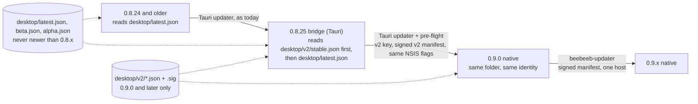

# Desktop 0.9.0 on Windows: the installer and the updater without Tauri

Lane P1, 2026-11-11. Ruling (Guus, 2026-11-11): 0.9.0 is the native Rust app (`native/beebeeb-drive-rune`, binary
`beebeeb-drive`), shipped **in place**: a 0.8.x install updates to it through the updater it has and keeps its
account, settings, `state.db`, sync folder and credentials. Amended the same day: a Tauri **0.8.25 bridge** is
allowed and wanted. Line numbers are at `v2-native` `b9e73441`.

**Amended 2026-11-11 after the independent security review of PR #283 ("Delta 2").** Where a paragraph below was
changed it says so; the rulings behind the changes: Guus, 2026-11-11 11:40: the updater key moves into the
`desktop-release` environment AND the native line gets its own, password-protected key; keep the Windows MSI;
GitHub "Latest" shows 0.9.0 only when it is stable; the update host stays GitHub Pages for now.

## 1. Today, exactly (0.8.x on Windows)

**Check.** 5 s after start, every 4 h (`activity_conflict_commands.rs:825-827`, `native_menu.rs:6-14`) and on "Check
for updates" (`update_window.rs:380`). The URL is built in code, with no `{{current_version}}` template:
`https://releases.beebeeb.io/desktop/{latest|beta|alpha}.json` (`update_window.rs:121-134`).

**Hosting.** `releases.beebeeb.io` is GitHub Pages of `beebeeb-io/releases` (`curl -I`, 2026-11-11: `server:
GitHub.com`); artefacts are GitHub release assets, `https://github.com/beebeeb-io/desktop/releases/download/
desktop-v<V>/<file>` (`release.yml:686`). Both are US systems (§8.2).

**Manifest** (`release.yml:851-887`; the published stable one is the fixture
`crates/beebeeb-updater/tests/fixtures/desktop-latest-0.8.22.json`): `version` (plain semver), `notes` (the release
body), `pub_date`, and `platforms`: `linux-x86_64`, `windows-x86_64` and `windows-x86_64-nsis` (both the NSIS
`Beebeeb_<V>_x64-setup.exe`), `windows-x86_64-msi`, `darwin-aarch64` when the Mac was built; each `url` +
`signature`. The manifest itself is **not signed**.

**Signature.** minisign (Ed25519 over BLAKE2b-512 of the file), written by Tauri's signer: the `.sig` asset and the
manifest field are base64 of the signature text, whose trusted comment is `timestamp:<unix>\tfile:<file name>`. The
verifying key is `plugins.updater.pubkey` (`tauri.conf.json:76`, key id `C6FADFD59D732197`); the private half is
only the CI secret `TAURI_SIGNING_PRIVATE_KEY` (`docs/RELEASING.md`, "Updater Signing Key Rotation"). Tauri verifies
the bytes only (`tauri-plugin-updater` 2.10.1 `updater.rs:1453-1463`): not the signed name, not the time.

**Offer and install.** A background check offers only a newer version; a manual check also reports an older channel
build, installed only by `install_channel_downgrade` with the version named (`update_window.rs:155-160`, `:539-567`).
Nothing installs without the person's click ("Restart to update", `src/v2/updateCopy.ts`), and there is **no** rule
that defers an install while changes are unsynced (0 matches in `update_window.rs`, `native_menu.rs`,
`src/v2/update.ts`). The updater downloads into memory, verifies, writes
`%TEMP%\Beebeeb-<V>-updater-*\Beebeeb-<V>-installer.exe`, starts it with `/P /R /UPDATE /ARGS` (`installMode:
passive`, `tauri.conf.json:78`; `updater.rs:786-866`) and calls `std::process::exit(0)`: the engine is not stopped
first. The installer closes a `beebeeb-desktop.exe` still running, replaces it, and `/R` starts it again.

**Installer** (the script `tauri build` generates, read from a real build:
`C:\bb-win\testbuild\target\release\nsis\x64\installer.nsi`). Per user, no elevation (`installMode: currentUser`,
`tauri.conf.json:98`); the hooks file adds nothing. On a PC without the WebView2 runtime a fresh install downloads
Microsoft's bootstrapper (`go.microsoft.com/fwlink/p/?LinkId=2124703`); an update skips that. No `beebeeb://`
protocol, file association or deep-link plugin exists (0 matches). Installer and uninstaller do nothing about the
Cloud Files sync root: the app registers it and only sign-out unregisters it (`windows_cf/mod.rs:336`, `:703`).

## 2. The bridge: 0.8.25 (Tauri), then 0.9.0 (native)

**The stepping stone is two manifest addresses, not a manifest feature.** Tauri's updater has no "minimum version"
field; its only version switch is the `{{current_version}}` URL template (`updater.rs:413-440`), which 0.8.x never
used and which a static host cannot route by range anyway. So: the legacy manifests keep carrying the 0.8.x line
only, and native builds are published only to `desktop/v2/{stable,beta,alpha}.json`. No older build knows it.

- **(a) On 0.8.25 or later (clean path).** 0.8.25 on Windows checks `[v2, legacy]` in that order; Tauri takes the
  first endpoint that returns a release (`updater.rs:470-520`), so before 0.9.0 exists (v2 answers 404) it still
  gets 0.8.x hotfixes, and from the day v2 exists it is offered 0.9.0. One click, one passive installer, the native
  app starts in the same folder. The v2 manifest is the 0.8.x shape plus `product`, `channel` and
  `platforms.*.size`; the Tauri parser has no `deny_unknown_fields` on these types (`updater.rs:71-84`), which the
  rehearsal proves on a real build (§7 R1).
- **(b) On 0.8.24 or older when 0.9.0 is published.** They never see 0.9.0. Their updater offers the newest 0.8.x
  in the legacy manifest (0.8.25 or a later 0.8.x); after that restart the 5-second check offers 0.9.0. Two
  restarts, each asked for, no manual download. An install older than 0.3.0 could never update in place (key
  rotation, `docs/RELEASING.md`) and still needs one manual reinstall. An unmodified ≤ 0.8.24 updater *could*
  install 0.9.0 directly if it were signed by the 0.8.x key, and then every old layout since 0.3.0 would be an
  upgrade source for the native engine. **Decision (lane, 2026-11-11): 0.9.0 is offered to 0.8.25+ only,
  because** the native engine then has one tested predecessor (data layout, credential names, sync-root state), a
  bad 0.9.0 is withdrawn without touching the 0.8.x line (§7 R7), and macOS/Linux keep updating from the legacy
  manifests unchanged.
- **How "0.8.25+ only" is enforced (Delta 2; the review found it enforced nowhere).** Three independent locks:
  1. **The key.** Native installers and v2 manifests are signed by the v2 key only (§4). A client on 0.8.24 or
     older trusts only the 0.8.x key, so a native installer served to it at a legacy address fails Tauri's
     signature check and is never started. (With one shared key this lock would not exist and lock 2 alone would
     hold: that was the design before Guus's ruling.)
  2. **The installer.** It refuses to run over an installed version below 0.8.25, in every mode, before a file is
     touched; a version that is empty or does not parse counts as below (§5). This is what stops a person who
     downloads 0.9.0 from the site and runs it over an old install.
  3. **The app.** On its first start the native app reads the hand-off note 0.8.25 wrote
     (`crates/beebeeb-updater/src/handoff.rs`, `arrival()`): earlier state without a note from 0.8.25 or later,
     for this very version, is `WithoutHandoff`, and the shell must not assume the pre-flight ran.
- **MSI installs:** v2 has no MSI entry, so they fall back to `windows-x86_64` (the NSIS file); the installer's WiX
  branch removes the MSI first (one UAC prompt) and installs per user. Rehearsal variant B.

**(c) What 0.8.25 contains for this:** `docs/superpowers/plans/2026-11-11-bridge-0.8.25.md`, with the exact
changes for the `main` lane (not applied on this branch, not compiled). All in `src-tauri/src/update_window.rs`:

1. Windows endpoints become `[<base>/desktop/v2/<channel>.json, <base>/desktop/<legacy>.json]`.
2. `download` → pre-flight → `install` instead of `download_and_install`. Pre-flight (10 s at most, best effort):
   record `installed_release_channel` (§8.3), write `%LOCALAPPDATA%\io.beebeeb.app\update-handoff.json`
   (`from`, `to`, `channel`, `at`), stop the engine, `CfDisconnectSyncRoot` (`windows_cf/mod.rs:258-301`), and
   checkpoint `state.db`'s WAL.
3. Tasks 2446 + 2447 (already in 0.8.25): the Tauri app writes the credential owner tags.
4. **Required** (Delta 2): after the download, the verified signature must sign the file the URL ends in, and that
   name must carry the manifest's version; a version that does not parse is refused. This closes §8.1 for the
   **old-format** manifests too, on 0.8.25 and later (Windows and Linux; the Mac bundle's name has no version: the
   plan states macOS's exposure and what closes it).
5. **Required** (Delta 2): a version of 0.9.0 or later is installed only if the v2 manifest, signed by the v2 key,
   names the same version, URL and signature; and only such a version may come from the v2 address at all.
6. **Required** (Delta 2): 0.8.25 trusts two keys, each for its own line: the 0.8.x key for versions below 0.9.0
   and the v2 key (`src-tauri/updater-v2.pub`, the same file as `crates/beebeeb-updater/keys/updater-v2.pub`)
   for 0.9.0 and later. 0.8.25 itself is signed by the 0.8.x key, so every older client can install it.

No pipeline change is needed for 0.8.25: `release.yml` publishes it as any 0.8.x.

## 3. Identity: what stays byte-identical, and what the native app must keep reading

| Value | Today | Where it is fixed | 0.9.0 |
|---|---|---|---|
| Product name | `Beebeeb` | `tauri.conf.json:3`; NSIS `PRODUCTNAME` | same |
| Identifier | `io.beebeeb.app` | `tauri.conf.json:5`; NSIS `BUNDLEID` | same |
| Publisher in the uninstall entry | `beebeeb` | NSIS `MANUFACTURER` (derived by Tauri from the identifier) | same |
| Install folder | `%LOCALAPPDATA%\Beebeeb` | NSIS `.onInit`, and `HKCU\Software\beebeeb\Beebeeb` (default) | same |
| Main binary | `beebeeb-desktop.exe` | NSIS `MAINBINARYNAME`; `HKCU\…\Uninstall\Beebeeb\MainBinaryName` | **same file name** (a test build: `beebeeb-desktop-test.exe`, §5) |
| Uninstall entry | `HKCU\Software\Microsoft\Windows\CurrentVersion\Uninstall\Beebeeb` | NSIS `UNINSTKEY` | same key |
| Shortcuts | `Start Menu\Programs\Beebeeb.lnk`, `Desktop\Beebeeb.lnk`, AppUserModelID `io.beebeeb.app` | NSIS | same |
| Autostart | `HKCU\…\CurrentVersion\Run` value `Beebeeb` = `"<exe path> "`, + `…\Explorer\StartupApproved\Run` | `app_run.rs:46`; `auto-launch` 0.5.0 `windows.rs:6-8` | same value name and exe path |
| Updater key | minisign `C6FADFD59D732197` | `tauri.conf.json:76` | **new: the v2 key**, minisign `FED25848C41F2348` (`crates/beebeeb-updater/keys/updater-v2.pub`, test-pinned); the old key stays the 0.8.x line's (§4) |
| Artefact name | `Beebeeb_<V>_x64-setup.exe` | `release.yml:766` | same |

**Decision (lane, 2026-11-11): the native binary is installed as `beebeeb-desktop.exe`, because** five things hold
that path today and none is rewritten by an installer: the autostart value, the Cloud Files icon resource
(`"<exe>,0"`, `windows_cf/mod.rs:588-591`), two COM `LocalServer32` entries (`status_ui.rs:485`,
`thumbnail_provider.rs:470`), 0.8.x's `/R` relaunch, and the installer's "is it running" check. The crate's binary
stays `beebeeb-drive`; `build-installer.ps1` renames it while staging. A later rename is possible.

**Paths the native app must keep reading** (contract for the engine and shell lanes; none depends on Tauri at run
time, but two were *resolved by* Tauri and must now be spelled out):

- State: `%LOCALAPPDATA%\io.beebeeb.app\` = Tauri's `app_local_data_dir()` (`state_paths.rs:27-31`): `state.db`
  (+ `-wal`, `-shm`), `.beebeeb-sync.lock` (the single-instance lock, `lockfile.rs:72`), `.device.json`,
  `legacy-sync-root-state\` (`state_paths.rs:11-15`). The native app derives this from the identifier constant.
- Config: `%APPDATA%\beebeeb\desktop.toml` (`config/paths.rs:12-17`; `dirs::config_dir()`, not the identifier).
- Window frame: `%APPDATA%\io.beebeeb.app\main-window-frame.json` (ours; the plugin's `.window-state.json` is ignored).
- Credentials: Windows Credential Manager, generic, target `io.beebeeb.app/<account id>/<leaf>` with leaves
  `session-token`, `wrapped-master-key`, `account-email`; legacy flat `io.beebeeb.app/<leaf>` (`keychain.rs:11`,
  `:629`; `keychain/accounts.rs:66-93`). In 0.8.x a hard-coded constant, so a Tauri test build shares them with
  the real app. **The native app must not (Delta 2, §5):** it derives the target prefix from its build-time
  identifier, so a test build reads and writes `io.beebeeb.app.test/…` only.
- Sync root: id `Beebeeb!<fnv1a64 of the folder path>`, provider id `Beebeeb`, provider GUID
  `b33b33b0-5217-4c0a-9e3f-1f2a7c4d8e90` (`windows_cf/mod.rs:90`, `:165`; `registration.rs:117-157`). The native
  engine re-registers with `CF_REGISTER_FLAG_UPDATE` on start, as today.
- New: `%LOCALAPPDATA%\io.beebeeb.app\updater.json` (replay marks) and `…\updates\` (staged installer). Removed
  by the installer: `…\EBWebView\` (WebView2's profile; nothing else reads it).

## 4. The new updater (`crates/beebeeb-updater`)

A library: no Tauri, no UI, no network or clock of its own (`cargo tree -e normal | grep -c tauri` prints 0).

**Signatures and keys (replaced in Delta 2; Guus, 2026-11-11 11:40).** The format stays the exact minisign form
Tauri's signer writes (it already signs a time and a file name, which Tauri ignores and we use); the verifier is
`minisign-verify` 0.2.5, the crate Tauri's updater uses (no dependencies); legacy (not pre-hashed) signatures are
refused, also when our own key made them (`signature.rs`, `refuses_a_legacy_signature_by_our_own_key`).

There are **two keys, one per release line**:

| Key | Signs | Trusted by | Private half |
|---|---|---|---|
| 0.8.x key, `C6FADFD59D732197`, no password | 0.8.x artefacts, 0.8.25 included | every 0.8.x build; 0.8.25 for versions below 0.9.0 only | environment secret `TAURI_SIGNING_PRIVATE_KEY` (+ `_PASSWORD`) |
| v2 key, `FED25848C41F2348`, password-protected | native installers and v2 manifests | 0.8.25 for 0.9.0 and later only; every native build, for 0.9.0 and later, and nothing else | environment secret `UPDATER_V2_PRIVATE_KEY` (+ `_PASSWORD`) |

In the crate a build's trust is a **list of keys, each with a version scope** (`policy.rs`: `Trust.keys`,
`TrustedKey { key, valid_for: KeyScope { from, before } }`). A signature by a trusted key for a version outside its
scope is refused (`Refusal::KeyNotValidForVersion` for a manifest, `ArtifactSignature` for an artefact). A native
build's list has one entry (`host::windows_trust_built_at`: the v2 key from 0.9.0 on); a later rotation is one
release whose list has two. The public key is one committed file, `crates/beebeeb-updater/keys/updater-v2.pub`
(`include_str!` in the crate, `--pubkey` / `--pubkey-file` in the release scripts, `src-tauri/updater-v2.pub` in
0.8.25); `a_release_build_has_the_v2_key` holds it to: a minisign key, not a placeholder, not the 0.8.x key, and
the release workflow names that test in its gate.

**Signed manifest.** New: `desktop/v2/<channel>.json.sig`, a detached signature of the manifest bytes by the same
key, whose signed file name is the channel's manifest file. The rules, in order (`policy.rs`, one test and one
killed mutant each; "the same key" is the v2 key since Delta 2):

1. The manifest's signature verifies under a trusted key and signs this channel's file name (`stable.json` is not
   `beta.json`).
2. The manifest parses **strictly** (Delta 2): every field is one this build knows, none is given twice, no
   platform is named twice, and `product`, `channel` and each `size` are present. What is signed is exactly what
   is understood. Consequence, accepted: the v2 field set is frozen; a new field needs a new manifest address.
   It says `product: desktop` and this channel, and its key may sign its version.
3. Its signed time (Delta 2: three bounds, `now` is this PC's clock):
   - not more than 24 hours ahead of `now` (`SignedInTheFuture`): a signature made with a wrong clock is refused
     and never becomes the mark, so it cannot block a channel; a mark that is already further ahead than that is
     not believed (the clock was set back since) and is replaced by the next manifest;
   - not older than the newest manifest this install accepted on the channel (`StaleManifest`; persisted per
     channel, so a replayed older manifest is refused after a restart too);
   - **not older than this build** when it offers anything newer (`OlderThanThisBuild`). Every release build has
     its own time baked in (`BEEBEEB_BUILD_NOT_BEFORE`, `host::BUILD_NOT_BEFORE`; see "The build time" below). A fresh install, a deleted `updater.json` and the bridge have no mark, and without this rule they took
     any old signed manifest above their own version, a withdrawn one included. **Decision (lane, 2026-11-11): a
     manifest signed before the build offers nothing: a newer version in it is refused, an equal or older one
     reads as "up to date", because** refusing it outright would turn every switch to a slower channel into an
     error and a false "not verified" warning, while offering its older build would let a withdrawn build come
     back as a downgrade on a fresh install. Cost, accepted: a person who moves to a slower channel is offered
     that channel's older build only after the channel's next manifest (a promotion re-signs it: one dispatch).
4. Equal version: up to date.
5. The artefact for `windows-x86_64-nsis` (then `windows-x86_64`) is at `https://releases.beebeeb.io/<plain path>`:
   https, that exact host, no port, user, query, fragment or dot segment.
6. It has a `size` in `1..=512 MiB`.
7. Its signature is by a trusted key that may sign this version (checked before a byte is downloaded), and signs
   the file name the URL ends in, which must be exactly `Beebeeb_<version>_<rest>.exe`. An old release's installer
   with its honest signature therefore cannot be offered as a newer version, and a manifest's signature (it signs
   `<channel>.json`) can never pass as an artefact's, nor the reverse.
8. Nothing below 0.9.0 is ever installed (a native build is never replaced by the Tauri app).
9. Older than installed: a downgrade. A background check holds the installed build; a manual check reports it, and
   only `DownloadDowngrade(<that version>)` starts it (today's rules, `update_window.rs:151-160`, `:553-559`).

**The build time (Delta 3). Release rule: a native build can only take manifests signed after its own commit
time.** The time baked in is the time of the commit the build is made from (`git log -1 --format=%ct`), so it is
reproducible and never later than the manifest the same run signs. It is held three times: the crate's `build.rs`
stops a build whose `BEEBEEB_BUILD_NOT_BEFORE` is set and is not plain digits of at least 2026-11-11 (the day the
v2 key was made, `policy::V2_KEY_CREATED`); the release workflow reads the mark `beebeeb-updater-not-before=<n>;`
out of the BUILT BINARY and refuses to go on unless it is exactly the commit's time; and at run time a build
without a plausible time takes no update at all: every check ends in `Failed { Refused(NoBuildTime) }`, a state
the UI shows. The rule is never silently off. (The mark is in the binary only once the shell links the updater:
until then the workflow refuses every native release, which is right.)
**Consequence for hotfix ordering:** a build made from a commit that is LATER than a channel's current manifest
does not accept that manifest when it names a newer version. Example: 0.9.3 is on stable, signed Monday; a hotfix
0.9.2 for an older line is committed Tuesday: its installs refuse the 0.9.3 manifest (`OlderThanThisBuild`) until
stable is signed again. So: **after every native release, re-publish (`publish_existing`) each channel manifest
that the new build should still be able to follow**, or release in commit order. The bridge 0.8.25 is not on the
native line and uses the fixed `V2_KEY_CREATED` instead of a time of its own (lead ruling, 2026-11-11).

**Freshness and withdrawal (replaced in Delta 2).** A host that keeps serving the last signed manifest (a freeze)
cannot be told from a quiet channel, and there is still no expiry field (**Decision (lane, 2026-11-11), kept:**
an expiring manifest needs the signing key on a schedule, a larger exposure than the freeze). What is done instead:

- **Withdrawing a build is publishing, never deleting.** A newer signed manifest that points at the build to go
  back to (`publish_existing` with that version) moves every client's mark past the withdrawn manifest, so it can
  never be served again to a client that saw the new one; a fresh install is covered by rule 3's build time for
  every manifest older than its own build. Removing a manifest revokes nothing: the host can serve it again.
- **The UI can say when nothing has been verified.** `Updater::freshness()` is `Unverified { days }` when no
  check has passed every rule for 14 days (`UNVERIFIED_WARNING_SECS`), counted from the last one that did, or
  from the build's own time if none ever did (so a deleted record cannot hide it). "Up to date" beside it would
  be a guess; the shell shows the warning with the last verified check's date. **What this state detects, and
  what it does not:** it detects blocking (no answer, or answers the rules refuse). It does NOT detect a replay
  freeze: a host that keeps serving the last manifest this install accepted passes every rule, the check counts
  as verified, and the install reads "up to date". Only an expiring manifest would show that, and that is the
  decision above.
- **An offer does not outlive the channel.** A background check while an offer, a resumable download or a staged
  update is on screen is `State::Rechecking { kept }` for one `Tick`: the UI keeps drawing `kept`; if the channel
  still offers exactly that, nothing changes; if it offers something else or nothing, the old offer and its staged
  file are dropped. No answer, or a refused one, is not news: `kept` stays.

**Apply. Decision (lane, 2026-11-11): download to a staging folder, verify, run the NSIS installer passively, let it
restart the app; not swap-in-place, because** a running exe cannot be replaced on Windows without a helper process,
the installer already closes the app, replaces the file, updates the uninstall entry's version and restarts it, and
it is the same mechanism every 0.8.x update has used. Staging is `%LOCALAPPDATA%\io.beebeeb.app\updates\`:
`<name>.part` while downloading, `<name>` once verified. The file is verified **again** at Apply, because it sits
in a folder the person's other programs can write, and (Delta 2) the check and the start are one hold: at Apply
everything else in the folder is removed (an installer loads from its own folder first), the file is opened so
that nothing can write, replace, rename or delete it (`host::open_denying_writes`: Windows share mode read only),
verified through that handle, and the handle is kept until the installer process exists. The path and the handle
travel as one `VerifiedInstaller`, which only the machine can make (Delta 3): `Apply::launch` receives it, and its
`start_nsis(EngineStopped)` is the only way to start an installer, so no public function starts a path that was
not just verified. Windows-only code: two `#[cfg(windows)]` tests, run by CI on a hosted Windows runner (`ci.yml`,
job `updater-windows`, each test named in the gate) and on the lead's native list.

**State machine** (`machine.rs`): one `State` and one `step(Event)`. States: `Idle`, `Checking`, `UpToDate`,
`Available { offer }`, `Downloading { received, total }`, `Verifying`, `ReadyToRestart`, `Restarting`,
`Failed { failure, resume }`. `Failure`: `Offline`, `ServerStatus(u16)`, `Refused(Refusal)`, `WrongSize`,
`BadSignature`, `DownloadInterrupted { received, total }`, `DowngradeChanged`, `Disk`, `InstallerDidNotStart`. No
string from the network reaches the UI. Each `Tick` does one bounded piece of work (the shell runs it on a worker
thread). `Http`, `Clock`, `Store` and `Apply` are traits; tests never start an installer.

- **Resume:** a dropped connection asks for the rest (`Range: bytes=<n>-`); a 200 starts over; a 206 from another
  offset is refused; three attempts in a row without a new byte stop with `DownloadInterrupted`, keeping the part
  for the next `Download`. Never more than `size` bytes are read; a stated total that differs is `WrongSize`.
- **Never automatic:** nothing is installed without `Event::Apply`, which only "Restart to update" sends (today's
  rule: no auto-install; and today's gap: no unsynced-changes rule, §1).
- **The engine is stopped before the installer starts: a precondition in the types (Delta 2; the review found
  `machine.rs` and this section contradicting each other).** `Apply::launch(installer, offer, EngineStopped)`
  cannot be called without an `EngineStopped`, and the machine gets one only from `Apply::stop_engine()`, which the
  shell implements as: stop the sync engine, park every upload in progress (resumable after the restart), then
  mint the proof. The order inside `Event::Apply` is fixed: verify the file, stop the engine, start the installer.
  If the engine does not stop: `Failed { EngineStillRunning }`, nothing is started, the staged update is kept. If
  the installer does not start: `Apply::resume_engine()`. A bad file never costs a running engine (it is refused
  first). **Decision (lane, 2026-11-11), kept:** an update does not wait for unsynced changes to drain, **because**
  parked uploads resume and local changes are in `state.db`, which the installer does not touch; blocking would
  leave a person with a large queue unable to take a fix for it.
- **Proxy and TLS** (`net.rs`, feature `net`): reqwest's defaults, as the engine's client (`HTTPS_PROXY`,
  `NO_PROXY`, the Windows system proxy; no prompt for a proxy password). TLS is the OS stack, so a company root is
  honoured; https only, no redirect followed, no header but a fixed user agent and `Range`.
- **Channels and the manual check:** `Event::Check { channel, intent }`; the channel comes from
  `DesktopConfig.release_channel`, and the shell writes `installed_release_channel` when it sees `Restarting`.
  `background_check_due()` keeps today's 4 hours.

## 5. The installer

**Decision (lane, 2026-11-11): NSIS, built by plain `makensis` from the script Tauri generated for 0.8.x
(`packaging/windows/installer.nsi`), because** the in-place upgrade decides it: 0.8.x's updater starts whatever it
downloads as an NSIS installer with `/P /R /UPDATE /ARGS` and exits (`updater.rs:801-865`), and the existing
install is found through NSIS's own keys (§3). An MSI (WiX) would be per machine or a second per-user product with
its own uninstall entry and no knowledge of the NSIS install; MSIX installs into a package container with
redirected app data and its own identity, which breaks every path in §3 and the Cloud Files registration, and needs
a Store or sideloading certificate. The script is kept line for line, with four marked changes: identity passed in
by the build script, the WebView2 section removed, the file-association include removed, our hooks (remove
`EBWebView` after install; remove `updates\` on uninstall). It still uses the `nsis_tauri_utils` 0.5.3 plugin DLL
(process lookup, semver compare, start-as-user; MIT/Apache-2.0; SHA-256 pinned in `build-installer.ps1`): an NSIS
plugin packed into the installer, not Tauri in the app.

- **Test mode shares nothing with the real app (replaced in Delta 2; data-loss class).** `Beebeeb Test`,
  `io.beebeeb.app.test`, binary `beebeeb-desktop-test.exe`, unsigned. **Contract for the shell lane:** the native
  binary takes its identifier at build time (`BEEBEEB_APP_IDENTIFIER`, default `io.beebeeb.app`) and derives from
  it the state folder (`%LOCALAPPDATA%\<id>`), the config file (`%APPDATA%\beebeeb-test\desktop.toml` for the test
  identifier), the credential target prefix (`<id>/…`), the single-instance lock and the sync-root provider id, so
  a test build can never read or write the real account. `build-installer.ps1 -Mode test` refuses a binary that
  does not carry the test identifier (and release mode one that does): until the shell honours the variable, no
  test installer can be built, which is the safe state.
- **The installer never ends a process (replaced in Delta 2).** The template killed every process of the binary's
  name, without asking in passive mode. Now (`utils.nsh`, `CheckIfAppIsRunning`): a running native app is asked to
  quit through its single-instance channel (the installed binary is started with `--quit-for-update`; **contract
  for the shell lane:** the running instance stops the engine, parks uploads and exits; without a running instance
  the flag exits at once); the installer waits 20 seconds; then it says the app is still running and offers Retry
  or Cancel. A hung app is ended by the person. An update the app started itself needs no asking: the engine is
  already stopped and the process is exiting. Only this product's own binary name is looked at.
- **It refuses an install below 0.8.25** (`RefuseBelowBridge`, §2): message, exit code 3, nothing changed; when an
  old updater started it, the app that was installed is started again. NSIS installs are checked in `.onInit`
  (every mode), and so are MSI installs (Delta 3: the MSI scan is a function, `FindWixInstall`, that `.onInit`
  calls too, so a silent `/S` run refuses as well).
- **Code signing:** unchanged in substance. Today Tauri calls `scripts/windows/sign-artifact.ps1` for the app
  binary, the uninstaller and the installers (`release.yml:365-383`), and `verify-authenticode.ps1` gates
  publication (`:488-510`). Now `build-installer.ps1 -Mode release` calls the same script for the same three files
  (the uninstaller through NSIS `!uninstfinalize`, as Tauri does) and refuses to run without
  `BEEBEEB_REQUIRE_SIGNING=1`; the gate expects 1 installer instead of 2 (no MSI).
- **The binary needs an icon and a version resource** (none today: no `build.rs` in `native/beebeeb-drive-rune`);
  release mode refuses a binary whose version resource is not `Beebeeb <V>`. Shell lane.
- **Size:** the Tauri installer of 0.8.22 is 8,854,808 bytes (measured). The native one is not measured: there is
  no native Windows release binary yet (§10).
- **Uninstall:** as today; the sync root stays registered and the Credential Manager entries stay after an
  uninstall, also with "delete app data" ticked. Delta 2 makes the box say so ("This does not sign you out and
  does not remove the Beebeeb folder from Explorer: sign out in Beebeeb before uninstalling") instead of removing
  them from NSIS script that no lane can run. Follow-up, not 0.9.0: an `--uninstall-cleanup` entry point of the
  native app (credentials + sync root) that the uninstaller calls before it deletes the binary.
- **Toolchain pin (Delta 2):** NSIS 3.11 as released, by SHA-256: the archive in the workflow, and
  `Bin\makensis.exe` and the stub `Stubs\lzma_solid-x86-unicode` again in `build-installer.ps1` (release mode
  refuses anything else); the plugin DLL was already pinned.

## 6. Release pipeline and hosting

`release.yml` is not changed. New: `.github/workflows/release-native-windows.yml` (same inputs; refuses a version
below 0.9.0), `scripts/native-channel-manifest.mjs` and `scripts/publish-release-files.sh`. Same gates: authored
`RELEASE_NOTES.md` (validator with `--no-macos`), `RELEASE_BLOCKERS.md`, the branch-point check, the Authenticode
gate, the key guard. It builds the native crate (baking in the build's time), packages and Authenticode-signs,
signs the installer and then the manifest with the v2 key (`tauri signer sign`, used as a signing tool; the key
reaches it by environment only) and verifies both against the committed public key, creates `desktop-v<V>` with
the authored notes (`make_latest: false`; a release becomes GitHub's "Latest" only when its stable manifest is
published: job `mark-latest`, Guus 2026-11-11), stages the files and publishes them. It never writes
`desktop/latest.json`, `beta.json` or `alpha.json` (the publish script refuses any path but the two below).
**MSI (Guus, 2026-11-11: keep the Windows MSI):** this pipeline builds the NSIS installer only; a native MSI is
not designed or built here and is open (§9 Q4).

**The signing boundary (Delta 2; review P1-1; details in task 2451, not repeated here).**

- Every job that signs names `environment: desktop-release`: `build` and `publish-manifest` here,
  `sign-macos-updater-artifact.yml`'s `sign`, and `release.yml`'s `build` (it already did; its `publish-manifest`
  holds no key). A promotion (`publish_existing`) is the same `publish-manifest` job, so the same gate.
- No step that holds a key installs dependencies: `bun install` and the signer's own install are separate steps
  without the key; the signing steps run the installed signer and nothing else, and read the key from the
  environment, never a command line.
- Before signing, in the workflow: the run's ref is `main` or `release/*`; a `release/*` ref passes the reviewed
  branch-point check, also for a promotion; the tag being published is in the history of that ref and has a
  published release; publishing runs one at a time (`concurrency: desktop-native-publish-manifest`).
- **The release tag is never checked out (Delta 3; review P1-A).** A promotion's scripts, signer and public key
  come from the dispatched commit (`github.sha`), not from `desktop-v<V>`: a bare `ref: desktop-v0.9.0` resolves
  a branch of that name before the tag, and any writer can push one. The tag is read only by its full name
  (`refs/tags/…`), for the ancestry check and to name the release whose assets are published; a branch carrying a
  release tag's name is refused outright (`scripts/native-release-ref-check.sh`, 21 self-tests, also in `ci.yml`).
  The public key file's SHA-256 is pinned in the workflow and in `tests/nativeChannelManifest.test.ts`, and the
  crate, the key, the packaging and the release scripts have `CODEOWNERS` entries.
- **These in-file checks are the second line.** A branch can carry its own copy of a workflow, so what holds is the
  environment's own rules, which only Guus can set:

**Settings Guus must make (a lane cannot change repository settings).** In `beebeeb-io/desktop` → Settings:

1. Environments → `desktop-release` → Environment secrets: add `UPDATER_V2_PRIVATE_KEY` and
   `UPDATER_V2_PRIVATE_KEY_PASSWORD` (the new key), and add `TAURI_SIGNING_PRIVATE_KEY` and
   `TAURI_SIGNING_PRIVATE_KEY_PASSWORD` with their current values.
2. Secrets and variables → Actions → Repository secrets: **delete** `TAURI_SIGNING_PRIVATE_KEY` and
   `TAURI_SIGNING_PRIVATE_KEY_PASSWORD` (an environment secret wins while both exist, but the repository copy stays
   readable outside the environment until it is deleted). The v2 key is never a repository secret.
3. Environments → `desktop-release` → Required reviewers: Guus (and Bram once provisioned); "Prevent self-review"
   off while there is one operator.
4. Environments → `desktop-release` → Deployment branches and tags → Selected: `main` and `release/*`. No tag rule.
5. Rules → Rulesets (Delta 3): a **tag** ruleset on `desktop-v*` (restrict creation, update and deletion to the
   release workflow's actor and Guus), and a **branch** ruleset that forbids creating any branch named
   `desktop-v*` (target `desktop-v*`, "Restrict creations", no bypass). The workflow refuses such a branch when it
   sees one; the ruleset stops it from existing.
6. Branch protection on `main`: "Require review from Code Owners" on, so the `CODEOWNERS` entries bind.
7. Check (task 2451): `gh secret list` shows the four names only under the environment; a dispatch of a signing
   workflow from a throwaway branch stops at the environment and never starts a step.

Order: merge the workflow changes first (steps 1 and 2 break any signing job that does not name the environment,
which after this PR and lane H1's is none), then 1, then 2 to 6, then 7.

**Layout under `https://releases.beebeeb.io/`** (the same on any host):

| Path | Content | Cache |
|---|---|---|
| `desktop/artifacts/<V>/Beebeeb_<V>_x64-setup.exe` | the installer; never replaced by other bytes | `public, max-age=31536000, immutable` |
| `desktop/v2/{stable,beta,alpha}.json` and `….json.sig` | manifest and its detached signature | `public, max-age=300, must-revalidate` |
| `desktop/{latest,beta,alpha}.json` | the 0.8.x manifests, written by `release.yml` only | as today (600 s) |

The host must answer `Range` requests (resume), serve over https without redirecting, and needs nothing else: no
code, no key. **The key never touches the host:** both signatures are made in CI before the publish step, which
gets only a staged tree and a target (`dir:<path>`: the `beebeeb-io/releases` checkout, today; `s3://…`: an
S3-compatible bucket; `rsync:…`: our own web server), chosen by the repository variable
`DESKTOP_RELEASE_PUBLISH_TARGET`. A publish credential can therefore withhold or freeze files, not forge them
(§4 rules 1, 3, 7). Moving to EU hosting (decision 2450) is a DNS change plus that variable.

## 7. Risks, how each is handled, and its test

| # | Risk | Handling | Test |
|---|---|---|---|
| R1 | 0.8.25's Tauri parser rejects the v2 manifest's extra fields | fields are additive; types have no `deny_unknown_fields` | rehearsal step 6 (a real Tauri build reads a v2 manifest) |
| R2 | The old updater restarts an exe that no longer exists | the file name does not change (§3) | rehearsal step 8; `verify-install.ps1` (`MainBinaryName`) |
| R3 | NSIS replaces the binary while the app runs with the Cloud Files provider connected | 0.8.25 pre-flight disconnects first (§2 item 2); without it the installer kills the process, as in every 0.8.x update; `state.db` is WAL and not in the install folder | rehearsal steps 7-9, with the app running and syncing |
| R4 | Explorer holds placeholders or a file is open in the sync folder | the installer touches only `%LOCALAPPDATA%\Beebeeb`; the sync root registration is untouched and the native engine reconnects with the same id | rehearsal step 10 (a placeholder open in Explorer during the update) |
| R5 | Two uninstall entries (NSIS + MSI, or old + new) | same `UNINSTKEY`; the WiX branch removes an MSI install | `verify-install.ps1` "exactly one uninstall entry"; rehearsal variant B |
| R6 | The native engine cannot open a state written by an old Tauri build | only 0.8.25+ is an upgrade source, enforced three times: the v2 key, the installer's refusal, the hand-off note (§2 b) | `handoff.rs` tests; native check 3 in `packaging/windows/README.md`; engine lane |
| R7 | A bad 0.9.0 reaches everyone | alpha, then beta, then stable (build once, promote by manifest). **Withdraw by publishing a newer signed manifest that points back** (`publish_existing` with the good version): removing a manifest withdraws nothing, the host can serve it again (§4, "Freshness and withdrawal") | `a_background_check_drops_an_offer_the_channel_has_withdrawn_or_replaced`, `a_manifest_older_than_this_build_never_installs_anything_even_with_no_mark` |
| R8 | Rollback to an old signed build through the update server | §4 rules 1, 3, 7 | `policy_tests.rs`, `machine_tests.rs` (34 of 34 mutants killed) |
| R9 | A partial or swapped file is run; `EBWebView` stays locked | `.part` until verified, verified again at Apply; best-effort removal, repeated by the next install | `machine_tests.rs`; `verify-install.ps1` |

Rehearsal and the lead's commands: `packaging/windows/README.md`.

## 8. Security findings in today's path (reported to the lead before any change; none changed here)

1. **Rollback through the release host.** The manifest is unsigned and the artefact signature is bound to nothing
   but the bytes (§1). Whoever can write the channel manifest (the `beebeeb-io/releases` repo, its push token,
   GitHub Pages) can set `"version": "9.9.9"` with the URL and signature of any old release since 0.8.4: every
   client offers it, and "Restart to update" installs the old build. Not run against production. The native
   updater closes it (§4); the bridge closes it for 0.8.25+ (§2 c, items 4-5). Filed as task 2449 [P0].
2. **US systems in the update path** (§1): existing, not extended; one host name to move (decision 2450).
3. **A record never written** (not security): `record_installed_release_channel` after `download_and_install` is
   unreachable on Windows (`update_window.rs:522`, `updater.rs:865`).

## 9. Open questions that are Guus's

- **Q1 (decision 2450). Where is `releases.beebeeb.io` served from for 0.9.0?** Guus, 2026-11-11: it stays GitHub
  Pages for now. A US system in the update path, existing and not extended; the client still allows one host
  name, so moving is a DNS change plus one repository variable (§6).
- **Q2. The updater key.** Answered (Guus, 2026-11-11 11:40): both. The old key moves into the environment; the
  native line has its own password-protected key (§4, §6).
- **Q3. GitHub "Latest" and beebeeb.io/download.** Answered: "Latest" shows 0.9.0 only when it is stable
  (`mark-latest`). The download page's wording and day are still open.
- **Q4. The MSI.** Answered: keep the Windows MSI. Open consequence: the native pipeline builds no MSI (§6); an
  existing MSI install still moves to the NSIS installer through the WiX branch (§2).
- **Q5. Certificates:** none new; Azure Artifact Signing is unchanged.

## 10. What this PR does not do

- It runs nothing on Windows: `makensis`, the PowerShell scripts and the rehearsal are written, not executed (a
  lane cannot run Windows binaries). The lead's commands: `packaging/windows/README.md`.
- It does not wire the updater into the native shell or the engine crate (PR #280), add the icon/version resource,
  implement the 0.8.25 changes, or touch autostart, tray, single instance, macOS or Linux. Three contracts in §5
  and §2 are therefore promises the shell lane must keep, with nothing in this PR that can test them:
  `BEEBEEB_APP_IDENTIFIER`, `--quit-for-update`, and calling `handoff::arrival()` before `state.db` is opened.
- Delta 2 does not build a native MSI, does not remove credentials or the sync root on uninstall (the box says
  so), does not give the upgrade rehearsal a
  release-identity mode (README section B), and does not split `release.yml`'s build step, which compiles and
  signs in one step with the 0.8.x key present (changing it changes the 0.8.x release path).
- `release-native-windows.yml` passes `actionlint` and has never run; the `s3` and `rsync` publish targets have
  never run; `net::HttpsClient` compiles for Linux and `x86_64-pc-windows-msvc` and was never run against a server.
