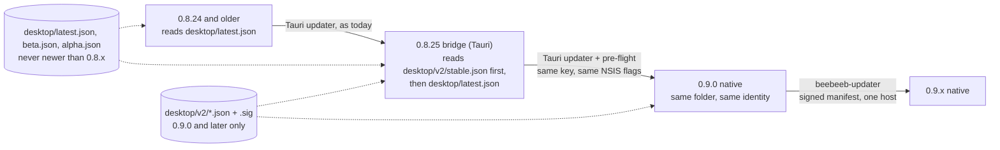

# Desktop 0.9.0 on Windows: the installer and the updater without Tauri

Lane P1, 2026-11-11. Ruling (Guus, 2026-11-11): 0.9.0 is the native Rust app (`native/beebeeb-drive-rune`, binary
`beebeeb-drive`), shipped **in place**: a 0.8.x install updates to it through the updater it has and keeps its
account, settings, `state.db`, sync folder and credentials. Amended the same day: a Tauri **0.8.25 bridge** is
allowed and wanted. Line numbers are at `v2-native` `b9e73441`.

## 1. Today, exactly (0.8.x on Windows)

**Check.** 5 s after start, every 4 h (`activity_conflict_commands.rs:825-827`, `native_menu.rs:6-14`) and on "Check
for updates" (`update_window.rs:380`). The URL is built in code, with no `{{current_version}}` template:
`https://releases.beebeeb.io/desktop/{latest|beta|alpha}.json` (`update_window.rs:121-134`).

**Hosting.** `releases.beebeeb.io` is GitHub Pages of `beebeeb-io/releases` (`curl -I`, 2026-11-11: `server:
GitHub.com`); artefacts are GitHub release assets, `https://github.com/beebeeb-io/desktop/releases/download/
desktop-v<V>/<file>` (`release.yml:686`). Both are US systems (§8.2).

**Manifest** (`release.yml:851-887`; the published stable one is the fixture
`crates/beebeeb-updater/tests/fixtures/desktop-latest-0.8.22.json`): `version` (plain semver), `notes` (the release
body), `pub_date`, and `platforms`: `linux-x86_64`, `windows-x86_64` and `windows-x86_64-nsis` (both the NSIS
`Beebeeb_<V>_x64-setup.exe`), `windows-x86_64-msi`, `darwin-aarch64` when the Mac was built; each `url` +
`signature`. The manifest itself is **not signed**.

**Signature.** minisign (Ed25519 over BLAKE2b-512 of the file), written by Tauri's signer: the `.sig` asset and the
manifest field are base64 of the signature text, whose trusted comment is `timestamp:<unix>\tfile:<file name>`. The
verifying key is `plugins.updater.pubkey` (`tauri.conf.json:76`, key id `C6FADFD59D732197`); the private half is
only the CI secret `TAURI_SIGNING_PRIVATE_KEY` (`docs/RELEASING.md`, "Updater Signing Key Rotation"). Tauri verifies
the bytes only (`tauri-plugin-updater` 2.10.1 `updater.rs:1453-1463`): not the signed name, not the time.

**Offer and install.** A background check offers only a newer version; a manual check also reports an older channel
build, installed only by `install_channel_downgrade` with the version named (`update_window.rs:155-160`, `:539-567`).
Nothing installs without the person's click ("Restart to update", `src/v2/updateCopy.ts`), and there is **no** rule
that defers an install while changes are unsynced (0 matches in `update_window.rs`, `native_menu.rs`,
`src/v2/update.ts`). The updater downloads into memory, verifies, writes
`%TEMP%\Beebeeb-<V>-updater-*\Beebeeb-<V>-installer.exe`, starts it with `/P /R /UPDATE /ARGS` (`installMode:
passive`, `tauri.conf.json:78`; `updater.rs:786-866`) and calls `std::process::exit(0)`: the engine is not stopped
first. The installer closes a `beebeeb-desktop.exe` still running, replaces it, and `/R` starts it again.

**Installer** (the script `tauri build` generates, read from a real build:
`C:\bb-win\testbuild\target\release\nsis\x64\installer.nsi`). Per user, no elevation (`installMode: currentUser`,
`tauri.conf.json:98`); the hooks file adds nothing. On a PC without the WebView2 runtime a fresh install downloads
Microsoft's bootstrapper (`go.microsoft.com/fwlink/p/?LinkId=2124703`); an update skips that. No `beebeeb://`
protocol, file association or deep-link plugin exists (0 matches). Installer and uninstaller do nothing about the
Cloud Files sync root: the app registers it and only sign-out unregisters it (`windows_cf/mod.rs:336`, `:703`).

## 2. The bridge: 0.8.25 (Tauri), then 0.9.0 (native)

**The stepping stone is two manifest addresses, not a manifest feature.** Tauri's updater has no "minimum version"
field; its only version switch is the `{{current_version}}` URL template (`updater.rs:413-440`), which 0.8.x never
used and which a static host cannot route by range anyway. So: the legacy manifests keep carrying the 0.8.x line
only, and native builds are published only to `desktop/v2/{stable,beta,alpha}.json`. No older build knows it.

- **(a) On 0.8.25 or later (clean path).** 0.8.25 on Windows checks `[v2, legacy]` in that order; Tauri takes the
  first endpoint that returns a release (`updater.rs:470-520`), so before 0.9.0 exists (v2 answers 404) it still
  gets 0.8.x hotfixes, and from the day v2 exists it is offered 0.9.0. One click, one passive installer, the native
  app starts in the same folder. The v2 manifest is the 0.8.x shape plus `product`, `channel` and
  `platforms.*.size`; the Tauri parser has no `deny_unknown_fields` on these types (`updater.rs:71-84`), which the
  rehearsal proves on a real build (§7 R1).
- **(b) On 0.8.24 or older when 0.9.0 is published.** They never see 0.9.0. Their updater offers the newest 0.8.x
  in the legacy manifest (0.8.25 or a later 0.8.x); after that restart the 5-second check offers 0.9.0. Two
  restarts, each asked for, no manual download. An install older than 0.3.0 could never update in place (key
  rotation, `docs/RELEASING.md`) and still needs one manual reinstall. An unmodified ≤ 0.8.24 updater *could*
  install 0.9.0 directly (same key, and §5's installer is a drop-in), but then every old layout since 0.3.0 would be
  an upgrade source for the native engine. **Decision (lane, 2026-11-11): 0.9.0 is offered to 0.8.25+ only,
  because** the native engine then has one tested predecessor (data layout, credential names, sync-root state), a
  bad 0.9.0 is withdrawn by deleting one v2 manifest without touching the 0.8.x line, and macOS/Linux keep
  updating from the legacy manifests unchanged.
- **MSI installs:** v2 has no MSI entry, so they fall back to `windows-x86_64` (the NSIS file); the installer's WiX
  branch removes the MSI first (one UAC prompt) and installs per user. Rehearsal variant B.

**(c) What 0.8.25 contains for this:** `docs/superpowers/plans/2026-11-11-bridge-0.8.25.md`, with the exact
changes for the `main` lane (not applied on this branch, not compiled). All in `src-tauri/src/update_window.rs`:

1. Windows endpoints become `[<base>/desktop/v2/<channel>.json, <base>/desktop/<legacy>.json]`.
2. `download` → pre-flight → `install` instead of `download_and_install`. Pre-flight (10 s at most, best effort):
   record `installed_release_channel` (§8.3), write `%LOCALAPPDATA%\io.beebeeb.app\update-handoff.json`
   (`from`, `to`, `channel`, `at`), stop the engine, `CfDisconnectSyncRoot` (`windows_cf/mod.rs:258-301`), and
   checkpoint `state.db`'s WAL.
3. Tasks 2446 + 2447 (already in 0.8.25): the Tauri app writes the credential owner tags.
4. Recommended (lead ruling 2026-11-11, task 2449): after the download, the verified signature must sign the file
   the URL ends in, and that name must carry the manifest's version. This closes §8.1 for the **old-format**
   manifests too, on 0.8.25 and later (Windows and Linux; the Mac bundle's name has no version).
5. Recommended: a version of 0.9.0 or later is installed only if the signed v2 manifest names the same version,
   URL and signature.

No pipeline change is needed for 0.8.25: `release.yml` publishes it as any 0.8.x.

## 3. Identity: what stays byte-identical, and what the native app must keep reading

| Value | Today | Where it is fixed | 0.9.0 |
|---|---|---|---|
| Product name | `Beebeeb` | `tauri.conf.json:3`; NSIS `PRODUCTNAME` | same |
| Identifier | `io.beebeeb.app` | `tauri.conf.json:5`; NSIS `BUNDLEID` | same |
| Publisher in the uninstall entry | `beebeeb` | NSIS `MANUFACTURER` (derived by Tauri from the identifier) | same |
| Install folder | `%LOCALAPPDATA%\Beebeeb` | NSIS `.onInit`, and `HKCU\Software\beebeeb\Beebeeb` (default) | same |
| Main binary | `beebeeb-desktop.exe` | NSIS `MAINBINARYNAME`; `HKCU\…\Uninstall\Beebeeb\MainBinaryName` | **same file name** |
| Uninstall entry | `HKCU\Software\Microsoft\Windows\CurrentVersion\Uninstall\Beebeeb` | NSIS `UNINSTKEY` | same key |
| Shortcuts | `Start Menu\Programs\Beebeeb.lnk`, `Desktop\Beebeeb.lnk`, AppUserModelID `io.beebeeb.app` | NSIS | same |
| Autostart | `HKCU\…\CurrentVersion\Run` value `Beebeeb` = `"<exe path> "`, + `…\Explorer\StartupApproved\Run` | `app_run.rs:46`; `auto-launch` 0.5.0 `windows.rs:6-8` | same value name and exe path |
| Updater key | minisign `C6FADFD59D732197` | `tauri.conf.json:76` | same (`signature.rs` `BEEBEEB_DESKTOP_PUBKEY`, test-pinned) |
| Artefact name | `Beebeeb_<V>_x64-setup.exe` | `release.yml:766` | same |

**Decision (lane, 2026-11-11): the native binary is installed as `beebeeb-desktop.exe`, because** five things hold
that path today and none is rewritten by an installer: the autostart value, the Cloud Files icon resource
(`"<exe>,0"`, `windows_cf/mod.rs:588-591`), two COM `LocalServer32` entries (`status_ui.rs:485`,
`thumbnail_provider.rs:470`), 0.8.x's `/R` relaunch, and the installer's "is it running" check. The crate's binary
stays `beebeeb-drive`; `build-installer.ps1` renames it while staging. A later rename is possible.

**Paths the native app must keep reading** (contract for the engine and shell lanes; none depends on Tauri at run
time, but two were *resolved by* Tauri and must now be spelled out):

- State: `%LOCALAPPDATA%\io.beebeeb.app\` = Tauri's `app_local_data_dir()` (`state_paths.rs:27-31`): `state.db`
  (+ `-wal`, `-shm`), `.beebeeb-sync.lock` (the single-instance lock, `lockfile.rs:72`), `.device.json`,
  `legacy-sync-root-state\` (`state_paths.rs:11-15`). The native app derives this from the identifier constant.
- Config: `%APPDATA%\beebeeb\desktop.toml` (`config/paths.rs:12-17`; `dirs::config_dir()`, not the identifier).
- Window frame: `%APPDATA%\io.beebeeb.app\main-window-frame.json` (ours; the plugin's `.window-state.json` is ignored).
- Credentials: Windows Credential Manager, generic, target `io.beebeeb.app/<account id>/<leaf>` with leaves
  `session-token`, `wrapped-master-key`, `account-email`; legacy flat `io.beebeeb.app/<leaf>` (`keychain.rs:11`,
  `:629`; `keychain/accounts.rs:66-93`). A hard-coded constant, so a test build shares them with the real app.
- Sync root: id `Beebeeb!<fnv1a64 of the folder path>`, provider id `Beebeeb`, provider GUID
  `b33b33b0-5217-4c0a-9e3f-1f2a7c4d8e90` (`windows_cf/mod.rs:90`, `:165`; `registration.rs:117-157`). The native
  engine re-registers with `CF_REGISTER_FLAG_UPDATE` on start, as today.
- New: `%LOCALAPPDATA%\io.beebeeb.app\updater.json` (replay marks) and `…\updates\` (staged installer). Removed
  by the installer: `…\EBWebView\` (WebView2's profile; nothing else reads it).

## 4. The new updater (`crates/beebeeb-updater`)

A library: no Tauri, no UI, no network or clock of its own (`cargo tree -e normal | grep -c tauri` prints 0).

**Signatures. Decision (lane, 2026-11-11): keep the existing key and the exact minisign form, because** one key then
verifies what 0.8.25 installs and what 0.9.x installs, `scripts/check-updater-signature-key.mjs` and the rotation
procedure stay valid, and the format already signs a time and a file name that Tauri ignores and we can use. The
verifier is `minisign-verify` 0.2.5, the crate Tauri's updater uses (no dependencies). Legacy signatures are refused.

**Signed manifest.** New: `desktop/v2/<channel>.json.sig`, a detached signature of the manifest bytes by the same
key, whose signed file name is the channel's manifest file. The rules, in order (`policy.rs`, one test and one
killed mutant each):

1. The manifest's signature verifies and signs this channel's file name (`stable.json` is not `beta.json`).
2. The manifest says `product: desktop` and this channel.
3. Its signed time is not older than the newest manifest this install accepted on the channel (persisted per
   channel: a replayed older manifest is refused after a restart too).
4. Equal version: up to date.
5. The artefact for `windows-x86_64-nsis` (then `windows-x86_64`) is at `https://releases.beebeeb.io/<plain path>`:
   https, that exact host, no port, user, query, fragment or dot segment.
6. It has a `size` in `1..=512 MiB`.
7. Its signature is by our key (checked before a byte is downloaded), and signs the file name the URL ends in,
   which must carry the manifest's version (`Beebeeb_0.9.1_x64-setup.exe`). An old release's installer with its
   honest signature therefore cannot be offered as a newer version.
8. Nothing below 0.9.0 is ever installed (a native build is never replaced by the Tauri app).
9. Older than installed: a downgrade. A background check holds the installed build; a manual check reports it, and
   only `DownloadDowngrade(<that version>)` starts it (today's rules, `update_window.rs:151-160`, `:553-559`).

**Freshness.** Rule 3 stops replay; it cannot stop a host that keeps serving the last manifest (a freeze).
**Decision (lane, 2026-11-11): no expiry field, because** an expiring manifest needs the signing key on a schedule,
a larger exposure than the freeze it prevents; the UI shows the last successful check (`Persisted.last_check`).

**Apply. Decision (lane, 2026-11-11): download to a staging folder, verify, run the NSIS installer passively, let it
restart the app; not swap-in-place, because** a running exe cannot be replaced on Windows without a helper process,
the installer already closes the app, replaces the file, updates the uninstall entry's version and restarts it, and
it is the same mechanism every 0.8.x update has used. Staging is `%LOCALAPPDATA%\io.beebeeb.app\updates\`:
`<name>.part` while downloading, `<name>` once verified. The file is verified **again** at Apply, because it sits
in a folder the person's other programs can write.

**State machine** (`machine.rs`): one `State` and one `step(Event)`. States: `Idle`, `Checking`, `UpToDate`,
`Available { offer }`, `Downloading { received, total }`, `Verifying`, `ReadyToRestart`, `Restarting`,
`Failed { failure, resume }`. `Failure`: `Offline`, `ServerStatus(u16)`, `Refused(Refusal)`, `WrongSize`,
`BadSignature`, `DownloadInterrupted { received, total }`, `DowngradeChanged`, `Disk`, `InstallerDidNotStart`. No
string from the network reaches the UI. Each `Tick` does one bounded piece of work (the shell runs it on a worker
thread). `Http`, `Clock`, `Store` and `Apply` are traits; tests never start an installer.

- **Resume:** a dropped connection asks for the rest (`Range: bytes=<n>-`); a 200 starts over; a 206 from another
  offset is refused; three attempts in a row without a new byte stop with `DownloadInterrupted`, keeping the part
  for the next `Download`. Never more than `size` bytes are read; a stated total that differs is `WrongSize`.
- **Never automatic:** nothing is installed without `Event::Apply`, which only "Restart to update" sends (today's
  rule: no auto-install; and today's gap: no unsynced-changes rule, §1). **Decision (lane, 2026-11-11): the shell
  stops the engine before `Apply` (the same pre-flight as §2 item 2) and does not block on unsynced changes,
  because** uploads are resumable and local changes are in `state.db`, which the installer does not touch; blocking
  would leave a person with a large queue unable to take a fix for it.
- **Proxy and TLS** (`net.rs`, feature `net`): reqwest's defaults, as the engine's client (`HTTPS_PROXY`,
  `NO_PROXY`, the Windows system proxy; no prompt for a proxy password). TLS is the OS stack, so a company root is
  honoured; https only, no redirect followed, no header but a fixed user agent and `Range`.
- **Channels and the manual check:** `Event::Check { channel, intent }`; the channel comes from
  `DesktopConfig.release_channel`, and the shell writes `installed_release_channel` when it sees `Restarting`.
  `background_check_due()` keeps today's 4 hours.

## 5. The installer

**Decision (lane, 2026-11-11): NSIS, built by plain `makensis` from the script Tauri generated for 0.8.x
(`packaging/windows/installer.nsi`), because** the in-place upgrade decides it: 0.8.x's updater starts whatever it
downloads as an NSIS installer with `/P /R /UPDATE /ARGS` and exits (`updater.rs:801-865`), and the existing
install is found through NSIS's own keys (§3). An MSI (WiX) would be per machine or a second per-user product with
its own uninstall entry and no knowledge of the NSIS install; MSIX installs into a package container with
redirected app data and its own identity, which breaks every path in §3 and the Cloud Files registration, and needs
a Store or sideloading certificate. The script is kept line for line, with four marked changes: identity passed in
by the build script, the WebView2 section removed, the file-association include removed, our hooks (remove
`EBWebView` after install; remove `updates\` on uninstall). It still uses the `nsis_tauri_utils` 0.5.3 plugin DLL
(process lookup, semver compare, start-as-user; MIT/Apache-2.0; SHA-256 pinned in `build-installer.ps1`): an NSIS
plugin packed into the installer, not Tauri in the app.

- **Test mode:** `Beebeeb Test`, `io.beebeeb.app.test`, unsigned, beside the real app, as
  `tools/agent-team/testbuild.ps1` does today. The native binary must take its identifier at build time (contract
  for the shell lane: `BEEBEEB_APP_IDENTIFIER`); credentials and `desktop.toml` are shared with the real app (§3).
- **Code signing:** unchanged in substance. Today Tauri calls `scripts/windows/sign-artifact.ps1` for the app
  binary, the uninstaller and the installers (`release.yml:365-383`), and `verify-authenticode.ps1` gates
  publication (`:488-510`). Now `build-installer.ps1 -Mode release` calls the same script for the same three files
  (the uninstaller through NSIS `!uninstfinalize`, as Tauri does) and refuses to run without
  `BEEBEEB_REQUIRE_SIGNING=1`; the gate expects 1 installer instead of 2 (no MSI).
- **The binary needs an icon and a version resource** (none today: no `build.rs` in `native/beebeeb-drive-rune`);
  release mode refuses a binary whose version resource is not `Beebeeb <V>`. Shell lane.
- **Size:** the Tauri installer of 0.8.22 is 8,854,808 bytes (measured). The native one is not measured: there is
  no native Windows release binary yet (§10).
- **Uninstall:** as today; the sync root stays registered after an uninstall (today's behaviour). Follow-up, not
  0.9.0: an `--unregister` entry point the uninstaller calls.

## 6. Release pipeline and hosting

`release.yml` is not changed. New: `.github/workflows/release-native-windows.yml` (same inputs; refuses a version
below 0.9.0), `scripts/native-channel-manifest.mjs` and `scripts/publish-release-files.sh`. Same gates: authored
`RELEASE_NOTES.md` (validator with `--no-macos`), `RELEASE_BLOCKERS.md`, the branch-point check, the Authenticode
gate, the key guard; only `build` names the `desktop-release` environment. It builds the native crate, packages and
signs, signs the installer and then the manifest with the same secret (`tauri signer sign`, used as a signing
tool; the key reaches it by environment only), creates `desktop-v<V>` with the authored notes (`make_latest:
false`), stages the files and publishes them. It never writes `desktop/latest.json`, `beta.json` or `alpha.json`
(the publish script refuses any path but the two below).

**Layout under `https://releases.beebeeb.io/`** (the same on any host):

| Path | Content | Cache |
|---|---|---|
| `desktop/artifacts/<V>/Beebeeb_<V>_x64-setup.exe` | the installer; never replaced by other bytes | `public, max-age=31536000, immutable` |
| `desktop/v2/{stable,beta,alpha}.json` and `….json.sig` | manifest and its detached signature | `public, max-age=300, must-revalidate` |
| `desktop/{latest,beta,alpha}.json` | the 0.8.x manifests, written by `release.yml` only | as today (600 s) |

The host must answer `Range` requests (resume), serve over https without redirecting, and needs nothing else: no
code, no key. **The key never touches the host:** both signatures are made in CI before the publish step, which
gets only a staged tree and a target (`dir:<path>`: the `beebeeb-io/releases` checkout, today; `s3://…`: an
S3-compatible bucket; `rsync:…`: our own web server), chosen by the repository variable
`DESKTOP_RELEASE_PUBLISH_TARGET`. A publish credential can therefore withhold or freeze files, not forge them
(§4 rules 1, 3, 7). Moving to EU hosting (decision 2450) is a DNS change plus that variable.

## 7. Risks, how each is handled, and its test

| # | Risk | Handling | Test |
|---|---|---|---|
| R1 | 0.8.25's Tauri parser rejects the v2 manifest's extra fields | fields are additive; types have no `deny_unknown_fields` | rehearsal step 6 (a real Tauri build reads a v2 manifest) |
| R2 | The old updater restarts an exe that no longer exists | the file name does not change (§3) | rehearsal step 8; `verify-install.ps1` (`MainBinaryName`) |
| R3 | NSIS replaces the binary while the app runs with the Cloud Files provider connected | 0.8.25 pre-flight disconnects first (§2 item 2); without it the installer kills the process, as in every 0.8.x update; `state.db` is WAL and not in the install folder | rehearsal steps 7-9, with the app running and syncing |
| R4 | Explorer holds placeholders or a file is open in the sync folder | the installer touches only `%LOCALAPPDATA%\Beebeeb`; the sync root registration is untouched and the native engine reconnects with the same id | rehearsal step 10 (a placeholder open in Explorer during the update) |
| R5 | Two uninstall entries (NSIS + MSI, or old + new) | same `UNINSTKEY`; the WiX branch removes an MSI install | `verify-install.ps1` "exactly one uninstall entry"; rehearsal variant B |
| R6 | The native engine cannot open a state written by an old Tauri build | only 0.8.25+ is an upgrade source (§2 b) | engine lane; rehearsal's `state.db` fingerprint before/after |
| R7 | A bad 0.9.0 reaches everyone | alpha, then beta, then stable (build once, promote by manifest); withdraw by removing the v2 manifest | `publish_existing` |
| R8 | Rollback to an old signed build through the update server | §4 rules 1, 3, 7 | `policy_tests.rs`, `machine_tests.rs` (29 of 29 mutants killed) |
| R9 | A partial or swapped file is run; `EBWebView` stays locked | `.part` until verified, verified again at Apply; best-effort removal, repeated by the next install | `machine_tests.rs`; `verify-install.ps1` |

Rehearsal and the lead's commands: `packaging/windows/README.md`.

## 8. Security findings in today's path (reported to the lead before any change; none changed here)

1. **Rollback through the release host.** The manifest is unsigned and the artefact signature is bound to nothing
   but the bytes (§1). Whoever can write the channel manifest (the `beebeeb-io/releases` repo, its push token,
   GitHub Pages) can set `"version": "9.9.9"` with the URL and signature of any old release since 0.8.4: every
   client offers it, and "Restart to update" installs the old build. Not run against production. The native
   updater closes it (§4); the bridge closes it for 0.8.25+ (§2 c, items 4-5). Filed as task 2449 [P0].
2. **US systems in the update path** (§1): existing, not extended; one host name to move (decision 2450).
3. **A record never written** (not security): `record_installed_release_channel` after `download_and_install` is
   unreachable on Windows (`update_window.rs:522`, `updater.rs:865`).

## 9. Open questions that are Guus's

- **Q1 (decision 2450). Where is `releases.beebeeb.io` served from for 0.9.0?** It must be our own hosting in the EU
  for "one host, ours" to be true (`AGENTS.md`). Until then the name points at GitHub Pages and each release
  commits its installer to that repo. The lead recommends EU hosting behind the same name (§6).
- **Q2. The updater key** was generated without a password (`CLAUDE.md`: "rotate before public release") and now
  also signs manifests, in one more CI job. Rotate before 0.9.0 (0.8.25 is a natural release N), or keep?
- **Q3. GitHub "Latest" and beebeeb.io/download** when 0.9.0 is stable: the native installer becomes the fresh
  Windows download while macOS and Linux stay on 0.8.x. Who decides the day and the wording?
- **Q4. Dropping the MSI** for Windows from 0.9.0 (§2, §5): confirm.
- **Q5. Certificates:** none new; Azure Artifact Signing is unchanged.

## 10. What this PR does not do

- It runs nothing on Windows: `makensis`, the PowerShell scripts and the rehearsal are written, not executed (a
  lane cannot run Windows binaries). The lead's commands: `packaging/windows/README.md`.
- It does not wire the updater into the native shell or the engine crate (PR #280), add the icon/version resource,
  implement the 0.8.25 changes, or touch autostart, tray, single instance, macOS or Linux.
- `release-native-windows.yml` passes `actionlint` and has never run; the `s3` and `rsync` publish targets have
  never run; `net::HttpsClient` compiles for Linux and `x86_64-pc-windows-msvc` and was never run against a server.
