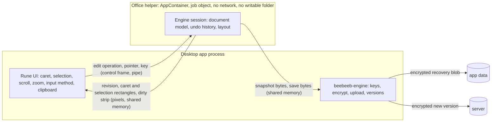

# Native Office editor (desktop 0.9.0): spike and contract

Task 2477. Follows `2026-11-12-native-office-viewer.md` (the viewer contract, merged with PR 351). The owner ruled on
2026-11-12 that the editor is in 0.9.0 as well, on the same Rust engines (WordCraft, GridCraft, DeckCraft, held in our
repository `beebeeb-io/desktop-office`). This document is a spike report and a contract. **No product code is in this
pull request**: one spec file and one throwaway spike folder that no workspace builds
(`spikes/2477-office-editor-throwaway/`).

Every number below points to a committed file under `spikes/2477-office-editor-throwaway/evidence/`:

| File | What it holds |
|---|---|
| `run-linux.log` | The final run on the Linux build VM: remove, build from our repository, closures, network proof, 40 documents, frame commands, timings, remove |
| `timings-linux-earlier-run.log` | The timing lines of an earlier run of the same binaries (the final run was 5 to 50 times slower, the VM is shared) |
| `timing-windows.log` | Our own Windows build of the two WordCraft spike binaries: keystroke and pipe round trip, then removal |
| `libreoffice-producer-windows.log` | LibreOffice 26.2.7 re-saving 18 fixtures on the Windows build VM, then removal |
| `package-diff-hand-made.md`, `package-diff-libreoffice.md` | Per saved file: package parts lost, added, changed; per feature preserved, reduced, dropped |
| `content-compare.txt` | Every cell of every workbook, every slide's text and every Word body, original against the unedited save (`celldiff.py`), and the same comparison failing on a removed cell |
| `bold-check.txt` | Whether the bold edit is in the saved files, for the final run and the earlier one (`boldcheck.py`) |
| `closure-check-local.txt` | The patch branch's closure check passing without default features and failing with them (a dependency listing on a developer machine, no build) |
| `linux-vm-earlier-directory-removed.log` | The viewer phase's audit directory on the Linux build VM, counted and removed |

## 1. Result in one table

| Question | Answer | Measured |
|---|---|---|
| Does editing link without a network crate? | GridCraft and DeckCraft: yes, as they are. WordCraft: only below its engine crate, or with a 13-line patch of ours | §2 |
| Does an edit survive save and reopen? | Yes: 40 of 40 documents, both producers | §3.1 |
| Does saving lose anything else? | Cell values, slide text and body text: no (40 of 40 files equal). Other content: yes, in four places: macros (2 of 3 engines), slide transitions (7 of 7 LibreOffice decks), linked external images (Word, Excel), chart style parts | §3.2 |
| Is one keystroke fast enough across a process boundary? | 4.2 ms at the median, 4.6 ms at p95 on Windows (60-page document, 508 KB of pixels back). 1 of 3 runs (Linux, the second) took 19 ms and 32 ms: above the budget, cause not established | §5.3 |
| Do the layout crates give caret, selection and hit-testing? | WordCraft and DeckCraft: yes. GridCraft: geometry only; the grid is ours to draw and hit-test | §4.1 |
| What do we have to write? | The whole interaction layer in Rune, for three document kinds. The upstream equivalents are about 12,000 lines of egui code we cannot embed | §4.2 |
| The 8 editor frames | 5 have their engine capability shown working (2 of them in part: no image insert, no named templates); 3 depend on our own engine and server and were not spiked | §6 |
| Honest size, viewer and editor together | About 30 lane-days (range 27 to 40), about 22 of them editor | §7 |

**Plainly, for "we got that now":** the document engines are there and they work: open, edit, undo, redo, recalculate,
save, reopen, without a network. That is proven. An editor is not proven: there is no caret, no selection, no typing,
no input method, no clipboard and no grid on our side yet, and none of it can be taken from upstream. Saving is not
safe on every file. §8 lists what could make 0.9.0 ship with the viewer only.

## 2. What editing links, per engine

Measured with `cargo tree -e normal` per package (per-package feature resolution, so a crate another workspace member
switches on does not count), for the Windows target, inside each upstream workspace with its own `Cargo.lock`, built
from `desktop-office` `main` at `da1d639b`. The Linux-target numbers are within 1 package (134 / 203 / 172 / 92 / 171 /
98). Source: `run-linux.log`, the `== closure` lines.

| What is linked | Packages | Network crates | Git-sourced | With an advisory | Licence outside the allow-list |
|---|---|---|---|---|---|
| WordCraft **below the engine**: model with edit operations, `.docx` and `.doc` readers, `.docx` writer, layout, render | 133 | 0 | 1 (`craft-proof`) | 1 (`zip 3.0.0`) | 0 |
| `wordcraft-engine` **as upstream ships it** (commands, undo, redo) | 210 | **2: `ureq`, `rustls`** | 6 | 1 | 1 (`webpki-roots`, CDLA-Permissive-2.0) |
| `wordcraft-engine` **with our patch**, font store off | 171 | 0 | 3 (`craft-pdf`, `craft-proof`, `krilla`) | 1 | 0 |
| `gridcraft-engine` (commands, undo, recalculation, `.xlsx` reader and writer) | 92 | 0 | 0 | 1 | 0 |
| `deckcraft-engine` (commands, undo, `.pptx` reader and writer, render) | 171 | 0 | 5 (`craft-audio`, `craft-media`, `craft-pdf`, `krilla`, `epaint_default_fonts`) | 3 | **16** (the `symphonia` family, MPL-2.0) |
| DeckCraft below the engine: model, `.pptx` reader and writer, render | 98 | 0 | 1 | 1 | 0 |

- **The advisory in every row** is `zip 3.0.0` with 4 RUSTSEC ids (2026-0367, -0368, -0369, -0429). `deckcraft-engine`
  adds two "unmaintained" notices (`rustybuzz 0.20.1`, `ttf-parser 0.25.1`). `cargo audit` over each whole lockfile:
  4 / 5 / 4 vulnerabilities (WordCraft / GridCraft / DeckCraft), the same as the viewer audit.
- **These counts are not comparable with the viewer contract's** 165 / 128 / 123: those came from `cargo metadata`,
  where features are unified across the whole workspace. The viewer rows measured here the same way as the editor are
  133 (WordCraft below the engine) and 98 (DeckCraft below the engine).
- **Where the network client comes from.** `wordcraft-engine` depends on `craft-font-store` (downloads fonts with
  `ureq` over `rustls`) without a feature gate. It is used in two files (`crates/engine/src/packs.rs`,
  `packs/store.rs`) and only when a host calls `use_font_store`. **No cargo feature removes it.**
- **The patch that removes it** (`patches/wordcraft-engine-font-store-optional.patch` in the spike folder): 2 files,
  13 insertions, 10 deletions. It makes the two crates optional behind a default-on feature `font-store` and widens
  eight `cfg` lines so the code path upstream already has for WebAssembly (no font store) is also used when the feature
  is off. Default features give the upstream closure back exactly (210 packages, the same 2 network crates: measured).
  With the feature off the spike built and ran 12 of 12 documents through the engine's own commands.
- **Undo and redo exist only in the engine crates.** Below `wordcraft-engine` there is a document model with public
  edit operations but no history. The spike wrote its own (a clone of the document per step: 0.01 to 0.02 ms for the
  60-page file, `snapshot_clone_ms`), and it restored the text in 12 of 12 documents. So WordCraft has two ways in,
  and the choice is an open question (§10, Q1): carry the patch and get the engine's 422 commands, or stay below the
  engine and write every command we need ourselves.
- **Not done:** `cargo deny` was not run for the editor closures (the viewer audit ran it per workspace); the licence
  column here is the allow-list of the viewer's `deny.toml` applied to `cargo tree` output. `cargo tree` reads the
  lockfile's declared licences, it does not read licence files.

## 3. Round trip, from our own build

Four spike binaries, each a crate copied into the upstream workspace of `desktop-office` (`wc-edit`, `wc-engine`,
`gc-edit`, `dc-edit`), built on the Linux build VM. The run script first compares the tree hash of each of our three
subtrees with the tree of the upstream release commit: 3 of 3 equal, and the same comparison against a hash with one
digit changed says DIFFERS (3 of 3).

**Network block, proven able to fail.** Every measured command ran in its own empty network namespace. Per binary, a
probe to a local listener and to a public host: 4 of 4 binaries CONNECTED twice without the block and NO CONNECTION
twice with it (`network proof` lines). The namespace is made with `sudo unshare -n` (the build user has passwordless `sudo`
on that VM) and the program then runs as the build user again (`setpriv`), not as root; nothing on the machine is
changed by it. Two unprivileged ways were tried first and are not used: user namespaces are refused on the VM, and
`systemd-run --user -p PrivateNetwork=yes` ran without blocking (the probe connected). This proves the round trips need no network; it does not replace the Windows sandbox test the viewer
contract demands for the shipped helper.

**Files.** 22 hand-made (Python `zipfile`, this spike: `make-fixtures.py`, `make-hard-fixtures.py`,
`make-feature-fixtures.py`) and 18 **saved by LibreOffice 26.2.7** on the Windows build VM (`soffice --headless
--convert-to`, the official MSI by its pinned SHA-256, administrative extract, removed afterwards). Per type: Word 7 +
5, Excel 7 + 6, PowerPoint 8 + 7: 40 documents. **No file saved by Microsoft Office was tested: 0.** We have none that may be committed to a public
repository; §7 puts a real corpus in the plan.

### 3.1 Is the edit there?

Three scripted edits per document through the public API, save, reopen with a fresh instance.

| Engine, way in | Edits | Hand-made | LibreOffice-saved | Undo restores | Redo restores |
|---|---|---|---|---|---|
| WordCraft below the engine | insert text, bold a range, delete a range | 7 of 7 reopen with the edited text (6 with all 3 edits; `remote.docx` has one paragraph, so the delete in paragraph 2 had nothing to delete) | 5 of 5 | 12 of 12 | 12 of 12 |
| WordCraft through the patched engine | `text.insert`, `select.text`, `format.bold` | 7 of 7 | 5 of 5 | 12 of 12 | 12 of 12 |
| GridCraft engine | `cell.set` text, `cell.set` two formulas, change an input (recalculation), `home.bold` | 7 of 7 | 6 of 6 | 13 of 13 | 13 of 13 |
| DeckCraft engine | `text.replace`, `slide.new`, `slide.duplicate` | 8 of 8 | 7 of 7 | 15 of 15 | 15 of 15 |

- **Recalculation:** `=1+2` and `=J2*2` read 3 and 6; after J2 becomes 5 they read 5 and 10: 13 of 13.
- **Bold is in the saved file** (`bold-check.txt`): Word 12 of 12 and 12 of 12 (checked in `word/document.xml`);
  Excel 13 of 13. In an earlier run the Excel bold was stored in 7 of 13 only: `home.bold` toggles against the active cell
  unless `on: true` is passed, and the spike did not pass it. The instrument was wrong, not the engine; the final run
  passes it.
- **A finding:** `slide.new {title}` put the title on the new slide in 4 of 15 decks. In the other 11 the deck's
  layouts (minimal ones in our fixtures, and what LibreOffice writes) have no title placeholder the command uses.
  A new slide in such a deck is empty; our UI must not promise a title.

### 3.2 What else changed

`pkgdiff.py` compares the original package with the unedited save (`resaved`) and the edited saves: 51 + 41
comparisons. It was shown to fail first: a copy of a macro file without `vbaProject.bin` is reported as 1 part lost
and "dropped".

| Producer, type | Files | Parts in the originals | Lost | Added | Bytes changed | Identical |
|---|---|---|---|---|---|---|
| Hand-made, Word | 7 | 32 | 1 | 40 | 30 | 1 |
| Hand-made, Excel | 7 | 73 | 3 | 33 | 57 | 13 |
| Hand-made, PowerPoint | 8 | 139 | 1 | 43 | 85 | 53 |
| LibreOffice, Word | 5 | 59 | 0 | 3 | 53 | 6 |
| LibreOffice, Excel | 6 | 99 | 9 | 0 | 90 | 0 |
| LibreOffice, PowerPoint | 7 | 148 | 3 | 19 | 142 | 3 |

(The unedited save. The edited saves lose the same parts.) **The writers rewrite the package from their model**: 457
of 550 original parts come back with different bytes. A save is never a small patch of the original file. The "added"
parts are defaults the hand-made files do not have (styles, theme, document properties).

**The content itself** (`content-compare.txt`, original against the unedited save): workbooks: 13 of 13 have every
cell, 0 cells lost, 0 values or formulas changed (866 cells; in the 7 hand-made workbooks 65 formulas that the
fixture stores without a cached result come back with the computed one, which is the engine calculating, not a
loss). Decks: slide text equal in 15 of 15. Word: body text equal in 12 of 12. The same comparison reports
DIFFERENT for 7 of 7 workbooks when one cell is removed from the saved side.

**Content the engines do not carry through.** A feature counts for a file only when the original has it.
**"Preserved" here means: the count of that element or part did not go down and its marker text is still in the
package. It does not mean the feature's content is equal or that it still works in Office.**

| Feature | Files that have it | Preserved | Dropped | Note |
|---|---|---|---|---|
| Macro project, Excel (`.xlsm`) | 1 | 1 | 0 | same bytes |
| Macro project, Word (`.docm`) | 1 | 0 | **1** | see the caveat below |
| Macro project, PowerPoint (`.pptm`) | 1 | 0 | **1** | the `.pptx` writer has no macro part: reading the code agrees |
| Slide transitions | 7 (all LibreOffice decks) | 0 | **7** | LibreOffice writes them inside `mc:AlternateContent`; they are gone after a save |
| Linked external image, Word | 1 | 0 | **1** | the drawing is removed on save |
| Linked external image, Excel | 1 | 0 | **1** | the drawing part and its relationships are removed |
| Linked external image, PowerPoint | 1 | 1 | 0 | the external relationship is still in the saved deck (and in the duplicated slide) |
| Chart style and colour parts (`style1.xml`, `colors1.xml`) | 4 (LibreOffice) | 0 | **4** | the chart parts themselves are kept: 8 of 8 |
| Comments, Word | 2 | 2 | 0 | both markers and both anchors |
| Tracked insertions and deletions | 2 | 2 | 0 | |
| Cell comments | 2 | 2 | 0 | |
| Conditional formatting, data validation | 2 | 2 | 0 | |
| Pivot table and pivot cache parts | 2 | 2 | 0 | present after save; **whether the pivot still works in Excel was not checked** |
| Speaker notes, slide comments | 2, 2 | 2, 2 | 0 | |
| Embedded media and images | 6 | 6 | 0 | one video is renamed (`media2.mp4` to another name, the same bytes) |
| Formulas | 13 | 13 | 0 | |
| Merged cells, frozen panes, number formats, defined names | 6, 6, 9, 2 | all | 0 | |
| Tables, headers and footers, numbering, styles (Word) | 2 | 2 | 0 | |

- **Refused: 0.** No engine refused to open or to save any of the 40 files. Nothing warns the user that a save will
  drop something. That warning has to be ours (§5.5).
- **Caveat on macros.** The macro parts in the fixtures are placeholder bytes, not real VBA, and LibreOffice itself
  dropped them when it re-saved those three files (so the LibreOffice rows have no macro to lose). The Word result
  disagrees with a reading of the WordCraft writer, which has a pass-through for the macro part; the fixture may not
  reference the part the way Word does. It needs one real macro file per type before it is called a defect.
- **Text counts.** In 6 hand-made Excel files the package holds 11 or 17 fewer text characters after the save. The
  cell comparison above shows no cell lost or changed in any of them, so the difference is in how strings are stored
  (in `spike.xlsx`: 4 strings held twice in the original, once in the save), not in what the cells say. One
  LibreOffice deck (`lo-feat-notes.pptx`) has 5 fewer characters in the package; its slide text is equal and its notes
  marker is there; where the 5 characters were was not traced.
- **Not tested:** embedded OLE objects, SmartArt, equations, form controls, digital signatures, password-protected
  files, right-to-left text, files above 60 pages or 20,000 formulas, `.doc` / `.xls` / `.ppt` (GridCraft imports
  `.xls` but saves only `.xlsx`; a legacy file can be edited only as "save as a new `.xlsx`").

## 4. Interaction: what the layout crates give, and what is ours

Their UI is egui and cannot be embedded. Caret, selection, input method, clipboard, hit-testing, scrolling and zoom
are ours in Rune, on top of their layout.

### 4.1 Functions that exist (public, below the UI crates)

| Need | WordCraft | GridCraft | DeckCraft |
|---|---|---|---|
| Edit operations | `wordcraft_doc::Document`: `insert_text`, `delete_range`, `format_range`, `split_paragraph`, `insert_block`, `remove_block`; or `Session::run(id, params)` in the engine | `Session::execute(id, params)`: `cell.set`, `home.*`, `data.*`, `insert.*` | `Session::execute(id, params)`: `text.set`, `text.insert`, `text.replace`, `slide.*`, `format.*` |
| Undo, redo | engine only: `Session::undo()`, `redo()` | `edit.undo`, `edit.redo` | `edit.undo`, `edit.redo` |
| Hit-test (point to position) | `DocLayout::hit(page, x, y, story)` | **none**: only `Sheet::col_left`, `row_top`, `col_width`, `row_height`, `merges`, `freeze` | text: `Layout::hit(point)`; shape under a point: in the engine, not public (`tools/hit.rs`) |
| Caret rectangle | `DocLayout::caret(&pos)`, `caret_on` | not applicable (the cell editor is a text field of ours) | `Layout::caret_at(pos, affinity)` |
| Selection rectangles | `DocLayout::selection_rects(doc, a, b, page)` | cell ranges from the geometry above | `Layout::selection_rects(a, b)` |
| Movement (arrows, line start and end) | `vertical`, `visual_step`, `line_bounds` | cell arithmetic, ours | in the engine's text commands (`text.move`) |
| Layout after an edit | `layout(doc, &mut LayoutCache, &opts)`: incremental, keyed on a per-paragraph revision | recalculation is incremental (`Calc::cells_changed`) | per slide |
| Pixels | `render_page`, `render_region`, `render_area(doc, page, rect, scale, opts)` | **no render crate below the UI** | `render_slide(pres, index, opts)` |
| What changed (invalidation) | **none**: no dirty-page or dirty-region result | **none**: a `revision` counter | **none**: a `revision` counter |
| Save to bytes | `wordcraft_docx::write(&doc)` | `file.saveBytes` | `cmd::file::save_bytes(&pres, "pptx")` |

Measured in the spike (WordCraft, 200 keystrokes in the middle of the 60-page document; the fixture is called
"30 pages" and lays out as 60 with the fonts on the build VMs):

| Step | Windows build VM | Linux, first run | Linux, second run |
|---|---|---|---|
| The edit itself (median) | 0.006 ms | 0.003 ms | 0.007 ms |
| Incremental re-layout, median / p95 / max | 2.98 / 3.49 / 4.18 ms | 0.85 / 0.89 / 1.64 ms | 1.78 / 2.47 / 10.86 ms |
| First full layout of the document | 69.7 ms | 21.7 ms | 48.2 ms |
| Render of the strip around the caret (794 x 160 px), median / p95 | 0.66 / 0.91 ms | 0.30 / 0.39 ms | 15.36 / 27.38 ms |
| Render of one full page (794 x 1123 px) | 4.4 ms | 2.3 ms | 20.0 ms |
| `caret` then `hit` at the caret gives the caret back | 200 of 200 | 200 of 200 | 200 of 200 |
| `selection_rects` non-empty | 200 of 200 | 200 of 200 | 200 of 200 |
| One character through the engine's `text.insert` (no layout), median / max | 0.019 / 0.214 ms | 0.009 / 0.165 ms | 0.008 / 3.027 ms |

GridCraft: one cell edit with 1,000 dependent formulas recalculates in 0.86 ms at the median (1.24 ms in the second
run); with 20,000 dependents 33 ms (73 ms in the second run, 143 ms at worst). DeckCraft: a slide render at 960 x 540
took 4 to 5 ms. **The two Linux runs are the same binaries on the same VM and differ by up to 50 times in render
and 2 times in layout. The cause is not established.** The VM is shared with up to ten builds, which may be it; it
was not measured. Both runs are kept.

### 4.2 Functions we must write

Named with the upstream egui files that do the same job today (line counts from our subtree; they are a size
reference, not code we can take: they are written against egui's input and paint types).

| Ours to write | Upstream reference, lines |
|---|---|
| Word: pointer to position, drag selection, double and triple click, scroll into view, caret blink, page scrolling and zoom | `wordcraft/crates/ui-egui`: `canvas/input.rs` 498, `canvas/geometry.rs` 240, `canvas/navigation.rs` 80, `scroll.rs` 587, `caret_glide.rs` 411 |
| Word: key map (arrows, word and line movement, shortcuts) | `keys/canvas.rs` 621 |
| Word: input method (composition text, candidate window position) | `keys/ime.rs` 569 |
| Clipboard: plain text first; formatted copy and paste later | `system_clipboard.rs` 292 |
| Sheets: the grid itself (cells, headers, gridlines, frozen panes, merged cells), hit-testing, visible range | `gridcraft/crates/ui-egui`: `grid/geo.rs` about 240, `grid/show.rs` 1,148 |
| Sheets: selection, keyboard movement, drag-fill, the cell editor and the formula bar | `grid/interact.rs` 1,179, `formula_bar.rs` 1,226 |
| Slides: canvas, shape selection and handles, text editing inside a shape | `deckcraft/crates/ui-egui` canvas about 2,400, `overlays.rs` 293, `input.rs` 237 |
| Slides: thumbnail strip, slide sorter | `panels/thumbs.rs` 622, `sorter.rs` 543 |
| Slides: input method | `app/ime.rs` 706 |
| Invalidation: which pages, cells or slides to re-render after an edit | none upstream; ours, from the revision counters and the caret position |
| Accessibility: the document's text for a screen reader | not looked at in this spike |

About 12,000 lines of reference. **Whether Rune gives a custom canvas widget raw composition events and the
candidate-window position was not verified**; Rune has text input widgets, a text area and a clipboard example, which
is not the same thing. That check is the first item of the plan.

## 5. The process boundary for an editor

One design. It extends the viewer's helper; it does not add a second one.

### 5.1 Where things live

- **The document model, the undo history and the layout live in the helper**: one helper process per open document.
  The parser is the attack surface; it stays in the sandbox, as in the viewer.
- **Input lives in the app.** The app owns the window, the keyboard, the pointer, the input method and the
  clipboard. The helper never sees the operating system's clipboard and has no window.
- **The app sends operations from a closed list**, not command names. The engines register hundreds of commands
  (WordCraft 422), among them ones that read and write files, export, print and speak. The helper maps our
  enumerated operations to command ids; an id that is not on the list cannot be sent.

### 5.2 What crosses per keystroke

App to helper: one binary control frame (sequence number, operation, the typed text). Helper to app: one frame with
the sequence number, the new revision, the caret rectangle, the selection rectangles, the page count, whether undo
and redo are possible, and which strip of which page changed; the pixels of that strip go through the shared-memory
ring the viewer contract defines. Pointer input is the same shape: the app sends page coordinates, the helper
answers with a position and its caret rectangle (`hit` then `caret`).

For sheets the cell editor is a text field of ours: nothing crosses while the user types in a cell; one `cell.set`
crosses on commit, and the answer lists the visible cells whose text changed.

### 5.3 Latency budget, measured

The spike's own two processes (the app side sends one byte per keystroke, the helper edits, re-lays-out, renders the
strip and sends 508,160 bytes of pixels back **through a pipe**, which is slower than shared memory):

| Round trip, 200 keystrokes, 60-page document | Median | p95 | Max |
|---|---|---|---|
| Windows build VM | 4.16 ms | 4.64 ms | 4.99 ms |
| Linux, first run | 1.54 ms | 1.70 ms | 2.98 ms |
| Linux, second run | 19.10 ms | 32.00 ms | 62.04 ms |

**Budget for the contract:** key press to pixels in the app's hands within 16 ms at p95 on the Windows build VM,
measured by a test that types 200 characters into the 60-page fixture; the test fails above the budget. **1 of the
3 runs here is above that budget** (the second Linux run, p95 32 ms), cause not established; the first PR that
builds the helper has to find out whether it is the machine or the code before the budget is trusted. Not measured: the
time Rune needs to put the strip on screen, the sandboxed helper (AppContainer adds no work per message, but that is
a claim until measured), a document above 60 pages.

### 5.4 A helper crash in the middle of an edit

- The spike killed the helper by its recorded process id: the app side saw the closed pipe at once (`host saw the
  dead helper: true`, 3 of 3 runs). Helper start to ready: 25 to 79 ms.
- **Recovery snapshots.** After 2 seconds without input, and at least every 10 seconds while there are unsaved
  edits, the helper serialises the document (the save of the 60-page file took 2.8 ms) and hands the bytes to the
  app over shared memory. `beebeeb-engine` encrypts them and writes one recovery blob per open document under the
  app's data folder; the previous blob is replaced only after the new one is written.
- **Encrypted how.** Recommendation: exactly as a file version is encrypted for upload (the same chunk format, a
  fresh file key wrapped by the same parent key), written locally instead of uploaded. No new cryptography, and a
  recovery blob could later be uploaded as a version unchanged. This touches the crypto layer and is an open
  question with that recommendation (§10, Q3); it gets the crypto review before code.
- **Plaintext on disk: never.** The snapshot goes helper memory to shared memory to the app's memory to ciphertext.
  The helper has no writable folder. The engines' own disk features must stay unreachable: `deckcraft-engine` has a
  recovery module that writes files (`recovery.rs`, `cmd/file.rs`), `wordcraft-engine` writes options, templates and
  fonts and has a safe-save path. They are not on the operation list, and the sandbox denies the write if one is
  reached anyway. The test for this must show a write attempt failing inside the helper.
- **After a crash** the app starts a new helper, loads the last snapshot and says what was kept: "The editor stopped.
  Your changes up to 14:32:07 are restored." Undo history is lost (it lived in the helper); the text says so. Two
  crashes on the same document within a minute open it read-only with the snapshot offered as a copy.
- **After an app crash or power loss** the blob is found at the next start: "Unsaved changes to *name* from 14:32.
  Restore / Discard". A blob is deleted on save, on discard, and on sign-out.

### 5.5 Save

1. `Ctrl+S`: the app asks the helper for the bytes in the file's own format.
2. **Loss check before the first save of a file.** At open, the helper saves the unedited document to memory and
   compares the package with the original the way `pkgdiff.py` does (parts lost, watched features reduced). If
   anything is lost, the document opens with a banner: "Saving here would drop: macros, slide transitions. Save a
   copy / Open read-only". The original is never overwritten by a lossy save without that choice. This is the answer
   to §3.2 and it is cheap: the saves measured 0.6 to 2.8 ms in the first Linux run.
3. The bytes go to `beebeeb-engine`: encrypt, upload as a **new version** of the same file. The old version stays in
   version history; a save never destroys the previous content.
4. **Conflict.** The upload carries the version the document was opened from. If the server has a newer one, the
   upload is refused and DW-1554 opens: Save as new version anyway / Keep both (upload as a second file next to it) /
   Discard and reopen / Cancel. The server has a field for this: `base_version_number` in the upload-init request
   (`beebeeb-api/src/routes/uploads/init.rs`, compared with the file's current version number). **Read, not
   exercised:** what the server answers on a mismatch, and whether the desktop engine sends the field, were not
   checked. (An earlier draft of this section said a search found 0 such names; that search ran against paths
   that do not exist. Searched again over 1,017 source files with a control string that does match.)
5. Synced-folder case: when the file also exists in a synced folder on this machine, the sync engine sees the new
   version like any other remote change. Not spiked.

### 5.6 Threat model: what changes against the viewer

| # | New with the editor | Mitigation in this design |
|---|---|---|
| 1 | The helper's output is no longer only pixels: its bytes become the user's file. A compromised helper can corrupt or plant content | Every save is a new version, the old one stays; size cap; the app re-reads the package structure before upload; a save is always a user action or a snapshot, never silent replacement |
| 2 | The helper lives for the whole editing session and holds state | Same sandbox as the viewer, restart with snapshot; one helper per document, never shared between accounts |
| 3 | The command surface: hundreds of engine commands, some with side effects | Closed operation list in our protocol; engine commands for files, print, export, speech, fonts, templates, recovery are not on it |
| 4 | `wordcraft-engine` can start processes (speech: `say`, `speech-dispatcher`, a configured program) and `deckcraft-engine` calls `mkfifo` | Job object with no child processes (as in the viewer contract); test that a spawn fails in the helper |
| 5 | Clipboard: content now flows in and out | The app owns the clipboard; paste is plain text first; the helper never touches the system clipboard |
| 6 | Insert image, insert link | The app reads the picked file and passes bytes; the helper has no file access. A link is text in the document; opening one goes through the app's existing "open" rule, never from the helper |
| 7 | Recovery blobs at rest | Encrypted as §5.4; deleted on save, discard and sign-out |
| 8 | Code of ours inside a subtree (the patch) | Patch file plus a check that fails when `ureq` or `rustls` is in the editor's closure (§10, Q1) |
| 9 | Linked external images | The viewer contract already forbids fetching them. On save Word and Excel drop the picture (§3.2) and the loss check reports it; PowerPoint keeps the link in the file, so a saved deck still names the external address: the app shows that such a link exists and never follows it |

Unchanged: no network (three ways, as in the viewer contract), AppContainer, job object, the plaintext rules.

## 6. The 8 editor frames

Windows entries of `design/desktop-v2/frames.json`. "Shown" means the spike ran the engine command and the result was
checked; it never means a frame was built. Count: shown 5 (DW-1550 and DW-1558 in part), not spiked 3 (DW-1552,
DW-1553, DW-1554).

| Frame | What it shows | Engine capability | Spike |
|---|---|---|---|
| DW-1550 Insert tab | Table…, Image…, Link…, Page break | `insert.table`, `insert.link`, `insert.pageBreak`, `insert.picture` | **Shown** for 3 of 4: table, link and page break returned ok, the file saved and reopened with the link text and the page break. Image **not tried** (the engine command takes a path; the helper has no file access, so it needs a bytes variant: not looked for) |
| DW-1551 Command palette | Commands, styles (Heading 1 to 3), Bold, file names; "Runs entirely on this device" | `para.heading1..3`, `format.bold`; the command registry for the list | **Shown**: 4 of 4 commands ok. The palette is our UI over our operation list; file names come from our engine |
| DW-1552 Unsaved | Dot, Save enabled, "Encrypted · unsaved changes" | A dirty state: revision counters (GridCraft, DeckCraft), history marks (WordCraft) | **Not spiked** beyond reading that the counters exist. The frame's rule text still names LibreOffice: the text changes with this contract (§10, Q6) |
| DW-1553 Saved | "Saved · encrypted · version 8" | Save to bytes (shown: 40 of 40), then our engine | **Not spiked** as a frame: the bytes exist, the version number is our upload path |
| DW-1554 Conflict | "Someone else saved first" and four choices | None in the office engines; server precondition | **Not spiked**; see §5.5 step 4 |
| DW-1558 New document | Docs · Sheets · Slides; Blank, Letter, Invoice, Meeting notes, Report; name | `file.new` | Blank **shown** in 3 of 3 engines. **The engines lack the four named templates**: DeckCraft ships other ones (Briefing, Lesson, Pitch and more), WordCraft opens a template from a file. Letter, Invoice, Meeting notes and Report are files we author, per document kind where they make sense |
| DW-1559 Data tab | Sort A to Z, Filter, Table, cell box, "Not a valid cell or range" | `data.sortAscending`, `data.filter`, `insert.table`, `edit.goTo` | **Shown**: sort gave apple, fig, pear; filter and table ok; go-to B5 ok; an invalid reference is refused with the engine's text "Reference isn't valid.", which we replace with the frame's |
| DW-1560 Slide layouts | Title slide; Title, content; Title, two content; Title only; Blank | `slide.new {layout}`, `slide.layout` | **Shown** on a new deck: 5 of 5, both commands. On an opened deck the choice is whatever layouts that file has; the picker must list those, not five fixed names |

## 7. Plan: viewer and editor together

Sizes: S about half a lane-day, M about 1.5, L about 3. These are estimates, not measurements.

| # | PR | Size | What it proves |
|---|---|---|---|
| 0 | Rune input check: a canvas widget that receives composition events, reports the candidate position, reads and writes the clipboard | S | Whether the interaction layer can be built on Rune at all. **First, alone; a "no" stops the editor** |
| 1 | `desktop-office`: our workspace crate skeleton, `deny.toml` bans, the closure check, the patch decision applied | S | 0 network crates in what we link, checked by a command that can fail |
| 2 | `crates/beebeeb-office-sandbox`: AppContainer and job object | M | A child that cannot connect, write or spawn: three tests that fail without the sandbox |
| 3 | The helper and its transport: control frames, shared-memory pixels, timeouts, restart | M | A page of a `.docx` on screen from a sandboxed process |
| 4 | Viewer, Word: pages, scroll, zoom, states (the 8 viewer frames' common parts) | M | Viewer frames against the board |
| 5 | Viewer, Sheets: the grid drawn by us from cell data, sheet tabs | M | The grid is ours; this is also the editor's grid |
| 6 | Viewer, Slides: slide, thumbnails | M | |
| 7 | Editor core, Word: operation list, hit-test, caret, selection, typing, undo and redo, keystroke gate | L | 200 keystrokes within the 16 ms budget; edit, save, reopen in a test |
| 8 | Input method and clipboard (all three kinds) | M | Composition in a document on Windows |
| 9 | Editor, Sheets: selection, cell editor, formula bar, recalculation on screen, Data tab (DW-1559) | L | |
| 10 | Editor, Slides: select a shape, edit its text, new slide, layouts (DW-1560) | L | |
| 11 | Save: bytes to a new encrypted version, unsaved and saved states (DW-1552, DW-1553), the loss check and its banner | M | A save never drops content silently: the §3.2 files as tests |
| 12 | Conflict (DW-1554): the desktop engine sends the base version; the server's answer to a stale one exercised first | M (+ S server, if the answer is not a refusal) | Two writers, one refused |
| 13 | Recovery: encrypted snapshots, crash restart, restore at start | M | Kill the helper mid-edit, text is back; no plaintext file exists (a search of the disk in the test) |
| 14 | Insert tab, command palette, New document and the four templates (DW-1550, DW-1551, DW-1558) | M | |
| 15 | Corpus: real files from Microsoft Office per type, run through open, loss check, save, reopen | M | The first numbers on real files |

**Total:** 2 S + 11 M + 3 L (+ 1 S server) is about 27 lane-days by the sizes; with review rounds and the unknowns in
PR 0 and PR 8, **about 30, range 27 to 40**. Viewer only (PRs 1 to 6, without 0): about 8.

**Lanes with disjoint file areas** (after PR 3 lands the transport, up to five at once): (a) sandbox crate, PR 2;
(b) helper and transport, PRs 3, 7 helper side, 13 helper side; (c) Word UI, PRs 4, 7, 14; (d) Sheets UI, PRs 5, 9;
(e) Slides UI, PRs 6, 10; (f) `beebeeb-engine` office module: save, versions, recovery blobs, PRs 11 to 13 engine
side; (g) `desktop-office` and the corpus, PRs 1, 15. PR 0 and PR 8 touch the shared input code and run alone.

**Three largest risks**

1. **The interaction layer.** Nothing of it exists, three document kinds need it, and Rune's support for a custom
   editing surface with an input method is unverified. It is most of the 22 editor days and the part an estimate is
   worst at. Rune at the revision the app pins has 56 source files that mention input-method events, among them tests
   named `canvas_input`, `caret` and `caret_follow`: the plumbing exists; none of it was run for an editing canvas.
2. **Losing content on save.** Found on our own small set: macros (2 of 3 engines), transitions (7 of 7), linked
   images, chart styles; 0 real Microsoft Office files tested. The loss check turns silent loss into "read-only for
   this file", which is safe, but it may turn out that many real files open read-only.
3. **Carrying a young upstream.** Versions 0.18 and 0.19, one vendor, 4 open `zip` advisories, a patch of ours to
   re-apply at each bump, engines that can write files and start processes unless the sandbox stops them, and a
   project that moves fast (the viewer contract's update review applies to twice the code now).

## 8. Proven, not proven, and what could make 0.9.0 ship with the viewer only

**Proven (counts above):** our own build of the engines edits, undoes, redoes, recalculates, saves and reopens 40 of
40 documents from two producers with no network; the network client can be compiled out of WordCraft's engine with
13 lines; caret, hit-test and selection geometry exist for Word and slide text; one keystroke costs 3 to 5 ms across
a process boundary on the Windows build VM; a dead helper is noticed; five frames' engine commands work; the server has a base-version field for the conflict case.

**Not proven:** any pixel of an editor in Rune; input method; clipboard; the grid; shape editing on slides; the
sandbox with a long-lived editing helper; saves of real Microsoft Office files; large files; the server's answer to a
stale base version; recovery; macOS; accessibility.

**Viewer only, if any of these happens:**

- PR 0 says Rune cannot give us composition events or the candidate position, and upstream Rune cannot be changed in
  time.
- The owner declines both ways into WordCraft editing (Q1): then Word has no editor, and an editor without Word is
  not one.
- The corpus (PR 15) shows that most real files fail the loss check. Then the honest product is "view, and edit the
  simple ones", and the copy has to say that.
- The editor PRs are not all merged when the viewer is. The viewer does not depend on PRs 7 to 15; the editor can
  follow in 0.9.1 without rework, because the helper, the transport and the grid are shared.

## 9. Contract

1. **Engines:** `desktop-office` at the pinned upstream tags; nothing above the engine crates is linked (no
   `ui-egui`, no `mcp`, no app crates). WordCraft's way in follows Q1.
2. **No network:** 0 crates of the viewer contract's network list in the editor's closure for Windows and macOS
   targets, checked by a script that is shown to fail (with default features it reports `ureq` and `rustls`).
3. **Boundary:** document model, history and layout in the sandboxed helper; input, clipboard and keys in the app;
   a closed operation list; no engine command that touches files, processes, print, speech, fonts or recovery.
4. **Latency:** key press to pixels within 16 ms at p95, 200 keystrokes, the 60-page fixture, Windows build VM.
5. **Save:** always a new version; the loss check runs at open and a lossy save needs the user's choice; conflict as
   DW-1554.
6. **Recovery:** encrypted snapshots as §5.4; no plaintext file outside the user's own synced files, proven by a
   test that searches the disk.
7. **Frames:** the 8 editor frames to the board, each with its `compare.sh` gate, DW-1552's rule text corrected.
8. **Not in 0.9.0:** tracked-changes UI, comments UI, macros (never run; kept or the file is read-only), editing of
   `.doc` / `.xls` / `.ppt` in place, co-editing.

## 10. Open questions for the owner (recommendation first)

- **Q1. The patch inside our subtree.** Recommended: carry it. It is 13 insertions and 10 deletions in 2 files of
  `wordcraft/crates/engine`, it changes nothing with default features, and it buys the engine's commands and undo.
  It would be the first commit of ours inside a subtree, and the repository is public now. It is **not pushed**: it
  sits on a local branch `patch/font-store-optional` of `desktop-office` (2 commits: the change, and `patches/` with
  the same diff as a file plus `check-editor-closure.sh`). The check was run both ways (a dependency listing on a developer
  machine, no build; `closure-check-local.txt`): without default features 4 of 4 targets pass (161 to 165 package
  names), with default features it fails with 8 lines (2 crates on 4 targets). The script is also in this pull
  request's spike folder (`patches/check-editor-closure.sh`); the branch head is `3b847ea6`.
  **At each upstream bump:** `git subtree pull` the new tag, `git apply --directory=wordcraft
  patches/wordcraft-engine-font-store-optional.patch`, run the check; if the patch no longer applies, the eight
  `cfg` lines in `packs.rs` and the two dependency lines are re-done by hand and the patch file regenerated. The
  alternative without a patch: edit below the engine (133 packages, 0 network crates, our own snapshot undo, shown
  working) and write each command ourselves. The exact diff is `patches/wordcraft-engine-font-store-optional.patch`
  in this pull request's spike folder.
- **Q2. Ask upstream to take the feature gate.** Recommended: yes, as a small pull request to WordCraft, so the patch
  disappears at a later bump. It is outward-facing and names us as a user of their code: the owner's call.
- **Q3. Recovery blob encryption** as §5.4 (the upload format, stored locally). An architectural choice in the crypto
  layer: needs the owner's yes and the crypto review.
- **Q4. MPL-2.0 in the editor.** `deckcraft-engine` brings the 16 `symphonia` packages (audio decoding for media on
  slides). The viewer avoided them by staying below the engine; the slide editor cannot (undo is in the engine).
  Recommended: accept MPL-2.0 for these unmodified crates and list them in the notices; the alternative is a second
  patch that makes `deckcraft-media` optional. A licence question: the owner's.
- **Q5. Lossy files.** Recommended: read-only with "Save a copy" when the loss check finds anything (§5.5). The
  alternative, saving anyway with a warning, loses user content by design.
- **Q6. DW-1552's rule text names LibreOffice.** Recommended: the design text changes to the Rust engines in the same
  PR that builds the frame. A design artefact changes first.
- **Q7. Templates** (Letter, Invoice, Meeting notes, Report): we author them. Recommended: Blank only in 0.9.0, the
  four named ones hidden until they exist; showing a template that is not there is a placeholder.
- **Q8. Real Microsoft Office files for the corpus.** We need a set that may live in a public repository, or a
  private place for it. Recommended: a private corpus repository; only counts are published.

## 11. What the spike did and did not do

- **Did:** four throwaway crates, 40 documents, two producers, two run scripts, one comparison tool; builds from
  our public repository on the build VMs only; nothing was run against production; nothing was built or run for
  measurement on a developer machine (compile checks and `cargo tree` only).
- **Deviation, corrected during the spike:** the first build cloned the upstream repositories, because
  `desktop-office` was private then. It became public the same evening and the final run builds from it; the tree
  comparison with upstream stayed as a check.
- **Clean-up, counted:** Linux build VM: 8,113 files under the spike's work directory before removal, 0 after; 0
  processes; 0 firewall rules (the block was a namespace per command). **A first version of this line was not the
  whole truth:** the audit tools and upstream clones of the viewer phase (7,047 files, in the viewer branch's
  target directory) were still on that VM and this spike used the `cargo-audit` from there. They were counted and
  removed afterwards (`linux-vm-earlier-directory-removed.log`): 0 spike directories left. Windows build VM, three
  runs (LibreOffice twice, timing once), each ending in a removal: files under the spike root 0 after removal (4,459
  before, in the timing run); uninstall entries 0;
  vendor registry keys 0; firewall rules 0; profile or program folders 0; processes started from the root 0. The
  build wrapper's own checkout and target folders on both VMs are the wrapper's, not the spike's, and were left.
- **Used on the build VM:** passwordless `sudo`, only for `unshare -n` (§3). Nothing was installed system-wide.
- **Not done:** no real Microsoft Office file; no UI; no sandbox run of the editing helper; no input method; no
  macOS; `cargo deny` not re-run; the pivot table not opened in Excel; the Word macro result not explained; the
  5-character difference in one deck's package not traced; the cause of the slow second Linux run not found; the
  Rune input check (PR 0) not started; the server's base-version field read, not exercised; frames DW-1552 to DW-1554 not exercised.
- **Wrong during the spike, corrected:** package counts in the first build log were too high (duplicate lines from
  `cargo tree`'s repeat marker; fixed before the numbers above); 3 LibreOffice outputs of the first producer run
  were copies of the wrong file (one output folder shared by three fixtures; re-run, 18 of 18 distinct); the Excel
  bold instrument (§3.1).
