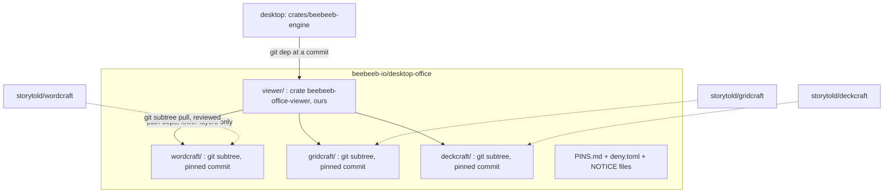

# Desktop 0.9.0: the native Office viewer (contract, spike result, plan)

**Status:** contract for review (task 2477, step 1). No product code in this PR; the spike is throwaway
(`spikes/2477-lok-viewer-throwaway/`).
**Ruling it implements:** 0.9.0 shows Word, Excel and PowerPoint files read-only, natively, with no web view; the
editor is 0.9.1. The owner's later direction (2026-11-12): prefer the Rust office projects (WordCraft, GridCraft,
DeckCraft) in one repository of ours, `desktop-office`; LibreOfficeKit is the fallback this contract compares against.

## 1. Result in one table

Measured on the Windows build VM (Windows 11, 16 vCPU, no GPU), every program under an outbound firewall block that
was first proven able to fail (the same exe connected before the rule and could not with it). "Pages" are pages of a
document, sheets of a workbook, slides of a deck. A page counts only if its PNG was looked at and shows the expected
text; a flat-colour image counts as 0.

| | LibreOfficeKit 26.2.7 | Rust: WordCraft 0.18.1 / GridCraft 0.19.1 / DeckCraft 0.18.1 |
|---|---|---|
| **.docx** easy (3 pages) | 3 of 3 | 3 of 3 (looser line spacing than LibreOffice on a file with no styles part) |
| **.docx** hard (2 pages: styles, list, table, picture, header, footer) | 2 of 2 | 2 of 2 |
| **.doc** (3 pages) | 3 of 3 | 3 of 3 |
| **.xlsx** easy (2 sheets) | **0 of 2: hangs in `documentLoad`** | values of 2 of 2 sheets read; no sheet image from the CLI (PDF export: 1 page, looked at) |
| **.xlsx** hard (3 sheets, 19 formulas without cached values, a chart) | **0 of 3: hangs** | 19 of 19 formula cells show the expected value; currency and percent formats right; the chart draws (PDF) |
| **.xls** (2 sheets) | **0 of 2: hangs** | values read; the tool warns that charts, pictures and comments of .xls are not read |
| **.pptx** easy (3 slides) | **0 of 3: hangs** | 3 of 3 |
| **.pptx** hard (4 slides: master, 2 layouts, inherited placeholders, table, picture, gradient) | **0 of 4: hangs** | 4 of 4 |
| **.ppt** (3 slides) | **0 of 3: hangs** | **0 of 3: refused** ("not a presentation DeckCraft can read") |
| A linked remote image | not fetched (0 connections), placeholder drawn | not fetched (0 connections), left out; `--strict` names it |
| Time to the last page, warm | 2.6 to 3.7 s per document (init 1.7 to 2.8 s, load 0.4 to 0.6 s, 5 to 9 ms per further page at 96 DPI, 29 to 34 ms at 192 DPI) | 43 to 86 ms per page **including** process start, load and layout (document layout alone: 43 to 49 ms) |
| First start ever | 8.4 s (first run after install), 6.6 s (new profile) | 1.4 s (first run of the 95 MB tool), then as above |
| Peak memory | 318 to 358 MB working set | not measured (the process had exited before the counter was read) |
| Size | 373 MB installer, 1,522 MB in 19,487 files extracted (`program` 711 MB, `share` 720 MB) | CLI executables 95 / 21 / 94 MB, each with its fonts inside; no separate download |
| Language | C++, in a helper process | Rust; 0 `unsafe` blocks in the three projects' own crates (their dependencies not counted) |

**The LibreOfficeKit hang.** Text documents work. Every spreadsheet and presentation load blocked forever at 0 % CPU
inside `documentLoad`: 21 of 21 attempts over 3 runs, across .xlsx, .xls, .pptx and .ppt. Four variations changed
nothing (6 of 6 still hung in the diagnosis phase, plus 1 of 1 with OpenCL probing off): `SAL_DISABLE_OPENCL=1`,
`MAX_CONCURRENCY=1`, the load option `Batch=true`, and every LibreOfficeKit call on a worker thread while the main
thread pumps Win32 messages. LibreOffice itself is not broken on that machine: `soffice --headless --convert-to`
wrote the .xls and .ppt fixtures from the same files in the same session. The cause is **not found**; the
upstream page still calls the tiled-rendering API experimental ([docs.libreoffice.org][lokdoc]). A viewer must
never hang on a document, so this alone rules LibreOfficeKit out as the 0.9.0 engine for sheets and slides unless
someone finds the cause.

**Recommendation: Rust first, for all three types, in-process; LibreOfficeKit is not built in 0.9.0.**
The Rust option rendered 15 of 15 pages of the formats it claims and refused the one it does not (.ppt) with a clear
error. LibreOfficeKit rendered 8 of 8 text pages and 0 of 17 sheet and slide pages. The open risks of the Rust
option are in §9; the biggest is not fidelity on these fixtures but that the projects are five weeks old.

Evidence: `spikes/2477-lok-viewer-throwaway/evidence/` (PNGs, `metrics.jsonl`, logs). Fixtures were generated by
the two scripts in the spike folder; the hard ones are hand-written OOXML, **not** files saved by Microsoft Office,
and nothing here was compared against Microsoft Office's own rendering.

## 2. The Rust option: what it is

| | WordCraft | GridCraft | DeckCraft |
|---|---|---|---|
| Repository | `github.com/storytold/wordcraft` | `github.com/storytold/gridcraft` | `github.com/storytold/deckcraft` |
| Licence | MIT OR Apache-2.0 | MIT OR Apache-2.0 | MIT OR Apache-2.0 |
| Created / last commit | 2026-10-07 / 2026-11-12 | 2026-10-07 / 2026-11-12 | 2026-10-07 / 2026-11-12 |
| Stars / forks / open issues | 17,879 / 4,934 / 2,885 | 7,480 / 3,450 / 1,983 | 4,758 / 2,734 / 823 |
| Listed contributors | 100 (the API's page limit) | 100 (limit) | 95 |
| Releases | v0.18.1, almost daily | v0.19.1, almost daily | v0.18.1, almost daily |
| Own Rust code | 403,096 lines | 252,960 lines | 184,161 lines |
| Packages in `Cargo.lock` | 707 | 672 | 628 |
| Reads | .docx, .doc, .odt, .rtf, .html, .md, .txt | .xlsx, .xlsb, .xls (values, formulas, formats), .csv | .pptx; .ppt and .odp are on its roadmap, not done |

- **Who:** the GitHub organisation "ArtCraft" (`storytold`, getartcraft.com). The Windows binaries are signed by
  "Learning Machines Inc", Atlanta, Georgia, US; the founder's profile says the same city. These are programs that
  run on the PC, not services: no data leaves through them. That fits the rule "no US systems in the data path";
  it is still a US-origin dependency and is listed for the owner in §10.
- **UI toolkit:** egui (their own fork of egui and winit). **We do not use their UI.** Each project is layered, and
  the layers below the UI are plain libraries: `wordcraft-layout` + `wordcraft-render` (a CPU rasteriser on
  `vello_cpu`), `deckcraft-render`, and GridCraft's model and calc crates. `wordcraft_render::render_page(doc, page,
  scale, opts)` and `render_region(doc, page, w, h, view, opts)` return pixels. So the answer to "can it draw into
  our Rune window?" is: **yes, as pixels we put on a Rune surface, the same way LibreOfficeKit tiles would arrive.**
  The egui editor chrome cannot be embedded in Rune and is not needed for a viewer.
- **Network code exists upstream, above the layers we use:** a Zotero client, an MCP server, a control channel and
  speech support (`reqwest`, `ureq`, `hyper` are in the lockfiles). The engine crates' own manifests name none of
  them. Our crate depends on the lower layers only and CI proves the absence (§5).
- **Code execution exists upstream:** GridCraft can run a workbook's Python cells in a sandbox (Linux, macOS; on
  Windows it refuses and shows `#BLOCKED!`); WordCraft has command macros. Neither is reachable from the viewer API,
  and the viewer build leaves those crates out.
- **Theming:** `RenderOptions` already carries paper colour, a dark-page mode and a read-mode paper. The chrome is
  ours (Rune), so our tokens apply without touching their UI.
- **Honest limits seen:** no .ppt; .xls without charts or pictures; GridCraft's CLI has no sheet-to-image command, so
  a sheet view was not looked at as pixels (only its PDF export and its computed values).

## 3. `desktop-office`: one repository of ours

Not created by this PR (§10). Three forks already exist, untouched, with 0 commits of ours:
`beebeeb-io/wordcraft`, `beebeeb-io/gridcraft`, `beebeeb-io/deckcraft`.

- **Layout:** each upstream comes in with `git subtree add --prefix=<name> <upstream> <commit>` (history kept, no
  squash), so one project can be updated without the others and every pin is a commit in `PINS.md`. We change
  nothing inside the three folders; a needed fix goes upstream first, or is a patch file listed in `PINS.md`.
- **Our code:** one crate, `viewer/`. Its whole public surface:
  - `open(bytes: &[u8], kind: Kind, limits: Limits) -> Result<Doc, OpenError>` (memory in, no path, no URL);
  - `Doc::pages() -> usize`, `page_size(i)`, `render(i, region, scale, theme) -> Rgba8` for documents and slides;
  - `Doc::sheets()`, `sheet(i).cells(range)` (text, number format applied, alignment, fill, borders, merged
    ranges, column widths, row heights) for workbooks, which the app draws as a native grid;
  - `Doc::outline()` (headings, sheet names, slide titles) and `Doc::stats()` (page / word / sheet / slide counts).
  It has no file, network, process or clipboard access of its own.
- **Licence duties:** each project's `LICENSE-MIT`, `LICENSE-APACHE`, `NOTICE` and `ATTRIBUTION.md` stay in its
  folder; a build copies the notices of everything it links (including the bundled fonts under OFL-1.1 and the word
  lists) into the app's third-party licence list, which DW-1557 shows. The ArtCraft name, wordmark and logos
  (`docs/brand/`, the app icons) are trademarks outside the open licence: no build of ours contains or shows them,
  and the product never calls the viewer by their names except in the licence list.
- **Visibility: public, recommended.** Our product clients are open source and the desktop app is AGPL; a private
  dependency would make the public desktop repo unbuildable for anyone else. Nothing in it is secret. The owner
  decides (§10).
- **Updates (supply chain).** The upstreams are five weeks old, release almost daily, have about 100 contributors
  each, and an AI coding agent is among the top six committers of WordCraft (134 commits). So:
  1. a pin moves only by a PR in `desktop-office` that contains the subtree pull and nothing else;
  2. the PR body lists the upstream commit range and its diff stat, and a reviewer reads every changed file under the
     crates the viewer links (not the UI, not the apps);
  3. CI on that PR: `cargo deny check` (licences: only the allow-list; bans: every network, TLS, process-spawn and
     scripting crate, checked on the **viewer's** dependency graph; sources: crates.io and the pinned git revs only),
     `cargo audit`, `cargo tree -p beebeeb-office-viewer` diffed against the previous pin (a new crate is named in
     the PR), and the fidelity corpus (§8) with a page count that may not drop;
  4. no automatic bumps, and at most one bump per project per release of ours unless a security fix needs one.

## 4. Frames: viewer (0.9.0) and editor (0.9.1)

The board has 17 Office frames for Windows (there is no DW-1510 on Windows; it is the iPhone's DI-1510).

| Frame | 0.9.0 | Reason |
|---|---|---|
| DW-1507 Docs | **viewer** | The page on grey, the outline pane and the status bar (page n of m, word count, Encrypted) are read-only by nature. The ribbon's edit controls and the floating selection toolbar are editor. |
| DW-1508 Sheets | **viewer** | The grid, column letters, row numbers, sheet tabs, the cell box and formula bar as read-only text, and the status bar's Sum / Average / Count of a selection. The ribbon is editor. |
| DW-1509 Slides | **viewer** | The filmstrip, the current slide and the status bar. New / duplicate / delete slide are editor. |
| DW-1511 older formats | **viewer** | .doc and .xls open; the note changes to say it is read-only. .ppt does not open in 0.9.0 and shows the DW-1556 state (§7). |
| DW-1556 could not prepare | **viewer** | The failure state for every way the viewer can fail (§7), with "Open in another app…". |
| DW-1557 licence notice | **viewer** | The licences oblige us from the first build that contains the engine. Its text changes (§6). |
| DW-1561 Present full screen | **viewer** | It only shows slides: next, previous, esc. Built last. |
| DW-1562 Open With | **viewer** | The way out when the viewer cannot show a file, and the only way to edit in 0.9.0. Its label "Beebeeb editor" is wrong for 0.9.0 (§6). |
| DW-1555 first-time download | **not needed with the Rust engine** | The engine is inside the installer, so nothing downloads. Kept for the fallback only (§9). |
| DW-1550 Insert tab | editor (0.9.1) | Inserts content. |
| DW-1551 command palette | editor (0.9.1) | Runs editor commands and styles. |
| DW-1552 unsaved changes | editor (0.9.1) | There are no changes in a viewer. |
| DW-1553 saved as a new version | editor (0.9.1) | No save. |
| DW-1554 someone else saved first | editor (0.9.1) | A save conflict. A viewer has nothing to lose; it follows what the other viewers do when a newer version arrives. |
| DW-1558 new document | editor (0.9.1) | Creates files. |
| DW-1559 Data tab: sort, filter, go to cell | editor (0.9.1) | Sort and filter change the sheet. "Go to cell" alone would be viewer, but the frame is the Data tab. |
| DW-1560 slide layouts | editor (0.9.1) | Changes a slide. |

Count: 8 viewer, 8 editor, 1 not needed (DW-1555). **Gate problem, not solved here:** DW-1507, DW-1508 and DW-1509
are drawn as editors. `compare.sh` must not drop a gated element or loosen a tolerance, so a read-only variant
needs either a board drawing of the viewer state or a recorded ruling on what the ribbon area shows in 0.9.0
(hidden, or shown with every edit control dimmed). That is §10, question 3.

## 5. Supply, threat model, plaintext

**Supply (Rust engine).** Source, built by us, linked into the app. No download at run time, nothing fetched from
anyone's host, nothing to hash-pin beyond the commit pins in `desktop-office` and `Cargo.lock`. Updated with the
app; removed with the app. The earlier WASM plan's rules (our own host only, SHA-256 pinned in the app, cached in
app data, not in the installer: PUNCHLIST B08) apply only to the fallback (§9).

**No network, enforced three ways.**
1. *By construction:* the viewer crate's dependency graph contains no network crate; `cargo deny` bans them by name
   and the PR check fails on a new one (§3). The viewer API takes bytes, never a path or a URL.
2. *By behaviour, tested:* a corpus file links a remote image; the test listens on loopback and asserts 0
   connections (the spike saw 0 for both engines, with the network open and with it blocked).
3. *By the operating system:* rendering runs in a helper process (below) with no network capability, so even a
   compromised renderer cannot connect. This is what makes the claim hold against a bug, not only against intent.

**Threat model.** A malicious file must not run code, fetch anything, write outside a temp area, read other files or
take the app down.

| Threat | Rust engine gives | We add |
|---|---|---|
| Macros, scripts | The viewer links no macro, Python or automation crate; VBA parts are never interpreted. | A test: a corpus file with a `vbaProject.bin` and one with a Python cell open as plain content. |
| External content (linked images, linked workbooks, remote templates) | The readers mark external targets as missing; nothing fetches (seen: 0 connections). | The loopback test in CI; the OS-level block. |
| Memory corruption | 0 `unsafe` in the projects' own crates; their dependencies (image decoders, font shaping, zip, XML) do contain `unsafe`. | The helper process, so a decoder bug lands in a process with no file, network or key access. |
| Crash, panic, endless loop, zip bomb, huge allocation | Not known; the three trackers hold 5,691 open issues and pull requests between them. | The helper has a job object with a memory cap, a CPU-time cap per page and a wall-clock timeout; `Limits` caps unpacked size, page count and image dimensions; a dead or silent helper becomes the DW-1556 state within the timeout. The app never blocks on it. |
| Writing files | The viewer API has no write path. | The helper's token cannot write anywhere. |
| Leaking the document | n/a | No logs of content; the helper's stderr is dropped in release builds. |

**The helper process: yes, also for Rust.** `beebeeb-office-render.exe`, started on the first Office open and
reused, one per app. On Windows it runs in an AppContainer with **no** capabilities (no network, no user files) in
a job object (kill-on-close, memory and CPU limits, no child processes). It receives the decrypted bytes and
returns pixels over an inherited anonymous pipe or shared memory, with the length-prefixed framing the engine
already uses for IPC. Reason for a process although the code is memory-safe at the top: the parsers underneath are
the classic attack surface, the code is young, and a hang must be killable. The same helper is where a
LibreOfficeKit fallback would live, which keeps the app side identical. **Not proven in the spike:** the
AppContainer itself (the spike used a firewall rule); proving it is step 2's first PR.

**Plaintext.** Decrypted bytes exist only in memory: in the engine while decrypting, in the pipe, and in the
helper. Never on disk: no temp file, no cache of pages, no thumbnail written. Rendered tiles are plaintext too:
they live in the app's memory as textures and are dropped when the viewer closes or the app locks. On close, lock,
sign-out or helper exit, the engine zeroizes its buffer and the helper's memory goes with the process (the helper
is killed, not asked). The window is excluded from capture on the same rule as the other viewers. Crash dumps for
the helper are off (`SetErrorMode` and no WER local dumps for that exe). The page file is the remaining gap, the
same as for every other viewer in the app; it is stated, not solved here.

## 6. Spec against reality (quoted, to be ruled; nothing is silently changed)

1. DW-1555: "the editor itself downloads (257 MB)". 257 MB was the WASM bundle. With the Rust engine nothing
   downloads; with LibreOfficeKit the official installer is 373 MB and 1,522 MB unpacked, and we did not measure a
   trimmed set. The frame is not needed in 0.9.0 (Rust), or its number is wrong (fallback).
2. DW-1557: "This editor is LibreOffice, compiled to run entirely on this device … Source: github.com/beebeeb-io/office;
   Third-party licenses (LibreOffice MPL-2.0, Qt LGPL-3.0, fonts OFL-1.1)". With the Rust engine it must name
   WordCraft, GridCraft and DeckCraft (MIT OR Apache-2.0), the fonts (OFL-1.1) and `desktop-office` as the source;
   no LibreOffice, no Qt. Proposed text: "This viewer is built on WordCraft, GridCraft and DeckCraft, open-source
   Rust projects. It runs entirely on this device. Source: github.com/beebeeb-io/desktop-office."
3. Every Office frame says "editor" ("Open (Beebeeb editor)", "Preparing the editor on this PC…", "We couldn't
   prepare the editor on this device."). In 0.9.0 it is a viewer: the copy needs a ruling per string.
4. DW-1511: "It opens and saves in the same format." 0.9.0 does not save, and .ppt does not open.
5. DW-1556: "The file is untouched; it can still be read in Preview." For an Office file the viewer **is** the
   preview; when it fails, only "Open in another app…" is left.
6. The task's verification line says "loads LibreOfficeKit … writes page tiles". Met for text documents only (8 of
   8 pages); for sheets and slides the spike's result is the hang. The goal behind it (a native renderer that shows
   the three types with the network blocked) is met by the Rust engine for the formats in §1.

## 7. Rendering and states

**Rendering.**
- *Documents and slides:* the app asks the helper for a page at a scale; the helper answers with RGBA8 pixels; the
  app uploads them as a texture and draws it on the grey canvas. Scale = zoom × the monitor's DPI factor, so text
  is sharp at 150 % and 200 %; a page is re-requested when zoom or DPI changes, and the old texture stays up until
  the new one arrives. Scrolling shows a virtual list of pages: the visible ones plus one screen each way are kept,
  the rest are dropped. Large zooms use `render_region` (tiles of 512 px) instead of whole pages. Texture memory is
  capped (default 256 MB) with least-recently-seen eviction.
- *Sheets:* a native Rune grid drawn from cell data the helper returns per visible range; frozen panes, merged cells,
  column widths and number formats come from the model. Charts and pictures arrive as pixels for their anchor
  rectangle. This is the part with the most work and the least spike evidence (§9).
- *Thread rule:* the UI thread never parses, lays out, renders or waits. Every request to the helper is a message
  with an id; answers arrive as events; a request the user scrolled past is cancelled. A missing answer is a state,
  never a frozen window. Measured headroom: 43 to 86 ms per page on the VM's CPU.
- *Not verified:* how Rune takes a raw pixel buffer as a texture. The Rune app has no image drawing yet (the
  viewers lane, task 2472, lands the first). Step 2's first PR proves it with one page before anything else.

**States** (each is a typed state of the viewer; none is a blank or a spinner without end):

| State | Shown | Frame |
|---|---|---|
| Opening (decrypting, first page not yet there) | the page skeleton with the status bar "Opening…" | DW-1507 / 1508 / 1509 skeleton; **no drawing exists** (§10) |
| Ready | the document | DW-1507, DW-1508, DW-1509 |
| Older format, opened | the document and the read-only note | DW-1511 |
| Format not supported (.ppt, .odp; password-protected files) | "We couldn't open this file here." with Open in another app… | DW-1556 (copy differs: ruling) |
| File damaged, or over a limit (size, pages, image size) | the same panel, with the reason in one line | DW-1556 |
| Renderer crashed, timed out or ran out of memory | the same panel with Try again (restarts the helper once) | DW-1556 |
| A picture or font could not be drawn | the page, and a quiet line in the status bar: "Some content isn't shown." | **no drawing exists** (§10) |
| Linked content not loaded | the page without it; nothing is fetched, no prompt | none needed |
| Newer version arrived while open | what the other viewers do (the viewers contract, task 2472) | not an Office frame |
| Engine download (fallback only) | progress, then the document | DW-1555 |

## 8. Plan for step 2 (honest size)

Seven PRs after this contract is merged; two lanes can run from PR 3 on. Calendar: about 6 to 8 lane-days, more if
the sheet grid or the AppContainer fights back.

| # | PR | Size | Proves |
|---|---|---|---|
| 1 | `desktop-office`: three subtrees, `PINS.md`, `deny.toml`, CI, the `viewer` crate with documents only | M | builds on Windows and macOS; `cargo deny` green; the corpus test with a count |
| 2 | desktop: the helper process (AppContainer, job object, pipe framing, timeouts), one .docx page as a texture in the Rune window | L | the network block from inside the container (must fail first without it); a hang fixture is killed in time |
| 3 | DW-1507 viewer: pages, scroll, zoom, DPI, outline, status bar | M | `compare.sh` at 0 failing, once §10 question 3 is answered |
| 4 | `viewer`: slides; DW-1509 and DW-1561 | M | filmstrip, present mode |
| 5 | `viewer`: workbook cell data; DW-1508 grid | L | the largest unknown: a native grid from the model |
| 6 | DW-1511, DW-1556, DW-1557, DW-1562 and the copy changes | S | every state of §7 reachable in a test |
| 7 | the fidelity corpus: 20+ real files per type saved by Microsoft Office, pages counted, as a CI gate in `desktop-office` | M | the number that decides whether a type ships in 0.9.0 |

PR 7 can start with PR 1 and should: it is the evidence this spike does not have.

## 9. Risks, and the fallback

1. **Fidelity on real files is unknown.** 15 of 15 pages here, but on 6 hand-made files, none from Microsoft Office,
   none with tracked changes, SmartArt, embedded fonts, pivot tables, right-to-left text or 200 pages. PR 7 measures
   it. Rule proposed: a type ships in 0.9.0 when at least 90 % of its corpus pages render without a missing element;
   below that the type shows DW-1556 with "Open in another app…" rather than a wrong page.
2. **A five-week-old dependency of 840,000 lines** with daily releases and about 100 contributors. A bad commit can
   land upstream at any time. Mitigations are the pin, the diff review per bump, `cargo deny` / `cargo audit` and the
   helper process (§3, §5). What they do not cover: a subtle parser bug in code nobody on our side has read in full.
3. **The sheet view is the least proven part.** No pixel of a GridCraft sheet was looked at (its CLI cannot make
   one). The values and formats were right; the grid is ours to draw.
4. **LibreOfficeKit as a fallback is not ready.** It would need: the hang found and fixed (unknown effort); a
   trimmed bundle (the full set is 1,522 MB) published on our host, SHA-256 pinned, cached in app data, with
   DW-1555; MPL-2.0 duties (the licence text, a notice of where the source is, our build recipe if we change
   anything; unmodified official binaries may keep the LibreOffice name under The Document Foundation's trademark
   policy, a repackaged subset is a question for them: [TDF trademark policy][tdftm]); a second engine to keep
   patched. Its macro defaults are good (the load path uses "never execute" unless `EnableMacrosExecution=true`:
   `desktop/source/lib/init.cxx`, lines 2968 to 2978 on branch `libreoffice-26-2-7`), it did not fetch the linked image, and it wrote
   its profile only where told (134 files, 487 KB, 0 outside). One integration fact for whoever picks it up: on
   Windows the official init header only compiles as C++, and the official build ships `mergedlo.dll` (148 MB), not
   `sofficeapp.dll`. **Proposal: do not build the fallback in 0.9.0.** .ppt and anything the corpus rules out go to
   "Open in another app…".
5. **The 0.9.1 editor.** The Rust projects are editors already (422 commands in WordCraft alone, save to .docx /
   .xlsx / .pptx), but their editing UI is egui. 0.9.1 either drives their engine crates from Rune chrome we build
   (the board's ribbon, palette and dialogs: large, but the same `desktop-office` and helper), or embeds nothing of
   theirs visually. LibreOfficeKit would give a mature editing core but the same amount of Rune chrome plus input,
   selection and clipboard bridging through a C API. The viewer work is reused in both; nothing in this contract
   closes either door.

## 10. Open questions for the owner

1. **Create `beebeeb-io/desktop-office`, public?** Recommended: yes, public (§3). Creating a public repository is
   outward-facing.
2. **The three forks** (`beebeeb-io/wordcraft`, `gridcraft`, `deckcraft`) exist and are unused once `desktop-office`
   holds subtrees. Keep as mirrors, or delete? Deleting is irreversible.
3. **What does the ribbon area show in the 0.9.0 viewer** (DW-1507 / 1508 / 1509): hidden, or drawn with edit
   controls dimmed? And who draws the missing states (opening skeleton, "Some content isn't shown.")?
4. **The copy:** "viewer" instead of "editor" in 0.9.0, the new DW-1557 text, the DW-1511 note, and the label in
   DW-1562 (§6).
5. **.ppt in 0.9.0:** accept "Open in another app…" (proposed), or fund the LibreOfficeKit fallback for it?
6. **A US-origin, US-signed dependency** that runs only on the PC and makes no connection: acceptable under the
   "no US systems in the data path" rule? Our reading: yes, it is code, not a system in the path; it is the
   owner's rule to read.
7. **The 90 % corpus rule** in §9.1 as the ship / hold line per type.

## 11. What the spike did and did not do

- Did: installed LibreOffice 26.2.7 from The Document Foundation's download (SHA-256 checked against their
  published value, signature valid) with an administrative install into one folder; downloaded the three ArtCraft
  release zips (SHA-256 checked against each release's `SHA256SUMS.txt`); ran both under per-program outbound
  firewall blocks; removed everything. Leftovers counted before and after: 0 files, 0 uninstall entries, 0 registry
  keys, 0 firewall rules, 0 profile folders, 0 processes.
- Did not: test with files from Microsoft Office; test macros, password-protected or damaged files; measure the
  Rust tools' memory; look at a sheet as pixels; build the Rust crates ourselves (the released binaries were run,
  so "links only the lower layers" is read from the manifests, not built); run `cargo deny` or `cargo audit` on
  them; prove an AppContainer; find the cause of the LibreOfficeKit hang; try LibreOfficeKit in the logged-in
  desktop session instead of the SSH session; measure a trimmed LibreOffice bundle; draw anything in Rune.

[lokdoc]: https://docs.libreoffice.org/libreofficekit.html
[tdftm]: https://wiki.documentfoundation.org/TDF/Policies/TradeMark_Policy
