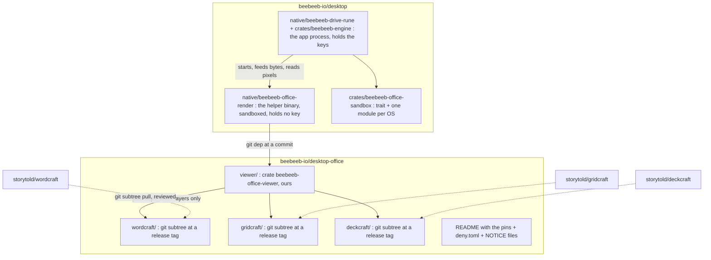

# Desktop 0.9.0: the native Office viewer (contract, spike result, plan)

**Status:** contract for review (task 2477, step 1), delta after the review of PR 351. No product code in this PR;
the spike is throwaway (`spikes/2477-lok-viewer-throwaway/`).
**Rulings it implements (owner, 2026-11-12):**
- 0.9.0 shows Word, Excel and PowerPoint files read-only, natively, with no web view; the editor is 0.9.1.
- "So artcraft it is, use that" (20:46): the viewer is built on WordCraft, GridCraft and DeckCraft, in one repository
  of ours, `desktop-office`. **The LibreOfficeKit fallback is not built.** Its numbers stay below as the record of
  why; it is no longer in the plan.
- Until the owner says otherwise, the open questions follow the lead's recommendations in decision 2482: the board
  draws the read-only viewer state first; the copy says "viewer" / "Open", not "editor"; .ppt shows "no preview,
  open with another app"; no network client is linked (the viewer links below `wordcraft-engine`); a type ships
  only at 90 % or more of a real-file corpus; `desktop-office` starts private.

Corrections made after the review are left visible: the wrong text is ~~struck~~ and the correction follows it.

## 1. Result in one table

Measured on the Windows build VM (Windows 11, 16 vCPU, no GPU). "Pages" are pages of a document, sheets of a
workbook, slides of a deck. A page counts only if its PNG was looked at and shows the expected text; a flat-colour
image counts as 0. All 23 counted page images were looked at (8 LibreOfficeKit, 8 WordCraft, 7 DeckCraft).

~~Every program ran under an outbound firewall block that was first proven able to fail.~~ Correction: the block was
proven able to fail for 1 of 4 programs, the spike's own (it connected before the rule and could not with it). For
the three Rust tools a rule was in place during the render runs but was not probed. Their network behaviour was
measured afterwards, in a separate run with two instruments that were each first seen to count (row "Any connection
at all" below; `evidence/rust/network/rustnet.log`).

| | LibreOfficeKit 26.2.7 | Rust: WordCraft 0.18.1 / GridCraft 0.19.1 / DeckCraft 0.18.1 |
|---|---|---|
| **.docx** easy (3 pages) | 3 of 3 | 3 of 3 (looser line spacing than LibreOffice on a file with no styles part) |
| **.docx** hard (2 pages: styles, list, table, picture, header, footer) | 2 of 2 | 2 of 2 |
| **.doc** (3 pages) | 3 of 3 | 3 of 3 |
| **.xlsx** easy (2 sheets) | **0 of 2: hangs in `documentLoad`** | 2 of 2 sheets read (42 cells each); sheet 1's values looked at; no sheet image from the CLI (PDF export: 1 page, looked at) |
| **.xlsx** hard (3 sheets, 19 formulas without cached values, a chart) | **0 of 3: hangs** | 19 of 19 formula cells show the expected value; currency and percent formats right; the chart draws (PDF) |
| **.xls** (2 sheets) | **0 of 2: hangs** | 2 of 2 sheets read (42 cells each); the tool warns that charts, pictures and comments of .xls are not read |
| **.pptx** easy (3 slides) | **0 of 3: hangs** | 3 of 3 |
| **.pptx** hard (4 slides: master, 2 layouts, inherited placeholders, table, picture, gradient) | **0 of 4: hangs** | 4 of 4 |
| **.ppt** (3 slides) | **0 of 3: hangs** | **0 of 3: refused** ("not a presentation DeckCraft can read") |
| A linked remote image, .docx | not fetched: 0 hits on the loopback listener in 2 runs (network open, and blocked); placeholder drawn | ~~not fetched (0 connections)~~ Correction: not measured in the first runs (the listener ran only inside the LibreOfficeKit program). Measured afterwards: next row |
| **Any connection at all**, 3 Rust tools, on files that link remote content (a linked picture in .docx, .pptx and .xlsx; `WEBSERVICE()`; a workbook linked on a web server) | not measured this way | **0 permitted, 0 blocked, 0 listener hits for 3 of 3 tools**, over 13 runs with the network open and the same 13 with a block rule per tool. Instruments first seen to count: the listener showed 1 hit for 1 test request; Windows' connection events showed 2 permitted and 1 blocked for the spike's own probe, and 1 for a loopback request. The linked picture is left out; `WEBSERVICE()` shows `#VALUE!`; the linked workbook cell is empty. **Not covered:** a document that names a font this PC does not have. Upstream has a font and language-pack downloader (`craft-font-store`, off until the user turns it on, linked by `wordcraft-engine`); none of the 26 runs could have triggered it |
| Time to the last page, warm | 2.6 to 3.7 s per document (init 1.7 to 2.8 s, load 0.4 to 0.6 s, 5 to 9 ms per further page at 96 DPI, 29 to 34 ms at 192 DPI): `evidence/libreofficekit/metrics.jsonl`, 9 lines | ~~WordCraft: 43 to 86 ms per page (layout alone: 43 to 49 ms). DeckCraft: 53 to 67 ms per deck~~ Correction, per log. WordCraft, one page, process start, load and layout included: 40 to 58 ms over 18 runs (`evidence/rust/artcraft.log`) and 43 to 86 ms over 8 runs (`artcraft-first-run.log`). DeckCraft, a whole deck of 3 or 4 slides: 50 to 64 ms over 4 runs and 53 to 67 ms over 4 runs (same two files). WordCraft's own layout time: 43 to 57 ms over 7 calls (`evidence/rust/wordcraft-info/*.json`, field `layoutMs`) |
| First start ever | 8.4 s for the first document after install and 6.6 s with a new profile (`evidence/libreofficekit/run-first-stopped.log`, lines "netopen" and "cold", field `total_to_last_page_ms`: 8384 and 6583) | 1.4 s for the first call of the 95 MB tool (`evidence/rust/artcraft-first-run.log`, line `wc-info-spike-docx`: 1381 ms; its `layoutMs` was 523), then as above |
| Peak memory | 318 to 358 MB working set | not measured (the process had exited before the counter was read) |
| Size | 373 MB installer, 1,522 MB in 19,487 files extracted (`program` 711 MB, `share` 720 MB): `evidence/libreofficekit/install.log` | CLI executables 95 / 21 / 94 MB, each with its fonts inside; no separate download |
| Language | C++ | Rust; a text search finds no `unsafe` block in the three projects' own crates (32 source files declare `forbid(unsafe_code)`); their dependencies are not counted and do contain `unsafe` |

**The LibreOfficeKit hang (the record; no longer in the plan).** Text documents work. Every spreadsheet and
presentation load blocked forever at 0 % CPU inside `documentLoad`: 21 of 21 attempts over 3 runs, across .xlsx,
.xls, .pptx and .ppt (3 in `run-first-stopped.log`, 12 in `run.log`, 6 in `hang-diagnosis.log`). Four variations
changed nothing: `SAL_DISABLE_OPENCL=1`, `MAX_CONCURRENCY=1`, the load option `Batch=true`, and every
LibreOfficeKit call on a worker thread while the main thread pumps Win32 messages. LibreOffice itself is not broken
on that machine: `soffice --headless --convert-to` wrote the .xls and .ppt fixtures from the same files in the same
session. **Every attempt ran from an SSH session, which has no desktop**; the program was never tried in the
logged-in desktop session, so a missing window station is a possible cause that this spike did not rule out. The
cause is not found; the upstream page still calls the tiled-rendering API experimental
([docs.libreoffice.org][lokdoc]). LibreOfficeKit is therefore **not shown to work** for sheets and slides on
Windows, which is a weaker statement than "cannot work".

**Recommendation, now the ruling: the Rust engine for all three types**, ~~in-process~~ **in a sandboxed helper
process, never in the process that holds the keys** (§5). The Rust option rendered 15 of 15 pages of the formats it
claims and refused the one it does not (.ppt) with a clear error. LibreOfficeKit rendered 8 of 8 text pages and 0 of
17 sheet and slide pages. The open risks are in §9; the biggest is not fidelity on these fixtures but that the
projects are five weeks old.

Evidence: `spikes/2477-lok-viewer-throwaway/evidence/` (PNGs, `metrics.jsonl`, 9 log files, 8 `layoutMs` records).
Fixtures were generated by the two scripts in the spike folder; the hard ones are hand-written OOXML, **not** files
saved by Microsoft Office, and nothing here was compared against Microsoft Office's own rendering.

## 2. The Rust option: what it is

| | WordCraft | GridCraft | DeckCraft |
|---|---|---|---|
| Repository | `github.com/storytold/wordcraft` | `github.com/storytold/gridcraft` | `github.com/storytold/deckcraft` |
| Licence | MIT OR Apache-2.0 | MIT OR Apache-2.0 | MIT OR Apache-2.0 |
| Created / last commit | 2026-10-07 / 2026-11-12 | 2026-10-07 / 2026-11-12 | 2026-10-07 / 2026-11-12 |
| Stars / forks / open issues | 17,879 / 4,934 / 2,885 | 7,480 / 3,450 / 1,983 | 4,758 / 2,734 / 823 |
| Listed contributors | 100 (the API's page limit) | 100 (limit) | 95 |
| Releases | v0.18.1, almost daily | v0.19.1, almost daily | v0.18.1, almost daily |
| Own Rust code | 403,096 lines | 252,960 lines | 184,161 lines |
| Packages in `Cargo.lock` | 707 | 672 | 628 |
| Reads | .docx, .doc, .odt, .rtf, .html, .md, .txt | .xlsx, .xlsb, .xls (values, formulas, formats), .csv | .pptx; .ppt and .odp are on its roadmap, not done |

- **Who:** the GitHub organisation "ArtCraft" (`storytold`, getartcraft.com). The Windows binaries are signed by
  "Learning Machines Inc", Atlanta, Georgia, US; the founder's profile says the same city. These are programs that
  run on the PC, not services: no data leaves through them. That fits the rule "no US systems in the data path";
  it is still a US-origin dependency and is listed for the owner in §10.
- **UI toolkit:** egui (their own fork of egui and winit). **We do not use their UI.** Each project is layered, and
  the layers below the UI are plain libraries: `wordcraft-layout` + `wordcraft-render` (a CPU rasteriser on
  `vello_cpu`), `deckcraft-render`, and GridCraft's model and calc crates. `wordcraft_render::render_page(doc, page,
  scale, opts)` and `render_region(doc, page, w, h, view, opts)` return pixels. So the answer to "can it draw into
  our Rune window?" is: **yes, as pixels we put on a Rune surface.** The egui editor chrome cannot be embedded in
  Rune and is not needed for a viewer.
- **Network code exists upstream, and one engine crate reaches it.** Walking each `Cargo.lock` from the workspace
  members: `wordcraft-engine` reaches `ureq` and `rustls`; `gridcraft-engine` reaches no network crate;
  `deckcraft-pptx`, `deckcraft-pdf` and `deckcraft-engine` reach `tokio` (an async runtime; whether its network
  feature is on was not checked). The WordCraft crates below the engine (`doc`, `docx`, `layout`, `render`, `fonts`,
  `formats`) reach none. **Rule: the viewer links WordCraft below `wordcraft-engine`, never the engine crate
  itself, and its dependency graph contains no socket, TLS or HTTP crate.** A lockfile lists every optional
  dependency, so the walk is an upper bound; the real answer is `cargo tree` on our crate, which CI checks (§3, §5).
  **Measured afterwards** (`cargo metadata` at the three release tags, normal dependencies, default features, on the
  Linux build VM): 7 of 19 WordCraft crates reach a network client (`wordcraft-engine` through `craft-font-store` →
  `ureq`, `rustls`), 3 of 18 GridCraft crates and 3 of 24 DeckCraft crates (the app, the egui UI and the web build
  in each). ~~`deckcraft-pptx`, `deckcraft-pdf` and `deckcraft-engine` reach `tokio`~~: with default features they
  reach no network or async-runtime crate; the lockfile walk was the upper bound it warned of. The closures a viewer
  would link (`wordcraft-render` + `-docx` + `-docbin`: 165 packages; `gridcraft-engine`: 128; `deckcraft-render` +
  `-pptx`: 123) contain 0 network crates. `cargo audit` on the whole workspaces: 4, 5 and 4 vulnerabilities; the one
  in those three closures is `zip 3.0.0` (4 advisories about extracting to disk; the projects call no
  extract-to-disk function: 0 calls against 270 uses of `ZipArchive`). Evidence in this PR:
  `evidence/upstream-audit/summary.txt`, `viewer-closures.txt` and the three `*-deny-bans.txt`.
  Who brings the rest (from the `cargo deny` inclusion graphs): `reqwest`, `hyper` and `h2` enter only the two app
  crates `wordcraft` and `gridcraft`, as a **build** dependency of the printing crate (`winprint` → `sigstore-verify`
  → `reqwest`), so those apps' builds can reach the network; no "may link" crate is in that graph. `tokio` reaches
  `deckcraft-pptx` and `deckcraft-pdf` only as a **dev** (test) dependency. Limits of the map: normal dependencies
  and default features only; nothing was compiled.
- **Code execution exists upstream:** GridCraft can run a workbook's Python cells in a sandbox (Linux, macOS; on
  Windows it refuses and shows `#BLOCKED!`); WordCraft has command macros. Neither is reachable from the viewer API,
  and the viewer build leaves those crates out.
- **Theming:** `RenderOptions` already carries paper colour, a dark-page mode and a read-mode paper. The chrome is
  ours (Rune), so our tokens apply without touching their UI.
- **Honest limits seen:** no .ppt; .xls without charts or pictures; GridCraft's CLI has no sheet-to-image command, so
  a sheet view was not looked at as pixels (only its PDF export and its computed values).

## 3. `desktop-office`: one repository of ours

Created after this contract's delta, private, on the lead's instruction: the three subtrees at v0.18.1 / v0.19.1 /
v0.18.1, a README, `deny.toml` and the first audit's output; no viewer crate, no CI. Three forks also exist, untouched, with 0 commits of ours:
`beebeeb-io/wordcraft`, `beebeeb-io/gridcraft`, `beebeeb-io/deckcraft`.

**The process boundary, stated once:** only the helper binary `beebeeb-office-render` links the viewer crate.
`crates/beebeeb-engine` and the Rune app never depend on `beebeeb-office-viewer` or on any WordCraft, GridCraft or
DeckCraft crate, directly or transitively; a CI check (`cargo tree -p beebeeb-engine` and `-p beebeeb-drive-rune`,
0 matches for those names) keeps it so. No parser of a hostile file ever runs in the process that holds keys.

- **Layout:** each upstream comes in with `git subtree add --prefix=<name> <upstream> <tag>` (history kept, no
  squash), so one project can be updated without the others and every pin is a tag and commit in the README. We
  change nothing inside the three folders; a needed fix goes upstream first, or is a patch file listed in the README.
- **Our code:** one crate, `viewer/`. Its whole public surface:
  - `open(bytes: &[u8], kind: Kind, limits: Limits) -> Result<Doc, OpenError>` (memory in, no path, no URL).
    `Kind` is an allow-list of exactly five: `Docx`, `Doc`, `Xlsx`, `Xls`, `Pptx`. The other formats the upstream
    readers know (.html, .rtf, .odt, .md, .csv, .xlsb) are not reachable; the kind comes from the file's extension
    **and** its first bytes agreeing, never from content sniffing alone;
  - `Doc::pages() -> usize`, `page_size(i)`, `render(i, region, scale, theme) -> Rgba8` for documents and slides;
  - `Doc::sheets()`, `sheet(i).cells(range)` (text, the formula's text, number format applied, alignment, fill,
    borders, merged ranges, column widths, row heights) and `sheet(i).render_object(id, scale) -> Rgba8` for a
    chart or picture, for workbooks, which the app draws as a native grid;
  - `Doc::outline()` (headings, sheet names, slide titles) and `Doc::stats()` (page / word / sheet / slide counts).
  It has no file, network, process or clipboard access of its own.
- **Licence duties:** each project's `LICENSE-MIT`, `LICENSE-APACHE`, `NOTICE` and `ATTRIBUTION.md` stay in its
  folder; a build copies the notices of everything it links (the bundled fonts under OFL-1.1) into the app's
  third-party licence list, which DW-1557 shows. ~~The viewer does not link the spelling word lists.~~ Correction: the
  measured WordCraft viewer closure contains `craft-proof` (through `wordcraft-layout`, for hyphenation), which
  embeds language data at build time when its data folder is configured. Whether a viewer build embeds any, and
  under which licences (upstream's `NOTICE` lists them), is open; PR 1 answers it. The ArtCraft
  name, wordmark and logos (`docs/brand/`, the app icons) are trademarks outside the open licence: no build of ours
  contains or shows them, and the product never calls the viewer by their names except in the licence list.
- **Visibility: private first** (the lead's instruction; reversible). Recommendation for later: public, because
  our product clients are open source and the desktop app is AGPL, and a private dependency makes the public
  desktop repository unbuildable for anyone else. It must be public before a public desktop branch depends on it.
  The owner decides (§10).
- **Updates (supply chain).** The upstreams are five weeks old, release almost daily, have about 100 contributors
  each, and an AI coding agent is among the top six committers of WordCraft (134 commits). So:
  1. a pin moves only by a PR in `desktop-office` that contains the subtree pull and nothing else;
  2. the PR body lists the upstream commit range and its diff stat, and a reviewer reads every changed file under the
     crates the viewer links (not the UI, not the apps);
  3. CI on that PR: `cargo deny check` (licences: only the allow-list; bans: every socket, TLS, HTTP, process-spawn
     and scripting crate, checked on the **viewer's** dependency graph; sources: crates.io and the pinned git revs
     only), `cargo audit`, `cargo tree -p beebeeb-office-viewer` diffed against the previous pin (a new crate is
     named in the PR), and the fidelity corpus (§8) with a page count that may not drop;
  4. no automatic bumps, and at most one bump per project per release of ours unless a security fix needs one.

## 4. Frames: viewer (0.9.0) and editor (0.9.1)

The board has 17 Office frames for Windows (there is no DW-1510 on Windows; it is the iPhone's DI-1510).

| Frame | 0.9.0 | Reason |
|---|---|---|
| DW-1507 Docs | **viewer** | The page on grey, the outline pane and the status bar (page n of m, word count, Encrypted) are read-only by nature. The ribbon's edit controls and the floating selection toolbar are editor. |
| DW-1508 Sheets | **viewer** | The grid, column letters, row numbers, sheet tabs, the cell box and formula bar as read-only text, and the status bar's Sum / Average / Count of a selection. The ribbon is editor. |
| DW-1509 Slides | **viewer** | The filmstrip, the current slide and the status bar. New / duplicate / delete slide are editor. |
| DW-1511 older formats | **viewer** | .doc and .xls open; the note changes to say it is read-only. .ppt does not open in 0.9.0 and shows the "no preview" state (§7). |
| DW-1556 could not prepare | **viewer** | The failure state for every way the viewer can fail (§7), with "Open in another app…". |
| DW-1557 licence notice | **viewer** | The licences oblige us from the first build that contains the engine. Its text changes (§6). |
| DW-1561 Present full screen | **viewer** | It only shows slides: next, previous, esc. Built last. |
| DW-1562 Open With | **viewer** | The way out when the viewer cannot show a file, and the only way to edit in 0.9.0. Its label "Beebeeb editor" becomes "Open" (§6). What it does with plaintext is §5.4. |
| DW-1555 first-time download | **not built** | The engine is inside the installer, so nothing downloads. |
| DW-1550 Insert tab | editor (0.9.1) | Inserts content. |
| DW-1551 command palette | editor (0.9.1) | Runs editor commands and styles. |
| DW-1552 unsaved changes | editor (0.9.1) | There are no changes in a viewer. |
| DW-1553 saved as a new version | editor (0.9.1) | No save. |
| DW-1554 someone else saved first | editor (0.9.1) | A save conflict. A viewer has nothing to lose; it follows what the other viewers do when a newer version arrives. |
| DW-1558 new document | editor (0.9.1) | Creates files. |
| DW-1559 Data tab: sort, filter, go to cell | editor (0.9.1) | Sort and filter change the sheet. "Go to cell" alone would be viewer, but the frame is the Data tab. |
| DW-1560 slide layouts | editor (0.9.1) | Changes a slide. |

Count: 8 viewer, 8 editor, 1 not built (DW-1555). **Gate:** DW-1507, DW-1508 and DW-1509 are drawn as editors.
`compare.sh` must not drop a gated element or loosen a tolerance, so (decision 2482) **the board draws the read-only
viewer state first**; no viewer frame is built against the editor drawing.

## 5. Supply, threat model, the helper, plaintext

### 5.1 Supply
Source, built by us, linked into the helper binary that ships in the installer. No download at run time, nothing
fetched from anyone's host, nothing to hash-pin beyond the pins in `desktop-office` and `Cargo.lock`. Updated with
the app; removed with the app. The earlier WASM plan's hosting and hash-pinning rules (PUNCHLIST B08) do not apply:
there is no bundle to host.

### 5.2 No network, enforced three ways
1. *By construction:* the viewer crate's dependency graph contains no socket, TLS or HTTP crate; `cargo deny` bans
   them by name and the PR check fails on a new one (§3). The viewer API takes bytes, never a path or a URL.
2. *By behaviour, tested:* corpus files link remote content; the test listens on loopback and asserts 0
   connections. ~~The spike saw 0 for both engines, with the network open and with it blocked.~~ Correction: the
   spike saw 0 listener hits for LibreOfficeKit on text documents (2 runs), and, in the later run, 0 permitted and 0
   blocked connections and 0 listener hits for 3 of 3 Rust tools (26 runs), with both instruments first seen to
   count. That was the released command-line tools, not our viewer crate; the CI test repeats it on our crate.
3. *By the operating system:* rendering runs in the helper (§5.3) with no network capability, so even a
   compromised renderer cannot connect. This is what makes the claim hold against a bug, not only against intent.
   **Windows only so far; macOS is an open item (§10).**

**Threat model.** A malicious file must not run code, fetch anything, ~~write outside a temp area~~ write anything
anywhere, read any other file or take the app down.

| Threat | Rust engine gives | We add |
|---|---|---|
| Macros, scripts | The viewer links no macro, Python or automation crate; VBA parts are never interpreted. | A test: a corpus file with a `vbaProject.bin` and one with a Python cell open as plain content. |
| Remote content (linked pictures, linked workbooks, remote templates, `WEBSERVICE()`) | The readers mark external targets as missing; nothing fetched (measured: §1). | The loopback test in CI; the OS-level block. |
| Local and UNC targets (`file:///C:/…`, `\\host\share\…` in a link) | **Not measured.** A reader that resolved one would read a local file into the page, or make Windows authenticate to another machine and hand over the account's credential hash. No crate ban sees this: it is plain file I/O. | The viewer API has no path type and never resolves a target to a path. Two corpus cases, each first seen to fail against a deliberately resolving reader: a `file:` target pointing at a canary file (its text must not appear in any page) and a UNC target (0 connection events for the process, counted with Windows' connection events, the instrument of §1). The helper's token can open neither. |
| Fonts | `wordcraft-fonts` describes itself as "bundled OFL + system" fonts and has a `system_font_dirs` function, so it reads the system font folder. Whether it parses fonts embedded in a document was **not checked**. The downloader for missing fonts lives in `wordcraft-engine`, which the viewer does not link. | The helper may read the system font folder and nothing else. Fonts embedded in a document are one more parser on hostile input: off in 0.9.0 unless PR 1 shows the reader has no such path; then the state "Some content isn't shown." |
| Memory corruption | No `unsafe` block found in the projects' own crates; their dependencies (image decoders, font shaping, zip, XML) do contain `unsafe`. | The helper process, so a decoder bug lands in a process with no file, network or key access. |
| Crash, panic, endless loop, zip bomb, huge allocation | Not known; the three trackers hold 5,691 open issues and pull requests between them. | The limits below; a dead or silent helper becomes a state within the timeout. The app never blocks on it. |
| Writing files | The viewer API has no write path. | The helper's token cannot write anywhere. |
| Leaking the document | n/a | No logs of content; the helper's stderr is dropped in release builds. |
| A lying helper | n/a | The app treats every answer as untrusted input (§5.3). |

**Limits** (proposed defaults; PR 2 lands them as constants with one test each, PR 7's corpus may move them, and a
file over one shows "Too large to preview here." with Open in another app…):

| Limit | Value | Enforced by |
|---|---|---|
| Input file size | 100 MB | the app, before decrypting for the viewer |
| Unpacked size of the container, and entries | 512 MB, 10,000 entries | the viewer (`Limits`) |
| Pages or slides | 2,000 | the viewer |
| Sheets, and non-empty cells per workbook | 256 sheets, 2,000,000 cells | the viewer |
| One decoded image | 16,384 px a side and 64 megapixels | the viewer |
| One rendered page or tile | 4,096 px a side (64 MB of pixels) | the app's request, checked again on the answer |
| Helper memory | 1 GB committed | the job object |
| Open (parse and layout) | 30 s wall clock | the app's timer; the helper is killed |
| Any single request (one page, one cell range) | 10 s of CPU, 15 s wall clock | job object and the app's timer; the helper is killed |

### 5.3 The helper process
- **What:** `beebeeb-office-render`, a separate executable in `native/beebeeb-office-render`. It is the only binary
  that links the viewer (§3). It holds no key, no session and no account data, and never sees ciphertext.
- **Lifetime: one helper per open document.** Started when the document opens, killed (not asked) when its viewer
  closes, when the app locks or signs out, and on any timeout or protocol error. Never reused for a second
  document, so nothing carries over from one hostile file to the next. Cost measured with the released tools: 40
  to 86 ms from process start to a first page.
- **Sandbox, Windows:** an AppContainer with **no** capabilities (no network, no user files, no network shares),
  inside a job object (kill-on-close, the memory and CPU limits above, no child processes), with crash dumps off
  for that executable. **Not proven in the spike** (it used a firewall rule); PR 2 proves it.
- **Sandbox, macOS: open item.** Nothing is designed. 0.9.0 ships macOS at the same moment, so the macOS helper
  needs its own deny-by-default profile with no network and no file access before the viewer ships there; until it
  exists, the Office viewer on macOS shows "no preview, open with another app" rather than rendering unsandboxed.
- **Where the code lives:** shared crates stay platform-neutral. A new crate `crates/beebeeb-office-sandbox` holds a
  small trait (start a confined helper, hand it two handles, kill it) with one module per operating system behind
  `cfg`; the AppContainer and job-object code is in its Windows module only. `crates/beebeeb-engine` gets no
  sandbox code and no viewer dependency: it only hands the decrypted bytes to the app's viewer host.
- **Transport** (not the engine's existing IPC frame, which is one JSON value per line capped at 1 MiB; a 794 x 1123
  page is 3.6 MB):
  - *control:* two inherited anonymous pipes carrying binary frames: a 4-byte little-endian length, then a message
    of at most 64 KiB. Messages: `Open{kind, doc_len}`, `Opened{pages | sheets, sizes}`, `Render{id, page, region,
    scale}`, `Rendered{id, w, h}`, `Cells{id, sheet, range}`, `CellData{id, …}`, `Outline`, `Stats`, `Cancel{id}`,
    `Error{id, code}`.
  - *bulk data:* unnamed, pagefile-backed shared memory sections created by the app and handed to the helper by
    handle: one read-only section with the document's bytes, and one writable section per render request of
    exactly `w * h * 4` bytes. Nothing has a name another process could open, and nothing is a file.
  - *untrusted answers:* the app checks every answer before use: `w` and `h` equal what it asked for and are
    under the limit; a count or length is under its limit; text is capped in length and never used as a path, a
    URL or a format string; an error is a code from a fixed list, never the helper's own words. Anything else is a
    protocol error: the helper is killed and the state is "Renderer stopped".

### 5.4 Plaintext
- **In the viewer: memory only.** Decrypted bytes live in the app while decrypting, in the shared section, and in
  the helper. Never on disk: no temp file, no cache of pages, no thumbnail written. Pixels, cell text, the outline
  and the counts held by the app are plaintext too: they are dropped when the viewer closes or the app locks. On
  close, lock, sign-out or helper exit the app zeroizes its buffer and unmaps the sections; the helper's memory
  goes with the process. The viewer window **and the Present window (DW-1561)** are excluded from capture on the
  same rule as the other viewers. The page file is the remaining gap, the same as for every other viewer in the
  app; it is stated, not solved here.
- **"Open in another app…" is not the viewer, and it is the one place where plaintext is on disk.** The other two
  native specs do not define it; this contract does, as far as it can without a ruling:
  1. *The file is in a folder that syncs to this PC and is available offline:* its plaintext is already on this
     disk, by the user's choice. The app asks Windows to open that path (the app's existing `ShellExecuteW` open).
     No copy is made, nothing is deleted afterwards, and an edit saved by the other program is an ordinary change
     in the sync folder: it uploads as a new version, as any edit there does.
  2. *The file is in a synced folder but online-only:* opening the path makes Windows ask our Cloud Files provider
     for the content, exactly as a double-click in File Explorer does. From then on it is case 1: the file is
     plaintext on this disk until the user frees the space. The app says so once, before it happens: "This
     downloads the file to this PC."
  3. *The file is not in any folder that syncs to this PC* (seen only in the Drive window): **open question for
     the owner (§10).** The board's DW-1562 says "Decrypts a copy for that app; saving there … uploads a new
     version", which needs a decrypted temporary copy: a location, who may read it, when it is deleted, and an
     upload path for edits that 0.9.0 does not have. **Proposal: 0.9.0 makes no temporary copy.** The action is
     offered only in cases 1 and 2; in case 3 the panel says "To open this in another app, make it available on
     this PC first." with that action. Nothing is silently decrypted to a temp folder, and no edit can be lost.
  How the sync folder behaves in cases 1 and 2 is read from the code (`windows_cf`, `open_path`), not tested here.

## 6. Spec against reality (quoted; the copy follows decision 2482 until the owner rules otherwise)

1. DW-1555: "the editor itself downloads (257 MB)". 257 MB was the WASM bundle. With the Rust engine nothing
   downloads; the frame is not built.
2. DW-1557: "This editor is LibreOffice, compiled to run entirely on this device … Source: github.com/beebeeb-io/office;
   Third-party licenses (LibreOffice MPL-2.0, Qt LGPL-3.0, fonts OFL-1.1)". It must name WordCraft, GridCraft and
   DeckCraft (MIT OR Apache-2.0), the fonts (OFL-1.1) and `desktop-office` as the source; no LibreOffice, no Qt.
   Proposed text: "This viewer is built on WordCraft, GridCraft and DeckCraft, open-source Rust projects. It runs
   entirely on this device." The source link is shown only once `desktop-office` is public.
3. Every Office frame says "editor" ("Open (Beebeeb editor)", "Preparing the editor on this PC…", "We couldn't
   prepare the editor on this device."). In 0.9.0: "viewer" where a noun is needed, "Open" on the menu.
4. DW-1511: "It opens and saves in the same format." 0.9.0 does not save, and .ppt does not open.
5. DW-1556: "The file is untouched; it can still be read in Preview." For an Office file the viewer **is** the
   preview; when it fails, only "Open in another app…" is left.
6. DW-1562: "Decrypts a copy for that app". See §5.4, case 3.
7. The task's verification line says "loads LibreOfficeKit … writes page tiles". Met for text documents only (8 of
   8 pages); for sheets and slides the spike's result is the hang. The goal behind it (a native renderer that shows
   the three types and makes no connection) is met by the Rust tools for the formats in §1.

## 7. Rendering and states

**Rendering.**
- *Documents and slides:* the app asks the helper for a page at a scale; the helper writes RGBA8 pixels into the
  shared section; the app uploads them as a texture and draws it on the grey canvas. Scale = zoom x the monitor's
  DPI factor, so text is sharp at 150 % and 200 %; a page is re-requested when zoom or DPI changes, and the old
  texture stays up until the new one arrives. Scrolling shows a virtual list of pages: the visible ones plus one
  screen each way are kept, the rest are dropped. Large zooms use `render_region` (tiles of 512 px) instead of
  whole pages. Texture memory is capped (default 256 MB) with least-recently-seen eviction.
- *Sheets:* a native Rune grid drawn from cell data the helper returns per visible range; frozen panes, merged cells,
  column widths and number formats come from the model. Charts and pictures arrive as pixels for their anchor
  rectangle. This is the part with the most work and the least spike evidence (§9).
- *Thread rule:* the UI thread never parses, lays out, renders or waits. Every request to the helper is a message
  with an id; answers arrive as events; a request the user scrolled past is cancelled. A missing answer is a state,
  never a frozen window. Measured headroom: ~~43 to 86 ms~~ 40 to 86 ms per page on the VM's CPU, process start
  included (§1).
- *Not verified:* how Rune takes a raw pixel buffer as a texture. The Rune app has no image drawing yet (the
  viewers lane, task 2472, lands the first). PR 2 proves it with one page before anything else.

**States** (each is a typed state of the viewer; none is a blank or a spinner without end):

| State | Shown | Frame |
|---|---|---|
| Opening (downloading, decrypting, first page not yet there) | the page skeleton with the status bar "Opening…" | the board's read-only drawing (to be drawn) |
| Download or decryption failed before the first page | the viewers contract's error state (task 2472 owns it; this viewer adds none) | not an Office frame |
| Ready | the document | DW-1507, DW-1508, DW-1509 (read-only drawing) |
| Older format, opened | the document and the read-only note | DW-1511 |
| No preview for this type (.ppt, .odp; password-protected files; macOS until its sandbox exists) | "No preview for this file here." with Open in another app… | DW-1556 (copy differs) |
| File damaged, or over a limit (§5.2) | the same panel, with the reason in one line | DW-1556 |
| Renderer stopped (crash, timeout, out of memory, protocol error) | the same panel with Try again (a new helper, once) | DW-1556 |
| A picture or font could not be drawn | the page, and a quiet line in the status bar: "Some content isn't shown." | to be drawn |
| Linked content not loaded | the page without it; nothing is fetched, no prompt | none needed |
| The app locks while a document is open | the helper is killed, pixels and text are dropped, the lock screen shows; after unlock the document opens again from the start | the app's lock frame |
| Newer version arrived while open | what the other viewers do (the viewers contract, task 2472) | not an Office frame |

## 8. Plan for step 2 (honest size)

Seven PRs after this contract is merged; two lanes can run from PR 3 on. Calendar: about 7 to 9 lane-days, more if
the sheet grid or the sandbox fights back. The macOS sandbox is not in this count.

| # | PR | Size | Proves |
|---|---|---|---|
| 1 | `desktop-office`: the `viewer` crate with documents only, `deny.toml`, CI | M | **first proof: a .docx and a .doc page rendered without `wordcraft-engine`** (`wordcraft_docx::read` / `wordcraft_docbin::read` → `wordcraft_layout::layout` → `wordcraft_render::render_page`; these public functions exist, the path was not built or run by us), with the same page count as the spike; builds on Windows and macOS; **pass / fail: 0 socket, TLS or HTTP crates in `cargo tree -p beebeeb-office-viewer`**; `cargo deny` and `cargo audit` with counts; the corpus test with a count; the loopback, `file:` and UNC cases, each first seen to fail |
| 2 | desktop: `crates/beebeeb-office-sandbox` (Windows module), `native/beebeeb-office-render`, the transport, the limits; one .docx page as a texture in the Rune window | L | five sandbox claims, each with a test first seen to fail without the sandbox: no network; no read of a user file; no write anywhere; the memory cap; a hang fixture killed in time. Plus: `beebeeb-engine` and the Rune app do not link the viewer |
| 3 | DW-1507 viewer: pages, scroll, zoom, DPI, outline, status bar | M | `compare.sh` at 0 failing against the board's read-only drawing |
| 4 | `viewer`: slides, linking `deckcraft-render` and `deckcraft-pptx` (0 network crates, 0 licences outside the allow-list). Whether it may link `deckcraft-engine`, which adds 16 MPL-2.0 audio-decoder packages, is §10 question 10; DW-1509 and DW-1561 | M | filmstrip, present mode, capture exclusion of the Present window |
| 5 | `viewer`: workbook cell data, chart and picture pixels; DW-1508 grid | L | the largest unknown: a native grid from the model |
| 6 | DW-1511, DW-1556, DW-1557, DW-1562, "Open in another app…" as ruled (§5.4), the copy changes | S | every state of §7 reachable in a test |
| 7 | the fidelity corpus: 20+ real files per type saved by Microsoft Office, pages counted, as a CI gate | M | the number that decides whether a type ships in 0.9.0 |

PR 7 can start with PR 1 and should: it is the evidence this spike does not have. Its files go into a repository
only with a stated origin and licence each (written by us, or openly licensed test corpora), and after a metadata
scrub (author, company, last-saved-by, revision history, embedded paths); while `desktop-office` is private they
live there, and nothing with an unclear origin is ever committed.

## 9. Risks

1. **Fidelity on real files is unknown.** 15 of 15 pages here, but ~~on 6 hand-made files~~ those 15 pages come
   from 5 files (2 hand-written .docx, 1 converted .doc, 2 hand-written .pptx); none is from Microsoft Office, none
   has tracked changes, SmartArt, embedded fonts, pivot tables, right-to-left text or 200 pages. PR 7 measures it.
   Rule (decision 2482): a type ships in 0.9.0 when at least 90 % of its corpus pages render without a missing
   element; below that the type shows "No preview for this file here." rather than a wrong page.
2. **A five-week-old dependency of 840,000 lines** with daily releases and about 100 contributors. A bad commit can
   land upstream at any time. Mitigations are the pin, the diff review per bump, `cargo deny` / `cargo audit` and the
   helper process (§3, §5). What they do not cover: a subtle parser bug in code nobody on our side has read in full.
3. **The sheet view is the least proven part.** No pixel of a GridCraft sheet was looked at (its CLI cannot make
   one). The values and formats were right; the grid is ours to draw.
4. **The sandbox is designed, not proven,** and for macOS not even designed (§5.3).
5. **Every counted page was rendered by a released tool that links the engine crates; the viewer must not link
   `wordcraft-engine`.** For DeckCraft the difference is nil: `deckcraft_engine::render` is a re-export of
   `deckcraft-render`. For WordCraft the lower path (reader → layout → render) exists as public functions but was
   never run by us; what the engine adds on top (font fallback choices, field updates, defaults) may change a page.
   PR 1's first proof is the same page count without the engine.
6. **The 0.9.1 editor.** The Rust projects are editors already (422 commands in WordCraft alone, save to .docx /
   .xlsx / .pptx), but their editing UI is egui. 0.9.1 drives their engine crates from Rune chrome we build (the
   board's ribbon, palette and dialogs: large, but the same `desktop-office` and helper). `wordcraft-engine` reaches
   a network client today (§2), so the editor needs that dependency cut or feature-gated upstream first.

**LibreOfficeKit, for the record only (not in the plan).** Besides the hang: the full set is 1,522 MB and would
need a trimmed bundle on our host; MPL-2.0 duties and The Document Foundation's trademark policy for a repackaged
subset ([TDF trademark policy][tdftm]); a second engine to keep patched. What worked: macros never execute by
default (`desktop/source/lib/init.cxx`, lines 2968 to 2978 on branch `libreoffice-26-2-7`), the linked image was
not fetched, the profile was written only where told (134 files, 487 KB, 0 outside). On Windows the official init
header only compiles as C++, and the official build ships `mergedlo.dll` (148 MB), not `sofficeapp.dll`.

## 10. Open questions for the owner (decision 2482 holds the first seven)

1. `beebeeb-io/desktop-office`: private first (the lead's instruction); **public when?** It must be public before a
   public desktop branch depends on it (§3).
2. The three forks (`beebeeb-io/wordcraft`, `gridcraft`, `deckcraft`) are unused once `desktop-office` holds the
   subtrees. Keep as mirrors, or delete? Deleting is irreversible.
3. The viewer state on the board: followed as "the board draws the read-only state first". Who draws it, and the
   two missing states (the opening skeleton, "Some content isn't shown.")?
4. The copy: followed as "viewer" / "Open"; the DW-1557 text and the DW-1511 note in §6 still need a yes.
5. .ppt in 0.9.0: followed as "no preview, open with another app".
6. A US-origin, US-signed dependency that runs only on the PC and made 0 connections in 26 measured runs (none with
   a document naming a font the PC lacks; upstream's font downloader is off by default and is not linked by the viewer):
   acceptable under the "no US systems in the data path" rule? Our reading: yes, it is code, not a system in the
   path; it is the owner's rule to read.
7. The 90 % corpus rule: followed.
8. **New: "Open in another app…" for a file that is not on this PC** (§5.4, case 3): no temporary decrypted copy
   in 0.9.0 (proposed), or the board's "decrypts a copy for that app", which then needs its own contract?
9. **New: the macOS sandbox for the helper** (§5.3): who designs it, and does the Office viewer ship on macOS in
   0.9.0 without it? Proposed: no; "no preview" there until it exists.
10. **New: MPL-2.0 in the slide path.** `deckcraft-engine` brings 16 `symphonia` audio-decoder packages under
    MPL-2.0. The plan links below it and needs none; if a later need pulls the engine in, MPL-2.0 (file-level
    copyleft, source of changed files to be offered) is a licence decision for the owner.

## 11. What the spike did and did not do

- **Did:** installed LibreOffice 26.2.7 from The Document Foundation's download (SHA-256 checked against their
  published value, signature valid) with an administrative install into one folder; downloaded the three ArtCraft
  release zips twice (SHA-256 checked against each release's `SHA256SUMS.txt`); proved the firewall block with its
  own program; measured the Rust tools' connections with a listener and Windows' connection events (audit setting
  switched on for the run and restored: "No Auditing" before and after); removed everything, twice. Leftovers
  counted after each removal: 0 files, 0 uninstall entries, 0 registry keys, 0 firewall rules, 0 profile folders, 0
  processes (`evidence/remove.log`, `evidence/remove-after-rustnet.log`).
- **Did not:** test with files from Microsoft Office; test macros, password-protected or damaged files; test
  `file:` or UNC targets; measure the Rust tools' memory; look at a sheet as pixels; build the Rust crates ourselves
  (the released binaries were run, so "links only the lower layers" is read from the manifests and lockfiles, not
  built); run `cargo deny` or `cargo audit`; prove an AppContainer; find the cause of the LibreOfficeKit hang or
  try it in the logged-in desktop session; draw anything in Rune.

### Not done in this delta: follow-ups from the review, one line each
- Review 12: PR 2's five sandbox tests are now named in §8; none exists yet.
- Review 13: "download or decryption failed" is cited to the viewers contract (task 2472), which must define it.
- Review 14: system fonts and embedded fonts are a threat-model row with two unknowns; PR 1 answers them.
- P3, `tokio` in DeckCraft: answered by the measurement in §2 (not reached with default features); PR 1's pass / fail rule stays.
- P3, sheet objects and formula text: added to the API in §3; not designed further.
- P3, corpus origin, licence and metadata scrub: a rule in §8; no corpus exists.
- P3, "6 files": corrected to 5 in §9.
- P3, word lists: ~~the viewer does not link them~~ `craft-proof` is in the WordCraft viewer closure (§3); what it embeds and under which licence is open for PR 1.
- P3, plaintext of sheet text, outline, counts and the Present window: added to §5.4.
- P3, CI runs every Rust suite for this PR because `scripts/ci-changed-areas.py` does not know `spikes/`: not
  changed here (outside this lane's file area); it fails open.
- P3, 3 MB of throwaway binaries stay in the public history after the folder is deleted: stated, not changed.

[lokdoc]: https://docs.libreoffice.org/libreofficekit.html
[tdftm]: https://wiki.documentfoundation.org/TDF/Policies/TradeMark_Policy
