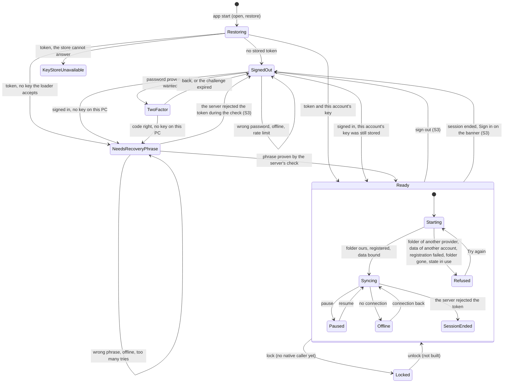
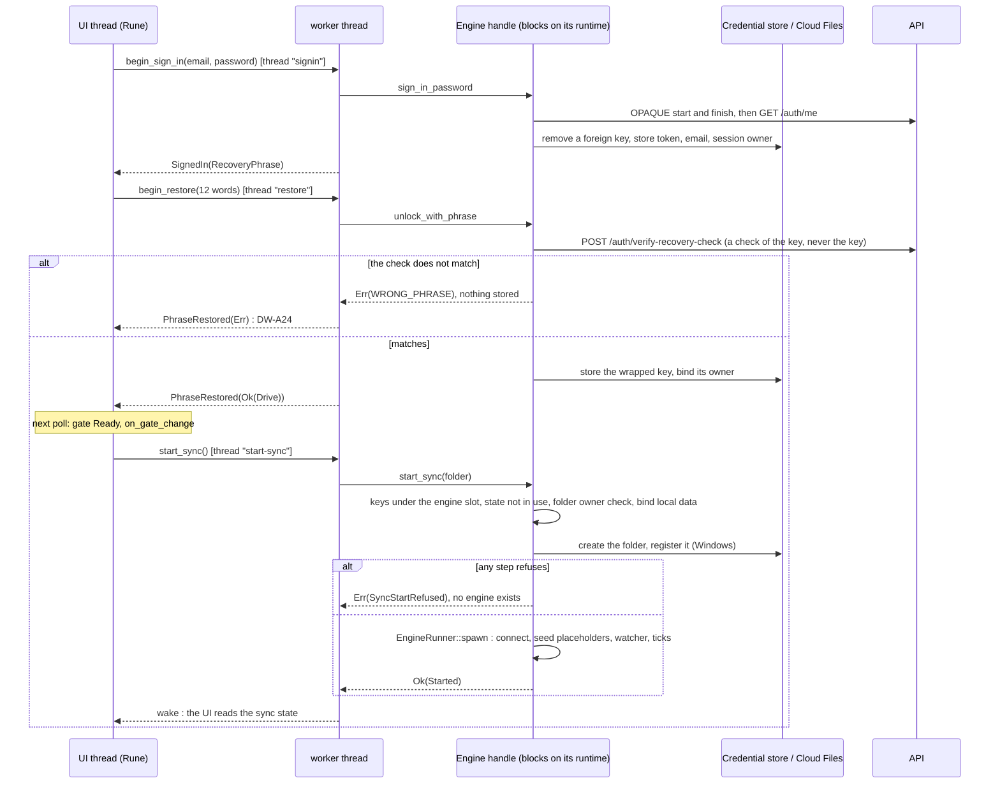
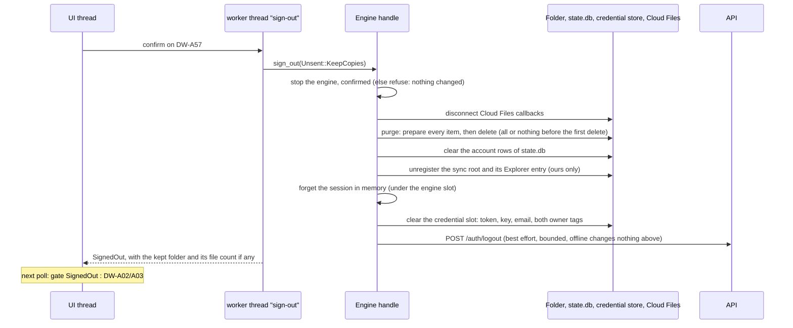
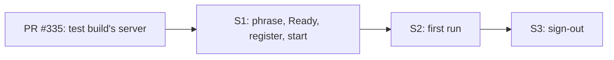

# Desktop 0.9.0 (native): from sign-in to an honest running sync, and signing out

**Status:** contract (spec + plan) for three pull requests, S1 to S3. Written 2026-11-12 by the design lane; the build
lane opens S1 with code on top of this file; a separate security review checks each PR against §9.
**Code read at:** `v2-native` = `bd94b159`. Every `file:line` below is from that commit. Paths are relative to the
repository root; `E/` is `crates/beebeeb-engine/src/`, `N/` is `native/beebeeb-drive-rune/src/`.
**Tasks:** 2445 (the path), 2465 (sign-out), 2462 and PR #335 (the test build's server), and by number only: 2456,
2457, 2464, 2466. Server behaviour and every known weakness are in the private notes of task 2445
("task 2445 notes", sections N1 to N7); this file states only what the client does and what each PR must guarantee.

**What I did not verify** (the build lane and the review must): nothing was run, not the app, not a test, not on
Windows. PR #335 was read from its description, not its code (it is open, head `4eeadea5`, and not in this tree).
The internals of `store::load_session_from_vault`, `AuthVault::install_session`, the platform credential store and
core's `recover_from_phrase` were read through their callers and comments only. Also not read: the global banner's
source, `N/shell/tray.rs` and `N/ui/status_line.rs` (S1 feeds them; their shape is the build lane's to check), the
`AccountSource` trait beyond its sign-out calls, and the non-Windows purge calls named in S3. Checked by grep:
`Engine::start_sync` has no caller in `src-tauri`; its callers are `N/engine_host.rs:271` and the tests
`crates/beebeeb-engine/tests/host_contract.rs:306-322`, `tests/fake_api_account.rs:259`. The four Mermaid diagrams
were not rendered here; the build lane renders them in the PR and fixes syntax if one fails.

## 1. What exists, and what is missing

| Piece | Where | State at `bd94b159` |
| --- | --- | --- |
| Gate, 6 states | `E/signin/gate.rs:19-35`, `decide_gate` `:269-284` | built; `NoPlan` cannot occur (`E/app.rs:240` passes `false` for the plan) |
| Restore at start | `Engine::restore`, `E/app.rs:202-228` | built; no network; a stored key the loader accepts unlocks at once |
| Password, second factor | `E/app.rs:268-339`, `finish_sign_in` `:344-379` | built |
| Recovery phrase | `Engine::unlock_with_phrase`, `E/app.rs:417-465`; proof `E/signin/recovery.rs:136-150` | built |
| Start sync | `Engine::start_sync`, `E/app.rs:476-527`; `EngineRunner::spawn` at `:509` | built; takes any folder; nothing creates the folder |
| Cloud Files registration | `windows_cf::connect_root`, `E/windows_cf/mod.rs:1040`, registers at `:1065` and `:1076`, called from `E/runner.rs:187` | runs inside the engine task, on every spawn |
| Folder owner check | `E/sync_root_owner.rs:46-66` and `check` `:85`, called at `E/app.rs:481`, `E/runner.rs:178`, `E/windows_cf/mod.rs:344` | built |
| Native start call | `LiveEngine::start_sync`, `N/engine_host.rs:328-344`; `start_sync_now` `:263-272`; callers `N/shell/mod.rs:426`, `N/shell/host.rs:434` | built; the outcome is only logged |
| Phrase screens | `EngineSignInSource::begin_restore`, `N/engine_host.rs:436-451`; DW-A23, A24, A25 (`N/frames/signin/FRAMES.md`) | built |
| First run, 11 frames | `N/frames/signin/setup/**`; `SetupSource` `N/frames/signin/setup/source.rs:113-154` | drawn on a fixture; nothing routes to it in the live app (`N/frames/signin/setup/mod.rs:601` is a scene) |
| Sign-out, keep everything | `Engine::sign_out_keeping_local_data`, `E/app.rs:621-649` | built, no caller |
| Sign-out, Windows purge | `E/windows_cf/signout.rs:69`; the order is in the old shell, `src-tauri/src/sign_out_commands.rs:9-425` | engine parts built; the order is not in the engine |
| Account pane on a live engine | `N/engine_host/tests.rs:397` (`account_has_no_source_on_a_live_engine`) | no source: DW-A57 cannot be reached |
| Fake API | `E/test_api/**`, `crates/beebeeb-engine/tests/fake_api_account.rs` | built (#323): OPAQUE, one account, 7 encrypted items |

Three states are **unreachable today**, and this contract keeps them so; each is said, not papered over:
`NoPlan` (above); `Locked` (`Engine::lock`, `E/app.rs:598`, has no native caller, `begin_unlock` is not wired,
`N/engine_host.rs:457`, and DW-0009 is not built); `KeyStoreUnavailable` has no frame (the shell's "not built yet"
frame shows). A lane that makes one reachable adds its frame first.

## 2. States and transitions

Two layers. The **engine gate** is `GateState` (`E/signin/gate.rs`). The **sync state** is new in S1 (§4.2): it says
whether an engine runs, and if not, why. The window shows the gate's screen; the status line, the tray and the
first-run step 5 show the sync state.

### 2.1 What the window shows

Only frames that are on the board. Where the board has no frame for a state, the row says so and §11 asks.

| State | Entered by | Window | Tray / status line |
| --- | --- | --- | --- |
| Restoring | `open()` then `restore()` on the start path (`N/engine_host/open.rs:44-62`) | nothing yet (the window opens on the restored gate) | none |
| SignedOut | no token; sign-out | DW-A01 / A02 / A03 | signed out; a click opens sign-in |
| wrong password, offline, rate limit, lock hint | `SignInProblem` (`E/signin/gate.rs:84-98`) | DW-A19, A20, A21, A22 | signed out |
| TwoFactor | `NextAfterSignIn::TwoFactor` | DW-A26, A27, A28 | signed out |
| NeedsRecoveryPhrase | signed in, no key | DW-A23; DW-A25 from "I don't have my phrase" | signed in, not syncing: "Sync is off" (S1 words, §11 D1) |
| wrong phrase | `gate::WRONG_PHRASE` (`E/signin/gate.rs:175`) | DW-A24 | as above |
| phrase: offline, too many tries | `gate::phrase_error` (`:193`) | DW-A23 with the rule's words (`FRAMES.md`, "states the board gives a rule") | as above |
| phrase: the session ended meanwhile | the check answers 401 (`E/signin/recovery.rs:67-69`) | until S3: DW-A23 with "The phrase check didn't finish. Try again." (`gate.rs:209`), and no way on; from S3: the sign-in form (DW-A02/A03), words D3 | signed out |
| KeyStoreUnavailable | the store cannot answer | the shell's not-built frame (no board frame) | signed in, not syncing |
| Ready, first time on this PC (S2) | gate Ready and setup not finished | DW-0201 to DW-0208 in the first-run window | step 5 and the tray follow the sync state |
| Ready, Starting | gate Ready | Files; DW-0118 while the first list loads | "Starting…" |
| Ready, Syncing / Paused | engine runs | Files (DW-0401) | Syncing, Paused, Up to date |
| Ready, Offline | engine status says no connection | Files with DW-0101 | offline |
| Ready, SessionEnded | the engine's auth health says rejected (`E/runner.rs:832`) | Files with DW-0105 ("Sign in") | "Sign in again" |
| Ready, Refused: another provider's folder | `sync_root_owner::refusal` (`E/sync_root_owner.rs:46`) | first run: DW-0280; later starts: no board frame, see D1 | "Sync is off" |
| Ready, Refused: registration failed | Windows answered an error | first run: DW-0280 with Windows' code; later: D1 | "Sync is off" |
| Ready, Refused: another account's data | `account_binding::OTHER_ACCOUNT_ON_WINDOWS` | no board frame, D1 | "Sync is off" |
| Locked | `Engine::lock` | DW-0009, not built: unreachable, §1 | locked |

`start_sync` is asked from exactly two places, as today: once after the event loop is up (`N/shell/mod.rs:426`) and
when the gate turns Ready (`N/shell/host.rs:428-436`). Both go through `LiveEngine::start_sync`; S1 makes it start
at most one start worker at a time.

## 3. Sequences

### 3.1 Fresh sign-in to a running sync (S1)

### 3.2 Sign-out (S3)

## 4. The seams (what calls what, on which thread, and what is new)

**Threads.** The UI thread never calls a blocking engine method (`E/app.rs:4-7` already says so). Each engine call
runs on a named worker thread started by the native host (`signin`, `2fa`, `restore`, `start-sync`, new: `sign-out`);
the engine's own work runs on its runtime's threads (`beebeeb-engine`); a result reaches the UI as an event on a
channel plus a wake (`ChannelHost`, `N/engine_host/open.rs:53`). The UI thread reads only values that never wait
(§4.2).

**The engine stays platform-neutral.** No Rune type, no window, no dialog in `crates/beebeeb-engine`. Windows calls
sit behind `#[cfg(target_os = "windows")]` inside the engine as today. No per-app literal anywhere: every name comes
from the `EngineIdentity` the handle was opened with.

### 4.1 Order of calls on the native side

1. `engine_host::open::open` (one per process, after the single-instance claim): state folder, account slot, the
   server binding of PR #335 (its `bind_to_server` runs before `Engine::open`; S1 must not move anything in front of
   it), `Engine::open`, `Engine::restore`.
2. Sign-in screens: `sign_in_password` → (`two_factor`) → (`unlock_with_phrase`), each on its worker.
3. Gate Ready: `LiveEngine::start_sync` → worker → `Engine::start_sync(folder)`, folder from `Engine::sync_root()`
   (`E/app.rs:682-687`: the settings' folder, else the identity's suggestion).
4. Running: `pause`, `resume`, the listing from `state.db`, file operations (already gated on a running engine,
   `N/engine_host.rs:560-567`).
5. Quit: `Engine::stop`. Sign-out: `Engine::sign_out` (S3).

### 4.2 New in the engine (S1)

| What | Where | Contract |
| --- | --- | --- |
| `SyncStartRefused` | `E/app.rs`, replacing the `String` error of `start_sync` | variants: `FolderOfAnotherProvider`, `FolderUnreadable`, `FolderMissing`, `RegistrationFailed { code: Option<i32> }`, `OtherAccountsData`, `IdentityUnknown`, `StopUnconfirmed`, `StateInUse`, `Other`. `Display` gives the existing sentences (a folder by its name, never a path). No variant carries a key, a token, a phrase or a path |
| The start order | `Engine::start_sync`, `E/app.rs:476` | under the transition lock and the engine slot, in this order: (1) reactivation allowed; (2) slot empty, else `AlreadyRunning`; (3) keys and their identity, `NoSession` returns here and **nothing on disk has been touched**; (4) the state folder's engine lock is not held by another live process, else `StateInUse` (before `state.db` is opened); (5) `sync_root_owner::check`; (6) the folder exists, or no account data is recorded yet, else `FolderMissing` (a recorded account with a vanished folder never gets a fresh empty folder to "sync"); (7) bind the local data to the account (today's `:505-506`); (8) create the folder if missing (`config::ensure_directory`, `E/config/paths.rs:47`); (9) Windows: `windows_cf::register_sync_root` (`E/windows_cf/mod.rs:343`), an error is `RegistrationFailed` with Windows' code; (10) `EngineRunner::spawn` |
| The engine task and the root | `connect_root`, `E/windows_cf/mod.rs:1040`; `E/runner.rs:187` | an engine task runs only on a root that is registered and whose callbacks are connected: `connect_root` hands its outcome to `runner::run`, which ends with an error status otherwise. The Explorer (WinRT) registration at `:1076` stays best effort and its outcome is kept for `SyncView.explorer` |
| `SyncRootPort` | new file `E/sync_root_port.rs` | the three OS answers a start needs, as a trait: the folder's registration (`sync_root_owner::Registration`), "register this folder" (`Result<(), i32>`), and "is the state folder's engine lock held by another live process" (the read half of `LockFile::acquire`, `E/lockfile.rs`). `Engine::start_sync` uses the OS implementation; `Engine::start_sync_with(port)` exists under `cfg(any(test, feature = "test-support"))` only, so a test on any OS can make each answer |
| `SyncView` | new file `E/sync_view.rs`; held by the handle | a snapshot the UI may read from any thread without waiting: `gate` (as last decided), `start` (`NotAsked`, `Starting`, `Running`, `Refused(kind)`), `explorer` (`Unknown`, `Adding`, `Added`, `Failed { code }`), `paused`, `offline`, `session_ended`. Written by the handle at the end of every transition and by the engine's status events. `Engine::view() -> SyncView` takes no lock that a transition or the engine slot holds |
| A fake API a rung can start | new `crates/beebeeb-engine/examples/fake_api.rs` (feature `test-support`) | serves `test_api::fake_account::test_account()` on a loopback port and prints the port; refuses any non-loopback bind (the harness's own `require_loopback`) |

### 4.3 New in the native shell (S1)

| What | Where | Contract |
| --- | --- | --- |
| Reads without waiting | `LiveEngine::session`, `tray_inputs` (`N/engine_host.rs:275-305`), `EngineFilesSource::sync_state` (`:590-598`), `EngineSignInSource::gate` (`:376`) | read `Engine::view()` only. `explorer_ready` is `view.explorer == Added`; `sync_state` is `None` when no engine runs (never "Up to date" for an engine that is not running) |
| One start at a time | `LiveEngine::start_sync` (`:328`), moved with `start_sync_now` to new `N/engine_host/sync.rs` | at most one `start-sync` worker; the result is in `SyncView`, and the UI is woken; the log line stays, with the refusal's kind only |
| Status words | `N/shell/tray.rs` inputs, `N/ui/status_line.rs` | Starting, Syncing, Paused, Up to date, Offline, "Sync is off" (D1), "Sign in again" |
| Banners | the global banner's source (`N/frames/global/`) | S1 feeds exactly two fields from `SyncView`: offline (DW-0101) and session ended (DW-0105). The banner's "Sign in" is wired in S3 |

### 4.4 What moves from `src-tauri`, what stays

| From `src-tauri` | To | PR |
| --- | --- | --- |
| "Create the folder, register, then start" (`finder_setup_commands.rs:794-834`) | the order of `Engine::start_sync` (§4.2) | S1 |
| The Windows arm of `clear_session_impl` (`sign_out_commands.rs:131-153`, `:187-258`, `:330-399`) and `kept_unknown_files_dir` | `Engine::sign_out`, new `E/app/sign_out.rs` | S3 |
| Persisting the folder and the "installed" status (`finder_setup_commands.rs:823-838`) | `EngineSetupSource`, S2 (§5.1) | S2 |

Stays in `src-tauri` (not this contract): the macOS keep step, send phase and flow windows (`sign_out_commands.rs`
from `:602`), the Finder reconciler, the startup probe of the old shell. `src-tauri` is not edited by S1 to S3 except
to delete what moved when nothing there still calls it.

## 5. The sync folder and Cloud Files

### 5.1 Who chooses the folder, and when

- **The board has no folder chooser.** First run step 5 is "Beebeeb is in File Explorer" (DW-0206, 0206b, 0280);
  `SetupSource` has no folder call (`N/frames/signin/setup/source.rs:113-154`). So the folder is the identity's
  suggestion: the home folder joined with `identity.sync_folder_name()` (`E/config/paths.rs:38-42`), "Beebeeb" for
  the real app and "Beebeeb Test" for the test build (`E/identity.rs:44`, `:63`). A chooser is new UI: §11 Q2.
- **S1:** every start resolves the folder the same way (`Engine::sync_root`) and registers before the engine.
  Nothing is persisted yet; the suggestion is stable for one Windows user.
- **S2:** the folder is written to the settings (`DesktopConfig.sync_root`, `E/config/types.rs:70`) by the start
  worker after the first `Ok(Started)`, through `DesktopConfig::update_at_then`, and only when the settings name none.
  From then on a changed home folder cannot move the sync folder. A new settings field `native_setup_done`
  (`E/config/types.rs`, default `false`, never part of the settings IPC) is set by `SetupSource::finish`.
  An install that already has `sync_root` set when the native app first opens (an upgrade from 0.8.x) gets
  `native_setup_done = true` in `open()`, before anything else writes: it never sees the first run.
- **The first run does not hold sync back.** Sync starts when the engine gate is Ready (S1's rule, unchanged by
  S2); the seven steps are settings. Step 5 shows what the start did: `Adding` while `start` is `Starting`, `Added`
  when the engine runs and `explorer` is `Added`, `Failed { code }` otherwise. "Try again" asks for a start again.

### 5.2 Registration

- **Before any engine:** §4.2 step 9. An engine never exists for a folder whose Cloud Files registration failed.
- **Whose:** the provider name and GUID are the identity's (`E/windows_cf/registration.rs:25`); the test build is
  `BeebeebTest` with its own GUID and COM class ids (`E/identity.rs:58-73`). The pin test
  `the_two_identities_share_no_value` (`E/identity.rs`) stays green and S1 adds nothing that bypasses it.
- **Never another provider's folder:** `sync_root_owner::check` refuses a folder registered to any other provider
  and a registration that cannot be read (`E/sync_root_owner.rs:46-66`), at three places already (§1) and at
  `unregister_sync_root` (`E/windows_cf/registration.rs:126-129`). S1 keeps all of them and adds none that reads the
  registration from anywhere else.
- **Later starts:** every start registers again with the same provider (idempotent at the OS, `E/windows_cf/mod.rs:341`)
  and never unregisters (unregistering deletes cloud-only placeholders; only sign-out does it, on purpose). A folder
  that is gone while account data is recorded refuses the start (§4.2 step 6).
- **Explorer entry:** best effort. When only the Explorer (WinRT) registration fails, sync runs and step 5 shows
  DW-0280, whose words ("the Beebeeb window works without File Explorer", `N/frames/signin/setup/view.rs:639`) are
  then true. When the Cloud Files registration itself fails, no engine runs and those words are not true: §11 Q3.

### 5.3 Beside the released app, and beside an older test build

- **Beside the released app (0.8.25 or later) signed in to the same account:** two providers with different names,
  GUIDs, folders, credential services, settings and state folders; each refuses the other's folder
  (`E/sync_root_owner.rs`, tests `a_folder_registered_to_another_provider_is_refused`). Both run their own engine
  against the same account. Not verified: two providers of ours connected in one Windows session at once (rung
  R1.5).
- **Beside the test build of task 2464:** task 2464 must be satisfied on a machine before a first test or a rung
  runs there (what to check: task 2445 notes N5). Independently, §4.2 step 4 refuses a start while another live
  process holds the state folder's engine lock.

## 6. Security invariants

Each has a test (the table under the invariants). "Never logged" means: not in `tracing`, not on stdout or stderr, not in the feedback capture,
not in an error value that reaches the UI.

| # | Invariant | Evidence today / what the PR adds |
| --- | --- | --- |
| I1 | The recovery phrase never leaves the process and is never in argv, a file, a log or an element label | secure `TextEdit` → `Zeroizing<String>` (`N/engine_host.rs:436-438`) → `unlock_with_phrase`; the server gets a check derived from the key (`E/signin/recovery.rs:36-49`). S1 adds the log-capture test |
| I2 | Every copy of the phrase and of the derived key is wiped after use | `Zeroizing` at `E/app.rs:417`, `:433`; the key `E/signin/recovery.rs:149`; `Session` is `ZeroizeOnDrop` (`E/session.rs:24`). S1: every copy on the phrase path is a wiping type (task 2445 notes N2) |
| I3 | A wrong phrase changes nothing on this PC and sends exactly one request (the check) | the store is written only after the proof (`E/app.rs:430-448`) |
| I4 | A phrase is accepted only on the server's positive answer; unreachable, 401, 5xx, any other 400 are refusals | `E/signin/recovery.rs:28-84` |
| I5 | The key is stored and put in memory only if the token the proof was made for is still the stored one, in the same turn | `E/app.rs:436-445` |
| I6 | No engine, no upload, no change in the sync folder before the gate is Ready | keys come only from the session in memory, under the engine slot (`E/signin/start.rs:43-64`, `E/app.rs:497-501`); S1's step 3 returns before any disk write |
| I7 | No engine exists for a folder that is not registered to this app's provider (Windows) | S1: §4.2 steps 5, 9 and `connect_root`'s result |
| I8 | A refused start changes nothing in the sync folder and nothing on the server | S1: steps 1 to 7 only read, bind `state.db` or refuse; no API call is made before `spawn` |
| I9 | A recorded account whose folder is gone never syncs into a new empty folder | S1: step 6 |
| I10 | The local data is bound to one account; another account's data refuses the start and nothing is reset | `E/app.rs:502-506`, `LocalState::reset` refuses (`:832-834`) |
| I11 | While locked or signed out, nothing of the account is written: no engine, no file operation, no API write | `lock` stops the engine, then forgets the keys (`E/app.rs:598-605`); file operations need a running engine (`N/engine_host.rs:560-563`); API calls need the session token (`E/app.rs:690-698`) |
| I12 | The app never says it syncs when it does not | S1: §4.3, `SyncView` |
| I13 | The test build's data stays with the server it was made for | PR #335; S1 keeps `Engine::open` and `restore` behind it and opens `state.db` nowhere earlier |
| I14 | The test build never reads or writes the real app's folder, settings, state or credentials, and the reverse | `E/identity.rs`, `identity_pin_tests.rs`, `N/engine_host/tests.rs:153` |
| I15 | Sign-out deletes a file only when it is proven to hold nothing the server lacks; anything else is copied out first or refuses the sign-out with nothing deleted | `E/windows_cf/signout.rs:69-236`, `prepare` `:240-325`; S3 calls it, changes none of it |
| I16 | Sign-out never unregisters or empties another provider's folder | `E/windows_cf/registration.rs:126-129` |
| I17 | After sign-out the credential slot holds 0 of its 5 entries (token, key, email, key owner, session owner), memory holds no session, and no engine can start with the old keys | `AuthVault::clear_session` (`E/keychain/vault.rs:263-274`); the session is forgotten under the engine slot |
| I18 | A sign-out's local result does not depend on the network; the server call reports a status word only | `E/app.rs:795-801`; `CLAUDE.md` "Never break" (task 1886) |

Where each invariant is tested (§8 tables unless a file is named):

| Invariant | Test |
| --- | --- |
| I1 | `the_phrase_and_key_are_in_no_log`, `no_launch_argument_can_carry_a_secret`; existing `a_typed_code_and_typed_words_are_in_no_tree_and_no_label` (`N/frames/signin/steps_tests.rs`) |
| I2 | `no_phrase_copy_outlives_the_call` |
| I3 | `a_wrong_phrase_writes_nothing`, rung R1.4 |
| I4 | `only_a_positive_answer_opens_the_vault` |
| I5 | `a_token_replaced_during_the_proof_stores_nothing` |
| I6 | `no_session_start_touches_nothing` |
| I7 | `a_failed_registration_starts_no_engine`, `another_providers_folder_is_refused_before_anything_is_written`, `the_runner_ends_when_connect_fails`, rungs R1.2, R1.6 |
| I8 | `a_refused_start_makes_no_request` |
| I9 | `a_vanished_folder_with_account_data_is_refused` |
| I10 | `a_refused_start_makes_no_request`; existing binding tests of `E/account_binding.rs` |
| I11 | `locked_writes_nothing`, `no_engine_starts_after_sign_out` |
| I12 | `the_status_is_never_up_to_date_without_an_engine`, `a_refusal_reaches_the_tray_and_the_status_line`, `step_5_follows_the_view` |
| I13 | PR #335's own tests; `nothing_reads_local_state_before_the_server_binding` |
| I14 | existing `the_two_identities_share_no_value` (`E/identity.rs:283`), `the_test_build_refuses_the_real_apps_state_folder_and_sync_folder` (`N/engine_host/tests.rs:153`), `E/identity_pin_tests.rs`; rung R1.2 |
| I15 | `an_unsent_file_is_copied_never_deleted`, `refuse_changes_nothing`, rung R3.1 |
| I16 | `another_providers_folder_is_never_unregistered`, rung R3.3 |
| I17 | `sign_out_leaves_0_of_5_entries`, `no_engine_starts_after_sign_out`, rung R3.2 |
| I18 | `sign_out_offline_is_complete`, rung R3.7 |

**Tasks 2456 and 2457: prerequisites for this path?**
- **2457: no.** On this path the token and its owner are written in one step from the server's answer for that token
  (`E/app.rs:351`, `:394-403`), and the key takes that owner (`E/signin/key_owner.rs:186-191`, `E/app.rs:450`).
  The residual case: task 2445 notes N4.
- **2456: no for S1 to S3 and for a first test on an empty test identity; yes before the real 0.9.0 ships.** On an
  empty slot the only writer of a key is `unlock_with_phrase`, after the proof. The release case and the evidence
  are in task 2445 notes N4.

## 7. What the test build does on the server, on a real account

What the client sends (all of it; what the server makes of it is in task 2445 notes N3):

| When | Request | Carries |
| --- | --- | --- |
| Sign-in | OPAQUE start and finish; `GET /api/v1/auth/me` (`E/app.rs:778-792`) | OPAQUE messages; the new session token |
| Phrase | `POST /api/v1/auth/verify-recovery-check` (`E/signin/recovery.rs:43-50`) | a check derived from the key |
| Engine start | `POST /api/v1/clients/devices` (`E/api_client/auth.rs:113-126`, `E/runner/telemetry.rs:337-338`) | computer name, platform, app version |
| Engine start | a sync session (`E/runner/telemetry.rs:345-356`) | the device id, "Beebeeb Desktop", "sync", the sync folder's local path |
| Running | heartbeats; the account's change feed; uploads only of what is put in the test sync folder | encrypted names and content |
| Backups | nothing unless a folder is switched on: the setting defaults empty (`E/config/types.rs:440`), the scheduler returns with no sources (`E/backup/scheduler.rs:158`) and resolves the device folder only after that (`:177`) | n/a |
| Sign-out | `POST /api/v1/auth/logout` (`E/app.rs:795-801`) | the token |

**Rules for the test build (S2 enforces, S1 keeps):**
- **Backups are off and stay off unless the person switches a folder on.** In a test build the first run's step 3
  starts with all six switches off (the real app keeps the board's three on), and `start_backup` is not wired by
  this contract in either build. The test build's backup device is its own (`E/identity.rs:68-69`), so a later
  backup lane cannot write into the real app's device folder.
- **A first sync downloads no file content:** placeholders only (`E/windows_cf/populate.rs`), content on open.
- **Nothing is uploaded that the person did not put in the test sync folder.**
- Acceptable for a first test with a real account: one more sign-in session, the device registration and one more
  sync session above. Their visible effect is in task 2445 notes N3.

## 8. The pull requests

Order: S1, then S2, then S3, one at a time. They are one file area in sequence, not three in parallel: all three
edit `N/engine_host.rs` and S2 and S3 both edit `N/shell/host.rs`, and both need S1's `SyncView`. S1 merges after
PR #335, or carries its merge: S1's rungs need `--api-base` in a test build.

**Fake-API tests, isolation.** The existing harness is one process: one state folder (a process-wide global,
`crates/beebeeb-engine/tests/fake_api_account.rs:39-58`) and `Engine::open` insists on it (`E/app.rs:143-145`). A
test that asserts "no `state.db`", "0 requests" or "exactly 1 request" cannot share it. So each scenario below marked
F is its own integration-test binary (`crates/beebeeb-engine/tests/<name>.rs`, one `#[test]`, its own temp state
folder and its own `FakeApi`), with the shared setup in `tests/common/mod.rs`. Request counts are read from that
binary's own fake. Each binary executes 1 test (the count guard's rule); `tests/fake_api_account.rs` stays as it is.

Truth lines: per test binary `test result: ok. N passed; 0 failed`, with the count guard
(`scripts/assert-cargo-test-counts.py`). A mutant is a one-line change to product code that the named test must turn
red; the PR body pastes red and green for each. One full test run, just before the PR opens.

### S1: recovery phrase → Ready → register → sync runs, and says so

**File area:** `E/app.rs`, `E/sync_view.rs` (new), `E/windows_cf/mod.rs` (`connect_root` only), `E/runner.rs` (the
lines around `:187`), `E/signin/recovery.rs` (I2 only), `crates/beebeeb-engine/examples/fake_api.rs` (new),
`crates/beebeeb-engine/tests/fake_api_account.rs`, `N/engine_host.rs`, `N/engine_host/sync.rs` (new),
`N/engine_host/tests.rs`, the two status sources (§4.3). No frame file changes.

**Functions:** `Engine::start_sync` (order, `SyncStartRefused`), `Engine::view`, `windows_cf::connect_root`,
`runner::run` (ends on a failed connect), the phrase path of `E/signin/recovery.rs` (I2), `LiveEngine::{session, tray_inputs, start_sync}`,
`EngineFilesSource::sync_state`.

| Test (unit U, fake-API integration F) | Asserts | Mutant that must turn it red |
| --- | --- | --- |
| F `phrase_then_start_syncs_7_items` | sign-in, phrase, `start_sync` on a folder that does not exist: folder created, `Started`, `view().start == Running`, `state.db` has 7 rows | remove step 8 (create the folder) |
| F `a_wrong_phrase_writes_nothing` | credential entries before = after (count and names); `state.db` absent; requests after sign-in = exactly 1 (`verify-recovery-check`); gate `NeedsRecoveryPhrase` | store the key before the proof |
| F `no_session_start_touches_nothing` | signed in without the phrase: `start_sync` is `NoSession`; the folder and `state.db` do not exist; 0 requests | move the key read after step 7 |
| F `a_refused_start_makes_no_request` | another account's `state.db`: `OtherAccountsData`; 0 requests to the fake; folder unchanged (listing before = after) | spawn before the binding |
| U `another_providers_folder_is_refused_before_anything_is_written` | through `start_sync_with`, the port answering `Provider("Other")`: `FolderOfAnotherProvider`; no folder change, no `state.db` | drop step 5 |
| U `a_failed_registration_starts_no_engine` | the port's register answering `Err(code)`: `RegistrationFailed { code }`, slot empty, `view().start == Refused` | ignore the registration's `Err` |
| U `a_vanished_folder_with_account_data_is_refused` | `FolderMissing`; the folder is not recreated | drop step 6 |
| U `state_in_use_is_refused_before_state_db_opens` | the port answering "held": `StateInUse`; `state.db` not opened (mtime, and no adoption mark) | move step 4 after step 7 |
| U `the_runner_ends_when_connect_fails` (source pin, the pattern of `N/engine_host/tests.rs:277`) | in `runner::run` the failed-connect arm returns before `ApiClient::new` | let the task go on after a failed connect |
| U `view_never_waits` | with the transition lock and the engine slot held by another thread, `view()` returns within 50 ms | read the slot in `view()` |
| U `the_status_is_never_up_to_date_without_an_engine` | `sync_state()` is `None` for `NotAsked`, `Starting`, `Refused` | restore the old `else` arm |
| U `one_start_worker_at_a_time` | 10 calls in a row → 1 `Engine::start_sync` call | remove the guard |
| F `only_a_positive_answer_opens_the_vault` | the fake's check answering, in turn, a closed port, 401, 500, 400 with another code, 200 without `valid`: 5 refusals, 0 keys stored, gate unchanged; then the true answer: Ready | read any non-400 failure as a match |
| F `a_token_replaced_during_the_proof_stores_nothing` | the fake's check handler replaces the stored token in the memory store before it answers "valid": `unlock_with_phrase` is `Err`, no key entry, gate not Ready | drop the "still the stored token" check (`E/app.rs:438-445`) |
| F `locked_writes_nothing` | after sync runs, `Engine::lock`: `view().start` is not `Running`; `start_sync` is `NoSession`; `trash_items` is `Err`; the files source's `local()` refuses; requests to the fake after the lock: 0 | `lock` keeps the session in memory |
| U (native) `no_launch_argument_can_carry_a_secret` | the launch parser (`N/shell/instance.rs`, `parse_args`) knows no flag whose value is a phrase, a password, a code, a key or a token: pin over its flag list | add a `--phrase` flag |
| U (native) `nothing_reads_local_state_before_the_server_binding` | source pin on `open()`: after PR #335, its binding call precedes `Engine::open`, and nothing before it opens `state.db` or a credential entry's value | move `Engine::open` above the binding |
| U `no_phrase_copy_outlives_the_call` | source pin: on the phrase path every `String` or `Vec<String>` holding words is `Zeroizing` (the existing pattern of `N/engine_host/tests.rs` source pins) | make one copy on that path a plain `String` |
| F `the_phrase_and_key_are_in_no_log` | with a capturing `tracing` subscriber and captured stderr over the whole happy path and the wrong-phrase path: 0 occurrences of any of the 12 words' joined form, the key bytes (hex and base64) and the token | log the phrase error with its input |
| U (native) `a_refusal_reaches_the_tray_and_the_status_line` | `Refused(kind)` → tray inputs not syncing, status "Sync is off", `explorer_ready == false` | map `Refused` to `Idle`/"Up to date" |
| U (native) `the_ui_thread_reads_the_view_only` | source pin: `session`, `tray_inputs`, `sync_state`, `gate` call no `engine.gate()`, `is_syncing()` or `is_paused()` | call `engine.is_syncing()` again |

**Native rungs (Windows build VM, desktop session; a test-identity build; preconditions P below):**

| Rung | Run | Proves |
| --- | --- | --- |
| R1.1 | start `fake_api` (it prints its port and the invented account's email, password and 12 words: fixtures, not secrets); start the app with `--api-base http://127.0.0.1:<port>`; sign in; type the phrase | the start line names the loopback server; the window reaches Files with 7 rows (count); screenshot |
| R1.2 | read the folder's sync-root registration (`CfGetSyncRootInfoByPath`, the engine's `registered_provider_name`) and list the user's sync roots before and after | provider name is the test identity's; 1 registration; the real app's folder (if present) untouched: before/after listing of sync roots, 0 lines different except the new one |
| R1.3 | list the test folder | 7 placeholders, all cloud-only (attributes), 0 bytes on disk; open one small file: it hydrates and its content equals the fixture |
| R1.4 | type a wrong phrase first | DW-A24; credential entries of the test identity before = after (count); no folder; fake's request log: 1 verify |
| R1.5 | with a second provider folder registered by the engine's QA provider (the crate's native tests' helper), start | both stay registered; each keeps its own files; no callback of one fires for the other (the engine log's connected generation, 1 per provider) |
| R1.6 | pre-register the test folder's path to another provider name, then start | "Sync is off"; no placeholder created; the foreign registration unchanged |
| R1.7 | quit and start again | Ready without the phrase; Syncing; still 1 registration, 7 placeholders |

P (every rung of S1 to S3): task 2464's precondition holds on the VM (the check is in task 2445 notes N5; a failed
check stops the rung); no network route except loopback; the lead runs it under the workspace's lock; evidence is counts and screenshots, never a credential.

### S2: the first run shows the truth, persists the folder, and finishes

**File area:** `N/engine_host/setup.rs` (new: `EngineSetupSource`), `N/engine_host.rs` (the gate mapping only),
`N/shell/host.rs` (`on_gate_change`, taking setup intents), `N/shell/state.rs` (which source the first run gets),
`E/config/types.rs` + `E/config/settings.rs` (`native_setup_done`), `N/engine_host/open.rs` (the upgrade mark).

**Functions:** `EngineSetupSource::{explorer, retry_explorer, show_in_explorer, finish, poll, folders}`; the shell
gate is `FirstRun` when the engine gate is `Ready` and `native_setup_done` is false; `on_gate_change` starts sync
when the ENGINE gate is Ready (so also under `FirstRun`); the start worker persists the folder (§5.1). Every other
`SetupSource` call keeps today's not-wired behaviour (logged), and the "You're set up" summary shows them as off.

| Test | Asserts | Mutant |
| --- | --- | --- |
| U `first_ready_on_a_new_pc_is_first_run` | fresh settings + engine Ready → shell gate `FirstRun`; after `finish` → `Ready`; after a restart → `Ready` | never write `native_setup_done` |
| U `an_08x_install_never_sees_the_first_run` | settings with `sync_root` set, flag absent → `open()` writes the flag; gate `Ready` | drop the upgrade mark |
| U `sync_starts_under_first_run` | gate turns `FirstRun` → 1 `start_sync` call | start only on shell `Ready` |
| U `step_5_follows_the_view` | `Starting` → `Adding`; `Running` + `Added` → `Added`; `Refused(RegistrationFailed{code})` → `Failed{code}` with that code as text; `Running` + Explorer entry failed → `Failed` | map every refusal to `Adding` |
| U `retry_asks_for_one_start` | `retry_explorer` → 1 start request | call nothing |
| F `the_folder_is_persisted_once` | after `Started`, the settings name the folder; a second start with another suggestion keeps the first | write on every start |
| U `the_folder_is_not_persisted_on_a_refusal` | `Refused` → `sync_root` still unset | persist before the start |
| U `show_in_explorer_only_when_added` | `Adding`/`Failed` → no open call | open always |
| U `the_test_build_offers_no_backup_by_default` | test identity → `folders()` all off, and `start_backup` writes no `known_folder_backup` key | default three on for the test identity |
| U `finish_writes_only_its_flag` | the settings before and after `finish` differ in `native_setup_done` only | write the whole config |

| Rung | Run | Proves |
| --- | --- | --- |
| R2.1 | R1.1 on a clean identity, walk the seven steps with "Not now" | DW-0206b then DW-0206 (screenshots); "You're set up"; main window opens with 7 rows |
| R2.2 | read the settings file | `sync_root` = the test folder, `native_setup_done = true`, `known_folder_backup` empty (3 values) |
| R2.3 | Explorer's navigation pane | 1 entry of the test provider; the real app's entry (if any) unchanged |
| R2.4 | make registration fail (the path pre-registered to another provider), start | DW-0280 with the engine's words; no engine (fake's log: 0 device registrations); "Try again" after removing the foreign registration → DW-0206 |
| R2.5 | restart | no first run; Files |

### S3: sign-out

**File area:** `E/app.rs` (the `mod sign_out;` line and visibility only), `E/app/sign_out.rs` (new),
`crates/beebeeb-engine/tests/fake_api_account.rs`, `E/windows_cf/signout_tests.rs` (native additions),
`N/engine_host/account.rs` (new: the live account source's sign-out), `N/frames/account/source.rs` (only if the
trait needs a result type), `N/shell/host.rs` (the intent), `N/engine_host/tests.rs`.

**`Engine::sign_out(unsent: Unsent) -> Result<SignedOut, SignOutRefused>`**, one transition, in this order. A refusal
before step 4's first delete changes nothing; after it, the refusal says what was kept and where.

1. Take the transition lock. Already signed out (no token flag, no session in memory, no stored token): skip to 4
   (the purge is never skipped), then 7.
2. Read the token for the later server call. Stop the engine and wait for the confirmed stop, keeping the engine
   slot; unconfirmed → `SignOutRefused::StopUnconfirmed`, still signed in (as `E/app.rs:624-626`).
3. Windows: disconnect the Cloud Files callbacks and wait for the credentials' release
   (`windows_cf::revoke_callbacks`, `wait_for_credential_release`, `E/windows_cf/mod.rs:248`, `:307`).
4. Purge the local account data.
   - Windows: `windows_cf::signout::purge(identity, &db, root, &choice)` (`E/windows_cf/signout.rs:69`). It prepares
     every item under exclusive handles before deleting any; deletes placeholders and files proven to hold only what
     the server has; staged and cached copies behind `is_disposable_cache_path`; then clears the account rows
     (`finish_windows_signout`, `E/state_db/signout.rs:210-243`). `Unsent::KeepCopies` (the default) copies whatever
     is not proven sent (untracked files, unsent edits, unknown content, staged uploads) into a new folder beside
     the sync folder before deleting it; `Unsent::Refuse` refuses instead. No `state.db` and a non-empty folder:
     refuse (`sign_out_commands.rs:236-243`).
   - Other OSes: clear the queue, the staged and cached copies and the account rows
     (`StateDb::purge_all_local_state`, `clear_account_data`); the sync folder is not touched (there it holds
     ordinary files).
5. Windows, only when a session existed: `unregister_sync_root` then `unregister_shell_sync_root` (this order;
   ours only, I16).
6. Under the engine slot: forget the session and any pending second factor in memory; then release the slot.
7. Clear the credential slot (`AuthVault::clear_session`); clear the email, the profile, the token flag.
8. End the session on the server: `POST /auth/logout`, bounded (5 s), result as a status word, never changing 1 to 7.

**What it deletes:** the session token, the wrapped key, the stored email, both owner tags (5 entries); the session
and keys in memory; the account's rows in `state.db` (files, queue, cursors, owner, device statistics); every staged
and cached plaintext copy; this app's Cloud Files registration and Explorer entry; every placeholder, and every file
in the sync folder that is proven identical to what the server holds.
**What it never deletes:** a file in the sync folder that holds bytes the server does not have (it is copied out
first, or the sign-out refuses); anything outside the sync folder, the state folder and the app's cache folders;
anything of another provider or identity; the kept-copies folder; the settings' account slot id (a random id, not an
account's; the handle of this process keeps using it, so removing it would orphan the next sign-in's entries); the
`state.db` file itself and its device custody rows (`E/state_db/signout.rs:233-235`); the record of PR #335 (the data
folder stays bound to its server). What an uninstall must still remove: task 2466.
**Offline:** steps 1 to 7 are local and complete; step 8 fails quietly and is not retried later (the token is gone
from this PC). What that leaves on the server: task 2445 notes N3; the PR body states it.
**Settings after sign-out:** `sync_root` and `native_setup_done` stay. They describe this PC, not an account: the
next sign-in uses the same folder (S1 creates and registers it again) and shows no first run.
**The session-ended banner (DW-0105 "Sign in"):** `Engine::end_rejected_session()` in the same file: stop the
engine, forget the memory session, remove the token and its owner only (`AuthVault::clear_session_token`,
`E/keychain/vault.rs:254-259`), keep the key, the email and all local data. Gate → SignedOut; the same account signs
in with its password and needs no phrase (`E/app.rs:368-377`). It has a second caller: a 401 from the phrase check
(`PhraseProblem::SessionEnded`, a new kind mapped from the proof's own 401 answer, never from a wrong phrase)
makes the `restore` worker call it, so the phrase screen can never trap a person whose session ended; another account's sign-in removes the key first
(`E/signin/key_owner.rs:141-173`) and is then refused by the binding at start (I10).

**Shell:** DW-A57's "Sign out" → `sign-out` worker → `Engine::sign_out(KeepCopies)`; while it runs the dialog's
button is disabled; on `Ok` the gate turns SignedOut on the next poll. `SignedOut.kept` and every refusal need words
the board does not have: D2. DW-A57a ("all Beebeeb apps") stays not wired. The Security pane needs a live source to
be reachable at all (§1): S3 adds the smallest one; panes it cannot fill show the not-built frame, never samples.

| Test | Asserts | Mutant |
| --- | --- | --- |
| F `sign_out_leaves_0_of_5_entries` | after sign-in + phrase + sync: entries = 5; after `sign_out`: 0; gate `SignedOut`; `view().start == NotAsked`; fake saw exactly 1 `POST /auth/logout` with the old token | skip `clear_session` |
| F `sign_out_clears_the_account_rows` | `list_files()` 7 → 0; `owner()` `None`; `has_account_data()` false; the `state.db` file exists | skip the row clear |
| F `sign_out_offline_is_complete` | fake stopped before `sign_out`: `Ok`; 0 entries; rows cleared | return `Err` when logout fails |
| F `no_engine_starts_after_sign_out` | `start_sync` right after → `NoSession`; a `start_sync` racing the sign-out (two threads, 100 rounds) never returns `Started` after `sign_out` returned | forget the session after releasing the slot |
| F `the_old_token_is_refused_after_sign_out` | a request with the old token to the fake → 401 | (harness check: the fake must record the logout) |
| U `an_unconfirmed_stop_refuses_and_keeps_everything` | `StopUnconfirmed`; 5 entries; rows intact | purge before the stop is confirmed |
| U `already_signed_out_still_purges` | no token, rows present → rows cleared, `Ok` | skip step 4 on the short path |
| U `the_slot_id_survives` | settings `account_id` before = after; a sign-in after sign-out finds its entries after a reopen | delete `account_id` |
| U `the_order_is_stop_purge_unregister_forget_clear_revoke` | a recording double for the 6 effects: the exact sequence | swap clear and purge |
| F `a_session_ended_during_the_phrase_check_returns_to_sign_in` | the fake answers the check with 401: the worker ends the rejected session; gate `SignedOut`; entries: token and session owner gone, nothing else written; a wrong phrase (400, the exact code) still stays on DW-A24 with the token kept | map every phrase failure to `SessionEnded` |
| F `end_rejected_session_keeps_the_key_and_the_data` | entries 5 → 3 (key, key owner, email); rows intact; password sign-in → `Drive` without the phrase | call `clear_session` |
| U (native) `sign_out_runs_off_the_ui_thread_and_once` | 2 presses → 1 call, on the worker | call from the handler |
| Windows-native (`signout_tests.rs`, build VM) `an_unsent_file_is_copied_never_deleted` | sync folder with 3 placeholders, 1 hydrated in-sync file, 1 untracked file, 1 edited file: after `KeepCopies` the folder is empty, the kept folder holds 2 files byte-equal to the originals, `kept.files == 2` | delete untracked files without the copy |
| Windows-native `refuse_changes_nothing` | same folder, `Unsent::Refuse`: `Err`; listing before = after; registration still present | delete before all items are prepared |
| Windows-native `another_providers_folder_is_never_unregistered` | root registered to the QA provider: sign-out refuses at the purge; registration unchanged | call `unregister_any_sync_root` |

| Rung | Run | Proves |
| --- | --- | --- |
| R3.1 | after R1.1: add one new file to the test folder and wait until it is uploaded; add a second with the fake stopped; sign out from Settings › Sign-in and security | sign-in screen; tray signed out; test folder gone or empty (count 0); kept folder holds exactly the 1 unsent file, byte-equal |
| R3.2 | count credential entries of the test identity | before 5, after 0 |
| R3.3 | sync roots of the user | the test provider's registration is gone; every other registration unchanged (before/after, 0 other lines different); no Explorer entry of the test provider |
| R3.4 | the state folder and cache folders | `state.db` present with 0 file rows; 0 staged and 0 cached files (counts) |
| R3.5 | the fake's request log | 0 delete or trash requests for the 7 items during the sign-out; 1 logout |
| R3.6 | sign in again, phrase | Syncing, 7 placeholders again plus the 1 uploaded file |
| R3.7 | sign out with the fake stopped | same local result as R3.2 to R3.4 |

## 9. Review checklist (security review, per PR)

**All three**
- [ ] No secret in a log, an error value, a `Debug`, a label, argv or a file: grep the diff for `phrase`, `words`,
      `token`, `key`, `password` next to `tracing::`, `eprintln!`, `println!`, `format!`, `{:?}`.
- [ ] Every new `String`/`Vec<u8>` holding a secret is `Zeroizing` or moved into one; no `.clone()` into a plain one.
- [ ] No per-app literal; every name from the handle's `EngineIdentity`; `identity_pin_tests.rs` unchanged and green.
- [ ] No blocking engine call on the UI thread; no new lock held across a network call other than the transition.
- [ ] Each test in the PR's table exists, and the PR body shows red on its mutant and green without it; counts, not
      a terminator string.
- [ ] The rungs' evidence is counts and screenshots; preconditions P were checked first (the count is in the body).
- [ ] Nothing in `crates/beebeeb-engine` depends on Rune or Tauri (`scripts/check-engine-boundary.sh`).

**S1**
- [ ] The start order is exactly §4.2; nothing on disk before step 3; `state.db` not opened before step 4; no API
      call before `spawn`.
- [ ] Every caller of `connect_root` handles its `Err`; no path builds an API client after a failed connect.
- [ ] `SyncStartRefused` and `SyncView` carry no path, name of a file, email or id.
- [ ] `view()` cannot wait on the transition lock, the engine slot or the credential store.
- [ ] The wrong-phrase path: one request, zero writes (I3), and the proof still fails closed (I4).
- [ ] Nothing runs in front of PR #335's binding in `open()`.
- [ ] The `fake_api` example cannot bind a non-loopback address and is not in a release build.

**S2**
- [ ] `native_setup_done` and `sync_root` are written through `DesktopConfig::update_at_then` only, merge-only.
- [ ] The first run cannot start a backup in a test build; `known_folder_backup` stays empty after every path
      through the steps.
- [ ] Step 5 never shows "Added" without a running engine and an Explorer entry.
- [ ] "Show in File Explorer" opens the registered folder only, through the existing no-shell open (`N/engine_host.rs:148`).

**S3**
- [ ] The order is exactly §8 S3; the purge runs only after a confirmed stop and the callback disconnect.
- [ ] `windows_cf::signout::purge` and `prepare` are called, not copied or changed.
- [ ] No delete outside the sync folder, the state folder and paths `is_disposable_cache_path` accepts.
- [ ] `unregister_sync_root` (with the owner check) is the only unregister call; `unregister_any_sync_root` stays
      test-only.
- [ ] The session is forgotten while the engine slot is held; the credential clear's error is returned, not logged
      away (task 2447's rule: every removal is tried, the first failure is the result).
- [ ] The logout call is last, bounded, and its failure changes nothing; no token in its log line.
- [ ] `end_rejected_session` removes the token and its owner only.
- [ ] The kept folder's path reaches the UI as a folder to show, and is never logged.

## 10. Decisions taken in this contract

- Decision (design lane, 2026-11-12): registration is a step of `Engine::start_sync`, not of the shell, because
  the order "keys, owner check, binding, register, engine" must be one transition under one lock.
- Decision (design lane, 2026-11-12): the binding (step 7) runs before the folder is created and registered, because
  another account's data must refuse with nothing new registered.
- Decision (design lane, 2026-11-12): the first run does not gate sync, because the board's steps are settings and
  step 5 reports a result ("Adding…" has no button that starts it).
- Decision (design lane, 2026-11-12): the default sign-out keeps copies of unsent work (`KeepCopies`), because the
  board's confirmation offers no choice and a refusal would leave the person signed in with no way forward.
- Decision (design lane, 2026-11-12): the account slot id is kept at sign-out, because the running handle keeps
  using it (§8 S3).
- Deviation from the brief, flagged: "sign-out deletes `state.db`" is built as "clears its account rows"; the file
  and its device custody rows stay, as the released Windows sign-out does (`E/state_db/signout.rs:233-235`).

## 11. Open questions for the owner (the default is built; only Q1 holds a merge, S3's)

Product decisions:

- **Q1. Sign-out: purge or keep?** The board's DW-A57 says "Your data stays encrypted on this PC; signing in again
  opens it" (`N/frames/account/security.rs:171`). The brief for this contract, task 2465 and the released Windows
  app purge. Both cannot hold, and the sentence is not accurate for files opened on this PC (they are ordinary
  files in the sync folder). Options: (a) purge, and change the sentence, for example "Files that are only in the
  cloud leave this PC. Anything not sent yet is kept in a folder beside it."; (b) keep everything
  (`sign_out_keeping_local_data` exists), and change "encrypted". **Recommendation: (a)**; it is the default built
  in S3. **S3 does not merge before this is answered:** a purging sign-out under a dialog that says the data stays
  would be a false statement in the product. With (a) the board's sentence changes first and S3 carries the new
  one; with (b) S3 shrinks to calling `sign_out_keeping_local_data` and the purge order of §8 is not built.
- **Q2. A folder chooser in the first run?** The board has none. Options: (a) none in 0.9.0, the folder is
  "Beebeeb" in the home folder (default); (b) a new step. **Recommendation: (a)**, and a "Location" row in Settings
  later.
- **Q3. DW-0280 when Cloud Files itself refuses.** The frame says the window works without File Explorer. That is
  true when only the Explorer entry fails, not when the sync root cannot be registered: then nothing syncs and the
  window has no list. Options: (a) keep the frame for the first case and add one sentence for the second ("Beebeeb
  can't sync on this PC yet") (default: the engine's own sentence in the frame's text slot); (b) build a
  window-only mode that lists and opens files without a sync folder. **Recommendation: (a)** for 0.9.0.
- **Q4. Backups in the test build.** Default: every switch off, and "Turn on backup" not wired. Options: keep it
  that way until the backup lane's own contract (**recommended**), or allow an explicit opt-in.
- **Q5. After the session ended:** default is the banner's "Sign in" → sign-in screen, local data and key kept, no
  phrase for the same account. Alternative: a full sign-out (purge). **Recommendation: the default.**

Design questions (words or a frame the board lacks; the build uses the default and marks it in the PR):

- **D1.** A start that is refused outside the first run (another provider's folder, another account's data,
  registration failed, folder gone, state in use) has no frame. Default: the status line and the tray say "Sync is
  off", and the failed toast (DW-0109's component) shows the engine's sentence once, with "Try again". Right after
  the phrase, the engine already has words for "the phrase is right, sync did not start"
  (`gate::UNLOCKED_SYNC_NOT_STARTED`, `E/signin/gate.rs:183`).
- **D3.** The sign-in form after a session ended during the phrase check has no words. Default: under the form, the
  engine's existing "Your sign-in expired. Start again from the password." (`E/signin/gate.rs:152`).
- **D2.** Sign-out's results have no words: "kept N files in <folder>" (default: the toast with "Show"), and a
  refusal (default: the failed toast with the engine's sentence; the dialog closes).
