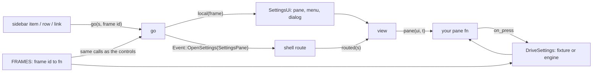

# Frame lane primer

For a lane that builds board frames in `native/beebeeb-drive-rune`. Paths are from this crate unless they start
with `~`. Written from the Settings group (the Bandwidth pane); other groups have the same parts under other names.

## Read these (about 2,500 lines), in this order

| # | File | What you take from it |
| --- | --- | --- |
| 1 | `README.md` | the gate's six counts, "Adding a frame", the component table |
| 2 | `src/frames/<group>/FRAMES.md` | which frames are built, and their known reds |
| 3 | `src/frames/<group>/mod.rs` | `Pane`, `MenuKind`, `Dialog`, `FRAMES` (the scenes), `routed`, `local`, `go`, `sync`, `view` |
| 4 | the group's source file (`settings/drive.rs` or `settings/source.rs`) | the `*Source` trait, the board fixture, the unwired source, `first(dev_build)` |
| 5 | ONE built pane close to yours (`settings/sync.rs`: rows, switch, buttons, dialogs) | how a pane is put together |
| 6 | `src/ui/settings_list.rs`, `settings_card.rs`, `settings_controls.rs` | lists, rows, pop-up button, switch, card, button, menu |
| 7 | `src/ui/settings_notice.rs`, `settings_meter.rs` (the `pub fn` lines) | note, tile, pill, meter, disc, `mixed` |
| 8 | the head of one test file (`settings/tests_drive.rs`, first 80 lines) | `runtime`, `settle`, `info`, `click`, `press` |
| 9 | `~/code/beebeeb.io/design/desktop-v2/frames.json`, your frames only | purpose, actions (`to`: the next frame), rules |
| 10 | `golden/<frame>-board.png` and `golden/<frame>.json`, your frames only | the picture, and which elements are keyed |

Print your frames from `frames.json` with a filter on `id`; never open the file whole (it holds every frame).
In `board.html` (3 MB) grep for your component (`grep -n 'function <Name>\|\.mk-<class>'`) and read those lines only:
the markup gives the structure, the CSS gives every measure.

## Skip these

`src-tauri/**`, `crates/**`, `engine_host*`, `source_engine*`, `src/ui/window.rs` and the Files window parts,
other groups' panes, `scripts/gate.py`, `scripts/capture-golden.mjs`, `MAP.md` files, the repo `CLAUDE.md` below
"Module map" (it is about the Tauri app and releases).

## How the parts fit



- **Source method:** added to the trait WITH a default body that returns the empty state, so the unwired source and
  engine-backed sources compile unchanged. The fixture overrides it with the board's content.
- **Pane:** `pub fn pane(ui: &SettingsUi, t: &Theme) -> (El, Option<El>)`: the page, and what is over it (menu, dialog).
- **Route:** the shell says which section shows (`Screen::Settings(SettingsPane::X)`). The group maps it in `routed`,
  `shell_pane` and `Pane::section`; a frame id maps to a pane in `local`.
- **Scene:** an entry in `FRAMES`. It swaps in a fixture state, calls `open_on` and then calls what the controls call.
- **Test:** scripted input through Rune's `Runtime`; asserts state, texts by key, roles and labels.

Worked example (Bandwidth's metered switch, shortened):

```rust
// drive.rs: the trait, with defaults
fn bandwidth(&self) -> Bandwidth { Bandwidth::default() }
fn set_sync_on_metered(&mut self, _on: bool) {}

// bandwidth.rs: the row; list and item numbers follow the draw order (keys `item-<L>-<I>-…`)
let on = bw.sync_on_metered;
lists::item_with(list, 2,
    &Item::new(Some(&ic::WIFI), "Sync on metered connections").sub(if on { ON } else { OFF }).ruled(),
    vec![lists::switch(&format!("item-{list}-2"), "Sync on metered connections", on, t)
        .on_press(move |s: &mut State| s.settings.drive.set_sync_on_metered(!on))],
    t)

// mod.rs: one line each
Screen::Settings(SettingsPane::Bandwidth) => Some(Pane::Bandwidth),          // routed
"DW-0785" | "DW-0785f" => (Pane::Bandwidth, None, None),                     // local
Pane::Bandwidth => SettingsPane::Bandwidth,                                  // shell_pane
Pane::Bandwidth => bandwidth::pane(ui, &t),                                  // view
("DW-0785f", |s| bandwidth::scene(s, "DW-0785f")),                           // FRAMES

// tests_bandwidth.rs: reach the state by the app's controls, compare with the scene's
let mut rt = runtime("DW-0746e");            // sync waits on a metered connection
click(&mut rt, "Bandwidth-row");
assert_eq!(bandwidth(&rt), scene_says("DW-0785f"));
press(&mut rt, "item-1-2-switch");           // Tab to it, Enter
assert!(bandwidth(&rt).sync_on_metered);
```

## Commands

Compile check on this machine (measured 15 s warm, 3 s after a one-file change):

```sh
export CARGO_TARGET_DIR=~/code/bb-worktrees/target-native-n2
~/code/beebeeb.io/scripts/coord/build-slot.sh -- cargo check --locked --tests
cargo fmt
```

Render, gate and tests run on the Linux build VM, on the PUSHED branch (commit and push first). `B` is your branch,
`OUT` a folder in your scratchpad; `$BB_OUT` (escaped, so the VM expands it) is copied back to `OUT`.

```sh
RB=~/code/beebeeb.io/scripts/coord/remote-build.sh
# gate, both themes, many frames in one run. Measured: build 1 min 26 s cold, 1 to 9 s warm;
# 10 frames x 2 themes plus two test filters ended inside one 10-minute call
$RB linux desktop $B --dir native/beebeeb-drive-rune --out $OUT -- "cargo build --locked --bin beebeeb-drive 2>&1 | tail -1;
  for f in DW-0785 DW-0785b; do for th in light dark; do
    EVIDENCE_DIR=\$BB_OUT scripts/compare.sh \$f --theme \$th --no-build > \$BB_OUT/\$f-\$th.txt 2>&1; tail -1 \$BB_OUT/\$f-\$th.txt
  done; done"
# your own tests only (seconds after the build; the filter is a module path)
$RB linux desktop $B --dir native/beebeeb-drive-rune -- "cargo test --locked settings::tests_bandwidth 2>&1 | grep -E '^test |test result'"
# the one full run, just before the pull request. Measured: 659 tests in 1,684 s (28 min): run it in the
# background and poll its log; a foreground call ends at 10 minutes
$RB linux desktop $B --dir native/beebeeb-drive-rune -- "cargo test --locked 2>&1 | grep -E '^test result|FAILED|panicked'"
```

- Per frame and theme `OUT/<frame>[-dark]/` holds `<frame>-native.png` (the render), `<frame>-side-by-side.png`,
  `<frame>-tiles.png` (every differing tile in red: read this one first) and `fail/<key>.png` (board | native).
- `OUT/<frame>-<theme>.txt` names each failing key; its last line is the truth line.
- Never start the built binary on this machine. `compare.sh` starts it, so `compare.sh` runs on the VM only.
- Mutants: patch a file in the VM's checkout inside the same remote command, run your test filter, write the file
  back, print `git status --porcelain` at the end. Send a script as `echo <base64> | base64 -d > /tmp/m.py`.

## Traps

- **Board crops.** A board frame may draw only a part of a pane: "scrolled to" frames omit the head instead of
  scrolling (the offset they would need can exceed what the window scrolls), short frames stop at the window's edge.
  Check `list-0-title`'s `y` and which keys are absent in `golden/<frame>.json` before you lay out. The app draws
  the whole pane; a value only a scene sets says which part is drawn. List indices then differ per crop, so number
  lists in draw order.
- **A pane with no route.** `shell::app::SettingsPane` lists the sections the shell can show. A sidebar item whose
  frame is not in `local` only asks the shell (`Intent::Show`) and nothing shows. A new section needs the variant,
  `ALL`, `label` and `slug` in `src/shell/app.rs` and a `Frame` entry in `src/shell/registry.rs`.
- **`settings::sync()` resets a pane the shell does not route.** It runs after every route change and on every key:
  a `Pane` whose `section()` is not in `routed` falls back to General.
- **Existing tests pin the old state.** `settings/tests.rs` counts `FRAMES`, expects `set-title` in every frame and
  lists what each sidebar item does; `shell/registry.rs` pins the number of frame groups and of `FRAMES` entries.
  A new pane changes all five. Run `cargo test --locked shell::registry frames::<group>` is not possible (one
  filter per call): run the two filters one after the other before the full run.
- **Goldens keyed for part of a frame.** A golden holds only the keys the keymap had when it was captured. What it
  does not key is compared by the frame tiles count alone: no text check, no geometry. Count those elements for the
  pull request; do not recapture an existing golden unless the key set is a strict superset.
- **Plain spaces.** The Windows goldens hold plain spaces where the Mac source in `board.html` has ` `; the text
  check compares characters. Take every string from `golden/<frame>.json`.
- **The board source you find first is the Mac's** (`DM-…`, "this Mac", `chevUD`). Device names, platform words and
  some icons differ on Windows: the golden decides.
- **Inline gaps.** In a `flex` parent with `gap`, a text node and a `<span>` beside it are two items: the gap goes
  between them, there is no space character.
- **No baseline alignment in Rune.** A figure and its smaller unit: two labels in a row, the unit pushed down by the
  difference of the two baselines (`(lh - size * 1.32) / 2 + size * 1.02` for JetBrains Mono).
- **An element under an open menu or dialog** can fail the pixel `edge` check in one theme (`DW-0787`, `DW-0785d`
  dark): a known red, named in `FRAMES.md`, never tuned away.
- **`MAP.md`.** A `native/*` branch carries no `MAP.md` change (the hook skips it); maps are regenerated on
  `v2-native` by the lead.
- **Shared files.** New frames go in new files. `mod.rs`, the source file and `FRAMES.md` get additive lines; a
  sibling lane adds its own in the same places, and a conflict keeps both sides.
- **Charts.** `rune::canvas(Shape::new().fill(points, colour).stroke(points, width, colour).line(..))` draws
  polygons and polylines in points. There is no dash: draw the segments. Make the canvas 2 pt larger than the plot
  on every side, or a line on its edge is cut.
