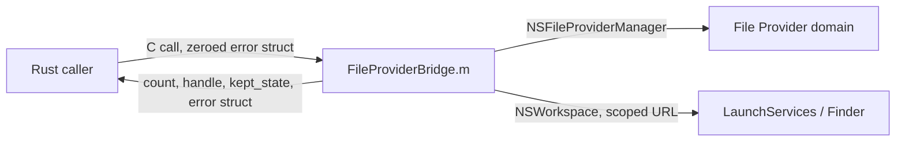

# macOS: the File Provider bridge

This note carries the rules of the Rust to Objective-C bridge to the macOS File Provider, the way Finder is opened and
asked to reveal an item, and the extension's log rules. It is the acceptance list for the native macOS app: every rule
below is one the native app must keep, and every test of the files below is listed with what it asserts.

The bridge is one Objective-C file compiled into the app, plus a thin Rust layer that decodes its answers. The Rust
layer decides nothing about what Finder shows. Decisions (when to add or remove the domain, what a person is told) live
in the engine: `crates/beebeeb-engine/src/finder_setup/error.rs` (the error and code types),
`crates/beebeeb-engine/src/finder_setup/launch_location.rs`, `crates/beebeeb-engine/src/finder_setup/policy.rs`,
`crates/beebeeb-engine/src/surfaces/phase.rs`, `crates/beebeeb-engine/src/ipc_socket.rs` (App Group) and
`crates/beebeeb-engine/src/file_provider_port.rs` (the port the runner uses to ask for a working-set signal, plus the
pure rule `should_signal_working_set`: a batch that changed items signals, an empty batch never touches the bridge). The
Finder visibility rule for shared items is in `crates/beebeeb-engine/src/finder_show.rs`. All of these exist at
`a57b9592`.

## Reference implementation

The shipped tag `desktop-v0.8.25` holds the reference implementation, at the same paths as below. Where a file or a test
differs between that tag and `a57b9592` (the commit this note was written from; the old shell is deleted after it), the section says so. The
Objective-C bridge, `macos_workspace.rs` and `extension_log_pin.rs` are byte-identical at both.

### `src-tauri/build.rs`
Reference: `desktop-v0.8.25:src-tauri/build.rs`. The tag also has a first call, `refuse_a_release_with_the_placeholder_key()`,
that refuses a release build while the Tauri updater key is a placeholder. That is Tauri updater glue and is not carried;
`a57b9592` has already removed it.

What it does: on an Apple target it compiles the bridge to one object, archives it to a static library and links it with
three frameworks. The `tauri_build::build()` call is Tauri glue, not carried.

Rules:
- The link block runs only when the cargo `TARGET` ends with `apple-darwin`.
- Compile: `xcrun clang -target <triple> -fobjc-arc -fmodules -mmacosx-version-min=14.0 -c macos/FileProviderBridge.m -o <OUT_DIR>/FileProviderBridge.o`.
  The native app builds the same file from `packaging/macos/FileProviderBridge.m`.
- `<triple>` is `arm64-apple-macos14.0` for `aarch64-apple-darwin` (and for any unknown Apple target), and
  `x86_64-apple-macos14.0` for `x86_64-apple-darwin` and `x86_64h-apple-darwin`.
- The minimum macOS version is 14.0. The bridge relies on it: there is no fallback for older systems (the removal mode
  below needs macOS 12, and `userEnabled` needs macOS 11, both below 14.0).
- Archive: `ar crs <OUT_DIR>/libbeebeeb_file_provider_bridge.a <OUT_DIR>/FileProviderBridge.o`.
- Output library name: `libbeebeeb_file_provider_bridge.a`, linked as `static=beebeeb_file_provider_bridge`, with the
  search path set to `OUT_DIR`.
- Frameworks linked: `Foundation`, `AppKit`, `FileProvider`.
- A failing `clang` or `ar` stops the build (an assert, with the message "clang failed for FileProviderBridge.m" or
  "ar failed for FileProviderBridge.o"). The build reruns when the bridge source changes.

Tests: none in this file.

### `src-tauri/macos/FileProviderBridge.m` (now at `packaging/macos/FileProviderBridge.m`)
Reference: `desktop-v0.8.25:src-tauri/macos/FileProviderBridge.m` (identical at `a57b9592`). This file is moved with
`git mv` to `packaging/macos/FileProviderBridge.m` and stays in the repo; the native app reuses it as is.

What it does: it is the only code that talks to `NSFileProviderManager` and `NSWorkspace`. It exposes plain C functions
that block until the system answers (or a stated time passes), and it reports every failure as a structured error.

Constants:
- Domain identifier `io.beebeeb.app.domain`. Display name `Beebeeb` (not "Drive": the orphan domain of an older bundle
  id used the name "Beebeeb", and the folder `~/Library/CloudStorage/Beebeeb-Beebeeb` collides with it; the orphan is
  cleared by a one-off helper, not by this bridge).
- `supportsSyncingTrash = YES` on macOS 13 and later, set explicitly so Finder's Trash is the system trash container.
- Bridge error domain `io.beebeeb.bridge`.

The error struct `BeebeebFpError` (mirrored by `BeebeebFpErrorC` in `macos_file_provider.rs`):

| field | type | offset |
|---|---|---|
| `code` | int64 | 0 |
| `underlying_code` | int64 | 8 |
| `has_underlying` | int32 | 16 |
| `domain` | char[128] | 20 |
| `underlying_domain` | char[128] | 148 |
| `message` | char[1024] | 276 |

Total size 1304 bytes, alignment 8. `_Static_assert`s pin the size, the alignment and every offset. Every write into a
caller buffer goes through one helper that is bounded by the buffer's own length and always NUL-terminated (`strlcpy`).
Filling an error first zeroes the whole struct, then copies the code, the domain (default `unknown-domain`), the
localized description as the message (default `unknown File Provider error`), and, when `NSUnderlyingErrorKey` holds an
`NSError`, `has_underlying = 1` with its code and domain.

Synthesized bridge errors (domain `io.beebeeb.bridge`, used when no `NSError` exists; the engine mirrors them as
`bridge_code` in `crates/beebeeb-engine/src/finder_setup/error.rs`):

| code | name | when |
|---|---|---|
| 1 | ManagerUnavailable | no `NSFileProviderManager` for the Beebeeb domain. Message "File Provider manager is unavailable for the Beebeeb domain" |
| 2 | StabilizationTimeout | the domain did not stabilize in the caller's timeout. Message "Timed out waiting for the Beebeeb File Provider domain to become available" |
| 3 | ResolveUrlTimeout | the Finder location did not resolve in 2 s. Message "Timed out resolving the Beebeeb Finder location" |
| 4 | SignalTimeout | the working-set signal was not acknowledged in 2 s. Message "Timed out signaling the Beebeeb File Provider working set" |
| 5 | NoIdentifier | a missing or empty item identifier ("no item identifier given"), a missing domain identifier ("no domain identifier given") |
| 6 | OpenTimeout | `NSWorkspace` did not answer an open in 5 s. Message "Timed out waiting for LaunchServices to open the URL" |
| 7 | InvalidURL | a URL that does not parse or has no scheme ("The URL does not parse"), a file URL given to the plain open ("File URLs open only through a Finder item's scoped URL"), a missing handle ("no URL handle given") |
| 8 | ItemMissing | the Finder location of an item is not on disk. Message "The Finder location of the item is not on disk" |

The `app` domain codes (such as `UNEXPECTED_BRIDGE_RETURN` = 3) are the Rust side's, not this file's.

Folder-state numbers `BeebeebKept*` (what the folder macOS reported after a removal holds; the same numbers as
`KEPT_*` in `desktop-v0.8.25:src-tauri/src/finder_removal.rs`, which carries `settle_kept_state`; the six values are
pinned against this file by `crates/beebeeb-engine/tests/file_provider_source_pins.rs`, and their meaning and the
re-check rule are in `file-provider-removal-and-kept-folders.md`):

| number | name | meaning |
|---|---|---|
| 0 | `BeebeebKeptNoneReported` | no URL came back |
| 1 | `BeebeebKeptMissing` | a URL came back but nothing exists there (macOS reports a folder even when it kept nothing) |
| 2 | `BeebeebKeptEmpty` | the folder exists and is empty (still counts as kept) |
| 3 | `BeebeebKeptHasEntries` | the folder holds at least one entry, or macOS kept a single item that is not a folder |
| 4 | `BeebeebKeptUnchecked` | something may be there, but the sandbox refused the look (a listing denied, or an error other than "not found") |
| 5 | `BeebeebKeptNoPath` | a URL without a path, or an empty file-system path |

The folder check (`BeebeebKeptFolderState`) rules: it runs on the URL macOS returned, never on a path string, because a
path carries no security scope. It calls `startAccessingSecurityScopedResource`, uses `lstat` (always allowed in the
sandbox), and treats `ENOENT` and `ENOTDIR` as missing. A non-directory is "has entries". A directory is opened with
`opendir`; it stops at the first entry other than `.` and `..` (hidden files count) and keeps no name; a read error is
"unchecked". It never opens a file. The scope is stopped afterwards.

Exported C functions, with the Rust caller of each:

| function | inputs | returns | Rust caller |
|---|---|---|---|
| `beebeeb_fp_resolve_location(void **out_handle, BeebeebFpError *)` | the out handle | 1 = handle set (caller owns it); 0 = macOS reports no location (domain not added); -1 = error. Resolves the domain's root container with a 2 s wait (error 3 on timeout). The handle is a retained, opaque `NSURL` (`CFBridgingRetain`); the URL never becomes a path | `macos_file_provider::resolve_location`, called by `finder_setup/macos_ports.rs` `open_location` |
| `beebeeb_fp_resolve_item(const char *identifier, void **out_handle, BeebeebFpError *)` | the item's File Provider identifier (the state database's file id) | as above; a NULL or empty identifier is error 5 | `macos_file_provider::resolve_item`, called by `macos_ports::reveal_item` |
| `beebeeb_open_scoped_url(void *handle, BeebeebFpError *)` | a handle from a resolve | 1 = opened, -1 = error. Always takes and releases the handle. Opens in this process through `NSWorkspace` and waits up to 5 s for the answer. Makes no File Provider call | `macos_workspace::open_scoped` |
| `beebeeb_reveal_scoped_url(void *handle, BeebeebFpError *)` | a handle | 1 = handed to Finder, -1 = error. Always takes and releases the handle. Checks the URL with `lstat` first (error 8 if absent), then `activateFileViewerSelectingURLs:`. Finder's own answer cannot be waited for (the call is `void`), so 1 means "it resolved and exists", not "a window was drawn". The scope is held 5 s after the call because the request reaches Finder later | `macos_workspace::reveal_scoped` |
| `beebeeb_release_url_handle(void *handle)` | a handle not going to be opened | none; releases it | `ScopedUrl`'s `Drop` in `macos_workspace.rs` |
| `beebeeb_open_url(const char *url, BeebeebFpError *)` | a non-file URL string (System Settings `x-apple.systempreferences:`) | 0 = opened, -1 = error. A file URL, an unparsable string or a missing scheme is error 7. Touches no File Provider state, so Rust calls it without the bridge gate | `macos_workspace::open_url`, called by `finder_setup_commands.rs` for the Login Items & Extensions pane (with a fallback URL) |
| `beebeeb_fp_domain_user_enabled(BeebeebFpError *)` | none | 1 = registered and `userEnabled`; 0 = registered and disabled by the person; 2 = not registered; -1 = lookup error. Reads the system's live registry (`getDomains`, no timeout) | `macos_file_provider::domain_state` |
| `beebeeb_fp_add_domain(BeebeebFpError *)` | none | 0 = success, -1 = error. `addDomain` only, no wait for stabilization (no timeout). It replies success even for a domain the person disabled, so the install decision lives in the engine | `macos_file_provider::add_domain` |
| `beebeeb_fp_wait_for_domain_ready(double timeout_seconds, BeebeebFpError *)` | the timeout | 0 = stable; -1 = timeout (error 2), no manager (error 1), or the system's error | `macos_file_provider::wait_for_domain_ready` |
| `beebeeb_fp_remove(char *location_buffer, unsigned long len, int *kept_state, BeebeebFpError *)` | a buffer for the kept folder path (Rust passes 4096 bytes) | 0 = removed, -1 = error. Removes the Beebeeb domain with `NSFileProviderDomainRemovalModePreserveDirtyUserData`; there is deliberately no plain remove-all fallback. No timeout | `macos_file_provider::remove` |
| `beebeeb_fp_remove_domain_by_id(const char *identifier, char *location_buffer, unsigned long len, int *kept_state, BeebeebFpError *)` | any domain identifier | 0 = removed or already gone, -1 = error. A NULL identifier is error 5 before the system is asked. Same preserve mode and same outputs | `cleanup_ffi::remove_domain` in `macos_file_provider.rs` (the sweep) |
| `beebeeb_fp_kept_folder_state_for_path(const char *path)` | a file-system path (NULL = state 0) | a `BeebeebKept*` number. The same check as the removal, on a file URL built from the path (`lstat` needs no scope) | `kept_state_for_path` in `macos_file_provider.rs`, used by the removal decode |
| `beebeeb_fp_signal_working_set(BeebeebFpError *)` | none | 0 = signaled, or the domain is not registered (nothing to signal is not a failure); -1 = error. Signals the working-set container (the only container a replicated extension honors) and waits at most 2 s (error 4). Best-effort | `macos_file_provider::signal_working_set` |
| `beebeeb_fp_list_domains(char *ids, unsigned long len, BeebeebFpError *)` | a buffer (Rust passes 8192 bytes) | the count of registered domains of THIS provider, or -1. Identifiers newline-separated. No timeout | `cleanup_ffi::list_domains` |

Both removals report the kept state and the location first, then the error: `kept_state` and `location_buffer` are
filled even when the call returns -1, so a reply that carries both an error and a folder still reaches the person with
that folder. The removal checks the folder before it decides.

The scoped-URL open rules (`BeebeebOpenURLAndWait`), which the native app must keep:
- The URL stays a URL and is opened in THIS process. A path string or a child `/usr/bin/open` loses the security
  extension, and LaunchServices refused the CloudStorage folder with error -54 while the spawn had already answered Ok.
- Order: take the scope (`BeebeebScope`), call `openURL:configuration:`, wait on a semaphore.
- `promptsUserIfNeeded = NO`, so no dialog can hold the answer back; `addsToRecentItems = NO`.
- The wait is 5 s (`BeebeebOpenTimeoutSeconds`). Silence is a failure (error 6), never a success.
- The scope is stopped inside the completion handler before the waiter is woken, and by a safety timer after 60 s
  (`BeebeebScopeSafetySeconds`) if the handler never comes. `BeebeebScope` stops exactly once, under `@synchronized`
  (check, mark, release), because the system counts starts.
- After the 5 s timeout the open is not cancelled (no API): a late success still opens the window after the caller was
  told it failed. This is a known, bounded false error.
- The resolve is a File Provider call and runs under the Rust bridge gate (up to 3 s of waiting). The open is not, and can
  stall for seconds, so the handle crosses the FFI and the gate is released before the open. `BeebeebLiveHandles`
  counts handles in flight so a test can see none leak.

Test hooks exported for Rust tests only (they touch no system service): `beebeeb_fp_test_fill_error`,
`beebeeb_fp_test_fill_bridge_error`, `beebeeb_fp_test_error_size`, `beebeeb_fp_test_error_align`,
`beebeeb_fp_test_error_offsets` (6 values in declaration order), `beebeeb_fp_test_bridge_codes` (8 values, in the order
of the table above), `beebeeb_test_url_handle` (a handle for any URL string) and `beebeeb_test_live_handles`.

Tests: none in this file; its behaviour is tested by `src-tauri/src/macos_file_provider.rs`,
`src-tauri/src/macos_workspace.rs` and `src-tauri/src/finder_open.rs`.

### `src-tauri/src/file_open_commands.rs`
Reference: `desktop-v0.8.25:src-tauri/src/file_open_commands.rs` (1117 lines at the tag, 771 at `a57b9592`; the macOS
parts are the same). No tests in this file.

Only the macOS parts are carried here: `open_in_finder` and `open_finder_location` (with their `_blocking` bodies).
`popover_snapshot` belongs to the menu-bar note. The rest has already moved to the engine or the native app:
`reveal_and_open_file` path rules in `crates/beebeeb-engine/src/path_safety.rs` (`is_contained`,
`reject_unsafe_rel_path`), the executable denylist in `crates/beebeeb-engine/src/file_ops.rs`
(`is_dangerous_executable`), diagnostics in `crates/beebeeb-engine/src/app/support_bundle_api.rs`, and free-up-space and
the conflict centre in the engine and native app. All three engine files exist at `a57b9592`.

Rules:
- `open_finder_location` ("Open in Finder" for the Beebeeb folder): on macOS it ignores any path argument and returns what
  the bridge answers (`file_provider_open_location`, which turns the gated resolve plus the open into the command's
  result through `finder_open_outcome`). It never runs `open <path>` as a child.
- `open_in_finder` ("Show in Finder" for one item): on macOS the identifier is checked first
  (`macos_validate_hydrate_item_identifier`, the same check as every identifier off the wire), then the namespace check
  `finder_may_show(&item_id, ...)` against the state database (an unknown item is "That item is not known on this Mac
  yet."; shared-with-me rows are refused, see `finder_open.rs`), then `file_provider_reveal_item(&item_id)` is the last
  expression and its outcome is the result. A missing state database is also "That item is not known on this Mac yet.".
  The item's Finder location is the URL macOS returns for its File Provider identifier, never `sync_root/<path>` (on a Mac
  the sync root is the app's private state folder, not a Finder location).
- Both commands run their blocking body on the blocking pool, because the bridge gate can wait up to 3 s and that must
  not happen on the main thread or a runtime worker. If the task stops before it answers, the answers are the fixed
  sentences "Could not open the Beebeeb folder." and "Could not show the file in your file manager." (the panic text can
  carry an OS message, so it goes to the log only).
- The menu's "Open in Finder" resolves the folder in Rust (the macOS path is `None`); it has no frontend status.
- Windows (`explorer`) and Linux (`xdg-open`) keep their own spawns; they are not part of this note.

Tauri glue, not carried: the `#[tauri::command]` wrappers and `on_the_blocking_pool` (a tokio `spawn_blocking`). The
native app needs only the rule that bridge calls never block the UI thread.

### `src-tauri/src/macos_file_provider.rs`
Reference: `desktop-v0.8.25:src-tauri/src/macos_file_provider.rs`. At the tag the file also defines
`WorkingSetSignalOutcome` and `should_signal_working_set` itself; at `a57b9592` they live in
`crates/beebeeb-engine/src/file_provider_port.rs` and are re-exported. All 27 tests are the same at both.

What it does: it declares the bridge's C functions, decodes the error struct, names the domain and item calls, and runs
the app-start sweep of stale domains. It decides nothing about what Finder shows.

The error struct decode (`BeebeebFpErrorC`, `#[repr(C)]`):
- Layout: `code: i64`, `underlying_code: i64`, `has_underlying: i32`, `domain: [c_char; 128]`,
  `underlying_domain: [c_char; 128]`, `message: [c_char; 1024]`; size 1304 (a compile-time assert), offsets
  `[0, 8, 16, 20, 148, 276]`.
- Every call starts from an all-zero struct (`zeroed()`), so a bridge path that fails without filling the error is seen
  as "no domain".
- `into_fp_error`: an empty domain becomes the app error `UNEXPECTED_BRIDGE_RETURN` with the message "the File Provider
  bridge failed without describing the error". Otherwise it builds the error with the domain, the code, the message, and
  the underlying (domain, code) when `has_underlying != 0`.
- Strings are read bounded to their own array (never past it, even when the NUL is missing), converted lossily, and
  trimmed. A cut inside a multi-byte character becomes U+FFFD.
- The structured error carries the OS's text only to the log; callers see the domain and the code (`redacted()`).

Domain and item calls (each runs one bridge function; a negative return is the error):
- `domain_state()`: 1 Enabled, 0 Disabled, 2 NotRegistered; any other value is the app error
  `UNEXPECTED_BRIDGE_RETURN` ("beebeeb_fp_domain_user_enabled returned N"). It reads the system's live registry, not a
  locally built domain object.
- `add_domain()`, `wait_for_domain_ready(timeout)` (the timeout is passed in seconds as `f64`), `signal_working_set()`
  (0 is `Delivered`, anything else is `UNEXPECTED_BRIDGE_RETURN`).
- `resolve_location()` and `resolve_item(item_id)` return `Result<Option<ScopedUrl>, FpError>`: `Ok(Some)` for a 1 with
  a handle, `Ok(None)` for a 0, the decoded error for a negative, and the app error `UNEXPECTED_BRIDGE_RETURN` ("<function>
  returned N") for a 1 without a handle or any other value. Every path that does not return the handle drops it, which
  releases it. An identifier that is empty or holds a NUL byte is the bridge error `NO_IDENTIFIER` (code 5), never
  `Ok(None)` (which would read as a quiet "nothing").
- `remove()`: removes the Beebeeb domain keeping files that never reached the server; passes a 4096-byte location buffer;
  returns `DomainRemoval` (what was kept) or `BridgeRemovalFailure { error, kept }`. A failed removal still carries the
  folder macOS kept.

The removal decode (the rule the native app must keep):
- There is ONE decode site for the reply to a domain removal: `decode_removal(code, kept_state, location_buffer,
  error_buffer)`. It forwards to `decode_removal_with(...)` with the real folder check (`kept_state_for_path`, which
  calls the bridge's own `beebeeb_fp_kept_folder_state_for_path`) and the real sleep (`std::thread::sleep`). The `_with`
  variant takes the check and the wait injected, so a test can drive the real decode without sleeping.
- `decode_removal` is called from exactly two places: `remove()` (sign-out, repair, install rollback) and
  `cleanup_ffi::remove_domain` (the stale-domain sweep). A source pin in `finder_removal.rs` keeps it the only place that
  decodes a reply. That pin read this Rust file, so it is not ported; the macOS phase writes its own pin over its own
  decode (`file-provider-removal-and-kept-folders.md`, rule 3).
- Order inside `decode_removal_with`: first read the location buffer exactly (never trimmed, byte for byte; empty is
  none); then settle a folder that reads as missing: `settle_kept_state(kept_state, location, check, wait)` re-looks up to
  `KEPT_MISSING_RECHECKS` = 4 times, waiting `KEPT_MISSING_RECHECK_INTERVAL` = 250 ms before each look (about 1 s, paid
  only by a removal that kept nothing), and stops at the first look that finds the folder, whatever it holds. Only a
  state of Missing (1) with a path is re-looked; any other state is final. Only AFTER that does it decode the result:
  the structured error (when the code is negative) and `removal_from_bridge(code, settled_state, location, message)`.
  A return code the bridge does not document becomes the app error `UNEXPECTED_BRIDGE_RETURN`.
- Why: the folder may be made or filled by macOS a moment after the completion handler runs, and a single early look
  would hide the person's files for good (no alert, no row, no record). An existing folder, empty or not, is kept.

The stale-domain filter ("which domains are ours"):
- `DOMAIN_IDENTIFIER` = `io.beebeeb.app.domain`, which must equal `BeebeebDomainIdentifier` in the bridge.
- `stale_domain_identifiers(domains, ours)` returns every identifier that is not EXACTLY ours (exact and case-sensitive:
  `IO.BEEBEEB.APP.DOMAIN` and `io.beebeeb.app.domain.stale` are stale; an empty list returns nothing). Our own identifier is
  never stale, even when the system reports it twice.
- `getDomains` returns only the CALLING provider's domains, so the sweep cannot see another bundle's orphan (for example
  the pre-rename `io.beebeeb.desktop.FileProvider` domain); that is cleared by a one-off helper, not by the sweep.
- `cleanup_stale_domains()` (macOS only): lists the registered identifiers (`beebeeb_fp_list_domains`, 8192-byte buffer,
  one identifier per line), notes whether ours is present (informational), and for each stale one calls
  `remove_domain`. A removal that succeeds adds its kept folder (if any) to `preserved_locations` and its identifier to
  `removals`. A removal that fails is logged as a warning ("stale-domain removal failed; the next app start retries"),
  its kept folder (if any) is still kept for the person, and it goes into `skipped`; one stubborn domain never blocks the
  rest. A NUL byte in an identifier is the app error `UNEXPECTED_BRIDGE_RETURN`. An enumeration error returns `Err`.
  Idempotent: a second run finds no stale domain.
- `StaleDomainCleanup { removals, preserved_locations, skipped, ours_present }` with `removed_count()`. Every removal
  keeps unsynced files (preserve mode, see the bridge).

Tests (acceptance list). They call the real Objective-C bridge, so they run on a Mac only.

| test | asserts |
|---|---|
| `test_1698_stale_domain_filter_removes_foreign_domains_keeps_ours` | from `[io.beebeeb.desktop.FileProvider, io.beebeeb.app.domain, com.other.zombie]` the filter returns the first and the third, never our own |
| `test_1698_stale_domain_filter_is_idempotent_and_safe` | a registry with only our id returns nothing; an empty registry returns nothing; `io.beebeeb.app.domain.stale` is stale (no partial match); `IO.BEEBEEB.APP.DOMAIN` is stale (case matters) |
| `the_error_struct_has_the_same_size_on_both_sides` | the Rust struct is 1304 bytes and equals the size the Objective-C side reports |
| `every_field_sits_at_the_same_offset_on_both_sides` | the six Objective-C offsets equal Rust's `offset_of!`, equal `[0, 8, 16, 20, 148, 276]`; alignment equal on both sides; size is a multiple of alignment |
| `the_bridge_error_codes_are_the_rust_constants` | the eight `BeebeebBridge*` values equal `bridge_code::*` in order, and equal `[1..8]` |
| `test_1885_a_resolve_without_an_identifier_is_a_bridge_error_not_a_quiet_nothing` | `resolve_item` of `""` and of a string with a NUL is `Err` with domain `io.beebeeb.bridge` and code `NO_IDENTIFIER` |
| `test_1885_only_a_one_with_a_handle_or_a_zero_is_an_answer_and_no_handle_leaks` | `decode_resolve` accepts (1, handle) and (0); a 1 without a handle, a 2 and `i32::MAX` are `UNEXPECTED_BRIDGE_RETURN`; a zero with a handle is `Ok(None)`; the live-handle count returns to its start after every case |
| `every_classified_domain_and_code_crosses_the_bridge_unchanged` | eleven (domain, code) pairs (`NSFileProviderErrorDomain` -2001 to -2005 and -2011 to -2014, `NSCocoaErrorDomain` 516, `NSPOSIXErrorDomain` 17) built as real `NSError`s come out with the same domain and code, the message "fixture" and no underlying error |
| `the_underlying_error_crosses_with_its_own_domain_and_code` | a Cocoa 516 error with a POSIX 17 underlying error keeps the underlying domain and code |
| `bridge_synthesized_errors_carry_the_bridge_domain` | a synthesized error with `STABILIZATION_TIMEOUT` decodes to domain `io.beebeeb.bridge`, that code, no underlying |
| `a_real_bridge_entry_point_reports_its_synthesized_code` | `beebeeb_fp_remove_domain_by_id(NULL, ...)` returns -1 with `NO_IDENTIFIER` and a non-empty message, with no system call |
| `a_long_message_is_cut_not_overflowed` | a 3000-character message into the 1024-byte field decodes to at most 1023 characters; the domain is intact |
| `an_overlong_ascii_message_fills_exactly_1023_bytes_and_the_last_byte_is_a_nul` | a 5000-byte message fills `message[0..1023]` and `message[1023]` is 0; the decoded length is 1023 |
| `an_overlong_domain_is_cut_and_terminated_without_touching_its_neighbours` | a 300-byte domain ends with a NUL at index 127; `underlying_domain` stays all zero; the decoded domain is 127 bytes and the message is "kept" |
| `filling_clears_whatever_the_struct_held_before` | filling a struct full of 0x7f bytes leaves no stale underlying domain or message tail and no `has_underlying`; the decoded error is exactly the new one |
| `a_missing_nul_is_read_only_up_to_the_end_of_its_own_array` | arrays filled with no NUL decode to exactly 128 `a`s (no read into the next array) and 1024 `m`s |
| `an_unfilled_error_becomes_an_app_error_not_an_empty_one` | an all-zero error decodes to `APP_DOMAIN` with `UNEXPECTED_BRIDGE_RETURN` |
| `test_1882_r2_bridge_check_a_missing_folder_is_missing` | a path that does not exist is state 1; a NULL path is state 0 (none reported) |
| `test_1882_r2_bridge_check_an_empty_folder_is_empty` | an existing empty folder is state 2 |
| `test_1882_r2_bridge_check_a_folder_with_one_item_has_entries` | a folder with one file is state 3 |
| `test_1882_r2_bridge_check_a_hidden_item_or_a_single_file_counts` | a folder holding only a dotfile is state 3; a single kept file (not a folder) is state 3 |
| `test_1882_r2_bridge_check_a_folder_it_may_not_list_is_unchecked` | a folder with mode 000 that holds a file is state 4 (shown, never hidden) |
| `test_1882_r3_a_folder_filled_after_the_completion_handler_is_seen` | a folder missing at first and filled during the second wait settles to state 3 after exactly 2 waits |
| `test_1882_r3_a_folder_that_exists_but_is_still_empty_is_seen` | a folder created during the first wait settles to state 2 (an existing folder is never reported missing) |
| `test_1882_r3_a_folder_missing_throughout_stays_missing_after_a_bounded_look` | a folder that never appears settles to state 1 after exactly `KEPT_MISSING_RECHECKS` waits |
| `test_1882_r3_the_decode_uses_what_the_settle_found` | for a success (code 0) and a failure (code -1, "busy"), `decode_removal_with` on a missing folder that fills during the third wait returns the kept location, stopping after exactly 3 waits; the error is reported as before (domain `NSFileProviderErrorDomain`, code -1001) |
| `test_1882_r3_the_decode_reports_nothing_kept_for_a_folder_missing_throughout` | a folder missing throughout, with code 0, decodes to success with no kept location after `KEPT_MISSING_RECHECKS` waits |

Related tests outside this file that pin the sweep and the removal wiring (not part of this file's list):
`test_1882_r2_the_install_cleanup_and_failed_removals_surface_their_folder` (the sweep keeps a folder that came back with
an error) in `src-tauri/src/finder_removal_wiring_tests.rs`.

### `src-tauri/src/finder_open.rs`
Reference: `desktop-v0.8.25:src-tauri/src/finder_open.rs`. At `a57b9592` the shared-with-me rule
(`finder_may_show`, `item_namespace` and its three sentences) has moved to `crates/beebeeb-engine/src/finder_show.rs` and
is re-exported; the test `test_1885_the_menu_alert_says_what_the_buttons_toast_says` (Rust sentence equals the React
`FINDER_OPEN_FAILED`) existed at the tag and was removed with the React frontend. The remaining 17 tests are the same.

What it does: it turns the bridge's answer for an open or a reveal into the command's result, and holds source pins that
keep a child `open` from coming back.

Rules:
- No macOS code path spawns `/usr/bin/open`. A child inherits the App Sandbox but not the extension on the URL the app was
  handed, so LaunchServices refused the CloudStorage folder (-54) while `spawn()` had answered Ok. Windows (`explorer`) and
  Linux (`xdg-open`) keep their spawns. The Objective-C side starts no child process either: no `NSTask`,
  `posix_spawn`, `popen(`, `system(`, `execv`, `fork(`, `launchPath`.
- Open and reveal go through the bridge with a scoped URL: the scope is taken, the URL is opened through `NSWorkspace`,
  and the bridge waits for LaunchServices (5 s, no dialog) and stops the scope inside the completion handler (a 60 s
  safety timer covers a handler that never comes; the scope stops once).
- The three macOS open actions (Open in Finder, Show in Finder, the System Settings link) return the bridge's outcome;
  none discards it. A failed System Settings open is not ignored.
- `finder_open_outcome(answer, nothing_there)`: `Ok(true)` is `Ok(())`; `Ok(false)` is an error with the given sentence
  (never a success); `Err(error)` is the error's `redacted()` text, which is the domain and the code only. The OS's own
  text can name a folder and never reaches the person.
- Outcome sentences (verbatim):
  - "Beebeeb isn’t in Finder right now, so there is nothing to open there." (open, when macOS reports no location)
  - "Beebeeb isn’t in Finder right now, so there is nothing to show there." (reveal, no location for the item)
  - "Files shared with you are not in Finder; they open in the web app." (a shared-with-me item or its pseudo folder
    `namespace:shared_with_me`; the File Provider is never asked about it)
  - "That item is not known on this Mac yet." (no row for the id)
  - "Beebeeb couldn’t open its Finder location." (the alert sentence for a failed menu open)
  - The alert's title is "Open in Finder".
- `menu_open_failure_alert(result, on_a_mac)` returns the title and sentence for any `Err` on a Mac, and nothing for a
  success or on Windows and Linux (they keep logging). The alert is a native error dialog, since the menu works with every
  window closed. It never carries an error code or a path.
- The "fallback" opens after an upload or a new folder run on the blocking pool and are not waited for; a failure is
  logged. The menu's open runs on the blocking pool and the failure is shown before it is logged.
- The search command drops shared rows before the limit only when the caller asked for rows it will show in Finder
  (`for_finder`) and only on a Mac (`exclude_shared = for_finder.unwrap_or(false) && cfg!(target_os = "macos")`).

Tauri glue, not carried: the source pins that read `lib.rs` (`open_in_finder_blocking`, `desktop_search_files`, the
`DesktopMenuAction::OpenFolder` arm, `spawn_blocking`, `show_menu_open_failure` with `.dialog()`). Their rules above are
kept; their wiring is for the native app to re-pin in its own shape.

Tests (acceptance list):

| test | asserts |
|---|---|
| `an_opened_location_is_ok` | `finder_open_outcome(Ok(true), ...)` is `Ok(())` |
| `no_location_is_an_error_with_the_given_sentence_never_a_success` | `Ok(false)` returns the sentence it was given, for both the open and the show sentences, which differ |
| `a_bridge_failure_reaches_the_commands_err_as_domain_and_code_only` | a Cocoa 256 error with a POSIX 1 underlying, a bridge `OPEN_TIMEOUT` and a gate-busy app error all come back as their `redacted()` text, which holds none of a home-folder path, `CloudStorage`, `couldn`, `Beebeeb-Beebeeb`; a gate-busy error is exactly "io.beebeeb.app 6" |
| `test_1885_a_shared_with_me_item_is_never_asked_of_the_file_provider` | a shared-with-me row and the pseudo folder are refused with the shared sentence (the pseudo folder without a lookup); own namespaces (my files, offline, conflicts) pass; an unknown id and a failing lookup are refused |
| `test_1885_open_in_finder_checks_the_namespace_before_it_asks_the_file_provider` | in the macOS body of `open_in_finder_blocking`, the order is shape check, then namespace check (`?`-propagated, via `item_namespace`), then the reveal; `item_namespace` follows the alias before reading the contract row (reads the engine's `finder_show.rs`) |
| `test_1885_every_test_that_asks_the_real_nsworkspace_is_ignored_with_a_reason` | exactly 2 tests in `macos_workspace.rs` ask the real `NSWorkspace`, and each is `#[ignore = "..."]` naming a GUI session |
| `test_1885_the_search_command_drops_shared_rows_only_for_finder_on_a_mac` | the search command's `exclude_shared` is the caller's flag AND macOS, and is passed to the query (the React pins were removed at `a57b9592`) |
| `test_1885_the_fallback_opens_never_block_the_caller` | the upload and new-folder fallbacks call `open_finder_location_in_background`, which uses the blocking pool and logs a failure; `open_finder_location_blocking(` has exactly 4 callers |
| `test_1885_a_failed_menu_open_on_a_mac_is_an_alert_with_the_one_sentence` | any `Err` on a Mac (including "no location") gives the title and the one sentence; success and non-Mac give nothing; the text has no "bridge", "NS" or `/` |
| `test_1885_the_menus_open_folder_shows_a_failure_before_it_logs_it` | the OpenFolder arm runs the open on the blocking pool, then shows the failure, then returns the result; the alert is a native error dialog for exactly what the pure function says |
| `test_1885_no_macos_code_path_spawns_open` | no line compiled on a Mac (both source trees, test modules skipped, comments skipped) contains `Command::new("open")`, `Command::new("/usr/bin/open")` or `/usr/bin/open`; the scan read over 10000 macOS lines and found at least 4 `explorer` or `xdg-open` spawns |
| `test_1885_the_bridge_starts_no_child_process` | the bridge's code (comments removed, over 400 lines) has none of `/usr/bin/open`, `NSTask`, `posix_spawn`, `popen(`, `system(`, `execv`, `fork(`, `launchPath` |
| `test_1885_the_three_macos_open_actions_go_through_the_bridge_and_return_its_outcome` | `open_finder_location_blocking` returns `file_provider_open_location()`; `open_in_finder_blocking` ends with `file_provider_reveal_item(&item_id)`; the settings open uses `macos_workspace::open_url(` and does not discard it; the two wrappers use `finder_open_outcome` |
| `test_1885_the_bridge_opens_the_scoped_url_and_waits_for_the_answer` | in `BeebeebOpenURLAndWait`, scope then `openURL:configuration:` then `dispatch_semaphore_wait`; `promptsUserIfNeeded = NO`; `[scope stop]` and the handler's `found_error` are present |
| `test_1885_the_scope_is_stopped_inside_the_completion_handler` | in the completion handler the scope stop comes before the semaphore signal; there are exactly two stops (the handler and the safety timer), none between the open call and the wait |
| `test_1885_a_handler_that_never_comes_still_releases_the_scope_exactly_once` | the safety timer stops the scope after `BeebeebScopeSafetySeconds` (a constant equal to 60); `BeebeebScope`'s stop checks `_active`, clears it, then releases, under `@synchronized`; the late-success edge is written in the comment before the function |
| `test_1885_the_resolve_opens_nothing_and_the_open_asks_the_file_provider_nothing` | the two resolve functions return a retained handle and use none of `openURL:`, `activateFileViewerSelectingURLs`, `BeebeebOpenURLAndWait`, `fileURLWithPath`, `.path`; the root resolve uses `NSFileProviderRootContainerItemIdentifier`; open, reveal and release take the handle before any use and use no `managerForDomain`, `getUserVisibleURLForItemIdentifier`, `BeebeebUserVisibleURL`, `BeebeebDomain()`, `fileURLWithPath` or `.path` |

Tests that read the bridge source (could run as source pins over `packaging/macos/FileProviderBridge.m`):
- `test_1885_the_bridge_starts_no_child_process`
- `test_1885_the_bridge_opens_the_scoped_url_and_waits_for_the_answer`
- `test_1885_the_scope_is_stopped_inside_the_completion_handler`
- `test_1885_a_handler_that_never_comes_still_releases_the_scope_exactly_once`
- `test_1885_the_resolve_opens_nothing_and_the_open_asks_the_file_provider_nothing`

### `src-tauri/src/macos_workspace.rs`
Reference: `desktop-v0.8.25:src-tauri/src/macos_workspace.rs` (identical at `a57b9592`).

What it does: the Rust handle type and the three NSWorkspace calls over the bridge: open a Finder item's scoped URL,
reveal one, and open a non-file URL (System Settings). None takes the File Provider gate.

Rules:
- `ScopedUrl` owns the bridge's retained handle. `from_raw` is `None` for NULL. `into_raw` gives the handle to a bridge
  call that consumes it. Dropping an unused `ScopedUrl` calls `beebeeb_release_url_handle`, so no path leaks it.
- `open_scoped(url)`: calls `beebeeb_open_scoped_url`, waits for LaunchServices (5 s limit), consumes the handle on every
  path. `reveal_scoped(url)`: calls `beebeeb_reveal_scoped_url`; `Ok` means the item resolved and exists, not that a
  window was seen.
- `done_or_error`: a 1 is `Ok`, a negative is the decoded error, anything else is the app error
  `UNEXPECTED_BRIDGE_RETURN` ("<function> returned N"). Never a guess at success.
- `open_url(url)`: a NUL in the string is the bridge error `INVALID_URL` ("the URL holds a NUL byte"). It runs without the
  gate on purpose: the link to System Settings must work exactly when the File Provider is stuck. It blocks up to 5 s, so
  callers run it on a blocking thread. A file URL is refused (they open only through a Finder item's scoped URL).
- Tests that count live handles share one counter and take turns (`tests_support::serialize_handles`).

Tests (acceptance list). The two `#[ignore]` tests need a logged-in GUI session; run them with `--ignored` on a Mac you
are sitting at.

| test | asserts |
|---|---|
| `test_1885_a_url_the_bridge_may_not_open_is_an_error_before_the_system_is_asked` | `""`, `"not a url"`, `"no-scheme"`, a `file://` URL and a string with a NUL each give `Err` with domain `io.beebeeb.bridge` and code `INVALID_URL` |
| `test_1885_an_open_launch_services_refuses_is_an_error_not_a_success` | (ignored: real `NSWorkspace`) opening `beebeeb-no-such-scheme-1885:nothing-opens-this` is an `Err` that is neither `INVALID_URL` nor `OPEN_TIMEOUT`, with a non-empty domain and a non-zero code |
| `test_1885_a_handle_is_released_unused_and_by_a_reveal_that_fails` | an unused handle raises the live count by 1 and dropping it lowers it back; revealing a `file://` URL that does not exist is `Err` with `ITEM_MISSING`, and the handle count is back to its start |
| `test_1885_an_ungated_open_that_launch_services_refuses_is_an_error_and_releases_its_handle` | (ignored: real `NSWorkspace`) `open_scoped` on an unopenable scheme is an `Err` that is not `OPEN_TIMEOUT`, and it consumed its handle |

### `src-tauri/src/extension_log_pin.rs`
Reference: `desktop-v0.8.25:src-tauri/src/extension_log_pin.rs` (identical at `a57b9592`). This file is ported
to the engine test `crates/beebeeb-engine/tests/file_provider_source_pins.rs`, module `extension_log`, with the same four
test names. It reads `BeebeebFileProvider/*.swift` and `scripts/build-fileprovider-extension.sh`, which stay in the repo.

What it does: it reads the File Provider extension's Swift source as the build compiles it, on every platform, and fails
when the extension logs in a way that cannot be read or leaks a value. On macOS 26 the unified log shows every `NSLog`
line of the extension as `<private>`, and a value marked public is shown to anyone who reads the log.

Rules (comment lines, those that start with `//`, are skipped):
- Only `os.Logger` through `ExtensionLog.swift` logs. No file calls `NSLog(`, `NSLogv(`, `os_log(`, `print(` or
  `debugPrint(`, bare or qualified by a module (`Foundation.`, `Swift.`, `os.`, `OSLog.`). A name that only ends in one of
  these (`IPCContentFingerprint(` ends in `print(`) is not a call, and a member of a value (`request.print(`) is not one.
- Only `ExtensionLog.swift` builds a `Logger` or `OSLog` (`Logger(`, `Logger.init(`, `OSLog(`, `OSLog.init(`, bare or
  module-qualified), or calls a value named `logger.`.
- `ExtensionLog.swift` builds exactly one `Logger` (it may be spelled `os.Logger(`).
- Every interpolation in `ExtensionLog.swift` says its privacy, `.public` or `.private`; nothing else (not `.auto`, not
  missing).
- Only closed values are public. `PUBLIC_VALUES`, verbatim: `line.call`, `line.options`, `id`, `call.rawValue`,
  `fields.domain`, `fields.code`, `cause`, `XPCBridge.appGroupID`. Anything else public, such as an error's description, a
  path or a file name, is a finding. The pin matches text: it does not see what a public name is bound to (an enum raw
  value, a bitmask, an id that parsed as a UUID, an `NSError` domain and code); the Swift harness tests those bindings. It
  also does not see a call with a space or line break before its parenthesis, a log function passed by reference, or
  output that is not a log call (`FileHandle`, `fputs`).
- The logger's subsystem is the extension's bundle id: the `static let subsystem = "..."` line of `ExtensionLog.swift`
  equals the `BUNDLE_ID="..."` line of `scripts/build-fileprovider-extension.sh`, and the file builds its logger with
  `Logger(subsystem: subsystem, category: category)`.
- The scan sees the extension: `ExtensionLog.swift`, `FileProviderExtension.swift`, `XPCBridge.swift` and
  `UploadStaging.swift` are present, and at least 10 `.public` interpolations are seen in the log file. CRLF line ends are
  handled.

Tests (acceptance list). The port keeps each name unchanged.

| test | asserts |
|---|---|
| `the_extension_logs_only_through_its_logger_and_makes_only_closed_values_public` | ported, same name: scans every `BeebeebFileProvider/*.swift`, requires the four named files and zero violations, and at least 10 public values in the log file |
| `the_logger_subsystem_is_the_extensions_bundle_id` | ported, same name: the subsystem string equals `BUNDLE_ID` from the build script, and the logger is built as `Logger(subsystem: subsystem, category: category)` |
| `the_pin_flags_a_planted_log_call_and_a_public_value_that_is_not_closed` | ported, same name: a planted `NSLog`, `os_log`, `print`, `debugPrint` is flagged once in another file and once with a second Logger in the log file; comments and `IPCContentFingerprint(` are clean; a Logger or `logger.` outside the log file is flagged; public `localizedDescription`, `url.path`, `item.filename`, a missing privacy and `.auto` are flagged; `.public` ids, `.private` file names and the public domain and code are clean; a log file with no Logger is flagged; CRLF input is flagged |
| `the_pin_flags_module_qualified_log_calls_and_loggers_built_elsewhere` | ported, same name: nine planted calls (`Foundation.NSLog(`, `Foundation.NSLogv(`, `Swift.print(`, `Swift.debugPrint(`, `os.os_log(`, `os.Logger(`, `Logger.init(`, `OSLog(`, `os.OSLog(`) are each flagged once; `request.print(`, `self.os.Logger(` and `OSLogStore.local()` are clean; the log file may spell its one logger `os.Logger(`; a second Logger in the log file is flagged |

### `src-tauri/src/app_run.rs` (macOS part: the stale-domain sweep at start)
Reference: `a57b9592:src-tauri/src/app_run.rs`, lines about 340 to 380 (the file is Tauri's app setup; only this block is
carried).

When it runs: at every app start on macOS, in the signed app process only, as a spawned background task off the startup
path, after the session-restore task is spawned. It runs through the bridge gate like every other bridge call
(`finder_setup::macos_ports::cleanup_stale_domains`, which calls `macos_file_provider::cleanup_stale_domains`). The
unsigned CLI never runs it and would get error -2001 from the system.

What it removes and keeps:
- It removes every registered domain of this provider whose identifier is not exactly `io.beebeeb.app.domain`. Our own
  domain is never a candidate, so a clean registry removes nothing.
- Every removal keeps files that never reached the server (preserve mode). For each kept folder the person gets the
  same alert as every other removal (`surface_kept_folder`), naming the folder; the log only counts them.
- It is best-effort: an error (no identity, a transient `NSFileProviderManager` error) is logged as a warning ("stale File
  Provider domain sweep unavailable in this context ... the next signed app start retries") and never blocks startup. A
  domain the system refuses to remove is logged and skipped, and the next start retries the whole sweep.
- It logs one info line (removed, skipped, ours_present, preserved counts) only when it removed something, skipped
  something, or our own domain is absent.

Tests covering it: `test_1698_stale_domain_filter_removes_foreign_domains_keeps_ours` and
`test_1698_stale_domain_filter_is_idempotent_and_safe` (the filter, in `macos_file_provider.rs`);
`test_1882_r2_the_install_cleanup_and_failed_removals_surface_their_folder`,
`test_1882_every_removal_path_surfaces_the_kept_folder` and
`test_1882_r4_no_blocking_file_provider_call_runs_on_the_main_thread_or_a_runtime_worker` (the sweep keeps a folder from a
failed removal, awaits the gate, and runs in a spawned task off the startup path) in
`src-tauri/src/finder_removal_wiring_tests.rs`. Tauri glue, not carried: `tauri::async_runtime::spawn` and the
`AppHandle`; the native app must keep the rules above.
