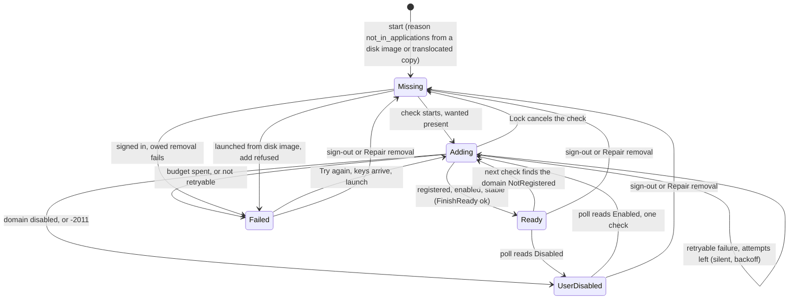
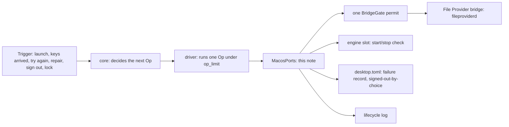
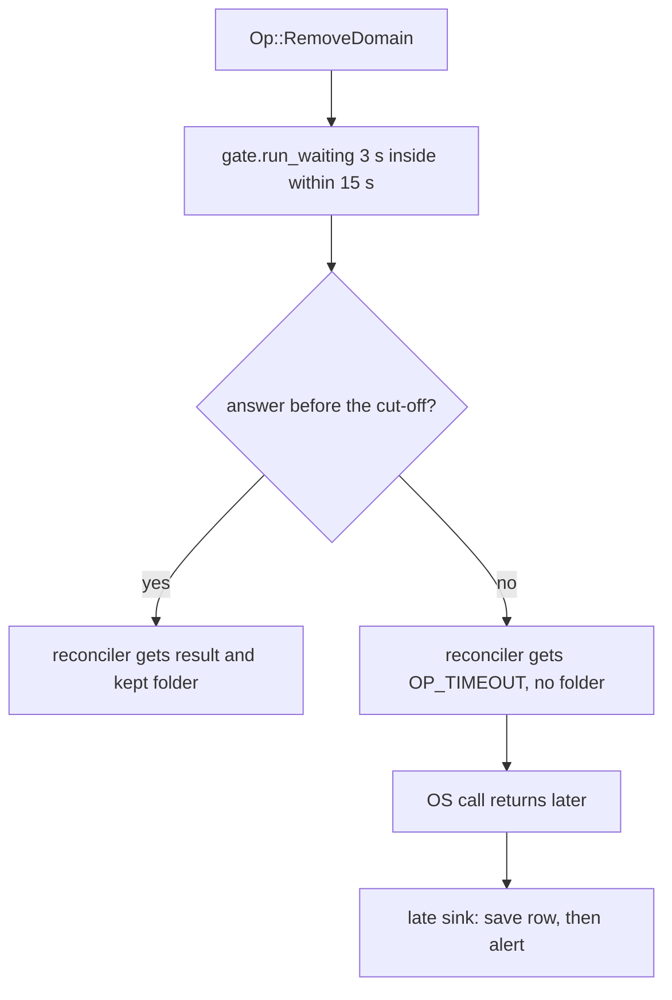

# macOS: the Finder location (the File Provider domain) and its reconciler

The native macOS app shows Beebeeb in Finder through a File Provider domain. In the 0.8.x Mac app one Rust task, the
Finder setup reconciler, keeps that domain present while the person is signed in, removes it when they sign out, and
repairs it on request. It reads and writes only through ports (the bridge, the engine slot, the settings file, a
lifecycle log). This note carries those rules and is the acceptance list for the macOS phase: every rule the native
macOS app must keep, and every test of each file with what it asserts.

**Reference implementation:** the shipped tag `desktop-v0.8.25`, at the paths named below. The files also exist at
`a57b9592` (the commit this note was written from) until the old shell is deleted; where a file differs between the two, its section says so.

**Related notes:** `file-provider-bridge.md` (the Objective-C bridge and the Rust layer over it, the stale-domain sweep
at start), `file-provider-removal-and-kept-folders.md` (a removal keeps the files that never reached the server, and
every kept folder the person is shown).

## The reconciler in one page

Reference implementation: tag `desktop-v0.8.25`. All 20 files below are byte-identical at that tag and at `a57b9592`.
Spec for background: `docs/specs/2026-10-06-macos-finder-setup-reconciler.md` (read at `a57b9592`). Section numbers
below (§5.1, §5.3 and so on) are that spec's.

**What it is for.** The reconciler keeps Beebeeb's Finder location (the File Provider domain) present while the person
is signed in and this Mac holds their keys, absent after a sign-out they chose, and untouched in every other case.
It is one task. It decides in a pure core (no OS, no clock, no I/O) and a driver runs the one operation the core asks
for. The native macOS app must keep this split: the core is platform-neutral and testable on an injected clock.

**What it wants (§5.1, `wanted()`).**
- Keys in memory (`vault_unlocked`): present. This holds even if the session was revoked (a startup 401 is not an input).
- No keys, no stored session token, and the last sign-out was the person's choice: absent.
- Everything else (keys missing, or a revoked session without a sign-out by choice): no action. Neither add nor remove.

**Triggers (§5.3).** `Launch`, `KeysArrived`, `UserEnabledFlipped`, `TryAgain` (all start a check), `SignOut` and
`Repair` (both remove), `Lock` (cancel and hold). The driver also feeds `AppActivated` and `Tick { window_visible }`.
- `Launch` and `KeysArrived` lift the hold. `TryAgain` and `UserEnabledFlipped` do nothing while held.
- A trigger that arrives during a check sets one "check again" flag. Any number of triggers produce exactly one
  follow-up check (§5.4).
- A revoked session is deliberately not a trigger.

**Events the driver applies.** `Trigger`, `Remove { trigger, ack }` (sign-out or Repair, with a waiter), `Lock { ack }`
and `AppActivated`. Before choosing the next operation the driver applies every event that arrived while the last
operation ran, so a sign-out or a lock always wins over the rest of a check.

**Steps of one check (§5.5).** Operations: `Observe`, `StartEngine`, `AddDomain`, `ReadDomain`, `WaitStable(d)`,
`FinishReady`, `StopEngine`, `RemoveDomain`.
1. `Observe`: read the session facts and the domain state (`Enabled`, `Disabled`, `NotRegistered`).
2. Wanted absent and the domain exists: remove it (`RemoveDomain`), land `Missing`.
3. Wanted present, domain `Disabled`: land `UserDisabled`. Never add.
4. Wanted present, domain `Enabled`: `StartEngine`, `WaitStable(2 s)`, `FinishReady`, land `Ready`. No add.
5. Wanted present, domain `NotRegistered`, launched from Applications or elsewhere: `StartEngine`, `AddDomain`,
   `ReadDomain`, `WaitStable(10 s)`, `FinishReady`, land `Ready`. From a disk image or a translocated copy: fail at once
   with `not_in_applications`, one attempt, nothing added.
6. A removal is owed (a previous account's domain is still registered) and the person is signed in: `RemoveDomain`
   first, then a fresh check. The engine start refuses until the removal is confirmed.
7. Any step that fails is classified. A retryable reason waits out its backoff and starts the whole check again at
   `Observe`. An engine this check started is stopped (`StopEngine`) before a `Failed` or `UserDisabled` landing.
8. Every real transition writes one lifecycle log line and publishes the view once.

**States it lands in (`FinderSetup`).** `Missing` (no check owns Finder; says nothing about presence), `Adding`
(a check is in flight, including silent retries), `Ready`, `UserDisabled` (turned off in System Settings), `Failed`
(one sentence and one action: "Try again"). `Missing` is never a resting state while wanted is present: a failed owed
removal lands `Failed`, not `Missing`.

**Retry schedule.** Source of the values: `crates/beebeeb-engine/src/finder_setup/policy.rs` (`RetryPolicy::default()`,
exists at `a57b9592`). Each attempt starts at an offset from the check's start, never from the end of the last attempt;
a slow attempt starts the next one late.

| Reason | Attempt offsets (s) | Attempts |
|---|---|---|
| `extension_loading`, `timeout` | 0, 5, 15, 45 | 4 |
| `unknown` | 0, 5 | 2 |
| `user_disabled`, `not_in_applications`, `folder_taken`, `signing` | 0 | 1 |

Other values: stabilize after add 10 s, confirm an existing registration 2 s, poll every 3 s. Nothing retries after
`Failed` until the next launch, keys arriving, or "Try again" (a fresh budget). Bringing the app forward never retries.
The classification table (§6.2: `-2001`, `-2003`, `-2004`, `-2012`, `-2014` to `extension_loading`; `-2011` to
`user_disabled`; `-2002` to `not_in_applications`; Cocoa 516 or POSIX 17 to `folder_taken`; stabilization timeout and the
driver's own op timeout to `timeout`; anything else `unknown`) lives in the same `policy.rs`.

**Polls (§7).** A read-only `ReadDomain` runs only between checks, never while held. While `UserDisabled` it runs every
3 s while a window is visible, plus once when the app becomes active; a read of `Enabled` runs exactly one check, which
only confirms. While `Ready` the same bound applies, and a read of `Disabled` moves `Ready` to `UserDisabled` with no
check, no add and no engine stop. While `Ready` and no window is visible the timer stops, and an app activation reads
once and sets it again.

Lock never changes the landing state it finds (a `Ready` or `UserDisabled` core stays as it is); it only cancels a
running or backing-off check, and a core that was `Adding` falls back to `Missing`. The hold lasts until `Launch` or
`KeysArrived`.

## Files: the reconciler core and driver

### `src-tauri/src/finder_setup/core.rs`
Reference: `desktop-v0.8.25:src-tauri/src/finder_setup/core.rs`.
What it does: module root of the pure reconciler core (spec §5). It wires the children (`types`, `decide`, `results`,
`landing`), re-exports the public vocabulary, and holds the test harness (a fake world plus a miniature driver on an
injected clock, `Sim`).
Rules:
- The core has no OS, no clock and no I/O. The driver feeds one `Input` at a time and runs the one `Op` that `next_op`
  asks for; while it runs nothing else is fed, so an add and a remove can never overlap (§5.4).
- The native macOS app must keep the core free of platform types so the same tests run anywhere.
- `SessionFacts` is built only by the macOS ports; the rest of the core is platform-neutral.
- Harness facts the tests rely on: the fake `World` answers `StartEngine` with `Ok(true)` (a new engine), `FinishReady`
  ok, and a `WaitStable` takes `wait_secs` on the fake clock; every other op takes no time. `Sim::run` answers ops and
  lets backoff timers fire until the core is settled, and panics after 500 steps if it never settles.
- Four session fixtures: signed in (keys, token), keys missing (token, no keys), signed out by choice (no token, flag
  set), signed out by a 401 (no token, flag not set). `removal_owed` is false in all four; `SIGNED_IN_OWING` sets it.
Tests: none in this file; its behaviour is tested by `core/tests/steps.rs`, `core/tests/retry.rs`, `core/tests/poll.rs`
and `core/tests/removal.rs`.

### `src-tauri/src/finder_setup/core/decide.rs`
Reference: `desktop-v0.8.25:src-tauri/src/finder_setup/core/decide.rs`.
What it does: `step` (what an input does to the state), `next_op` (which operation is next), trigger and tick handling,
and starting a check (spec §5.1, §5.3).
Rules:
- The poll (`polls`) is on only when not held and the state is `UserDisabled` or `Ready`; it runs only between checks.
- A disk image or a translocated copy is `Missing` with reason `not_in_applications` from construction, before any check
  (§6.2, "exposed before sign-in").
- `next_op` called while an operation is running logs a warning and returns `Idle`; it never starts a second one.
- Operation per step: `Observe`, `StartEngine`, `AddDomain`, `ReadDomain`, `WaitStable(10 s)` after an add,
  `WaitStable(2 s)` to confirm an existing registration, `FinishReady`, `StopEngine`; `RemoveDomain` while removing.
- Backoff: before its deadline `next_op` returns `WakeAt(deadline)`; at or after it, the attempt counter goes up by one
  and the check restarts at `Observe`.
- Idle: a pending poll read returns `ReadDomain`; otherwise a pollable state returns `WakeAt(poll_due)` or `Idle` if there
  is no timer. While held there is no timer, so there is no past `WakeAt` that would spin the driver.
- `SignOut`: sets the hold, drops a pending read, clears "check again", persists "signed out by choice" as true, and moves
  to removal (requested, no check afterwards). Sign-out tells the reconciler first, then the app stops the engine, so
  the reconciler cannot start one in the gap.
- `Repair`: clears "check again" and moves to removal that is requested and followed by one fresh check. It does not
  set the hold.
- `Lock`: sets the hold, drops a pending read and "check again". If a check is running or backing off, it goes `Idle`,
  forgets that it started an engine (the app stops it right after), and a state of `Adding` falls back to `Missing`
  with the launch-location reason. Lock never removes.
- `Launch` and `KeysArrived` lift the hold and request a check. `TryAgain` and `UserEnabledFlipped` request a check only
  when not held.
- `request_check`: starts a check when idle, otherwise sets "check again". `start_check` resets the attempt to 1, the
  max to 0 and the start time.
- `on_tick`: acts only when idle and pollable. When the poll is due, a visible window sets a pending read and re-arms the
  3 s timer; with no window, `UserDisabled` re-arms the timer, `Ready` clears it (no wake-ups while hidden).
- `AppActivated` while idle and pollable sets a pending read and arms the timer if none is set.
Tests: none in this file; its behaviour is tested by `core/tests/steps.rs`, `core/tests/retry.rs` and `core/tests/poll.rs`.

### `src-tauri/src/finder_setup/core/landing.rs`
Reference: `desktop-v0.8.25:src-tauri/src/finder_setup/core/landing.rs`.
What it does: where a check ends. The terminal `FinderSetup` states, the persisted failure, and `finish_check`.
Rules:
- `Failed` landing: reason from the check (default `unknown`), error from the last error (default an app-domain
  "unexpected bridge return" code, "failed without an error"). It persists the failure as an effect, then sets state.
- `UserDisabled` landing: reason `user_disabled`, keeps the last error, and arms the 3 s poll timer.
- `Ready` landing: clears the last error, clears the "this check started the engine" flag (the engine now belongs to the
  signed-in session), persists "no failure", and arms the poll timer.
- `Missing` landing: the reason is the launch-location reason (none from Applications), with an optional error.
- `finish_check` goes `Idle`, clears the start time, and starts exactly one more check if "check again" is set and the
  core is not held.
- `set_state` does nothing when state and reason are both unchanged. Otherwise it emits one `Transition` (from, to,
  reason, error, attempt, max attempts where max is at least attempt) and one `Publish`. Every transition is one log line.
Tests: none in this file; its behaviour is tested by `core/tests/steps.rs` and `core/tests/removal.rs`.

### `src-tauri/src/finder_setup/core/results.rs`
Reference: `desktop-v0.8.25:src-tauri/src/finder_setup/core/results.rs`.
What it does: what one finished operation means (`on_done`, `on_check_result`, `on_observed`, `attempt_failed`,
`end_check`). It never chooses the next operation.
Rules:
- The idle `UserDisabled` poll: a read of `Enabled` emits `UserEnabledFlipped` and starts exactly one check (never an
  add). The idle `Ready` poll: only a read of `Disabled` (and not held) moves to `UserDisabled` with no error; it adds
  nothing and stops nothing. Any other answer (enabled, not registered, a failed read) changes nothing.
- A finished removal returns to idle. If an owed removal that the check itself asked for failed (check follows, not
  requested by the person), the core lands `Failed` with the classified reason and max attempts 1, never a resting
  `Missing` (§13.1). Otherwise the state is `Missing` with the removal's error, if any.
- A confirmed removal emits `DomainRemovalConfirmed`; a requested removal emits `RemoveFinished(result)`.
- A fresh check follows a removal when the removal was a Repair (always, even if it failed), or an owed removal that
  worked, or "check again" is set; never while held.
- `Observe` handling: if wanted is present and the person had signed out by choice, it persists "signed out by choice"
  false. If a removal is owed and the domain is `NotRegistered`, it emits `DomainRemovalConfirmed`.
- `Observe` outcome table: absent plus domain exists: remove (not requested, no check after). Present plus owed plus
  domain exists: remove, then check. Absent plus read error: `Missing` with the error. Absent plus `NotRegistered`, or no
  action: `Missing`. Present plus `Disabled`: `UserDisabled`. Present plus `Enabled`: `Adding` (unless already `Ready`
  or `Adding`) then `StartEngine` without add. Present plus `NotRegistered`: if the launch location allows add,
  `Adding` then `StartEngine` with add; else fail with reason `not_in_applications`, max attempts 1, and an app-domain
  launch-location error, "Beebeeb was opened from a disk image or a translocated copy". Present plus a read error: an
  attempt failure.
- After `StartEngine` the next step is `AddDomain` (add) or the 2 s confirm wait (no add). A successful add emits
  `DomainAddConfirmed`. After the add, `ReadDomain`: `Disabled` lands `UserDisabled`; anything else (enabled, not listed,
  a failed read) goes on to the 10 s stabilization wait. A failed read is never evidence of anything.
- `StopEngine` result: `Ok` clears "started engine". An `Err` leaves it set (the engine may still be alive; never claim
  it stopped), logs the failure as a same-state transition (log only, nothing a person sees), and the check still lands
  with its OWN reason.
- Errors from `StartEngine`, `AddDomain`, `WaitStable` or `FinishReady` are attempt failures.
- `attempt_failed`: classifies the error; stores reason, max attempts for that reason, and the error. Reason
  `user_disabled` lands `UserDisabled`. Otherwise if the policy has a next attempt time, it logs an `Adding` to `Adding`
  transition with reason and "attempt n of N", publishes, and enters backoff until `max(at, now)`; if the budget is spent
  it lands `Failed`.
- `end_check`: if this check started an engine, run `StopEngine` first, then land; else land at once.
- A result that does not fit the current phase is logged as a warning and ignored.
Tests: none in this file; its behaviour is tested by `core/tests/steps.rs`, `core/tests/retry.rs`, `core/tests/removal.rs`
and `core/tests/poll.rs`.

### `src-tauri/src/finder_setup/core/types.rs`
Reference: `desktop-v0.8.25:src-tauri/src/finder_setup/core/types.rs`.
What it does: the state and its vocabulary: `Trigger`, `Wanted`, `SessionFacts`, `DomainState`, `Observation`, `Op`,
`OpResult`, `Input`, `Transition`, `Effect`, `Next`, and `CoreState`.
Rules:
- Trigger names written to the lifecycle log: `launch`, `keys_arrived`, `user_enabled_flipped`, `try_again`, `sign_out`,
  `repair`, `lock`.
- `SessionFacts` has four fields: `vault_unlocked` (keys in memory), `auth_present` (a session token is stored),
  `signed_out_by_choice` (persisted; a startup 401 does not set it), `removal_owed` (persisted; an account reset or an
  unconfirmed sign-out removal left the previous account's domain registered).
- `wanted()` (§5.1): keys in memory is `Present`; else no token and signed out by choice is `Absent`; else `NoAction`.
- `Effect`s the driver carries out: `Publish`, `TriggerReceived`, `Transition`, `PersistFailure(Some or None)`,
  `PersistSignedOutByChoice(bool)`, `RemoveFinished(result)`, `DomainRemovalConfirmed` (clears "removal owed"),
  `DomainAddConfirmed` (clears the persisted "domain gone" mark).
- `OpResult::EngineStarted(Ok(true))` means this op started a new engine; `Ok(false)` means one was already running.
  `Removed` carries what macOS kept of files that had not reached the server; the core decides nothing from it.
- A new core starts as `Missing`, reason from the launch location, attempt 0, max 0, not held, idle.
- `is_held()`: held by sign-out or Lock until keys arrive. `is_settled()`: idle, nothing running, no poll read pending.
Tests: none in this file; its behaviour is tested by `core/tests/steps.rs` (`wanted_follows_section_5_1`).

### `src-tauri/src/finder_setup/core/tests/poll.rs`
Reference: `desktop-v0.8.25:src-tauri/src/finder_setup/core/tests/poll.rs`.
What it does: the `UserDisabled` and `Ready` polls, the hold, the launch-location reasons, and a persisted failure
cleared by `Ready`.
Rules: see the polls paragraph in "The reconciler in one page".
Tests (acceptance list):
| test | asserts |
|---|---|
| `user_disabled_poll_reads_only_while_visible_and_a_flip_runs_one_check` | After `UserDisabled`, next is `WakeAt` +3 s; a tick with no window re-arms +6 s with no read; a tick with a window returns `ReadDomain`; an activation reads once; a read of `Enabled` emits `UserEnabledFlipped`, runs exactly 2 `Observe` in total, and never adds. |
| `a_ready_domain_turned_off_while_running_lands_user_disabled_from_the_poll_alone` | `Ready` keeps a 3 s timer; a read of `Enabled` changes nothing; a read of `Disabled` lands `UserDisabled` (reason `user_disabled`, no error) with one `Ready` to `UserDisabled` transition, a publish, and no trigger effect; op list unchanged (no check, add or stop). The flip back on runs one check: 2 `Observe`, 0 `AddDomain`, 0 `StopEngine`. |
| `a_ready_domain_turned_off_while_running_is_read_once_when_the_app_becomes_active` | An activation on `Ready` returns `ReadDomain`; a read of `Disabled` lands `UserDisabled`; 0 adds, 1 `Observe`. |
| `a_ready_core_with_no_window_visible_sets_no_timer_and_a_focus_resumes_the_poll` | `Ready` lands with a 3 s timer; a tick with no window leaves `Idle` (also an hour later); an activation reads once and re-arms +3 s; the next visible tick reads and `Disabled` lands `UserDisabled`. |
| `the_ready_poll_ignores_every_answer_but_turned_off` | For reads `Enabled`, `NotRegistered` and an op-timeout error, the state stays `Ready` with no reason, no effects, and settled. |
| `a_held_ready_core_does_not_poll` | After `Lock`, state stays `Ready`; the pending read is dropped, `next` is `Idle`; ticks and activations 30 s later still give `Idle`. |
| `a_disk_image_launch_reports_the_reason_before_any_check_and_never_adds` | A disk-image core is `Missing`/`not_in_applications` at start; after `KeysArrived` only `Observe` runs and it lands `Failed`/`not_in_applications`. |
| `a_registered_domain_is_confirmed_even_from_a_disk_image` | A disk-image launch with an `Enabled` domain lands `Ready` (§5.5: the location check applies only when not registered). |
| `ready_clears_a_persisted_failure` | After a `folder_taken` failure, `TryAgain` into a good world lands `Ready` with no reason or error and emits `PersistFailure(None)`. |
| `a_held_user_disabled_core_does_not_poll_and_keys_arriving_resumes_it` | `Lock` on `UserDisabled` keeps the state, drops the pending read, `next` is `Idle`, no tick or activation reads (0 `ReadDomain`, no flip effect); `KeysArrived` lands `UserDisabled` again, the poll timer is back at +3 s and a flip is noticed. |
| `sign_out_drops_a_pending_user_disabled_read` | With a read pending, `SignOut` runs only `RemoveDomain` (no `ReadDomain`) and lands `Missing`. |
| `lock_during_backoff_cancels_the_retry_and_holds_until_keys_arrive` | After a `-2001` add failure the core waits at +5 s; `Lock` makes the state `Missing`, no reason, `Idle`, no retry after the deadline, `TryAgain` ignored; `KeysArrived` runs one more check (2 `Observe` total) and lands `Ready`. |
| `sign_in_after_a_sign_out_by_choice_clears_the_persisted_intent` | An `Observe` with `signed_out_by_choice` true and keys present emits `PersistSignedOutByChoice(false)`. |

### `src-tauri/src/finder_setup/core/tests/removal.rs`
Reference: `desktop-v0.8.25:src-tauri/src/finder_setup/core/tests/removal.rs`.
What it does: sign-out and Repair, the hold, the owed-removal flags, and Lock.
Rules: sign-out and Repair remove once; sign-out holds; Repair always runs its one fresh check; an owed removal runs
before the engine starts and never loops.
Tests (acceptance list):
| test | asserts |
|---|---|
| `sign_out_cancels_the_check_in_flight_removes_and_holds_until_keys_arrive` | A `SignOut` after `AddDomain` gives ops `Observe, StartEngine, AddDomain, RemoveDomain`, state `Missing`, `RemoveFinished(Ok)` and `PersistSignedOutByChoice(true)`; `TryAgain`, activation and tick leave `Idle`; `KeysArrived` lands `Ready`. |
| `a_repair_whose_removal_fails_still_checks_once_and_never_lands_failed_on_the_way` | A failing removal (516) is `Missing` on the way, with no `PersistFailure(Some)`; then 1 removal, 1 `Observe` (the fresh check) and `Ready`. |
| `repair_removes_then_checks_exactly_once` | From `Ready`, `Repair` runs `RemoveDomain, Observe, StartEngine, AddDomain, ReadDomain, WaitStable(10 s), FinishReady`, lands `Ready`, and emits `RemoveFinished(Ok)`. |
| `only_a_confirmed_removal_releases_the_owed_flag` | `DomainRemovalConfirmed` is emitted for a Repair removal that succeeds and not for one that fails; a sign-out removal emits it too. |
| `only_a_successful_add_says_the_domain_is_registered` | `DomainAddConfirmed` appears after a successful add, not after `-2011`; a check on an already registered domain never emits it. |
| `an_observe_that_finds_the_domain_absent_releases_the_owed_flag` | An `Observe` with `removal_owed` and `NotRegistered` emits `DomainRemovalConfirmed`; without owed it does not. |
| `an_owed_removal_runs_before_the_check_starts_the_engine` | With owed and domain `Enabled`, ops go `Observe, RemoveDomain, Observe, StartEngine`; confirmed is emitted; ends `Ready`. |
| `an_owed_removal_that_fails_does_not_loop` | A failing owed removal runs `Observe, RemoveDomain` once and settles `Failed` with the classified reason of 516, the error kept, max attempts 1, `PersistFailure(Some)` and no confirmation; the next `TryAgain` removes once more (2 total) and still says `Failed`. |
| `lock_cancels_the_check_and_holds_until_keys_arrive` | `Lock` during `Adding` gives `Missing`, `next` is `Idle` (no `StartEngine`), `TryAgain` ignored; `KeysArrived` lands `Ready`. |

### `src-tauri/src/finder_setup/core/tests/retry.rs`
Reference: `desktop-v0.8.25:src-tauri/src/finder_setup/core/tests/retry.rs`.
What it does: the retry budget (spec §7) on an injected clock.
Rules: four attempts at 0/5/15/45 s for transient reasons, two for `unknown`, one for the rest; "Try again" restarts
the budget.
Tests (acceptance list):
| test | asserts |
|---|---|
| `transient_failures_make_four_attempts_at_0_5_15_45` | A `-2001` add failure starts attempts at 0, 5, 15, 45 s, ends `Failed`/`extension_loading` with attempt 4 of 4, one `StopEngine`, and exactly two state changes seen (`Adding`, `Failed`). |
| `a_slow_attempt_delays_the_next_start` | With a 10 s stabilization timeout per attempt, starts are 0, 10, 20, 45 s, ending at 55 s with reason `timeout`. |
| `unknown_makes_two_attempts_and_not_retryable_reasons_make_one` | An unknown error: starts 0, 5, `Failed`/`unknown`. Cocoa 516: start 0 only, `Failed`/`folder_taken`, `PersistFailure(Some(folder_taken, error))`. |
| `nothing_retries_after_failed_without_a_trigger_and_try_again_restarts_the_budget` | After `Failed`, a tick and an activation leave `next` as `Idle`; `TryAgain` resets attempt to 1 and runs a second add (2 total). |

### `src-tauri/src/finder_setup/core/tests/steps.rs`
Reference: `desktop-v0.8.25:src-tauri/src/finder_setup/core/tests/steps.rs`.
What it does: the check itself: wanted, operation order, landing states, and the trigger-by-observation table.
Rules: the order of operations of a check, a failed read is not evidence, a stop that did not finish is never claimed.
Tests (acceptance list):
| test | asserts |
|---|---|
| `wanted_follows_section_5_1` | Signed in is `Present`; keys with no token and the flag set is `Present`; keys missing is `NoAction`; signed out by choice is `Absent`; signed out by a 401 is `NoAction` (R2). |
| `present_and_not_registered_adds_then_lands_ready` | Ops `Observe, StartEngine, AddDomain, ReadDomain, WaitStable(10 s), FinishReady`; `Ready`, no reason, `PersistFailure(None)`. |
| `present_and_registered_confirms_without_adding_and_ready_never_flickers` | Ops `Observe, StartEngine, WaitStable(2 s), FinishReady`; `Ready`. A second trigger on a `Ready` domain never publishes `Adding` and adds 0. |
| `present_and_turned_off_lands_user_disabled_without_adding` | Only `Observe`; `UserDisabled` with reason `user_disabled`. |
| `turned_off_right_after_add_stops_the_engine_it_started` | Ops end `AddDomain, ReadDomain, StopEngine`; lands `UserDisabled`. |
| `a_stop_that_did_not_finish_is_logged_never_claimed_and_the_check_still_lands_with_its_own_reason` | For an unconfirmed stop and an op timeout: state `UserDisabled` with `user_disabled`, "started engine" stays true, exactly one same-state `Adding` to `Adding` log transition carrying the stop error. A stop that finished clears the flag and logs no same-state transition. |
| `domain_disabled_from_add_is_user_disabled_not_failed` | `-2011` from add lands `UserDisabled`; one add (not retried). |
| `a_failed_read_after_add_is_not_evidence_and_still_waits` | A failed `ReadDomain` still goes on to the 10 s wait and `Ready`. |
| `every_trigger_against_every_observation_ends_in_a_state_a_person_can_act_on` | For `Launch`, `KeysArrived`, `TryAgain` against 12 worlds, final state and `RemoveDomain` count match the table (for example keys missing: `Missing`, 0; signed out by choice and registered: `Missing`, 1; owed removal fails: `Failed`, 1); wanted present never rests in `Missing`; not wanted never adds. |
| `merged_triggers_produce_exactly_one_follow_up_check` | After one `Observe`, 5 `TryAgain` and 1 `Launch` give exactly 2 `Observe` in total, and `Ready`. |

### `src-tauri/src/finder_setup/driver.rs`
Reference: `desktop-v0.8.25:src-tauri/src/finder_setup/driver.rs`.
What it does: module root of the single Finder reconciler task (spec §5.4, §9). It receives events, runs one operation
at a time, owns the timer, and is generic over `Ports` (OS, engine, app) and `Clock`. It re-exports the surface
(`Event`, `FinderSetupHandle`, `RemoveAnswer`, `Ports`, `Clock`, `FinderSetupView`, `copy_details`, `op_limit`, `within`)
and holds the test fakes.
Rules:
- The native macOS app must keep the seam: the driver is generic over the OS and the clock so tests run on a fake clock.
- Test fakes (shared by `tests/`): `FakeClock` (advances only when slept on; unix time `1_791_291_909` plus elapsed),
  `FakePorts` (records ops with fake-clock seconds, published views, log events, persisted failures, signed-out writes,
  removals confirmed, domains added, kept folders), a removal-waiter probe, and a hook that panics inside an op.
- Fixed sentence shown when the reconciler is not running: "Beebeeb’s Finder setup isn’t running. Quit and reopen
  Beebeeb to start it again."
- No leak: no published view, persisted failure, "Copy details" or removal error may contain a path, a file name or the
  OS message (`assert_no_leak` checks for a user folder, a file name and the OS sentence).
- `spawn` and `SystemClock` are the Tauri/macOS glue; `FINDER_SETUP_CHANGED_EVENT` is Tauri glue, not carried.
Tests: none in this file; its behaviour is tested by `driver/tests/ops.rs`, `driver/tests/panics.rs`,
`driver/tests/reconciler.rs` and `driver/tests/view.rs`.

### `src-tauri/src/finder_setup/driver/check.rs`
Reference: `desktop-v0.8.25:src-tauri/src/finder_setup/driver/check.rs`.
What it does: the reconciler loop and its lifecycle: apply every waiting event before choosing the next operation, run at
most one operation, answer removal waiters only after the view is published. It also owns the panic stop and the Tauri spawn.
Rules:
- `Driver` holds the core, the last saved failure, every queued removal waiter, the view channel, the shared hold flag,
  and the retry policy.
- Every `Effect` is carried out in order: `TriggerReceived` and `Transition` go to the lifecycle log; `PersistFailure(Some)`
  stores only domain, code and a unix time (`at`), never the message (the message goes to the log only);
  `PersistFailure(None)` clears it only when one exists; the persisted-flag effects go to the port.
- The view is published once, after every effect, if the core asked for a publish OR the saved failure changed (a repeat
  failure moves only `at`, and "Copy details" shows it).
- Removal waiters are answered last, after the publish, so a woken caller never reads the view from before the removal.
  One removal answers every queued waiter. If no waiter took the answer (the waiter gave up, or none was queued), what the
  removal kept goes to the port to show the person.
- `drive` publishes the first view at start, yields every loop (an instant fake clock must not starve the runtime),
  drains all queued events first, then runs one op, sleeps until a `WakeAt` (an event can pre-empt it; on a wake it asks
  the port whether a window is visible and feeds `Tick`), or waits for an event. A closed channel ends the loop.
- Panic stop: if anything in the loop panics, the task catches it, ends the channel (`trigger`, `remove`, `lock` then say
  "not running"), and there is no restart; the next launch starts a fresh driver. It publishes one `Failed` view with
  reason `unknown` and the error `io.beebeeb.app` code 5 (reconciler panic), a fixed sentence "the Finder reconciler
  panicked" (never the panic payload, which can name a path), a lifecycle line, and the saved failure. The handle is
  updated first because it needs nothing from the ports that may have panicked; each port call is then guarded so one
  more panic does not stop the report.
- `spawn` is the Tauri runtime spawn: Tauri glue, not carried (the `start` function is the carried one).
Tests: none in this file; its behaviour is tested by `driver/tests/reconciler.rs` and `driver/tests/panics.rs`.

### `src-tauri/src/finder_setup/driver/details.rs`
Reference: `desktop-v0.8.25:src-tauri/src/finder_setup/driver/details.rs`.
What it does: builds the "Copy details" text for support (spec §6.2).
Rules:
- Lines, in order: `Beebeeb <app version> on macOS <macOS version>`; `Finder setup: <state>`; `Reason: <reason or none>`
  (the view's reason, else the last failure's); `Error: <domain> <code>` or `Error: none`; `Last attempt: <UTC time>`
  (`%Y-%m-%dT%H:%M:%SZ`, or "unknown") only with a failure; `Attempts: <attempt> of <max, at least attempt>`;
  `Launched from: <location>`; a blank line; `Lifecycle log (last N lines):` and the lines.
- Never a path, a file name, the email or the account id: the view carries none and the log tail is already redacted.
  Version tokens go through the log's token sanitizer.
- `copy_details` reads the last 200 lines (`TAIL_LINES`) of the real lifecycle log itself, so no caller can hand it a
  short or an empty tail. The text builder is private.
Tests: none in this file; its behaviour is tested by `driver/tests/view.rs` (`copy_details_names_what_support_needs_and_never_a_path`,
`copy_details_reads_the_last_200_lifecycle_lines`).

### `src-tauri/src/finder_setup/driver/handle.rs`
Reference: `desktop-v0.8.25:src-tauri/src/finder_setup/driver/handle.rs`.
What it does: the handle the app holds: the events it sends to the reconciler (trigger, removal, lock, app active) and
the view it reads back.
Rules:
- A removal (`remove`) accepts only `SignOut` and `Repair`; any other trigger is refused with "<name> is not a removal"
  and nothing is sent (it would leave a waiter nobody answers).
- The removal error is the OS error's domain and code only (`NSCocoaErrorDomain 516`), never its message. Either way
  the answer carries what macOS kept of files that had not reached the server, so the caller can name the folder.
- Sentences: not running: "Beebeeb’s Finder setup isn’t running. Quit and reopen Beebeeb to start it again."; stopped
  between send and answer: "the Finder reconciler stopped"; lock not acknowledged: "the Finder reconciler did not
  acknowledge the lock within <n>s"; removal not done in time: "the Finder reconciler did not remove within <n>s";
  removal waiter dropped: "the Finder reconciler stopped before removing".
- `app_activated` has nothing to tell a person if it fails (it only logs a warning).
- `is_held()` reflects the core's hold after the last event it applied (a Lock is applied before it is acknowledged), so
  "Try again" can say why it does nothing.
- `Lock` is acknowledged only after the core cancelled any check and set the hold; the app then stops the engine.
- `fixed`, `for_test` and `set_held_for_test` exist for tests only.
Tests (acceptance list):
| test | asserts |
|---|---|
| `handle_error_sentences_are_pinned_table_driven` | `NotRunning` is the not-running sentence; `Stopped` is "the Finder reconciler stopped"; `LockTimeout(5 s)` is "the Finder reconciler did not acknowledge the lock within 5s". |

### `src-tauri/src/finder_setup/driver/limits.rs`
Reference: `desktop-v0.8.25:src-tauri/src/finder_setup/driver/limits.rs`.
What it does: one time limit per operation, and `within`, which turns a call that never returns into a redacted timeout.
Rules (the native macOS app must keep all of these):
- Limits: `Observe` and `ReadDomain` 10 s (one `getDomains` round trip); `StartEngine`, `FinishReady`, `StopEngine` and
  `RemoveDomain` 15 s; `AddDomain` 20 s (it may have to register the extension); `WaitStable(w)` is `w` plus 3 s (the
  bridge enforces `w` itself; the extra 3 s backs up a bridge that never returns).
- Reason: several bridge primitives wait forever for the system's File Provider daemon, and a stuck one must not hang the
  reconciler and, behind it, sign-out or lock.
- `within(op, limit, call)`: a call not back by the limit is dropped and becomes an error in the app domain with code 6
  (op timeout), message `<StepName> did not answer within <limit>`. That classifies as `timeout` and retries on the
  schedule. The text names only the operation and the limit.
- Step names used in that sentence: `Observe`, `StartEngine`, `AddDomain`, `ReadDomain`, `WaitStable`, `FinishReady`,
  `StopEngine`, `RemoveDomain`. A check of a present domain walks the first six in that order; a removal walks
  `StopEngine`, `RemoveDomain`.
Tests (acceptance list):
| test | asserts |
|---|---|
| `finder_setup_step_names_every_operation_table_driven` | Each of the 8 ops maps to its step enum and the exact name string above (`WaitStable(2 s)` maps to `WaitStable`). |
| `the_finder_setup_step_order_is_observe_start_add_read_wait_finish` | Mapping the six-op walk gives the steps in the order `Observe, StartEngine, AddDomain, ReadDomain, WaitStable, FinishReady`. |

### `src-tauri/src/finder_setup/driver/ports.rs`
Reference: `desktop-v0.8.25:src-tauri/src/finder_setup/driver/ports.rs`.
What it does: the seam between the reconciler and the app: `Ports` (where an operation runs and where its log, failure
and view go) and `Clock` (the schedule's clock, injected in tests, §7).
Rules:
- `Ports`: `run(op)`, `publish(view)`, `log(event)`, `persist_failure(record or none)`,
  `persist_signed_out_by_choice(bool)`, `domain_removal_confirmed()` (clears the persisted "removal owed" flag),
  `domain_added()` (clears the persisted "domain gone" mark), `kept_folder(kept)` and `window_visible()`.
- `kept_folder` is called for a removal nobody took the answer of (an owed removal at launch, the account binding's
  Repair, or a sign-out or Repair whose waiter gave up). The port shows the person the kept folder the way the app-start
  sweep does: saved for the Settings sync row, then the alert. The kept value may be nothing.
- `Clock`: `now`, `unix_now`, `sleep_until`. `SystemClock` is the real one (macOS only).
Tests: none in this file; its behaviour is tested by `driver/tests/reconciler.rs`.

### `src-tauri/src/finder_setup/driver/state.rs`
Reference: `desktop-v0.8.25:src-tauri/src/finder_setup/driver/state.rs`.
What it does: the published view (`finder_setup_state` return value and the `finder-setup-changed` payload) and the one
rule for which reason a person is told.
Rules:
- The view has exactly six keys: `setup`, `reason`, `launch_location`, `attempt`, `max_attempts`, `last_failure`.
- Reason rule: `Failed` and `UserDisabled` publish the core's reason; `Missing` publishes only `not_in_applications`
  (device check D7: opened from a mounted disk image, reported before sign-in); `Adding` never publishes a reason (the
  core keeps the reason of the attempt it silently retries, and publishing it would flash a failure that is not one yet);
  `Ready` never. The match is exhaustive so a new state must choose.
- `FinderSetupView::initial(launch)` is the first view, before any check.
- Event name `finder-setup-changed` and the Serialize shape are Tauri glue (the TypeScript UI's JSON), not carried; the
  native macOS app must keep the reason rule and the fields.
Tests: none in this file; its behaviour is tested by `driver/tests/view.rs`.

### `src-tauri/src/finder_setup/driver/tests/ops.rs`
Reference: `desktop-v0.8.25:src-tauri/src/finder_setup/driver/tests/ops.rs`.
What it does: pins the operation limits and proves a call that never returns ends in a failure, not a hang.
Rules: see `driver/limits.rs`.
Tests (acceptance list):
| test | asserts |
|---|---|
| `every_operation_has_a_named_limit_and_stabilization_keeps_its_own_wait` | `op_limit` is 10 s for `Observe`/`ReadDomain`, 15 s for `StartEngine`/`FinishReady`/`StopEngine`/`RemoveDomain`, 20 s for `AddDomain`, `WaitStable(10 s)` is 13 s and `WaitStable(2 s)` is 5 s; `stabilize_after_add` is at most 10 s; every limit is above 0 and at most 30 s. |
| `a_call_that_never_returns_is_cut_off_at_its_limit_with_a_redacted_timeout_error` | `within` cuts a pending call at 40 ms in under 5 s with domain `io.beebeeb.app`, code `OP_TIMEOUT`, message "AddDomain did not answer within 40ms", classified `timeout`, redacted text "io.beebeeb.app 6"; every op is cut the same way; a call that answers (value, or its own error) passes through unchanged. |
| `an_add_that_never_returns_ends_in_failed_timeout_after_the_schedule_not_in_a_hang` | A port whose add never returns (20 ms limit) ends `Failed` with reason `timeout`, attempt 4 of 4, a saved failure of domain `io.beebeeb.app` and code `OP_TIMEOUT`, with `Observe` starts at 0, 5, 15, 45 s on the injected clock, and no leak in the published JSON. |

### `src-tauri/src/finder_setup/driver/tests/panics.rs`
Reference: `desktop-v0.8.25:src-tauri/src/finder_setup/driver/tests/panics.rs`.
What it does: a port that panics is reported and stops the reconciler; a stop that did not finish is logged, never claimed.
Rules: see the panic stop in `driver/check.rs`.
Tests (acceptance list):
| test | asserts |
|---|---|
| `a_panicking_port_ends_in_one_failed_unknown_view_and_a_handle_that_says_so` | A panic inside `AddDomain` is caught (task ends normally); the view is `Failed`/`unknown`, last failure domain `io.beebeeb.app` code `RECONCILER_PANIC`; the last published view equals it, the failure is persisted, there is exactly one `Failed` log line (from `Adding`, message "the Finder reconciler panicked"), the tracing capture has an ERROR line, and nothing leaks a path; "Copy details" contains "Error: io.beebeeb.app 5"; afterwards `trigger`, `remove` and `lock` return the not-running sentence and the view stays final. A second driver whose publish, log and persist all panic still delivers the final view to the handle. |
| `a_stop_that_did_not_finish_is_logged_and_the_check_still_ends_with_its_own_reason` | With a folder-taken add and a failing stop, the view reason is `folder_taken` (saved failure code 516, not the stop's), the last op is `StopEngine`, exactly one log transition carries the stop error, and the view has no leak. |

### `src-tauri/src/finder_setup/driver/tests/reconciler.rs`
Reference: `desktop-v0.8.25:src-tauri/src/finder_setup/driver/tests/reconciler.rs`.
What it does: the reconciler loop end to end on a fake port and clock: a check's operations, the schedule, Lock and
sign-out removal, the polls, kept folders, and the order of publish and answer.
Rules: see `driver/check.rs`, `driver/handle.rs` and the polls paragraph above.
Tests (acceptance list):
| test | asserts |
|---|---|
| `a_launch_runs_one_check_and_publishes_ready` | `Launch` on `NotRegistered` runs the six ops in order; the first published view is `Missing`, the last `Ready` and equal to the handle's view as JSON; a `Launch` trigger line is logged; exactly one log transition to `Ready`. |
| `sign_out_resolves_its_ack_after_the_removal` | After `Ready`, `remove(SignOut)` returns ok; the view is `Missing` already; the last op is `RemoveDomain`; the persisted "signed out by choice" writes are `[true]`. |
| `an_event_sent_during_an_operation_waits_for_it_and_wins_over_the_rest_of_the_check` | A `SignOut` sent from inside `AddDomain` is applied after it: ops are `Observe, StartEngine, AddDomain, RemoveDomain` and the view is `Missing`. |
| `transient_failures_follow_the_schedule_on_the_injected_clock` | A `-2001` add failure: `Observe` starts 0, 5, 15, 45 s; `Failed`, `extension_loading`, 4 of 4; the saved failure is `NSFileProviderErrorDomain -2001` at the base time plus 45 s; one failure persisted. |
| `a_persisted_failure_is_in_the_first_view_and_ready_clears_it` | A saved failure is in the first view before any check; after `TryAgain` reaches `Ready` it is cleared and `persisted_failures` is `[None]`. |
| `lock_is_acknowledged_and_holds_until_keys_arrive` | `handle.lock` is acknowledged and `is_held()` turns true; `TryAgain` while held runs no op (200 yields); `KeysArrived` runs ops and clears the hold. |
| `one_removal_answers_every_waiter_queued_for_it_and_runs_once` | A Repair waiter and a SignOut waiter queued together are both answered `Ok` by one `RemoveDomain` (the only op), the view is `Missing`, and "signed out by choice" is `[true]`. |
| `a_confirmed_removal_reaches_the_port_and_a_failed_one_does_not` | The port's `domain_removal_confirmed` count is 1 after a removal that worked and 0 after a 516 failure. |
| `test_1882_a_reconciler_removal_answers_its_waiter_with_the_kept_folder` | For a removal that works and one that fails (`NSCocoaErrorDomain 516`, message domain and code only), the waiter gets the kept folder and the port is not asked to show it. |
| `test_1882_a_reconciler_removal_nobody_waits_for_hands_the_kept_folder_to_the_port` | A Repair sent as a plain trigger still hands the kept folder to the port once, and runs `RemoveDomain`. |
| `test_1882_a_kept_folder_whose_waiter_gave_up_goes_to_the_port` | A removal whose waiter was dropped hands the kept folder to the port. |
| `a_successful_add_reaches_the_port_and_a_failed_one_does_not` | The port's `domain_added` count is 1 after a good add and 0 after a 516 failure. |
| `the_os_message_reaches_the_log_and_nothing_a_person_or_a_file_sees` | With an OS message that names a path, no published view, persisted failure, "Copy details" text or removal error contains it; the message IS in the log event; the saved failure is `NSCocoaErrorDomain 516`; the removal error is exactly "NSCocoaErrorDomain 516". |
| `a_repeated_failure_republishes_the_time_of_the_last_attempt` | A disk-image failure repeated 60 s later republishes with `at` moved by 60 s though the core published nothing; the last event agrees with the state. |
| `the_user_disabled_poll_reads_only_while_a_window_is_visible_or_on_activation` | With no window there is no poll (only `Observe`); an activation reads once and the flip runs exactly one check (`Observe, ReadDomain, Observe, StartEngine, WaitStable(2 s), FinishReady`, never an add); with a window visible the timer reads by itself and reaches `Ready`; still no add. |
| `a_domain_turned_off_while_ready_is_noticed_by_the_poll_without_a_relaunch` | Off with no window and no activation: nothing reads; an activation reads once and lands `UserDisabled` with no check, add or stop, and only the `Launch` trigger logged; back on runs one check; off again with a visible window is noticed by the timer; 2 `Observe` in total, no add, no stop. |
| `a_ready_driver_with_no_window_visible_stops_waking_until_a_window_gains_focus` | After `Ready` with no window, `window_visible` is asked once and then never again, with no timer waited on and no read; a visible window plus an activation reads at once and 3 s later; a `Disabled` read lands `UserDisabled` with 1 `Observe` and no add. |
| `a_handle_says_so_when_its_reconciler_is_gone_or_silent_and_refuses_what_is_not_a_removal` | A handle whose receiver is gone returns the not-running sentence for remove and lock; a silent one times out with "did not remove" and "did not acknowledge the lock"; `remove(Launch)` is an error and sends nothing; `fixed(view).view()` equals the view. |
| `a_removal_waiter_is_answered_only_after_the_view_is_published` | While the view is published for a sign-out, the waiter's receiver is still empty (`ack_pending_at_publish == [true]`); afterwards it is answered `Ok`. |

### `src-tauri/src/finder_setup/driver/tests/view.rs`
Reference: `desktop-v0.8.25:src-tauri/src/finder_setup/driver/tests/view.rs`.
What it does: the view a person reads and the "Copy details" text: the exact JSON shape, the reason rule, and the
launch-location notice at start.
Rules: see `driver/state.rs` and `driver/details.rs`.
Tests (acceptance list):
| test | asserts |
|---|---|
| `copy_details_names_what_support_needs_and_never_a_path` | The header of a failed view is exactly: "Beebeeb 0.8.12-alpha.1 on macOS 26.0 / Finder setup: failed / Reason: folder_taken / Error: NSCocoaErrorDomain 516 / Last attempt: 2026-10-06T13:05:09Z / Attempts: 1 of 1 / Launched from: applications" and a blank line; it ends with the one-line log tail; the header has no `/` or `@`. |
| `the_view_is_exactly_the_json_the_typescript_parses` | A failed view equals the sample JSON, with exactly the six keys and four `last_failure` keys (`at`, `code`, `domain`, `reason`); numbers are JSON numbers; the initial view for `Elsewhere` is `missing` with nulls and zero counts; the four `launch_location` and five `setup` wire names are `applications/translocated/disk_image/elsewhere` and `ready/missing/adding/failed/user_disabled`. |
| `a_view_carries_a_reason_when_failed_or_user_disabled_or_missing_for_the_launch_location` | For every state and every failure reason: `Failed` and `UserDisabled` carry it, `Missing` carries only `not_in_applications`, `Ready` and `Adding` carry none; with no reason held, none is shown. |
| `a_disk_image_or_translocated_launch_is_missing_for_not_in_applications_before_any_check` | The initial view for a disk image or translocated launch is `Missing`/`not_in_applications`; for Applications or elsewhere it is `Missing` with no reason. |
| `a_dmg_launch_publishes_not_in_applications_at_start_with_no_trigger` | The handle's first view already carries `not_in_applications`; the first publish after start is `Missing` with that reason and the disk-image location; no op ran. |
| `a_silent_retry_never_publishes_its_reason` | In a `-2001` run, an `Adding` view with attempt 3 was published; no non-`Failed`, non-`UserDisabled` view carries a reason; the last view carries `extension_loading`. |
| `copy_details_reads_the_last_200_lifecycle_lines` | The tail reader is asked for 200 lines, and the text ends with "Lifecycle log (last 2 lines):" followed by the two returned lines. |

## Finder setup: the macOS ports, the commands, the wiring pins and the lifecycle log

Reference for every file below: tag `desktop-v0.8.25`, same paths. Where the tag differs from `a57b9592` the section
says so. Engine-crate leaves that already hold macOS rules (read them, do not restate them here), all present at
`a57b9592`: `crates/beebeeb-engine/src/finder_setup/error.rs`, `crates/beebeeb-engine/src/finder_setup/launch_location.rs`,
`crates/beebeeb-engine/src/finder_setup/policy.rs` (the retry policy), `crates/beebeeb-engine/src/surfaces/phase.rs`
(the failure reasons), `crates/beebeeb-engine/src/ipc_socket.rs` (App Group socket), and
`crates/beebeeb-engine/src/file_provider_port.rs` (owns `is_gate_busy`, the rule "the gate answered busy").

How the pieces fit: the reconciler (state machine in `finder_setup/core*`, task in `finder_setup/driver*`, other notes)
decides; the ports in this note do the OS work and have no decisions of their own.

The per-operation limits the ports run under (`op_limit`, in `finder_setup/driver/limits.rs`, covered by the driver note):
`Observe` and `ReadDomain` 10 s; `StartEngine`, `FinishReady`, `StopEngine`, `RemoveDomain` 15 s; `AddDomain` 20 s;
`WaitStable(w)` is `w` plus 3 s. The default retry offsets: transient reasons (`extension_loading`, `timeout`) 0, 5, 15,
45 s; `unknown` 0 and 5 s; everything else one attempt; a freshly added domain gets 10 s to stabilise, an existing one
2 s to confirm; the "turned off in System Settings" poll and the `Ready` poll read `userEnabled` every 3 s.

### `src-tauri/src/finder_setup/macos_ports.rs`
Reference: `desktop-v0.8.25:src-tauri/src/finder_setup/macos_ports.rs` (one difference: at the tag `is_gate_busy` is
defined here; at `a57b9592` it lives in the engine crate and is re-exported for tests only. The rule is the same).
What it does: the macOS implementation of the reconciler's `Ports`: it runs each `Op` against the File Provider bridge,
the engine, the app's event bus, the lifecycle log and `desktop.toml`. It is the only part of the reconciler that touches
the OS. It also owns the one process-wide gate every File Provider call goes through.

Rules:
- The native macOS app must make every File Provider bridge call through ONE process-wide gate: a semaphore with one
  permit. The reconciler, the startup sweep, the working-set signal and the reads behind "Open in Finder" all share it, so
  no two File Provider calls run at once and none starts beside a stuck one.
- The permit is taken BEFORE the blocking thread is spawned and moves into the blocking closure. It is released when the OS
  call returns, never when the caller gave up. The reason: several File Provider primitives wait forever for
  `fileproviderd`, and a cut-off cannot cancel the OS call. Without the gate every cut-off call would leave one more
  blocked thread, and a second `addDomain` or `removeDomain` could run beside the stuck one and put Beebeeb back in
  Finder after sign-out.
- Four ways in, by what the caller can do:
  - fail fast (`run`, async): a busy gate answers at once with the app error `OP_TIMEOUT`, message
    "an earlier bridge call has not returned". Never queues. Used by `AddDomain`, `ReadDomain`, `WaitStable`, the
    working-set signal and the startup stale-domain sweep.
  - bounded wait (`run_waiting`, async): waits for the permit at most `BRIDGE_GATE_WAIT` = 3 s on the semaphore's FIFO
    queue (no thread of its own while it waits), then answers the same `OP_TIMEOUT`. Used by `Observe` (the launch read
    that heals a leftover domain) and `RemoveDomain` (a removal is never retried by the core).
  - fail fast, synchronous (`run_sync`): the caller is already on its own thread; the working-set signal uses it. It owes
    its ids to the next engine tick instead of waiting.
  - bounded wait, synchronous (`run_sync_waiting`): for the two reads a person waits on (the `userEnabled` read and "Open
    in Finder" / "Show in Finder"). It parks the calling thread for at most 3 s on the semaphore's own queue. It works
    from inside an async task without a runtime and without being starved by the task's cooperative budget (a free gate is
    taken at once, never waited out).
  A waiter that gives up leaves the queue; if a permit was already handed to it, that permit is dropped.
- The 3 s wait sits INSIDE `Observe`'s 10 s and `RemoveDomain`'s 15 s limits. It adds nothing to the bound Lock and Sign-out
  derive their acknowledgement waits from.
- A closed gate answers `UNEXPECTED_BRIDGE_RETURN` ("the bridge gate was closed"); a panicked bridge task answers the same
  code with "bridge task failed: <error>".
- Engine start and stop are NOT cut off as a whole (not wrapped in `within`). A future dropped after it spawned an engine
  loses the `started` answer; one dropped after it took the engine out of its slot detaches the engine task, which keeps
  running untracked with the session's keys. Their limit covers only the wait for the engine slot (see
  `src-tauri/src/finder_setup_commands.rs`, `start_check_engine` / `stop_check_engine`). `FinishReady` is cut off as a whole,
  which is safe only because its one `await` is the engine slot, before anything is spawned.
- `Ports::run` per op: `Observe` reads the session facts, then the domain state (bounded wait). `StartEngine` ensures the
  default sync folder exists, takes the active account, runs the start check; errors are `ENGINE_START`. `AddDomain`,
  `ReadDomain`, `WaitStable(timeout)` go through the fail-fast gate under `within(op, limit, ..)`. `FinishReady` saves the
  sync folder and ensures the engine; errors are `FINISH_READY`. `StopEngine` with no account is `Ok` ("no account, so no
  engine"). `RemoveDomain` is below.
- Session facts (spec "facts"): `vault_unlocked` (the active account holds a session), `auth_present` (a stored session
  token exists), `signed_out_by_choice` (from `desktop.toml`), `removal_owed` (the persisted "removal owed" flag). Fail
  safe: a config that cannot be read never counts as "signed out by choice", so an unreadable config never removes the
  domain.
- Config writes: `finder_last_failure` and `finder_signed_out_by_choice` are saved only when the value changes (a repeat
  writes nothing). Every write is ONE load-change-save under the config-write lock (`DesktopConfig::update_at`). No code in
  the ports saves a copy of the config loaded earlier, because a Repair may have saved the kept folder in between and the
  stale copy would put the old row back. A write that fails is logged and ignored.
- `domain_removal_confirmed` clears the persisted "removal owed" flag. `domain_added` clears the persisted "domain gone"
  mark. `publish` emits the whole view on `FINDER_SETUP_CHANGED_EVENT` (Tauri glue, not carried: the native app publishes
  the same view to its own surfaces). `window_visible` is true when any app window is visible (the `Ready` poll runs only
  then).
- Removal and the kept folder. `removeDomain` makes macOS keep files that never reached the server, in a folder; the answer
  carries that folder, also when the removal failed. The reconciler stops waiting for the removal at its limit (15 s) but
  the OS call goes on. So the removal's answer travels on a one-shot channel:
  - while the reconciler still listens it gets `Removed(result, kept)`, and the driver hands the folder to the waiter or to
    `kept_folder`;
  - once it stopped listening, the blocking thread hands the folder itself to a late sink, before the gate is freed;
  - exactly one of the two gets it: the reconciler closes the channel before it reads, and reads an answer that is already
    there even when the cut-off fired just after it was sent;
  - a cut-off with no answer is `Removed(Err(timeout), no folder)`; a call that returns without an answer is
    `UNEXPECTED_BRIDGE_RETURN` "the removal returned no answer".
  The sink (`surface_reconciler_kept`) saves the folder for the Settings > Sync row first, then raises the alert naming it.
  Logs never carry the folder.
- "Open in Finder" and "Show in Finder" (one item, by its File Provider identifier): resolve the location under the gate
  (bounded 3 s wait), release the gate, THEN open or reveal through the workspace API. `Ok(false)` means "the system
  reports no location": nothing is opened. A resolve error or an open error is the caller's. The open is not a File Provider
  call and can stall in LaunchServices for seconds; a sign-out removal waits only 3 s for the gate and is never retried, so
  an open must never hold the permit.
- Nothing the OS said leaves the ports except as the typed view, the redacted lifecycle log and stdout tracing: the ports
  never read an OS error message, never build a `Display` text of one, and `persist_failure` takes a `FailureRecord`
  (reason, domain, code, time) only.

Tests: none in this file's own body (it holds only the test helpers `production()` and `arm()` and the two submodules);
its behaviour is tested by `src-tauri/src/finder_setup/macos_ports/tests/gate.rs` and
`src-tauri/src/finder_setup/macos_ports/tests/config.rs`.

### `src-tauri/src/finder_setup/macos_ports/tests/config.rs`
Reference: `desktop-v0.8.25:src-tauri/src/finder_setup/macos_ports/tests/config.rs` (same test names).
What it does: pins the persisted flags, the one-update config rule, the facts, and the kept-folder routing of a late
removal. Paths in the tests are fixtures; the rule is "a folder under the person's CloudStorage".

Rules the native macOS app must keep: see the "Config writes", "Session facts", "Removal and the kept folder" and
`domain_removal_confirmed` / `domain_added` bullets of `macos_ports.rs` above.

Tests (acceptance list):
| test | asserts |
|---|---|
| `the_macos_port_releases_the_removal_debt_and_the_facts_carry_it` | `domain_removal_confirmed` calls `clear_finder_removal_owed()`, and `session_facts` reads `finder_removal_owed()` (source pin). |
| `the_macos_port_clears_the_domain_gone_mark_when_the_domain_is_added` | `domain_added` calls `clear_finder_domain_gone()` (source pin). |
| `an_unreadable_config_never_counts_as_signed_out_by_choice` | An `Err` config gives `signed_out_by_choice: false` with the other three facts as passed; a readable config with the flag true gives true; a default config gives false. |
| `the_config_is_written_only_when_a_value_changes` | `set_failure(None)` on an empty config returns false; a new record returns true and is stored; the same record again returns false; `None` clears and returns true. Same four-step pattern for `set_signed_out_by_choice` (false->false no write, true yes, true->true no, false yes). The record used is reason `FolderTaken`, domain `NSCocoaErrorDomain`, code 516. |
| `a_removal_that_finishes_after_the_op_limit_still_saves_the_row_and_raises_the_alert` | With a 30 ms limit and a removal held in the OS: the reconciler gets `Removed(Err("RemoveDomain did not answer within 30ms"), no folder)`; nothing is saved or alerted yet; after the OS call returns the folder is alerted exactly once and saved as the Sync row's kept folder; the gate frees only then. |
| `a_removal_that_answers_in_time_gives_the_reconciler_its_folder_and_nothing_goes_to_the_late_sink` | An in-time success returns `Removed(Ok, folder)`; an in-time failure (`NSFileProviderErrorDomain` -2001) with a kept folder returns `Removed(Err(that error), folder)`; no alert, nothing saved by the late sink. |
| `at_the_cut_off_the_folder_goes_to_the_reconciler_or_to_the_late_sink_never_both_never_neither` | Answer sent before the read, though `within` fired: the reconciler has the folder, the sink sees nothing. Reconciler gave up first with a timeout: it has no folder, and the later returning call (a failed removal) hands its folder to the sink: one alert, folder saved. |
| `a_kept_folder_saved_during_a_reconciler_config_update_survives_it` | A reconciler update held between load and save (200 ms) while the kept folder is saved: both end up on disk (kept folder and the failure record, reason `Timeout`, code `OP_TIMEOUT`). |
| `the_ports_write_the_config_only_through_one_update_at` | The port source has no `.save()`; `update_config` calls `update_config_at`; that calls `DesktopConfig::update_at(path, \|cfg\| (change(cfg), ()))`; both `persist_failure` and `persist_signed_out_by_choice` go through `update_config(move \|cfg\|`. |
| `a_reconciler_config_update_during_a_kept_folder_save_keeps_the_folder` | The other order: a kept-folder save held between load and save while the reconciler sets signed-out-by-choice: the folder and the flag both end up on disk. |

### `src-tauri/src/finder_setup/macos_ports/tests/gate.rs`
Reference: `desktop-v0.8.25:src-tauri/src/finder_setup/macos_ports/tests/gate.rs` (same test names).
What it does: pins the one bridge gate (one OS call at a time, slot freed only when the OS call returns), the op limits
that run over it, and the open that takes the gate. Several are source pins on `macos_ports.rs`: carry the rule, not the
string search.

Rules the native macOS app must keep: the "one process-wide gate", "four ways in", "3 s inside the limits", "engine start
and stop are not cut off" and "Open in Finder releases the gate before opening" bullets of `macos_ports.rs` above, plus:
- exactly two reconciler calls wait for the gate (`Observe`, `RemoveDomain`); `AddDomain`, `ReadDomain`, `WaitStable` fail
  fast; the working-set signal and the stale-domain sweep fail fast;
- the one blocking spawn in the file is the gate's;
- the limits: `RemoveDomain` stays 15 s and `Observe` 10 s; the 3 s wait is shorter than both.

Tests (acceptance list):
| test | asserts |
|---|---|
| `every_operation_is_bounded_in_the_shape_that_cannot_orphan_an_engine` | `run` takes one `op_limit(op)`; `Observe`, `AddDomain`, `ReadDomain`, `WaitStable`, `RemoveDomain` are each under `within(op, limit, ..)` and through the gate; `FinishReady` is under `within`; `StartEngine` and `StopEngine` pass `limit` to `start_check_engine` / `stop_check_engine` and are NOT under `within`; no gate call lacks a `within`; exactly one `spawn_blocking` in the file. |
| `the_gate_takes_its_permit_before_the_spawn_and_the_blocking_closure_owns_it` | The blocking closure owns and drops the permit; fail-fast `run` does `try_acquire_owned` before the spawn and never awaits a queue; `run_waiting` acquires before the spawn, is bounded by a timeout, and spawns no thread while waiting. |
| `a_stuck_bridge_call_holds_the_gate_so_the_next_call_fails_fast_and_spawns_nothing` | With one call stuck in the OS, a second `run` returns at once with app domain, code `OP_TIMEOUT`, message "an earlier bridge call has not returned", classified `Timeout`, and its closure never ran; the stuck call then returns `Ok(1)`. |
| `the_gate_is_released_when_the_stuck_call_returns_not_when_it_was_cut_off` | A call cut off at 30 ms ("AddDomain did not answer within 30ms") still holds the gate; a next call is refused with `OP_TIMEOUT` and does not run; after the OS call returns the gate is idle and a call returns `Ok(5)`. |
| `a_synchronous_bridge_call_shares_the_one_gate` | `shared()` is one `Arc` for the process; inside `run_sync` the gate is held and a nested `run_sync` is refused with `OP_TIMEOUT`; the permit is back after; a call stuck in the async path refuses a synchronous call. |
| `the_ports_use_the_shared_gate_and_the_wrappers_are_the_only_other_callers` | `MacosPorts::new` uses `BridgeGate::shared()` and not `BridgeGate::new()`; the five wrappers (`open_location`, `reveal_item`, `domain_state`, `signal_working_set`, `cleanup_stale_domains`) each take the shared gate. |
| `a_waiting_call_gets_the_gate_when_the_holder_returns_inside_the_wait` | A holder released after 1 s: `run_waiting(3 s)` returns `Ok(5)` after at least 900 ms and less than 3 s; the permit is back. |
| `a_waiting_call_that_outlasts_the_wait_fails_with_the_busy_error_and_runs_nothing` | With a 200 ms wait against a holder that never returns: `OP_TIMEOUT`, `is_gate_busy` true, waited at least 200 ms and under 5 s, closure never ran, holder still holds the permit; the waiter left the queue (a later call works once the holder returns). |
| `the_signal_the_poll_and_the_sweep_still_fail_fast` | With the shared gate held, `signal_working_set` fails busy in under 500 ms; the reconciler has exactly two `run_waiting(BRIDGE_GATE_WAIT,` calls (`Observe`, `RemoveDomain`); the three other ops use `gate.run(` and no waiting; the signal and the sweep wrappers have no waiting form. |
| `the_calls_a_person_waits_on_wait_a_little_for_the_gate` | `domain_state` uses `run_sync_waiting(BRIDGE_GATE_WAIT, ..)`; `resolve_then` waits for the gate for the resolve; `open_location` and `reveal_item` call `resolve_then` on the shared gate with their resolve and their open; `signal_working_set` still uses `run_sync`. |
| `test_1885_the_open_is_called_after_the_statement_that_holds_the_gate` | In `resolve_then` the gate statement ends before `then(handle)`; the open is called once; one gate call. |
| `test_1885_a_removal_gets_the_gate_while_an_open_is_blocked_inside_launch_services` | With the open parked inside its callback, a fail-fast `run_sync` (the removal's strictest form) gets the gate and returns; the open then finishes `Ok(true)`. |
| `test_1885_the_open_runs_only_after_a_resolve_that_found_a_location_and_its_errors_are_the_callers` | No location is `Ok(false)` with nothing opened; a resolve error (`NSFileProviderErrorDomain` -2001) is returned and opens nothing; an open error (`NSCocoaErrorDomain` 256) is returned and the gate is free after; a found location opens once and returns `Ok(true)`. |
| `a_synchronous_call_waits_for_a_gate_held_less_than_the_bound_and_fails_busy_after_it` | `run_sync_waiting`: held 1 s inside the 3 s bound it waits (900 ms to under 3 s) and returns `Ok(5)`; held past a 200 ms bound it returns `OP_TIMEOUT` ("an earlier bridge call has not returned"), runs nothing, leaves the queue; from inside a current-thread task it still returns `Ok(9)` after a 300 ms hold; from a task that has used its cooperative budget a free gate returns `Ok(11)` in under 500 ms. |
| `the_gate_wait_fits_inside_the_limits_it_runs_under` | `BRIDGE_GATE_WAIT` is at most 3 s and shorter than `Observe` (10 s) and `RemoveDomain` (15 s); `Observe`'s and `RemoveDomain`'s `run_waiting` is inside its `within(op, limit,`. |
| `no_os_message_leaves_the_ports_except_to_the_log_and_stdout` | The port source never reads `.message` or builds `error.to_string()`; `publish` emits only the view on `FINDER_SETUP_CHANGED_EVENT`; `persist_failure` takes a `FailureRecord`. |

### `src-tauri/src/finder_setup_commands.rs`
Reference: `desktop-v0.8.25:src-tauri/src/finder_setup_commands.rs` (formatting and the multi-app `crate::APP` argument
differ at `a57b9592`; the rules are the same).
What it does: the Finder reconciler's engine start/stop check, its Tauri commands, the identify-and-rebind logic for a
session that does not know who it is, and the Repair command. It is a MIXED file: the Windows shell integration commands
(`windows_shell_integration_state`, `install_windows_shell_integration`) and the Windows/Linux install-era Finder commands
(`install_finder_location`, `continue_without_finder_location`, `finder_location_state`, `require_open_folder_root`) are
Tauri / Windows glue, not carried to the macOS app. The Tauri `#[tauri::command]` wrappers and their registration are also
"Tauri glue, not carried"; the sentences they return are listed because the macOS app shows them.

Rules (the native macOS app must keep):
- Engine start check (`start_check_engine`, step 2 of the check: the extension talks to the engine's socket, so the engine
  must run before `addDomain`). Returns `Ok(true)` when this call started the engine (so a failed check must stop it) and
  `Ok(false)` when one was already running. Order: take the engine slot under the limit; then refuse if an earlier stop was
  never confirmed; rehydrate the persisted pause state (best effort; unreadable means not paused); if an engine is already
  in the slot reuse its bind-status handle (so a REAL bind error is still seen, not a silent timeout); otherwise spawn the
  engine through the one bound-start path. Only the wait for the slot is under the limit; nothing after the spawn may be
  dropped. Then wait for the sync socket (own bound 3 s). If the socket never comes up and this call started the engine,
  stop it (a failed stop is logged) and fail with the engine-start error. Refusals inside: no session
  (`ENGINE_START_NO_SESSION_FOR_FINDER`), removal owed (`FINDER_REMOVAL_OWED_ERROR`), engine not in its slot after start
  ("the sync engine is not in its slot after it started").
- Engine stop check (`stop_check_engine`): take the slot under the limit; no engine in the slot is `Ok`; else take the engine
  out and stop it through the one stop helper, uncancelled (it gives up on its own after 5 s). Unconfirmed means
  `ENGINE_STOP_UNCONFIRMED`, "the sync engine did not confirm it stopped", and the helper has already closed the sign-out
  gate (sign-out stays refused until a restart). The core never claims a stop that did not happen. If the slot could not be
  taken in time the engine was not touched and stays tracked.
- "Try again": no reconciler (or a stopped one) is an error the UI shows as its "couldn't retry" toast. Without a reconciler
  the sentence is "Finder setup is only available on macOS."; with a stopped one it is "Beebeeb’s Finder setup isn’t
  running. Quit and reopen Beebeeb to start it again." (no path, no OS text). While the reconciler is held (after sign-out or
  Lock, until keys arrive) it sends nothing and returns "Beebeeb adds itself to Finder when you’re signed in and the vault is
  unlocked." (the quiet `Missing` row's sentence). Otherwise exactly one `TryAgain` trigger is sent. On macOS and Linux a
  session in memory with no email first asks the server who it is (explicit action: not debounced, never a second request
  while one is in flight); a session with an email never waits on the network.
- Identify an unidentified session (macOS and Linux): a session in memory whose account the app cannot name asks the server
  again at app activation, at most once per `IDENTIFY_ON_ACTIVATION_EVERY` = 60 s, and never while a request is in flight
  (per account, one ticket; dropping the ticket ends the flight). Pace `Debounced` (activation) honours the 60 s; pace `Now`
  ("Try again", the startup's second request) is asked for once. The session generation is captured before the session is
  read, so the Keychain write after naming refuses if any transition (sign-out, lock, another sign-in) happened since. An
  email the naming could not write to the Keychain is written later in a checked turn, with no request needed. When the
  session is named, the engine start it was refused is run, then the reconciler gets `KeysArrived` (so a failure recorded
  before the naming is rechecked by itself).
- After a naming in the background: an engine already running for the same account is kept (never stopped and respawned);
  an empty slot gets a start. The one exception (`owner_is_another_account_by_id`): the local-data owner record and the named
  session BOTH know a user id and the ids differ. Then the running engine runs over another account's data, so it is stopped
  through the one stop helper and the start goes through the account binding (which resets the data or refuses). An owner
  record that cannot be read, or an id that is missing on either side, compares with nothing and the engine is kept. The
  outcome is one of `KeptRunning`, `Started`, `Restarted`.
- "Copy details" is the driver's public `copy_details(view, app version, macOS version)`, which reads the last 200
  lifecycle lines itself.
- "Show in Finder" for `not_in_applications`: reveal the running app bundle so the person can drag it to Applications;
  errors "This copy of Beebeeb is not an app bundle." and "Could not show Beebeeb in Finder." (the opener's own text may
  name a path and goes to the log only). Off macOS: "Only available on macOS."
- `finder_domain_user_enabled` is async and runs on the blocking pool (it waits up to 3 s for the gate); failure sentence
  "Could not check whether Beebeeb is turned on in System Settings."
- Open System Settings at Login Items & Extensions: `x-apple.systempreferences:com.apple.LoginItems-Settings.extension`;
  if it cannot be opened, fall back to `x-apple.systempreferences:`; each failure is logged; the final error is the redacted
  one. No gate: it touches no File Provider state and must work exactly when File Provider is stuck. Async, on the blocking
  pool (waits up to 5 s for LaunchServices). Sentence on a panic: "Could not open System Settings." Off macOS: "Only
  available on macOS."
- Repair (`reset_macos_integration`, the command name is Tauri glue): on a Mac Repair removes the domain THROUGH the
  reconciler (`Repair` trigger), which then runs one fresh check by itself, so a signed-in Mac ends with Beebeeb back in
  Finder. Order: read the sync queue; if operations are queued, preserve them and skip the cache cleanup ("Preserved N queued
  operation(s); disposable cache cleanup was skipped."); else delete only disposable, unpinned cache files and clear their
  metadata; stop the engine and remove the stale IPC socket while STILL holding the engine slot (so an engine a waiting check
  starts the moment the slot is free is never the one whose socket is removed); then the reconciler removal; the folder macOS
  kept is saved for the Sync row (saved on its own under the config-write lock because on a Mac Repair saves no config) and
  shown; then disable "Start at login" if it was on. The result carries `removed_file_provider_domain`,
  `preserved_location`, `disabled_autostart`, `removed_socket`, `removed_cache_files`, `skipped_cache_files`,
  `pending_operations_preserved`, `sync_root_preserved`, `engine_stop_unconfirmed` (always on the wire, also `false`) and
  `warnings`. On a Mac nothing writes the install-era `finder_install_*` keys.
- The install-era commands on macOS only refuse: `install_finder_location` returns "On macOS Beebeeb adds itself to Finder.
  Use finder_setup_retry."; `continue_without_finder_location` returns "Finder setup is automatic on macOS";
  `finder_location_state` returns "On macOS use finder_setup_state." (Tauri glue, not carried; the native app has no such
  commands, it only keeps the rule that Finder setup is automatic.)

Tests: none in this file; its behaviour is tested by `src-tauri/src/finder_setup_command_tests.rs`,
`src-tauri/src/finder_setup_wiring_tests.rs`, `src-tauri/src/finder_engine_tests.rs` and
`src-tauri/src/finder_ipc_timeout_tests.rs`.

### `src-tauri/src/finder_setup_command_tests.rs`
Reference: `desktop-v0.8.25:src-tauri/src/finder_setup_command_tests.rs` (same test names; at the tag the helpers
`body_between`, `macos_compiled` and `without_items` are defined in the file, at `a57b9592` they come from `source_pin`).
What it does: pins the "Try again", notify, copy-details and registration contracts of the commands, that a Mac never
installs through the old install path, that the lifecycle log is initialised once, and that the engine start/stop check is
cut off only while it waits for the slot. Many tests read `lib.rs` source: the rule is stated, not the search.

Tests (acceptance list):
| test | asserts |
|---|---|
| `finder_setup_state_reads_the_reconcilers_view_and_says_so_when_there_is_none` | No reconciler gives "Finder setup is only available on macOS."; with a fixed view the same view is returned. |
| `try_again_sends_exactly_one_try_again_trigger` | "Try again" sends exactly one `TryAgain` trigger, then the channel is empty. |
| `try_again_while_held_says_what_adds_beebeeb_and_sends_nothing` | While held: `Err("Beebeeb adds itself to Finder when you’re signed in and the vault is unlocked.")` and nothing sent; once not held, one `TryAgain` is sent. |
| `the_launch_trigger_follows_the_startup_restore` | The `Launch` trigger is sent right after the startup session restore (within 400 bytes, same task), and the reconciler is spawned before the restore task (so it exists to be triggered). Tauri source pin; the rule is "launch check after the restore, whichever way it went". |
| `try_again_without_a_reconciler_or_with_a_stopped_one_is_an_error_the_frontend_can_toast` | No reconciler: "Finder setup is only available on macOS."; a reconciler whose receiver is gone: "Beebeeb’s Finder setup isn’t running. Quit and reopen Beebeeb to start it again."; neither contains `/` or `NS`. |
| `notify_finder_reaches_a_running_reconciler_and_survives_a_stopped_or_a_missing_one` | A missing reconciler is a no-op; a running one receives exactly the trigger; a stopped one does not panic; the source logs a `tracing::warn!` and does not discard the `Result` with `let _ =`. |
| `copy_details_is_the_public_driver_function_with_the_view_and_the_lifecycle_tail` | No reconciler gives the macOS-only sentence; for a `Failed`/`FolderTaken` view with record `NSCocoaErrorDomain` 516 the text has the lines "Finder setup: failed", "Reason: folder_taken", "Error: NSCocoaErrorDomain 516", "Launched from: applications", starts with "Beebeeb ", and contains "Lifecycle log (last 0 lines):" (no test starts the real log); the command calls the driver's `copy_details(` and not a private formatter. |
| `the_frontends_five_commands_are_registered_and_so_are_the_four_windows_and_linux_ones` | Nine command names (`finder_setup_state`, `finder_setup_retry`, `finder_setup_copy_details`, `finder_setup_show_app`, `open_login_items_and_extensions_settings`, `install_finder_location`, `continue_without_finder_location`, `finder_location_state`, `finder_domain_user_enabled`) are each registered exactly once. Tauri glue, not carried. |
| `the_macos_census_helper_drops_exactly_what_a_mac_does_not_compile` | Test of the test helper: on synthetic text, `macos_compiled` drops `not(macos)`, `test` and `windows` items and attributed statements/arguments and keeps macOS items. Tooling, not carried. |
| `no_macos_compiled_path_calls_the_install_era_commands_and_the_macos_variants_exist` | In macOS-compiled source none of `install_finder_location`, `continue_without_finder_location`, `finder_location_state`, `finder_domain_user_enabled` is called, each is still defined; the first three are defined exactly twice in the whole source (one real body for Windows/Linux, one refusal for macOS). Rule: a Mac never installs through the old path. |
| `nothing_a_mac_compiles_writes_the_old_finder_install_keys` | macOS-compiled code never assigns `finder_install_status`, `finder_install_last_error`, `finder_install_reason_category` or `finder_install_last_attempt_at`, and never calls `persist_finder_install_result(`, `record_finder_install_result(`, `begin_finder_install_attempt(` or `finder_install_failed(`. |
| `the_install_era_commands_refuse_on_macos` | (macOS only) the three commands return "On macOS Beebeeb adds itself to Finder. Use finder_setup_retry.", "Finder setup is automatic on macOS" and "On macOS use finder_setup_state.". |
| `setup_initialises_the_lifecycle_log_once_with_a_names_function_that_takes_no_app_lock` | The real `lifecycle_log::init(` is called exactly once, from `setup()`, inside a macOS-only block, with `lifecycle_known_names`; that function takes no lock, never calls `event`/`tail`, never unwraps or panics, never touches `AppState`, never blocks on a runtime, and opens its own `StateDb`. |
| `the_names_function_never_panics_without_a_state_db_and_never_touches_the_real_log` | Calling it with no app-local state dir does not panic and the real log tail stays empty. |
| `the_support_bundle_carries_the_lifecycle_tail_without_changing_its_format` | `with_lifecycle_tail` adds the key `lifecycle_log` with the lines and leaves `diagnostics_format` at 2; `export_diagnostics` calls it with `lifecycle_log::tail(lifecycle_log::TAIL_LINES)` (200). |
| `a_check_start_and_stop_are_cut_off_only_while_they_wait_for_the_engine_slot` | `start_check_engine` order: slot under limit, then spawn, then the socket wait, and no `within(` in it; `stop_check_engine` order: slot, then `take()`, then the stop helper, no `within(`; `lock_engine_slot` is the one place with `within(` and `acct.engine.lock().await`; `ensure_sync_root_and_engine` has exactly one `.await` (the slot). |
| `the_finder_reads_a_person_waits_on_never_wait_on_the_main_thread` | `open_finder_location`, `open_in_finder`, `open_login_items_and_extensions_settings` and `finder_domain_user_enabled` are each defined once, async, and hand exactly their blocking work to `on_the_blocking_pool`; the menu's "Open in Finder" is spawned onto the blocking pool and not run inline; `open_current_finder_location` appears 3 times (definition, menu, tray event). Rule: the bounded gate wait never runs on the main thread. |
| `a_blocking_call_runs_on_the_blocking_pool_and_a_panic_answers_a_fixed_sentence` | The work runs on a thread other than the caller's; its `Err` comes back unchanged; a panic returns the caller's fixed sentence (the panic text, which can carry an OS message, goes to the log only). |
| `test_1885_without_items_drops_a_one_line_item_and_keeps_the_next_one` | Test of the test helper `without_items`: a covered one-line item is dropped, the next item kept, a multi-line covered item dropped whole, `mod` and `use` items behave as before. Tooling, not carried. |

### `src-tauri/src/finder_setup_wiring_tests.rs`
Reference: `desktop-v0.8.25:src-tauri/src/finder_setup_wiring_tests.rs` (same test names; at the tag the update commands'
two events are written inside `update_window/flow.rs::download_record_install`, at `a57b9592` inside the two commands, and
`every_window_shown_is_also_focused_so_the_ready_poll_resumes` counts 13 window `show()` sites at the tag and 15 at
`a57b9592`; at the tag `keys_for_engine_start` is read from the shell source and at `a57b9592` from
`crates/beebeeb-engine/src/signin/start.rs`).
What it does: source pins that read the Tauri `lib.rs` and session sources. The native app has no such sources, so what is
carried is the RULE each one pins. Four of the tests run real code (the stop helper, the Repair socket, the purge, the JSON
shapes) and are real behaviour tests.

Rules the native macOS app must keep (from these pins):
- Every place that puts keys in memory tells the Finder reconciler (`KeysArrived`). The four places are: a new sign-in, a
  recovery-phrase unlock, an unlock from the Keychain, and the startup restore. The startup restore is covered by the
  `Launch` trigger instead. The two login commands (password, 2FA) store only a token and install no keys. A branch that
  starts the engine also tells the reconciler. Only a sign-in writes `signed_in` to the lifecycle log, never an unlock
  after Lock.
- Sign-out, Lock and Repair reach the reconciler BEFORE the engine stops (Lock "holds" the reconciler first, Sign-out sends
  `SignOut` first, Repair sends `Repair`). On a Mac there is no second, direct domain removal.
- Lock and Sign-out clear the session ONLY through one helper that needs the engine-slot guard, so the session is cleared
  before the slot is released (the wrong order must not compile). The helper recovers a poisoned session lock, clears the
  session and clears the poison. Sign-out releases the slot right after its last session turn; both of its paths take the
  slot before the purge.
- Every engine start (seven sites) takes the slot, THEN refuses while an earlier stop is unconfirmed, THEN starts. Reading
  the keys for an engine start refuses first too. A start that replaces a running engine checks the flag again between the
  stop and the spawn.
- Every engine stop goes through ONE helper that records an unconfirmed stop (an engine task that cannot be confirmed ended
  closes the gate for every start and for sign-out until a restart). Exactly one engine abort exists in the app. A confirmed
  stop leaves the gate open.
- A refused start on an unconfirmed stop records its own refusal (code `engine_stop_unconfirmed`, sentence "Beebeeb’s sync
  didn’t confirm it stopped. Quit and reopen Beebeeb before syncing again.") for the surfaces; every session transition
  (write, Lock, Sign-out) clears it, and the next refused start records it again. The refusal text contains "Restart
  Beebeeb", no `/`, no `NS`.
- Lock and Sign-out wait for the reconciler's acknowledgement: `FINDER_LOCK_TIMEOUT` = 45 s and `FINDER_REMOVE_TIMEOUT` = 60 s
  (these were derived from the longest operation: a failed engine start is 15 s + 3 s + 15 s + 5 s = 38 s; Lock must wait
  longer than that and at least 45 s; Sign-out must wait longer than 38 s plus `RemoveDomain`'s 15 s).
- No File Provider bridge function is called outside the gate (eight bridge functions: `remove`, `add_domain`,
  `domain_state`, `wait_for_domain_ready`, `resolve_location`, `resolve_item`, `cleanup_stale_domains`,
  `signal_working_set`). Ten call sites exist: the reconciler's five bridge operations and the five wrappers (open, reveal,
  domain state, working-set signal, stale-domain sweep).
- App activation (window focus) tells the reconciler (`app_activated`: one read-only `userEnabled` check); the `Ready` poll
  runs only while a window is visible, so every window that is shown is also focused in the same block. Updates write
  `update_downloaded` and `update_installed` to the lifecycle log.
- The sign-out purge never deletes the lifecycle log: a path under `Library/Logs/<app logs folder>` (both the home and the
  sandbox container location) is never a disposable cache path, even when the OS temp dir is an allowed root and a database
  row points at it.
- Lock and Sign-out answer `Ok` when the action happened, with `warning` always on the wire (`null` when every step was
  confirmed) and a closed `{code, sentence}` for what was not (the three sentences below). An `Err` still means "it did not
  happen". The menu's Sign out shows an error and a warning on every platform; only "You are not signed in on this device."
  is Windows-only.
- Repair reports `engine_stop_unconfirmed` as a field read from the account AFTER its own stop, so an earlier unconfirmed stop
  that left the slot empty counts too. On macOS the warning string is not repeated in `warnings` (the surface renders the
  field's sentence); on Linux it stays.
- The support bundle carries the lifecycle tail through one call.

Tests (acceptance list):
| test | asserts |
|---|---|
| `every_function_that_installs_keys_tells_the_finder_reconciler` | Exactly four functions put keys in memory (`install_new_session`, `install_recovered_session`, `install_unlocked_session`, `restore_stored_session`); each checked install has one production caller; `install_unlocked_session` has two callers; in `apply_session` (1), the recovery unlock (2), `unlock_vault` (2) and `reauth_in_place` (1) the count of `keys_arrived(` equals the count of engine starts; the two login commands install no keys. |
| `only_a_sign_in_writes_signed_in_to_the_lifecycle_log` | `keys_arrived` writes `SignedIn` only when `from == KeysFrom::SignIn`; `unlock_vault` calls it twice with `KeysFrom::Unlock`; apply-session, recovery unlock and re-auth use `SignIn` and never `Unlock`. |
| `sign_out_lock_and_repair_reach_the_reconciler_before_the_engine_stops` | Sign-out's `SignOut` trigger comes before the first engine stop and no second direct removal exists; Lock's `finder_lock_for` comes before taking the engine lock; Repair uses the `Repair` trigger and its macOS-compiled body has no direct `remove_file_provider_domain(`. |
| `lock_and_sign_out_clear_the_session_only_through_the_helper_that_needs_the_slot` | The helper takes the slot guard type and holds the only `take()`; Lock calls it once, before its one `drop(engine_slot)`; Sign-out calls it once with the `SignOut` transition, has three `drop(engine_slot)`, releases right after `finish_sign_out_turn` on both paths, and both `take_slot_and_stop_engine_for_sign_out` calls precede the purge; `held_engine_slot` appears in two places only. |
| `a_poisoned_session_mutex_is_recovered_and_cleared_by_lock_and_sign_out` | The helper recovers a poisoned session (`into_inner().take()`) and calls `clear_poison()`, only warns, and both Lock and Sign-out clear through it. |
| `every_engine_start_refuses_while_a_stop_is_unconfirmed` | The seven start sites (`ensure_sync_root_and_engine`, `persist_sync_root_and_start_engine`, `pick_sync_root`, `start_check_engine`, `start_engine_for_pending_finder_install`, `start_engine_if_possible`, `start_engine_unless_running`) each take the slot, then call `engine_start_refusal(`, then start; the key read for an engine start refuses before it locks. |
| `no_file_provider_bridge_call_is_made_outside_the_bridge_gate` | Over every non-test source file outside the bridge module, any use of the eight bridge function names is in `finder_setup/macos_ports.rs` and goes through `.run(`, `.run_sync(`, `.run_waiting(`, `.run_sync_waiting(` or `resolve_then(&BridgeGate::shared(),`; more than 10 000 production lines were read; exactly 10 gated sites. |
| `becoming_active_and_updates_reach_the_reconciler_and_the_log` | The window-focus handler calls `handle.app_activated()` on `Focused(true)`; the two update commands write `UpdateDownloaded` and `UpdateInstalled` (at the tag via `download_record_install`). |
| `every_window_shown_is_also_focused_so_the_ready_poll_resumes` | Every window `show()` is followed in the same block by `set_focus()` on the same window; counts: 15 windows (13 at the tag), 1 app unhide, 3 notification builders, 9 parentless dialogs. |
| `the_support_bundle_still_carries_the_lifecycle_tail` | `with_lifecycle_tail(` appears exactly twice (definition and the one call). |
| `the_acknowledgement_timeouts_outlast_the_longest_operation_they_can_wait_behind` | (macOS only) `StartEngine` limit + 3 s + `StopEngine` limit + 5 s = 38 s and no other op's limit exceeds it; `FINDER_LOCK_TIMEOUT` is at least 45 s and more than 38 s; `FINDER_REMOVE_TIMEOUT` is at least 45 s and more than 38 s + `RemoveDomain`'s 15 s. |
| `a_sign_out_purge_never_deletes_the_lifecycle_log` | With state rows that point at an ordinary cache file, a log under `Library/Logs/<app>` and a rotated log under the container's Logs folder: the gate says the ordinary file is disposable and the logs and their folders are not; the purge removes 1 file, skips 2, and both logs survive. |
| `every_engine_stop_goes_through_the_one_helper_and_every_respawn_refuses_after_it` | Exactly one `.abort().await` in production, inside `stop_engine_in_slot`, which sets `engine_stop_unconfirmed` from `task_confirmed()`; eight stop sites use the helper; Lock and Sign-out stop through their own step (`stop_engine_for_lock`, `stop_engine_for_sign_out`); Sign-out stops through its helper on both paths; the three replacing starts re-check `engine_start_refusal(` between the stop and the spawn. |
| `the_stop_helper_records_an_unconfirmed_stop_and_only_that` | (not Windows) A finished engine task: stopped, flag not set, next start allowed; an engine with no await point (cannot be force-aborted, 7 s): not confirmed, flag set, `engine_start_refusal` is an error. |
| `an_engine_start_refuses_while_an_earlier_stop_is_unconfirmed` | With the flag set the refusal contains "Restart Beebeeb" and no `/` or `NS`; clear flag is `Ok`. |
| `a_start_refused_on_an_unconfirmed_stop_shows_its_own_refusal_until_a_transition_clears_it` | Nothing refused gives `null`; after a refused start the view is `{code: "engine_stop_unconfirmed", sentence: "Beebeeb’s sync didn’t confirm it stopped. Quit and reopen Beebeeb before syncing again."}`; each transition (Write, Lock, SignOut) clears it, the flag still refuses, and the next refused start records it again. |
| `repairs_engine_stop_reports_an_unconfirmed_stop_whoever_made_it` | (not Windows) A clean stop reports false with no warnings; an earlier unconfirmed stop reports true; Repair's own unconfirmed stop reports true; the warning string stays off macOS and `warnings` is empty on macOS. |
| `session_action_outcome_json_is_the_frontends_contract` | `{warning: null}` when confirmed; else `{warning: {code, sentence}}` with `finder_removal_unconfirmed` ("You are signed out, but Beebeeb could not confirm that it was removed from Finder. If it still shows there, restart Beebeeb and sign out again."), `finder_lock_unconfirmed` ("The vault is locked, but Beebeeb could not confirm that its Finder setup stopped. Restart Beebeeb to be sure.") and `engine_stop_unconfirmed` ("The vault is locked, but the sync engine did not confirm it stopped. Restart Beebeeb before unlocking again."); `clear_session` and `lock_vault` answer `Result<SessionActionOutcome, String>` and never put a warning in an error string. |
| `the_native_menus_sign_out_shows_errors_and_warnings_on_every_platform` | The menu's Sign out arm shows the error message and the warning sentence in a dialog with no platform cfg before the result match; only "You are not signed in on this device." is Windows-only. |
| `repair_removes_the_socket_while_it_still_holds_the_engine_slot` | The remover runs while `engine.try_lock()` fails (slot held) and `removed_socket` is true; a failing remover ("remove IPC socket: denied") gives `removed_socket` false and that one warning; Repair names `remove_stale_ipc_socket` once, through its engine stop. |
| `the_repair_result_carries_engine_stop_unconfirmed` | The result serialises `engine_stop_unconfirmed` for both true and false; Repair fills it from the stop's own answer, before it builds the result. |

### `src-tauri/src/lifecycle_log.rs`
Reference: `desktop-v0.8.25:src-tauri/src/lifecycle_log.rs` (one difference: `default_dir` uses the app identity's logs
folder name at `a57b9592` and the literal `Beebeeb` at the tag; the path below is the Beebeeb one).
What it does: a small append-only log of Finder setup and session events, written on macOS only. It is a closed vocabulary
of typed events; the only free text is an `NSError` message, and that passes the redactor first. It is NOT a `tracing` sink
and holds no user content, so it survives sign-out. Before `init` (tests, Windows, Linux) every event is dropped and the
tail is empty.

Rules (the native macOS app must keep):
- Location: `<home>/Library/Logs/Beebeeb/lifecycle.log`. Under the app sandbox `<home>` is the app container, so a shipped
  build writes `~/Library/Containers/io.beebeeb.app/Data/Library/Logs/Beebeeb/lifecycle.log`. The sign-out purge never
  deletes it (see the wiring test `a_sign_out_purge_never_deletes_the_lifecycle_log`).
- Rotation: a file never exceeds `MAX_BYTES` = 1 MiB (1 048 576). A line that would push the current file past it first
  rotates. Three files are kept: `lifecycle.log`, `lifecycle.log.1`, `lifecycle.log.2`; the oldest is deleted on rotation.
- Tail: the last `n` lines across the files, oldest first. "Copy details" and the support bundle use `TAIL_LINES` = 200.
- The closed event vocabulary. Every line is one line, no newline, an RFC 3339 UTC timestamp to the second
  (`%Y-%m-%dT%H:%M:%SZ`), a space, then the event:
  - `launch app=<version> macos=<version> location=<launch location>`; example
    `2026-10-06T13:05:09Z launch app=0.8.12 macos=26.0 location=applications`.
  - `trigger <trigger>`; example `2026-10-06T13:05:09Z trigger keys_arrived`.
  - `transition from=<setup> to=<setup> reason=<reason or none> attempt=<n>/<max>`, and when an error is attached
    ` domain=<domain> code=<code>`, then ` underlying=<domain>:<code>` if there is an underlying error, then
    ` message="<redacted message>"`. Example
    `2026-10-06T13:05:09Z transition from=adding to=failed reason=folder_taken attempt=1/1 domain=NSCocoaErrorDomain code=516 underlying=NSPOSIXErrorDomain:17 message="failed"`.
  - `signed_in` (a sign-in completed: keys arrived from a sign-in; an unlock after Lock is NOT logged; no email, no account id).
  - `signed_out`.
  - `update_downloaded from=<version> to=<version>`.
  - `update_installed from=<version> to=<version>`.
- Redaction. Versions, locations and NSError domains pass a whitelist `[A-Za-z0-9._-]`, at most 64 characters, so no free
  text can slip in (a version with a quote, a space and a path in it keeps only its letters, digits, `.`, `_` and `-`). The NSError message goes through the export
  redactor with the state database's known names: paths become `[path]`, file and folder names become `[name]`, and a name
  the state database knows is removed even where the redactor would keep it (a bare number such as `2025` survives the
  redactor alone and only the known-name scan removes it). After redaction `"`, newline and carriage return in the message
  are replaced with spaces so the line stays one line.
- Known names are read ONLY for a transition that carries an error, once per such transition, never cached (they go stale as
  files sync and would span accounts), and with NO log lock held: the function pointer is copied out under a short lock, the
  lock released, the function called, and the lock taken again only to rotate and write. That function must not panic and
  must not call `event` or `tail`; it opens its own state database and adds the sync root as an extra path, as the support
  bundle does, instead of borrowing a handle from a caller that may hold its lock.
- It is initialised once, from setup, on macOS only. A write failure is logged to tracing and ignored.
- Nothing from the general tracing stream ever reaches the file (engine errors embed paths and file names); no tracing
  `Layer` or writer is wired to it.
- Support bundle tail: the support bundle gets the last 200 lines under the key `lifecycle_log` (additive, the format number
  stays 2); "Copy details" prints them after the line "Lifecycle log (last N lines):".

Tests (acceptance list):
| test | asserts |
|---|---|
| `every_event_has_one_closed_line_shape` | The seven line shapes above, byte for byte, at 2026-10-06T13:05:09Z (launch, trigger, signed_in, signed_out, update_downloaded, update_installed, and a transition with an underlying error). |
| `the_nserror_message_is_redacted_known_names_and_paths_never_reach_the_file` | A message naming a home path, `CloudStorage/Beebeeb-Beebeeb`, `Tax 2025/aangifte.pdf` leaks none of the path, user, folder or file words; the line contains `[path]` and `[name]`; with a control showing `2025` survives without known names and is removed with them. |
| `free_text_cannot_enter_through_versions_or_domains` | A version string with quotes and a path is reduced to `0.8.11xUserssam` by the whitelist. |
| `rotates_at_one_megabyte_and_keeps_three_files` | After 4 106 lines of 1 024 bytes only `lifecycle.log`, `.1`, `.2` exist, each at most `MAX_BYTES`; `.1` is exactly 1 MiB and the current file 10 KiB. |
| `tail_reads_the_last_lines_oldest_first_across_rotated_files` | With a 64-byte cap and 30 lines, `tail(10)` returns lines 20 to 29 in order; `tail(1000)` starts at line 08 (earlier lines rotated out). |
| `the_general_tracing_stream_never_reaches_the_file` | Tracing warnings and errors naming a secret file do not appear; the file holds exactly the one `signed_in` line; the module has no `Layer` or `MakeWriter`; the tracing initialiser in `run()` does not mention the lifecycle log. |
| `names_are_read_with_no_log_lock_held_and_never_cached` | An event with no error never calls the names function; two failing transitions call it twice; both calls saw the log lock free; the written lines (3) contain no `2025`, so the names read outside the lock were used. |
| `before_init_events_are_dropped_and_tail_is_empty` | Without `init`, `event(SignedOut)` writes nothing and `tail(TAIL_LINES)` is empty. |

### `src-tauri/src/finder_engine_tests.rs`
Reference: `desktop-v0.8.25:src-tauri/src/finder_engine_tests.rs` (same test names).
What it does: behaviour tests of `stop_check_engine` (the reconciler's engine stop) on real runner objects: the limit cuts
off only the wait for the engine slot, never a stop that already holds the engine.

Rules the native macOS app must keep: see "Engine stop check" under `finder_setup_commands.rs`. A stop that has taken the
engine runs to the end past the limit, and a stop that cannot be confirmed closes the sign-out gate.

Tests (acceptance list):
| test | asserts |
|---|---|
| `a_stop_that_has_taken_the_engine_runs_to_completion_past_the_limit_and_the_engine_does_not_survive` | With a 50 ms limit and an engine task that ignores cancel: the stop still returns `Ok(())`, takes at least 3 s (the abort's graceful window), the slot is empty, the unconfirmed flag is not set, and the task stops ticking. |
| `a_stop_with_no_engine_in_the_slot_is_a_stop` | An empty slot is `Ok(())`. |
| `a_stop_that_cannot_take_the_slot_reports_it_and_leaves_the_engine_tracked` | With the slot held by someone else and a 50 ms limit: error with app domain and code `OP_TIMEOUT`; the engine is untouched; the unconfirmed flag stays false. |
| `a_stop_that_cannot_confirm_the_engine_is_gone_closes_the_sign_out_gate_and_says_so` | An engine task with no await point and a 1 s limit: error with code `ENGINE_STOP_UNCONFIRMED`; the unconfirmed flag is set (sign-out stays refused until a restart); the slot is empty. |

### `src-tauri/src/finder_error_redaction_tests.rs`
Reference: `desktop-v0.8.25:src-tauri/src/finder_error_redaction_tests.rs` (same test names).
What it does: pins that the text a person can see from a bridge error carries domain and code only, never the OS message.

Rules the native macOS app must keep:
- A bridge error shown to a person is `"<domain> <code>"`, plus ` (underlying <domain> <code>)` when there is one; for a
  Cocoa 516 with an underlying POSIX 17: `NSCocoaErrorDomain 516 (underlying NSPOSIXErrorDomain 17)`. The OS message (which
  names a folder and a path) is never part of it.
- The `userEnabled` read returns its error only through that redacting conversion, never through `Display`.
- "Open in Finder" and "Show in Finder" go through the gated wrappers and the one redacting open-outcome conversion
  (no location is the "nothing to open" / "nothing to show" outcome). A Mac has no direct domain removal; the reconciler
  owns it.

Tests (acceptance list):
| test | asserts |
|---|---|
| `the_bridge_error_text_a_person_can_see_is_redacted` | For both a unit and an `Option<String>` result the error becomes exactly `NSCocoaErrorDomain 516 (underlying NSPOSIXErrorDomain 17)` and contains neither "Secret Folder" nor the home path; an `Ok` value passes through unchanged. |
| `the_domain_user_enabled_read_goes_through_the_redacting_conversion` | The macOS `file_provider_domain_user_enabled` body calls `user_facing_fp(finder_setup::macos_ports::domain_state())` and builds no text with `to_string` or `{e}` (source pin). |
| `the_open_and_the_reveal_go_through_the_gate_and_the_one_redacting_conversion` | `file_provider_open_location` and `file_provider_reveal_item` are exactly `finder_open_outcome(macos_ports::open_location(), NOTHING_TO_OPEN)` and `finder_open_outcome(macos_ports::reveal_item(item_id), NOTHING_TO_SHOW)`; no `to_string`; no macOS-only `remove_file_provider_domain()` is left (source pin). |

### `src-tauri/src/finder_ipc_timeout_tests.rs`
Reference: `desktop-v0.8.25:src-tauri/src/finder_ipc_timeout_tests.rs` (same test names).
What it does: pins what counts as a timeout when the sync socket does not come up while Finder is set up, and that the
sentence a person reads is one fixed constant. The classifier that saves the category is for Windows and Linux; the macOS
reconciler has its own typed `Timeout` reason (engine crate `finder_setup/error.rs`, `policy.rs`), but the sentence rule
applies to the socket wait on both.

Rules the native macOS app must keep:
- The sentence shown when the local sync socket is not ready is one constant:
  "Beebeeb wasn’t ready in time to add its Finder location." It holds neither "timed out" nor "timeout" (no "daemon", no
  "Timed out waiting for" in product wording), so the classifier must recognise this exact text as a timeout, and a reworded
  sentence must not turn the saved reason into "unknown".
- An error is a timeout if its lower-cased text contains "timed out" or "timeout", or it contains the sentence above. Every
  wording saved by an earlier version stays a timeout. Nothing else is: an entitlement error, `NSFileProviderErrorDomain
  Code=-2011`, "File Provider is only available on macOS.", "Beebeeb wasn’t ready to sync." and the empty string are not.
- The socket wait fails with the shared constant (no second copy of the sentence) and the classifier asks the one predicate.

Tests (acceptance list):
| test | asserts |
|---|---|
| `the_sentence_a_person_reads_is_a_timeout_and_so_is_every_wording_that_was_saved_before` | The constant, "Timed out waiting for the local Beebeeb sync daemon before installing Finder location.", "Timed out waiting for the Beebeeb File Provider domain" and "request timeout" are all timeouts. |
| `nothing_else_is_a_timeout` | The entitlement error, "NSFileProviderErrorDomain Code=-2011", "File Provider is only available on macOS.", "Beebeeb wasn’t ready to sync." and "" are not timeouts. |
| `the_wait_fails_with_the_constant_and_the_classifier_asks_the_predicate` | `wait_for_file_provider_ipc_ready` fails with `FINDER_IPC_NOT_READY` and has no copy of the old wording "wasn’t ready in time"; `classify_finder_install_error` calls `finder_install_error_is_timeout` (source pin). |

### `src-tauri/src/app_run.rs` (macOS part: the reconciler spawn)
Reference: `desktop-v0.8.25:src-tauri/src/app_run.rs` (same code at the tag; at `a57b9592` lines 295 to 330). Only the
spawn is described here; the stale-domain sweep that follows it is covered by another note.
What it does: during app setup on macOS it starts the one Finder reconciler task and, after the session restore, tells it to
run its launch check.

Rules (the native macOS app must keep):
- Where: in setup, after the tray and the "auth present" flag are set, and BEFORE the session restore task is spawned, so the
  launch trigger always finds the reconciler.
- Order on macOS: (1) initialise the lifecycle log from `<home>/Library/Logs/Beebeeb` with the known-names function (if the
  folder cannot be found, the log stays off); (2) write the `launch` event with the app version, the macOS version string and
  the launch location (applications, disk image, and so on; engine-crate `launch_location.rs`); (3) read the persisted last
  failure from `desktop.toml` (`finder_last_failure`; an unreadable config means none); (4) spawn the reconciler with the
  macOS ports, the system clock, the launch location, that persisted failure and the default retry policy (retry offsets 0,
  5, 15, 45 s for transient reasons, 0 and 5 s for `unknown`, one attempt otherwise; stabilise 10 s; confirm 2 s; poll 3 s);
  (5) store its handle in app state.
- The persisted last failure lets the surfaces show the previous failure from the first frame instead of an empty state; a
  later successful `Ready` clears it (the port writes the config only on a change).
- The `Launch` trigger: after `restore_session_on_startup` finishes, whichever way it went, the same task sends
  `Trigger::Launch`, so the launch check sees the keys the restore installed.
- App activation is a separate path: window `Focused(true)` calls `handle.app_activated()` (one read-only `userEnabled`
  check).
- Tauri glue, not carried: `tauri::async_runtime::spawn`, `app.handle()`, `app.state::<AppState>()`.

Tests: no test in `app_run.rs`. The spawn and its order are pinned by `the_launch_trigger_follows_the_startup_restore` and
`setup_initialises_the_lifecycle_log_once_with_a_names_function_that_takes_no_app_lock` in
`src-tauri/src/finder_setup_command_tests.rs` (both listed above), and the window-focus call by
`becoming_active_and_updates_reach_the_reconciler_and_the_log` in `src-tauri/src/finder_setup_wiring_tests.rs`.

### `src-tauri/src/tests.rs` (the Finder setup tests)
Reference: `desktop-v0.8.25:src-tauri/src/tests.rs` (the file is longer at the tag; the Finder setup tests below exist at both
refs under the same names). All of these are about the OLD "install-era" Finder state (`finder_install_*` in `desktop.toml`).
That state exists on Windows and Linux only (`#[cfg(not(target_os = "macos"))]`); on macOS the reconciler owns the truth and
nothing writes those keys (see `nothing_a_mac_compiles_writes_the_old_finder_install_keys`). So the native macOS app does not
carry these tests as they are. What survives into the macOS design is the reason vocabulary, which the engine crate now holds
as typed reasons (`finder_setup/error.rs`, `finder_setup/policy.rs`, `surfaces/phase.rs`): provisioning, disabled,
user-disabled, timeout, unsupported, unknown.

The install-era classifier, for the record: the lower-cased error contains "turned off in system settings" -> `user_disabled`;
else "provision", "entitlement" or "app-group" -> `provisioning`; else "disabled", "-2011" or "sync is not enabled" ->
`disabled`; else a timeout (see above) -> `timeout`; else "not available", "only available" or "unsupported" ->
`unsupported`; else `unknown`. The user-disabled sentence is: "Beebeeb is turned off in System Settings. Open Login Items &
Extensions, turn on Beebeeb under File Providers, then try again."

Tests (acceptance list):
| test | asserts |
|---|---|
| `classifies_file_provider_setup_errors` | (not macOS) The entitlement text is `provisioning`; "NSFileProviderErrorDomain Code=-2011" is `disabled`; "Timed out waiting for the Beebeeb File Provider domain" and the old daemon wording and `FINDER_IPC_NOT_READY` are `timeout`. |
| `classifies_user_disabled_domain_distinctly_from_the_generic_disabled_case` | (not macOS) The user-disabled sentence classifies as `user_disabled`, not the generic `disabled`. |
| `maps_persisted_file_provider_error_into_state` | (not macOS) A saved config with status "error", last error, attempt time 42 and category "timeout" yields a state that is not installed with those same fields. |
| `failed_finder_install_is_returned_as_the_saved_state_not_as_an_error` | (not macOS) A failed attempt is returned as a state (status "error", category "timeout", attempt time stamped) and that state equals what is read back from the saved config; the failure is saved OR returned as an error, never both. |
| `a_later_successful_finder_install_clears_the_saved_failure` | (not macOS) After a failure, a successful result gives an installed state with no error and no category and clears the saved error. |
| `install_finder_location_never_saves_a_failure_and_also_returns_it_as_an_error` | (source pin on the Windows/Linux command, runs on every OS) After the config is loaded there is no hand-written `return Err(` or `=> Err(`; both failure arms go through `finder_install_failed(` and `return` it; the only hand-written failure save is the user-disabled state followed by `return Ok(`; `record_finder_install_result(` is never called there. |
| `install_finder_location_clears_the_previous_failure_before_the_new_attempt_starts` | (source pin, every OS) Order inside the command: load the config, clear the old failure (`begin_finder_install_attempt`), start the pending engine, then install the domain. |
| `starting_an_attempt_clears_the_saved_failure_but_not_an_installed_state` | (not macOS) Clearing a saved failure returns true and leaves status "missing" with the attempt time kept as history; clearing again returns false (no write); an "installed" state is not cleared. |
| `fresh_user_disabled_runtime_result_beats_a_stale_persisted_timeout` | (not macOS) A saved "timeout" plus a fresh user-disabled runtime error gives category `user_disabled` and that message. |
| `fresh_genuine_timeout_beats_a_stale_persisted_user_disabled_state` | (not macOS) A saved `user_disabled` plus a fresh genuine timeout gives category `timeout` and the timeout message (the disabled card must not stay for a condition that no longer applies). |

Other tests in this file that are macOS-gated or macOS-named and are NOT Finder setup:
- not this note (sign-out/purge or menu-bar note): `disposable_cache_roots_includes_the_macos_hydrate_cache_dir` (macOS only),
  `free_up_space_allowed_roots_includes_the_macos_hydrate_cache_dir` (macOS only), `macos_tray_flyout_geometry_matches_configured_window`,
  `macos_window_mode_is_popover_when_anchor_present`, `macos_window_mode_is_regular_when_anchor_absent`.
- not this note (sign-out/purge note, the staged-write sweep under `finder-writes`): `the_purge_sweeps_orphan_staged_files_behind_the_gate`,
  `the_sweep_enters_only_staging_directories_this_user_owns`, `another_users_staging_directory_is_left_alone_and_never_fails_a_purge`.
