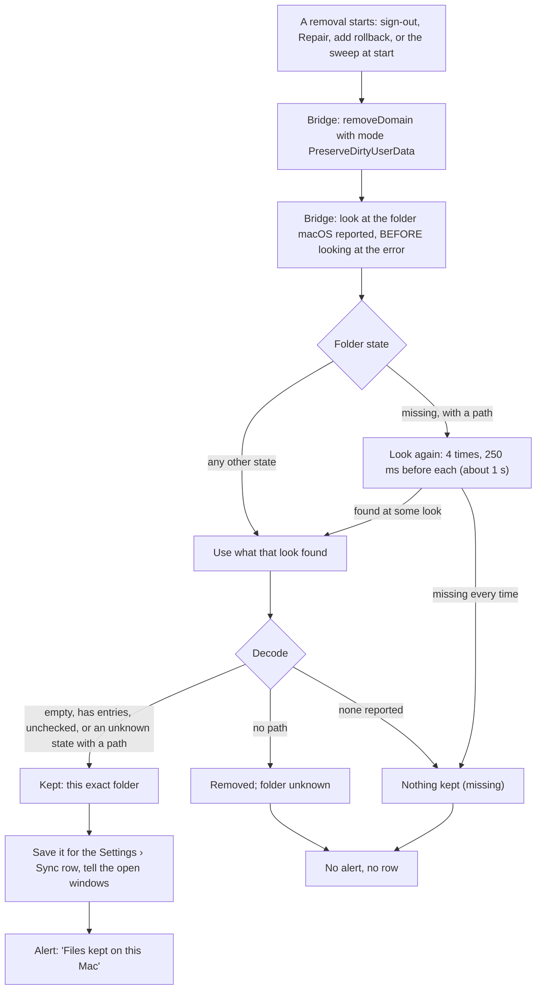

# macOS: removing the Finder location keeps unsynced files, and the kept folders

The native macOS app adds Beebeeb to Finder as a File Provider domain. Sometimes it has to remove that domain:
at sign-out, at Repair, when an Add-to-Finder attempt rolls back, and in the sweep at start that clears stale
domains. A removal can destroy files that never reached the vault. macOS keeps them only when the removal asks it
to, and then it reports a folder where it put them. This note is the carried rule set and acceptance list for
that, and for every other folder the 0.8.x Mac app kept for the person and showed in Settings › Sync.

**Reference implementation:** the shipped tag `desktop-v0.8.25`, under the paths named below (for example
`desktop-v0.8.25:src-tauri/src/finder_removal.rs`). Every test named here exists at that tag with the same name;
the files also exist at `a57b9592` (the commit this note was written from) until the old shell is deleted. Specs:
`docs/specs/2026-10-09-macos-removal-keeps-unsynced-files.md` (the removal) and
`docs/specs/2026-10-10-macos-sign-out-waiting-writes.md` (the sign-out keep step).

**Still running:** the source pins over files that stay in this repo were ported, with the same test names, to
`crates/beebeeb-engine/tests/file_provider_source_pins.rs` (module `domain_removal`). They read
`packaging/macos/FileProviderBridge.m` and `BeebeebFileProviderTools/DomainControlTool.swift`. A test marked
"ported" below runs there on every OS.

Related notes: `file-provider-bridge.md` (the Objective-C bridge and the Rust decode that calls it),
`file-provider-domain.md` (the reconciler that runs Repair and sign-out removals).

## The flow of one removal

## The rules the native macOS app must keep

### 1. Every domain removal keeps unsynced files
- Every `NSFileProviderManager` domain removal, in Objective-C or Swift, passes the preserving mode:
  `NSFileProviderDomainRemovalModePreserveDirtyUserData` (Objective-C) or `.preserveDirtyUserData` (Swift). The mode
  exists from macOS 12; Beebeeb requires macOS 14, so there is no fallback to a plain removal.
- No remove-all call (`removeAllDomains…`) anywhere: it never keeps anything.
- The bridge has ONE removal function, `BeebeebRemoveDomainKeepingUnsynced(`, used by both exported entry points
  `beebeeb_fp_remove` (sign-out, Repair, rollback) and `beebeeb_fp_remove_domain_by_id` (the sweep): one definition
  plus two calls.
- The repo has exactly two removal sites today: the bridge's one and the developer helper's one
  (`BeebeebFileProviderTools/DomainControlTool.swift`). A new site must pass the mode or the pin goes red.

### 2. What the bridge reports, and in which order
- Reply code: `0` = removed, `-1` = error (with an error message). Any other code is an error too ("an unknown reply
  is an error"). An empty error message becomes "File Provider domain removal failed".
- The bridge looks at the folder macOS reported **before** it looks at the error, and copies its path into the reply
  first, so a reply that carries both an error and a folder reaches the app with the folder's state.
- The folder states (the same numbers in the bridge and in the app's decode; pinned):

| value | name in the bridge | meaning |
|---|---|---|
| 0 | `BeebeebKeptNoneReported` | no folder came back |
| 1 | `BeebeebKeptMissing` | a folder came back, nothing exists there (macOS can report a folder even when it kept nothing) |
| 2 | `BeebeebKeptEmpty` | the folder exists and is empty; kept all the same, macOS may not have filled it yet |
| 3 | `BeebeebKeptHasEntries` | the folder (or one kept file) holds at least one entry |
| 4 | `BeebeebKeptUnchecked` | something may be there, the sandbox refused the look |
| 5 | `BeebeebKeptNoPath` | a URL without a path: the domain is removed, no folder can be named |

### 3. A folder that reads as missing is looked at again
- Only state 1 with a non-blank path is looked at again. Every other state is final, and a missing state with no
  path (or a blank one) is not looked at.
- 4 looks, with a 250 ms wait before each: about one second, paid only by a removal that kept nothing.
- Each look is at the exact reported path. It stops at the first look that finds the folder, whatever it holds, and
  uses what that look found. Missing every time: "nothing kept".
- **There is ONE decode site for a removal, and it settles first.** In `desktop-v0.8.25:src-tauri/src/macos_file_provider.rs`,
  `decode_removal` calls `decode_removal_with(code, kept_state, location_buffer, error_buffer, kept_state_for_path,
  std::thread::sleep)`, which calls `settle_kept_state(kept_state, location, check, wait)` with the bridge's own
  folder check and a real sleep, and only then `removal_from_bridge(...)` with the settled state. Both removal paths
  (sign-out/Repair/rollback through `remove()`, and the sweep through `remove_domain`) go through it. The native
  macOS app's decode must have the same shape: one site, settle, then decide. (The pin of this shape read the old
  Rust file and is not ported; see `test_1882_r3_every_removal_settles_a_missing_folder_before_it_decides` and
  `test_1882_r5_the_settle_pin_passes_on_a_windows_checkout` below. The macOS phase writes its own pin over its own
  decode.)
- The settle blocks for about a second, so no removal (nor the install, whose cleanup is a removal, nor the sweep)
  may run on the main thread or on an async runtime worker: it runs on a blocking pool.

### 4. Decoding the folder state
- 2 with a path: kept, looked inside, empty. 3 with a path: kept, looked inside, not empty. 4 with a path: kept,
  not looked inside.
- An unknown state with a path (for example 9 or -4) is shown as kept, unchecked: a path is never hidden.
- 5, or any state without a non-blank path: "removed; folder unknown". The domain IS removed; it is not a failed
  removal; there is no folder to show.
- 0 or 1: nothing kept. A stale path left in the buffer never turns "nothing kept" into a folder.
- An error reply decodes the folder the same way, and the folder rides with the error.
- Empty versus full is told apart only in the log, never to the person.

### 5. What the person sees, and what the log says
- After a removal that kept files: one alert, title **"Files kept on this Mac"**, body = the sentence
  **"Files that hadn’t reached your vault yet were kept on this Mac, in this folder:"**, a blank line, then the folder.
- Nothing kept, or folder unknown: no alert, no row.
- The title and the sentence name no provider, no platform service and hold no path separator.
- Logs never carry the folder: an info line that files were kept (with `preserved`, `contents_checked`, `empty`), a
  debug line when nothing was kept (`none` or `missing`), a warning when macOS reported kept files without a folder.
  The alert logs that it was shown and that it was closed (debug lines, no path), because macOS draws the alert in
  its own process and a device check needs the app's word for it.

### 6. Sign-out and Repair
- Sign-out: a removal failure is logged and never stops the sign-out. A folder kept with the error still reaches the
  alert. Both ways out of a sign-out (success and failure) raise the alert; every failure after the removal carries
  the folder.
- Repair: returns (removed, kept folder). A failure becomes exactly one warning,
  **"Could not remove Finder File Provider domain: <message>"**, and a folder kept with the error is still returned.
- macOS Repair saves no settings of its own; it saves the row's record (rule 7) without an alert of its own, and its
  result carries the folder to the Sync tab (`preserved_location`, `null` when nothing was kept).
- A Repair whose save fails after the removal returns the save's error and still names the folder once (alert);
  with nothing kept it shows nothing; a Repair whose save works shows no extra alert.

### 7. The Settings › Sync row for the folder macOS kept (`kept_unsynced_folder`)
- The newest kept folder is saved and replaces an older one. The same folder again changes nothing and writes nothing.
- "Dismiss" clears the saved folder only if it is still the one the row showed; a folder kept in the meantime is
  never dismissed unseen. Its answer says whether it cleared the row and which folder is saved now
  (`cleared`, `current`), so a row that showed an older folder shows the newer one instead of vanishing.
- A settings save never clears it; it survives a restart; the key is absent until something was kept.
- Every write is one load-change-save under the config-write lock, so a kept-folder save and a settings save
  running at the same moment both land; a write that changes nothing leaves the file alone and no temp file behind.
- Every save of the row's folder goes through ONE function, which saves and then tells every open window once that
  the folder changed (no path in the event; a window reads the folder itself). A save that failed is logged without
  the path, and the windows are told anyway.
- The 0.8.x shell has no reveal command of its own for this row (only read and dismiss); the reveal rule is the
  keep step's (rule 8) and the conflict copies' (rule 9).

### 8. The sign-out keep step's folder (`kept_unsent_folder`, `kept_unsent_unfinished`)
- The keep step (macOS sign-out) copies changes that were not sent into `Changes not sent` (engine:
  `crates/beebeeb-engine/src/sign_out/kept_names.rs`, `kept_root`, `event_folder_name`; the copy itself:
  `crates/beebeeb-engine/src/sign_out/kept_writer.rs`) and records two keys: the row's folder and the folder added
  to the unfinished list (once; a folder already listed is listed once).
- Both keys are saved in ONE durable write, the keep step's last act: one write, one flush of the file, one rename,
  then a flush of the directory; the file is owner-only (0600). A failure before the rename changes nothing; a
  failure after it returns an error with both keys in the file, and the take-back leaves no key naming the folder
  and puts the older row back. Every other config save stays a plain save (no flush).
- Dismiss clears only the folder the row showed; it leaves the list and the other key alone. The two kept-folder
  keys never touch each other.
- A completed purge clears the unfinished list and nothing else (the row stays).
- "Show in Finder" goes through the system's reveal (never `/usr/bin/open`) and reveals only the saved folder
  (`reveal_target`); anything else, or a folder that is gone, answers
  **"That folder isn’t on this Mac any more. It may have been moved or deleted."** Dismiss forgets, never deletes.

### 9. Copies kept by a conflict decision ("Keep the other", `kept_conflict_copies`)
- On a Mac a parked write's bytes are its staged copy. "Keep the other" first keeps the Mac's bytes in a new event
  folder under `Changes not sent`, under the file's path, and adds the copy to its OWN list in one durable save
  (never the sign-out's one folder slot, never its unfinished list). Any failure removes what it made, and the
  decision changes nothing.
- Settings › Sync lists every kept copy, oldest first, until the person dismisses it. Dismiss forgets the copy from
  the list and never deletes it. "Show in Finder" reveals only a copy the list holds.
- A decision that changed something signals the File Provider (Finder reads the item again; a signal the bridge gate
  does not deliver is owed to the next tick) and tells an open Sync tab to read its rows again.

### 10. 0.8.x data on a Mac at the in-place upgrade
A Mac on 0.8.x may hold all four keys in `desktop.toml`: `kept_unsynced_folder`, `kept_unsent_folder`,
`kept_unsent_unfinished`, `kept_conflict_copies`. The engine's settings type already reads every one of them
(`crates/beebeeb-engine/src/config/types.rs`, the `kept_*` fields). The native macOS app must show each non-empty
one in Settings › Sync and let the person dismiss it (forget, never delete); where a row offers "Show in Finder", it
reveals only that row's saved folder or listed copy. Rules 7–9.

Why a 0.8.x Windows PC holds neither of the first two keys:
- `kept_unsent_folder` (and its list) has one writer, the sign-out keep step (`sign_out/keep.rs`, built only on macOS).
- `kept_unsynced_folder` is written through `record_kept_folder`. Its Windows and Linux route
  (`remember_kept_folder_held`, from Add to Finder's cleanup, its rollback and Repair) records only a folder that a
  File Provider removal reported, and on Windows and Linux every File Provider install and removal answers
  "File Provider is only available on macOS." with nothing kept (`desktop-v0.8.25:src-tauri/src/local_state_purge.rs`,
  `install_file_provider_domain` and `remove_file_provider_domain`). So that route never runs with a folder.

---

## Files and their tests

### `src-tauri/src/finder_removal.rs`
Reference: `desktop-v0.8.25:src-tauri/src/finder_removal.rs`.

What it does: the pure half of the removal, built on every OS so its tests run everywhere: the folder-state numbers,
the settle, the decode into "kept / nothing / unknown", the sentence and the alert, sign-out's and Repair's handling,
the row's record and dismiss, and the source scanner. The FFI calls live in `macos_file_provider.rs`.

Rules: 1–7 above. The constants: `KEPT_MISSING_RECHECKS = 4`, `KEPT_MISSING_RECHECK_INTERVAL = 250 ms`,
`PRESERVED_FILES_TITLE`, `PRESERVED_FILES_SENTENCE` (verbatim in rule 5). `InstallFailure` and
`remember_kept_folder_held` are built only on Windows and Linux (Add to Finder and Repair flows that hold their own
copy of the settings); on macOS there is no install path, so they are not carried.

| test | asserts |
|---|---|
| `test_1882_r3_the_helper_prints_preserved_for_any_existing_folder` | **ported, same name.** The developer helper's `remove()` prints one `preserved: <path>` line for any folder that exists (has entries, empty, unchecked) after the re-checks, says "which is missing" when it is still missing, never calls an empty folder "nothing kept"; its `settledKeptFolder` loops `keptMissingRechecks` times with `Thread.sleep(keptMissingRecheckInterval)` on the same URL; its constants equal 4 and 0.25 s; it looks through the URL's own security scope |
| `test_1882_r5_the_helper_pin_passes_on_a_windows_checkout` | **ported, same name.** The same helper pin passes on the helper's source with CRLF line ends |

### `src-tauri/src/finder_removal/tests/bridge.rs`
Reference: `desktop-v0.8.25:src-tauri/src/finder_removal/tests/bridge.rs`.

What it does: decodes the bridge's reply, and the bounded re-check of a missing folder. Rules 2–4.

| test | asserts |
|---|---|
| `test_1882_bridge_reply_with_a_kept_folder_reports_that_exact_folder` | code 0 with state 3 and a folder decodes to that folder byte for byte, a trailing space included, marked as looked inside |
| `test_1882_bridge_reply_with_nothing_kept_reports_no_folder` | code 0 with state 0 is "nothing kept (none)", even when a stale path is left in the buffer |
| `test_1882_bridge_errors_never_invent_a_folder` | an error reply with state 0 is the plain error with nothing kept, despite a stale path; code -1 with nothing is an error; code 1 (an old reply) and code 7 are errors |
| `test_1882_r2_a_reported_folder_that_is_missing_keeps_nothing` | states 0 and 1 with a folder decode to nothing kept (none / missing) and give no alert and no row; Repair of a missing folder is (removed, no folder) with no warning |
| `test_1882_r2_a_folder_with_an_entry_or_that_cannot_be_checked_is_kept` | state 3 is kept and looked inside; state 4 is kept and not looked inside; both reach sign-out's alert |
| `test_1882_r3_an_existing_empty_folder_is_kept_like_an_unlistable_one` | state 2 with a folder is kept (empty); sign-out raises the alert; Repair reports it with no warning; the same on an error reply; empty and full differ only in the value, not to the person; state 2 without a path is "folder unknown" |
| `test_1882_r3_a_missing_folder_that_appears_within_the_window_is_kept` | missing, missing, then has-entries: the third look keeps it; each look is at the exact path; one 250 ms wait before each look; the files reach the alert; a folder that first appears empty is kept and the looking stops at the first sight |
| `test_1882_r3_a_folder_missing_throughout_is_nothing_kept_after_a_bounded_wait` | a folder missing on every look: exactly 4 looks and 4 waits, totalling between 750 ms and 1.5 s; then nothing kept (missing) and no alert |
| `test_1882_r3_only_a_missing_folder_with_a_path_is_looked_at_again` | states 0, 2, 3, 4, 5 and 9 are final (no look, no wait); state 1 with no path, an empty or a blank path is not looked at |
| `test_1882_r3_every_removal_settles_a_missing_folder_before_it_decides` | **not ported (its subject is the old Rust decode).** In `macos_file_provider.rs` there is one `removal_from_bridge(` call; `decode_removal` passes the bridge's own check and `std::thread::sleep`; `decode_removal_with` settles first and decodes the settled state; `decode_removal(` appears 3 times (definition, `remove()`, the sweep's `remove_domain`). Acceptance item for the macOS phase: rule 3's "one decode site, settle first" |
| `test_1882_r2_a_url_without_a_path_is_removed_with_the_folder_unknown` | state 5, or states 3/4 with no, empty or blank path, decode to "folder unknown"; Repair says removed with no warning and no folder; sign-out shows nothing |
| `test_1882_r2_an_unknown_state_never_hides_a_path` | states 9 and -4 with a path are kept, unchecked; state 9 without a path is "folder unknown" |
| `test_1882_r2_a_reply_with_an_error_and_a_folder_keeps_the_folder` | an error reply with state 3 and a folder keeps the error message and the folder; sign-out's alert gets the folder; Repair returns (not removed, the folder) and one warning "Could not remove Finder File Provider domain: …"; an error with a missing folder is still nothing kept |
| `test_1882_r2_the_bridge_checks_the_folder_before_the_error` | **ported, same name.** In `BeebeebRemoveDomainKeepingUnsynced`, `BeebeebKeptFolderState(found_location)` and `BeebeebCopyString(path, location_buffer…` come before `if (found_error != nil)` |

### `src-tauri/src/finder_removal/tests/saved.rs`
Reference: `desktop-v0.8.25:src-tauri/src/finder_removal/tests/saved.rs`.

What it does: the row's saved folder, the alert text, and where a kept folder goes. Rules 5–7.

| test | asserts |
|---|---|
| `test_1882_r2_the_latest_kept_folder_is_saved_and_replaces_an_older_one` | recording a folder changes the settings; a second folder replaces it; the same folder again reports no change |
| `test_1882_r2_dismissing_clears_only_the_folder_the_row_showed` | dismissing an older folder than the saved one changes nothing; dismissing the saved one clears it; dismissing again changes nothing |
| `test_1882_r2_the_saved_folder_survives_a_settings_save_and_a_restart` | applying a settings object built from defaults keeps the folder; a TOML round trip keeps it; a default settings file has no `kept_unsynced_folder` key |
| `test_1882_r2_the_folder_states_match_the_bridge` | **ported, same name.** The bridge defines `BeebeebKeptNoneReported = 0,` through `BeebeebKeptNoPath = 5,` with the values in rule 2 |
| `test_1882_alert_text_is_the_sentence_a_blank_line_then_the_folder` | the body is the sentence, a blank line, the folder; the title and the sentence are the exact strings in rule 5 |
| `test_1882_r2_nothing_kept_raises_no_alert` | no folder: no alert; a folder: (title, sentence + blank line + folder) |
| `test_1882_the_sentence_names_no_provider_and_holds_no_path` | the title and the sentence contain no provider or platform-service name, no "file provider" wording and no `/` |
| `test_1882_kept_location_returns_the_folder_and_nothing_when_nothing_was_kept` | a kept removal gives its folder; a nothing-kept removal gives none |
| `test_1882_sign_out_carries_a_kept_folder_and_survives_a_failed_removal` | sign-out gets the folder from a kept removal, none from a nothing-kept one, and none (no panic, no stop) from a plain failure |
| `test_1882_repair_carries_a_kept_folder_and_turns_a_failure_into_one_warning` | Repair: (removed, folder) with no warning; (removed, none) with no warning; a failure is (not removed, none) and exactly the warning "Could not remove Finder File Provider domain: busy" |

### `src-tauri/src/finder_removal/tests/writes.rs`
Reference: `desktop-v0.8.25:src-tauri/src/finder_removal/tests/writes.rs`.

What it does: the row's writes share one lock with every settings save; the dismiss answer. Rule 7.

| test | asserts |
|---|---|
| `test_1882_r5_the_sweeps_kept_folder_save_does_not_lose_a_concurrent_settings_save` | while a slow settings update holds the write lock, the kept-folder save waits; afterwards the file holds both the folder and the settings change |
| `test_1889_a_flow_with_its_own_copy_records_the_kept_folder_without_losing_a_concurrent_save` | (Windows/Linux flow, not carried as code; the rule carries) a flow holding an old copy of the settings records the folder onto the file as it is now: the in-flight settings save survives, the copy then holds both; the same folder again writes nothing |
| `test_1889_a_record_whose_write_failed_rides_the_flows_next_write` | (Windows/Linux flow) a record whose write failed is not lost: the flow's own failed write returns the error, and the next write lands the record and the result together; once landed it is not owed again |
| `test_1882_r5_dismissing_the_row_does_not_lose_a_concurrent_settings_save` | a dismiss that waits on a slow settings update clears the row and keeps the settings change |
| `test_1882_r5_the_saved_folder_write_reports_unchanged_and_leaves_the_file_alone` | saving the same folder again reports no change and leaves the file byte for byte; a dismiss of another folder clears nothing and writes nothing; no temp file is left |
| `test_1882_r5_a_dismiss_with_a_stale_path_leaves_the_newer_folder_and_reports_it` | with a newer folder saved, a dismiss of the older one answers (not cleared, the newer folder), keeps the newer folder and writes nothing; a dismiss of the newer one answers (cleared, none); again answers (not cleared, none) |
| `test_1882_r5_the_dismiss_outcome_is_the_json_the_frontend_reads` | (Tauri glue: the old UI's JSON) the answer serializes as `{"cleared": false, "current": "<folder>"}` and `{"cleared": true, "current": null}` |

### `src-tauri/src/finder_removal/tests/pins.rs`
Reference: `desktop-v0.8.25:src-tauri/src/finder_removal/tests/pins.rs`.

What it does: the source pins of rule 1, and proof that the pins read a Windows checkout (CRLF text, `\` paths) the
same as any other. **Ported** to `crates/beebeeb-engine/tests/file_provider_source_pins.rs` (module
`domain_removal`), 7 of 8 tests with the same names; the bridge path is now `packaging/macos/FileProviderBridge.m`.

| test | asserts |
|---|---|
| `test_1882_scanner_flags_objc_removals_without_the_mode` | **ported.** In an Objective-C sample the scanner skips `//` and `/* */` comments and reports 4 sites: a removal without the mode (not preserving), one with the mode on a wrapped line (preserving), one with `RemoveAll` (not), and `removeAllDomains…` (not) |
| `test_1882_scanner_flags_swift_removals_without_the_mode` | **ported.** In a Swift sample: a comment is skipped; `remove(domain)` is not preserving; `mode: .preserveDirtyUserData` is, also split over lines; `.removeAll` and `removeAllDomains` are not |
| `test_1882_every_domain_removal_in_the_repo_keeps_unsynced_files` | **ported.** Every `.m`, `.mm` and `.swift` file in the repo (skipping `target`, `node_modules`, `.git`, `dist`, `graphify-out`, `docs`): exactly 1 site in the bridge and 1 in the helper, at least 2 in all; the bridge's keeping helper appears 3 times (definition + 2 calls) and both exported removals call it; no site lacks the mode |
| `test_1882_r5_the_reader_gives_a_windows_source_the_same_path_and_text` | **ported.** A `\` path and CRLF text read as the `/` path and LF text; a Unix source reads unchanged |
| `test_1882_r5_the_settle_pin_passes_on_a_windows_checkout` | **not ported (its subject is the old Rust decode, deleted with the old shell).** The settle-shape pin of rule 3 passes on `macos_file_provider.rs` with CRLF line ends. Acceptance item: the macOS phase's own decode pin must also read a CRLF checkout |
| `test_1882_r5_the_bridge_pins_pass_on_a_windows_checkout` | **ported.** The folder-before-error pin and the folder-state pin pass on the bridge with CRLF line ends |
| `test_1882_r5_the_repo_scan_passes_on_a_windows_checkout` | **ported.** The repo scan with `\` paths and CRLF text equals the plain scan and passes |
| `test_1882_r5_the_pins_still_fail_a_real_violation_in_the_windows_form` | **ported, one leg fewer.** In the Windows form a real violation still fails each pin for its own reason: the bridge without its folder check fails "the folder is checked"; the helper without its re-check sleep fails "the helper looks again at a missing folder"; a CRLF Swift file with a `\` path and a removal without the mode is named as an offender. The leg over the old Rust decode (a decode that skips the settle) is not ported, for the reason above |

### `src-tauri/src/finder_removal_wiring_tests.rs`
Reference: `desktop-v0.8.25:src-tauri/src/finder_removal_wiring_tests.rs` (line endings differ from `a57b9592`; the
test names are the same).

What it does: source and mock-app pins that every macOS removal path hands the kept folder to the person (alert,
saved row) and that the open windows are told. The mechanics read the old shell's source and its Tauri events; the
rules (6 and 7) carry.

| test | asserts |
|---|---|
| `rebase_i2_a_surfaced_folder_tells_the_windows_after_it_is_saved` | on a mock app: a kept folder is saved, then every window gets `kept-folder-changed` (no payload), then the alert; nothing kept: no save, no event, no alert |
| `rb3_f1_a_repair_that_kept_a_folder_tells_the_windows_once_after_the_row_is_saved` | a Repair that kept a folder emits the event once, after the save, so the Sync tab's own read finds the new folder; the event carries no path |
| `rb3_f1_every_save_of_the_rows_folder_goes_through_the_one_function_that_tells_the_windows` | source census of both trees: the row's folder is saved in exactly one function, which saves then tells the windows; sign-out, the sweep, the reconciler and macOS Repair all go through it; no other writer of the row exists; the Windows/Linux held-copy writer has exactly its three named sites |
| `test_1882_the_repair_result_carries_the_kept_folder_to_the_frontend` | the Repair result serializes `preserved_location` as the folder, and as `null` when nothing was kept |
| `test_1882_the_kept_folder_alert_logs_that_it_was_shown_and_closed` | the alert decision is `kept_folder_alert`; "closed" is logged inside the alert's callback, "shown" after it returns; neither line carries the folder |
| `test_1882_r2_every_removal_path_saves_the_kept_folder_for_the_sync_row` | sign-out (command and menu) and the sweep save then show through one function; the save is one load-change-save under the write lock; Repair on macOS saves the row's record without an alert and through the function that tells the windows; a failed save after a removal still shows the folder; a reconciler removal nobody waits for, and one that finished after its time limit, are surfaced the same way; the row's two commands are registered |
| `test_1882_r2_the_install_cleanup_and_failed_removals_surface_their_folder` | on macOS there is no install path and the reconciler never removes a domain it added; the sweep keeps a folder that came back with an error; the rollback surfaces a folder from a failed removal |
| `test_1882_every_removal_path_surfaces_the_kept_folder` | sign-out's folder rides out of the session clear on every failure after the removal and on both successful returns; both ways out of a sign-out raise the alert; Repair puts the folder in its result; the rollback and the sweep raise the same alert; there is no other removal (macOS: two through the reconciler) |
| `test_1882_r4_no_blocking_file_provider_call_runs_on_the_main_thread_or_a_runtime_worker` | every blocking File Provider call (removal, install, sweep) goes through the blocking pool (or, on macOS, the reconciler's bridge gate); the blocking primitives are called in exactly one place each |

### `src-tauri/src/repair_kept_folder_tests.rs`
Reference: `desktop-v0.8.25:src-tauri/src/repair_kept_folder_tests.rs`.

What it does: Finder Repair after its removal, when the save that follows fails or works. Rule 6.

| test | asserts |
|---|---|
| `test_1882_r3_a_repair_whose_save_fails_after_the_removal_still_names_the_kept_folder` | a save that fails ("No space left on device") returns that error, and the alert naming the kept folder is raised exactly once |
| `test_1882_r3_a_repair_whose_save_fails_with_nothing_kept_shows_nothing` | the same failed save with nothing kept returns the error and raises no alert |
| `test_1882_r3_a_repair_that_saves_shows_no_extra_alert` | a Repair whose save works returns ok and raises no alert (its result carries the folder to the row) |
| `test_1889_the_repairs_result_write_lands_next_to_the_kept_folder_record_that_came_before_it` | while a settings save runs during the removal, the Repair's record is written onto the file first and its result next; the file holds the record, the result and the other save |

### `src-tauri/src/sign_out/kept_record.rs`
Reference: `desktop-v0.8.25:src-tauri/src/sign_out/kept_record.rs`.

What it does: the sign-out keep step's two keys and the conflict copies' list in `desktop.toml`. Rules 8–9. Paths
are never logged. The purge's list clear (`clear_unfinished_at`) returns the step that failed (`read` / `write`),
never the error text, because a read error can quote a line of the file and the list's lines are kept folders'
paths. Built only for macOS use.

| test | asserts |
|---|---|
| `kept_unsent_folder_follows_1882s_rules_and_its_own_key` | a newer folder replaces an older one; the durable write is owner-only (0600); a settings save of one field, or a whole default settings object, does not clear it; the two kept-folder keys never touch each other; dismiss clears only the shown folder and leaves the list and the other key; a stale dismiss answers (not cleared, the current folder) |
| `the_marker_save_is_one_durable_write` | both keys go in one write, one file flush, one rename, then a directory flush; a failure before the rename changes nothing; a failure after it leaves both keys in the file for the take-back, which removes every key naming the folder and restores the older row; a folder already listed is listed once; plain saves make no flush; only the keep step's save picks the durable write, which flushes both and is owner-only |
| `a_completed_purge_clears_the_unfinished_list_and_nothing_else` | after a completed purge the unfinished list is empty and the row's folder stays |

### `src-tauri/src/task_2190_kept_copies_tests.rs`
Reference: `desktop-v0.8.25:src-tauri/src/task_2190_kept_copies_tests.rs`.

What it does: the copies "Keep the other" kept, next to a sign-out's folder. Rule 9.

| test | asserts |
|---|---|
| `task_2190_two_kept_copies_and_a_sign_out_folder_are_all_listed` | two kept copies hold the Mac's bytes; both are listed and revealable; the sign-out's folder is not revealable as a copy but stays saved and revealable as the row's folder; the sign-out prompt names only its own folder; dismissing a copy removes it from the list and leaves the file on disk |
| `task_2190_a_decision_tells_an_open_sync_tab` | (Tauri glue for the mechanism) the decision command tells the windows that the kept rows changed when the decision changed something |

### `src-tauri/src/vault_lock_commands.rs`
Reference: `desktop-v0.8.25:src-tauri/src/vault_lock_commands.rs` (2 lines differ from `a57b9592`, none in the
kept-folder part).

What it does: the old shell's lock and unlock commands (lock now lives in the engine,
`crates/beebeeb-engine/src/app/lock_api.rs`), plus the kept-folder surface carried here. No tests in this file; its
kept-folder behaviour is tested by `finder_removal_wiring_tests.rs`, `finder_removal/tests/*.rs` and
`sign_out/kept_record.rs` above.

The kept-folder parts, each a rule the native macOS app must keep:
- `surface_kept_folder` / `surface_kept_folder_with`: a kept folder from the sweep or a reconciler removal is saved
  for the row first, then the alert. Nothing kept: nothing at all.
- `surface_sign_out_folders`: after a sign-out, ONE alert names the keep step's folder (already recorded by the keep
  step), then the folder macOS kept, which is saved for its row here. Neither path is logged.
- `save_kept_folder_for_row` / `save_kept_folder_for_row_with`: the one place the row's folder is saved; save first,
  then tell the windows (`kept-folder-changed`, no payload), once each. A failed save is logged without the path.
- `kept_unsynced_folder` / `dismiss_kept_unsynced_folder`: read the row's folder; dismiss under the write lock with
  the (`cleared`, `current`) answer (rule 7).
- `kept_unsent_folder` / `dismiss_kept_unsent_folder` / `show_kept_unsent_folder`: the keep step's row: read it;
  dismiss (forget, never delete) and tell the windows; "Show in Finder" through the system's reveal, never
  `/usr/bin/open`, and only for the saved folder (`reveal_target`), else the sentence in rule 8.
- Windows parts (`kept_unknown_files_dir`, files of unknown content kept on Windows) are superseded on Windows and
  not carried here.

**0.8.x data:** on a 0.8.x Mac only macOS code ever writes the two keys these commands read (rule 10 says why). The native macOS app
must show a non-empty `kept_unsynced_folder` and `kept_unsent_folder` once in Settings › Sync and let the person
dismiss each one.

### `src-tauri/src/activity_conflict_commands.rs` (macOS part: copies kept by a conflict decision)
Reference: `desktop-v0.8.25:src-tauri/src/activity_conflict_commands.rs`. The rest of this file is not a macOS
rule and is covered elsewhere.

The macOS parts: `keep_parked_copy` / `keep_parked_copy_at` (macOS only: keep the Mac's bytes first, record durably,
undo on failure), `conflict_copy_reveal_target` (reveal only a listed copy), `kept_conflict_copies`,
`show_kept_conflict_copy`, `dismiss_kept_conflict_copy`, and the signal and the window event after
`resolve_parked_conflict`. Rule 9. Tests: `task_2190_two_kept_copies_and_a_sign_out_folder_are_all_listed`,
`task_2190_a_decision_tells_an_open_sync_tab` (above).
