# macOS: packaging, signing, notarisation and updates (carry note C6)

Every Tauri build goes, on every OS. What the Rune macOS app needs from the Tauri macOS
bundle, its signing and its release scripts is carried here first, so the delete may remove `src-tauri/` and the seven macOS
scripts and `sign-macos-updater-artifact.yml`. This is the macOS phase's packaging and release specification.

- **Reference implementation:** the shipped tag `desktop-v0.8.25`. At the tag the bundle is driven by
  `src-tauri/tauri.conf.json` (`bundle.macOS`), `src-tauri/tauri.macos.conf.json` and `scripts/before-bundle.mjs` (Tauri's
  `beforeBundleCommand`, which on macOS runs `scripts/prepare-macos-provisioning-profiles.sh` then
  `scripts/build-fileprovider-extension.sh`). At v2-native's `a57b9592` the web view is gone (`build` holds only `frontendDist`);
  the bundle blocks are unchanged.
- **Line numbers** are at `a57b9592`. After the delete, read them with `git show a57b9592:<path>`.
- **Kept, not carried:** `scripts/build-fileprovider-extension.sh` stays (re-pointed by the Tauri deletion), and so do the File
  Provider extension sources (`BeebeebFileProvider*/`) and CI's `fileprovider-swift` job. `docs/RELEASING.md` (the hand-run version
  of section 4) is a dated procedure; t-delete classes it.
- **Specs:** `docs/specs/2026-10-25-macos-sandboxed-updater.md`, `docs/specs/2026-10-24-macos-two-surface-app.md` §0 ruling 5.

## 0. Rows carried here

| census row | what | section |
|---|---|---|
| §5 git mv `src-tauri/entitlements.plist` → `packaging/macos/entitlements.plist` | the containing app's entitlements, each named | 1 |
| §5 git mv `src-tauri/icons/icon.icns` → `packaging/macos/icon.icns` | the app icon | 1 |
| §5 `src-tauri/tauri.macos.conf.json` | the macOS windows and the menu-bar icon (and, from `tauri.conf.json`, the bundle values) | 2 |
| §5 `src-tauri/src/update_window.rs` (macOS install path) | a Mac never installs in place | 3 |
| §5 `src-tauri/src/mac_update_tests.rs` | 3 tests | 3, 8 |
| §5 `src-tauri/src/keychain_isolation_tests.rs` | 2 tests | 7, 8 |
| §4 `.github/workflows/sign-macos-updater-artifact.yml` | the updater artefact's signing in CI | 5 |
| §4 macOS local scripts: `scripts/release-macos-local.sh`, `scripts/test-release-macos-local.sh`, `scripts/sign-local-macos-app.sh`, `scripts/macos-release-preflight.sh`, `scripts/prepare-macos-provisioning-profiles.sh`, `scripts/qa-fileprovider.sh`, `scripts/fixtures/release-macos-shim.sh` | their signing, notarisation and provisioning steps | 4, 6, 9 |

The other two moved artefacts (`packaging/macos/tray-template.png`, `packaging/macos/tray-template@2x.png`) are C5's; the bridge
source `packaging/macos/FileProviderBridge.m` is C3's.

## 1. What the containing app is made of

| artefact | where | notes |
|---|---|---|
| entitlements | `packaging/macos/entitlements.plist` | see the table below |
| app icon | `packaging/macos/icon.icns` | the bundle icon |
| menu-bar icon | `packaging/macos/tray-template@2x.png` (and the 1× file) | a template image: macOS tints it (`iconAsTemplate: true`) |
| File Provider extension | `Contents/PlugIns/BeebeebFileProvider.appex` | built by `scripts/build-fileprovider-extension.sh`; bundle id `io.beebeeb.app.FileProvider`; its own entitlements in `BeebeebFileProvider/BeebeebFileProvider.entitlements` |
| extension control helper | `Contents/MacOS/BeebeebFileProviderCtl` | built by the same script |
| provisioning profile | `Contents/embedded.provisionprofile` (the app) and `…/BeebeebFileProvider.appex/Contents/embedded.provisionprofile` | section 6 |

Entitlements of the containing app (every key in the moved file):

| key | why |
|---|---|
| `com.apple.security.app-sandbox` | the containing-app shape macOS requires for a File Provider extension |
| `com.apple.security.application-groups` | the App Group shared with the extension: `<team id>.io.beebeeb.app.fileprovider` (the exact value is in the moved file); the engine's IPC socket lives in it (`crates/beebeeb-engine/src/ipc_socket.rs:15`) |
| `com.apple.security.files.user-selected.read-write` | the folder picker (user-approved sync and cache folders) |
| `com.apple.security.network.client` | the API, sync and update checks |
| `com.apple.security.network.server` | the local socket between the app and the extension, where macOS applies network policy |

## 2. The bundle values

From `src-tauri/tauri.macos.conf.json` (the census row) and `src-tauri/tauri.conf.json` (`identifier`, `bundle`), which goes with it:

| value | 0.8.x |
|---|---|
| bundle identifier | `io.beebeeb.app` (the extension: `io.beebeeb.app.FileProvider`) |
| product name | Beebeeb |
| category | Productivity |
| minimum macOS | 14.0 |
| architecture | Apple Silicon only (`aarch64-apple-darwin`); the manifest key is `darwin-aarch64` |
| embedded files | `embedded.provisionprofile` ← the app's profile; `PlugIns/BeebeebFileProvider.appex` and `MacOS/BeebeebFileProviderCtl` ← the extension build's output |
| signing identity in the repo | none (`null`): supplied at sign time by `APPLE_SIGNING_IDENTITY` |
| frameworks / ATS exception | none / none |
| Beebeeb window (`main`) | 920 × 620, minimum 760 × 520, resizable, not full screen, created hidden and placed by the app (C5 §5), decorations on, overlay title bar with a hidden title |
| popover | 372 × 488, not resizable, no decorations, not transparent, always on top, skips the task switcher, visible on all workspaces, created hidden |
| menu-bar icon | the template image above, no menu on a left click (the click toggles the popover) |

## 3. Updates on a Mac

1. **Never in place** (task 2176): the App Sandbox denies replacing the running bundle, so an in-place install can only fail after the
   download. A Mac is offered a download instead (two-surface spec §0 ruling 5). Both install commands refuse first, before they touch
   the updater, with `update_install_unsupported: Beebeeb on a Mac downloads updates and cannot install them in place.`
   (`in_app_install_refusal`, `src-tauri/src/update_window.rs:468`); a caller tells a refusal from a failure by the code. Only those
   two commands install; the update loop never downloads, it only announces (`update-available`).
2. **One install at a time** and the rest of the install machine moved to `crates/beebeeb-updater` (`machine.rs`, with tests);
   channel choice, downgrade hold, signature check and stop-the-engine-before-install are there too (T0, `update_window.rs` row).
3. **The relaunch flag** the updater leaves before a restart is C5 §7.
4. **The macOS updater artefact** (0.8.x): `Beebeeb.app.tar.gz`, a single top-level `Beebeeb.app`, recreated from the STAPLED app with
   `COPYFILE_DISABLE=1` (no AppleDouble files), signed with the updater key in CI (section 5); its signature is the `darwin-aarch64`
   entry of the channel manifest (`alpha.json`, `beta.json`, `latest.json` for stable). How the native 0.9.0 updater serves a Mac is
   the macOS phase's to decide; the rules above are the floor.

## 4. The release procedure (from `scripts/release-macos-local.sh`, 13 steps)

macOS is never built in CI: the Developer ID signing key never leaves the keychain of the Mac the release runs on. The script is
fail closed: every gate that can say no runs before the first upload, and nothing is published unless the notarised, stapled
artefacts were verified. Usage: `release-macos-local.sh <VERSION> <CHANNEL> [--dry-run] [--from-step N] [--skip-local-sig-check]`;
VERSION is plain semver; CHANNEL is `alpha`, `beta` or `stable`; step 1 always runs; a resume past step 2 needs the artefacts built
from HEAD (a recorded build stamp).

Configuration, by name only (no value lives in the repo except defaults that are not secret): `APPLE_SIGNING_IDENTITY` (the Developer
ID Application identity), `MACOS_APP_PROVISION_PROFILE`, `MACOS_FILE_PROVIDER_PROVISION_PROFILE`, `BB_NOTARY_KEY_ID`,
`BB_NOTARY_ISSUER`, `BB_NOTARY_KEY_PATH` (the App Store Connect API key), `BB_NOTARY_TIMEOUT` (45 min per submission),
`BB_MINISIGN`, `BB_UPDATER_VERIFY_PUBKEY` (only for a key-rotation transition release), `BB_RELEASE_REPO`, `BB_RELEASES_REPO`,
`BB_WORKFLOW_REF`, `BB_POLL_INTERVAL`, `BB_WORKFLOW_TIMEOUT`.

```mermaid
flowchart TD
  S1["Step 1: Release state: tools, Apple Silicon, clean tree, HEAD = tag commit, CI release exists, notes and blockers, identity, notary key, minisign"] --> S2["Step 2: Build the .app only, hardened runtime, version patched for the build only, updater artefacts off, updater key stripped from the env"]
  S2 --> S3["Step 3: Preflight the unnotarised .app (spctl execute skipped)"]
  S3 --> S4["Step 4: Notarise the .app (zip, notarytool submit --wait; Accepted or fetch the log and stop)"]
  S4 --> S5["Step 5: Staple the .app; codesign verify deep strict; full preflight"]
  S5 --> S6["Step 6: Rebuild the .dmg from the stapled app (hdiutil UDZO, /Applications link); sign it with a timestamp; verify"]
  S6 --> S7["Step 7: Notarise the .dmg; the mounted app is stapled and carries VERSION"]
  S7 --> S8["Step 8: Staple the .dmg; full preflight (hdiutil verify, spctl install)"]
  S8 --> S9["Step 9: Recreate Beebeeb.app.tar.gz from the stapled app; the app inside is stapled"]
  S9 --> S10["Step 10: Upload .dmg + tarball to the GitHub release (clobber), read both back"]
  S10 --> S11["Step 11: Dispatch sign-macos-updater-artifact; wait on OUR run; download the .sig; minisign-verify it against the tarball"]
  S11 --> S12["Step 12: Dispatch release.yml publish_existing to backfill the channel manifest"]
  S12 --> S13["Step 13: Assert the manifest: version, darwin-aarch64 url = this tag, signature = the uploaded .sig, Windows/Linux entries on this tag"]
```

Step details that are rules, not plumbing:
1. **Step 1 refuses** when a tool is missing (`git gh jq bun bunx xcrun codesign spctl hdiutil ditto plutil security tar`, and
   minisign unless `--skip-local-sig-check`), off Apple Silicon, on a dirty tree, when HEAD is not the tag's commit, when the tag is
   not on origin, when `RELEASE_NOTES.md` does not name the version, carries a `<!-- lead:` marker or lacks real test counts
   (`<N> pass / 0 fail`, `test result: ok. <N> passed`; zero or a literal `N` is refused), when `RELEASE_BLOCKERS.md` lists an item
   (a `[macOS]`-scoped one too), when the CI release does not exist yet, when the signing identity is not in the keychain, or when
   the notary key file is missing. A malformed `BB_UPDATER_VERIFY_PUBKEY` is refused up front.
2. **Step 2** builds with `--bundles app` (Tauri's own dmg drove Finder over AppleScript and failed with -10006; step 6 builds the
   dmg with `hdiutil`) and `createUpdaterArtifacts: false` as a CLI override (the updater key is a CI-only secret; step 9 recreates
   the tarball). The Apple notarisation and updater-signing variables are unset for the build, so the updater private key can never
   reach it. The version patch is restored after the build and the tree must be clean again; a failed build leaves no stamp and no
   stale app.
3. **Notarisation** uses `xcrun notarytool submit --wait` with the API key; anything but `Accepted` fetches `notarytool log` and stops.
4. **spctl must say "Notarized Developer ID"**, not merely accept.
5. **Step 11** waits on its own workflow run (by the run URL `gh` prints; with no URL, exactly one new run, else refuse rather than
   guess); a run that succeeds without attaching the `.sig` is a failure; the signature must verify with minisign against the key
   baked into the release (or the transition key).
6. **Step 13** is a consistency check (the manifest's signature string equals the uploaded `.sig`); only step 11 proves the signature
   verifies the tarball.

## 5. The updater artefact's signature (`.github/workflows/sign-macos-updater-artifact.yml`)

The one step that needs the updater signing key, which exists only as a CI secret: sign an already built, notarised macOS updater
artefact a person uploaded to an existing release, and upload the `.sig` back. It builds nothing and touches no Developer ID material.
- Trigger: `workflow_dispatch` with `release_tag`. Permissions: `contents: write`. Runs on Linux, in the `desktop-release`
  environment (its rules, a required reviewer and release branches only, decide who can sign: task 2451).
- Steps: download `Beebeeb.app.tar.gz` from the release; install the signer in a step that holds no key (pinned
  `@tauri-apps/cli@2.11.4`); sign with `TAURI_SIGNING_PRIVATE_KEY` / `TAURI_SIGNING_PRIVATE_KEY_PASSWORD` passed only as environment
  variables (nothing secret on a command line); require the `.sig`; upload it with `--clobber`.
- Then `release.yml` with `publish_existing=true` emits the `darwin-aarch64` manifest entry only when that `.sig` exists.
- The macOS phase replaces the Tauri signer with the native updater's own signing (the 0.8 key's public half moves to
  `keys/updater-0.8.pub` with t-prep); the rules above (key only in CI, environment-gated, nothing on argv, sign only what was
  notarised and uploaded) stay.

## 6. Signing order and provisioning

1. **Provisioning** (`scripts/prepare-macos-provisioning-profiles.sh`, run by `before-bundle.mjs` before Tauri signs): the app's and
   the extension's profiles come from `MACOS_APP_PROVISION_PROFILE` / `MACOS_FILE_PROVIDER_PROVISION_PROFILE` (a path) or their
   `…_BASE64` twins; with neither, an empty placeholder lets a local UI bundle assemble, and the preflight rejects it.
2. **Local signing, inside out** (`scripts/sign-local-macos-app.sh`): copy each profile into its bundle; sign the extension with its
   own entitlements, then the helper, then the app with the app's entitlements; verify the extension and the helper strictly and the
   app deeply. With no `APPLE_SIGNING_IDENTITY` it signs ad hoc, for local bundle checks only. The extension and the helper must exist
   in the bundle first.
3. **A release signs with the hardened runtime** (`BEEBEEB_MACOS_HARDENED_RUNTIME=1`, read by the extension build) and a timestamp; a
   Developer ID binary without the runtime flag is rejected by notarisation.

## 7. Trust checks (from `scripts/macos-release-preflight.sh`)

1. **Profiles:** each bundle's `embedded.provisionprofile` exists and decodes (`security cms -D`); its application identifier ends
   with the bundle id; its app groups hold the App Group (or the team-prefixed form); its platform is macOS.
2. **The extension's entry point** (task 1524 issue 5, a P0 crash on macOS 26): no `BeebeebFileProvider/main.swift`; no Swift file
   names `NSExtensionMain`; the extension binary defines no `_main` of its own, imports `_NSExtensionMain` from Foundation, and its
   `LC_MAIN` entry offset points at that stub (the linker's `-e _NSExtensionMain`, as Xcode sets for every extension).
3. **Files lint:** the app entitlements and the extension's `Info.plist` pass `plutil -lint`.
4. **Config:** the bundle identifier is `io.beebeeb.app`, the entitlements file is the one named, updater artefacts are on, the updater
   public key is present; the release workflow parses and names its two updater-signing secrets.
5. **Identity:** a Developer ID Application identity is in the keychain.
6. **A `.dmg`:** `hdiutil verify` and `spctl --assess --type install`. **A `.app`:** strict `codesign --verify` of the extension, the
   helper and the app (deep), their entitlements printed, `TeamIdentifier` set, the hardened runtime flag (`flags=0x10000(runtime)`)
   on every Developer ID binary, and `spctl --assess --type execute` (skipped only for the unnotarised app of step 3).
7. **Keychain isolation in tests** (`src-tauri/src/keychain_isolation_tests.rs`): no library test resolves the real macOS Keychain
   store, and only the keychain module names it. The engine holds the compile-time half: the real store does not exist in a macOS test
   build (`crates/beebeeb-engine/src/keychain.rs:75-78`, `TestKeychainStore` takes its place).

**The File Provider QA harness** (`scripts/qa-fileprovider.sh`, task 1699): one local health report, green on a healthy Mac even before
the app is installed: (1) `pluginkit -m -p com.apple.fileprovider-nonui` lists our extension; (2) `fileproviderctl dump` shows our
domain(s); (3) `fileproviderctl evaluate <mount>` accepts our items; (4) `fileproviderctl diagnose` produced dump logs for a Beebeeb
domain (its exit code is reported, never gating: any provider on the machine can make it non-zero); (5) `BeebeebFileProviderCtl
status`, if built. SKIPs (no mount, no helper) do not fail; it never uses the irreversible `testingModes` entitlement. Overrides:
`FPCTL`, `PLUGINKIT`, `FP_BUNDLE_ID`, `FP_DOMAIN_MOUNT`, `FP_CTL`.

## 8. Acceptance list: every test of the carried Rust files

### 8.1 `src-tauri/src/mac_update_tests.rs` (3)
- `a_mac_refuses_an_in_place_install_with_a_typed_error_and_nothing_else_does`: on a Mac the refusal leads with `update_install_unsupported:` and says it downloads updates; Windows and Linux are not refused.
- `both_install_commands_refuse_before_they_touch_the_updater`: in each install command the refusal comes before the updater is built.
- `only_those_two_commands_install_an_update`: exactly two `download_and_install` call sites; the update loop only emits `update-available`.

### 8.2 `src-tauri/src/keychain_isolation_tests.rs` (2)
- `no_lib_test_can_resolve_the_real_macos_keychain_store`: every store constructor resolves to the in-memory test store in a test build, never the real Keychain store.
- `the_real_store_is_named_nowhere_but_keychain_rs_and_every_vault_uses_the_two_constructors`: no file but the keychain module names the real store or its FFI module, and every vault is built from one of the two constructors.

## 9. Acceptance list for a future macOS release script (`scripts/test-release-macos-local.sh`, 163 checks in 52 scenarios)

The test runs the whole release on Linux against `scripts/fixtures/release-macos-shim.sh`, one stand-in linked under the tool names
(`xcrun codesign spctl hdiutil ditto plutil gh bunx bun security uname minisign git tar base64`). The shim models only the ordering
and trust rules the script relies on: stapling needs a prior Accepted notarisation of THAT artefact; spctl accepts only a notarised
artefact; `codesign --verify` on a dmg needs a timestamped signature; a dmg records whether its source app was stapled; only the sign
workflow creates the updater `.sig`, and the manifest backfill emits `darwin-aarch64` only when it exists; macOS `base64` decodes
with `-D` only. A guard scenario proves the shim itself can go red. The scenarios (one line each), which a native release script
must pass again:

- full run with shims: happy path, order, artefact contents
- resume with `--from-step 12`
- stable channel targets `latest.json`
- `--dry-run` runs nothing
- argument validation
- notarytool says Invalid for the app (step 4)
- notarytool says Invalid for the dmg (step 7)
- spctl rejects the stapled app (step 5)
- spctl rejects the dmg (step 8)
- spctl accepts but not as Notarized Developer ID (step 5)
- version mismatch: the version patch did not reach the build (step 3)
- the tag points at another commit than HEAD (step 1)
- the tag does not exist on origin (step 1)
- dirty working tree (step 1)
- unresolved lead markers in `RELEASE_NOTES.md` (step 1)
- `RELEASE_NOTES.md` does not mention the version (step 1)
- `RELEASE_BLOCKERS.md` lists an item (step 1)
- `RELEASE_BLOCKERS.md` lists a `[macOS]`-scoped item (step 1)
- the release-blockers check exits with an unexpected code (step 1)
- no `RELEASE_BLOCKERS.md` at all lets the release through
- the CI release does not exist yet (step 1)
- signing identity not in the keychain (step 1)
- notary key file missing (step 1)
- the build fails; tracked files are restored (step 2)
- the app signature is missing (step 5)
- the rebuilt dmg carries no signature (step 6)
- the preflight fails (step 3)
- the upload is corrupted in transit (step 10)
- the signing workflow fails (step 11)
- another dispatch of the same workflow is in flight and fails; the script waits on its own run (steps 11, 12)
- `gh` prints no run URL and two runs are candidates: refuse, do not guess (step 11)
- `gh` prints no run URL and exactly one new run exists: that one is ours
- the decoder on the Mac only knows `-D`; step 11 still verifies the signature
- the signing run succeeds but no `.sig` is on the release (step 11)
- the signature does not verify against the baked public key (step 11)
- the manifest workflow fails (step 12)
- the manifest is stale after publishing (step 13)
- the manifest points `darwin-aarch64` at another tag (step 13)
- the model of the Tauri build is honest (the shim itself can go red)
- Finder automation is denied (-10006) and the release does not care
- an updater signing key in the operator's shell never reaches the build
- the tag was re-cut after a failed run; `--from-step N` must not reuse the old commit's artefacts (step 1)
- the build-commit stamp is missing on a resume (step 1)
- a failed rebuild leaves no stamp and no stale app behind (step 2)
- `RELEASE_NOTES.md` has no lead marker but its Verification counts were never filled in (step 1)
- only one of the two counts is filled in (step 1)
- the Verification counts are zero (step 1)
- minisign is required up front (step 1)
- `--skip-local-sig-check` is the explicit opt-out from the minisign requirement
- `BB_UPDATER_VERIFY_PUBKEY` overrides the key for a transition release (step 11)
- a malformed `BB_UPDATER_VERIFY_PUBKEY` is refused up front (step 1)
- hygiene

## 10. For the delete: what still names the moved paths

These readers of the old paths are outside this slice; each goes with the delete or is re-pointed there (t-delete's list):
`src-tauri/tauri.conf.json:87` (`icons/icon.icns`), `:111` (`entitlements.plist`); `src-tauri/tauri.macos.conf.json:39`
(`icons/tray-template@2x.png`); `scripts/macos-release-preflight.sh:125`, `:138`; `scripts/sign-local-macos-app.sh:13`;
`RELEASE.md:146`; `crates/beebeeb-engine/src/ipc_socket.rs:15` (→ `packaging/macos/entitlements.plist`, t-delete item 2);
`BeebeebFileProvider/XPCBridge.swift:126` (a comment). Until the delete merges, the Tauri macOS bundle and its suite cannot find the
moved icon, menu-bar icon and entitlements; no 0.9.0 build reads them (2537).
