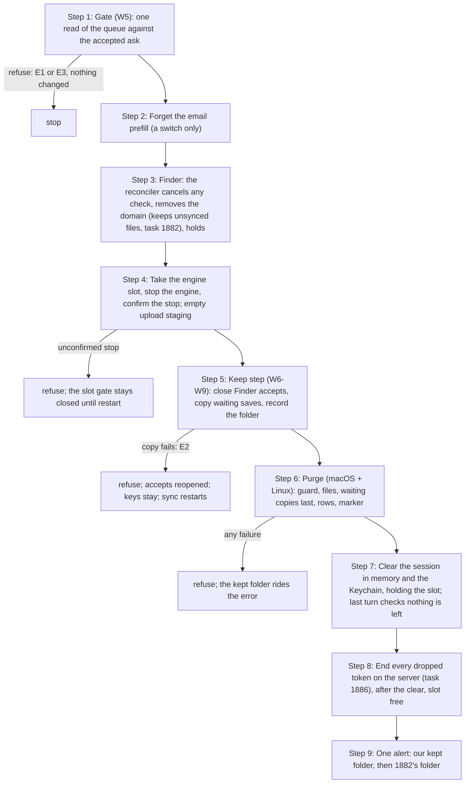

# macOS: sign-out, lock and the engine start (carry note C4)

Tauri leaves every OS, and 0.9.0 ships the Rune macOS app. A macOS rule whose only copy
lives in `src-tauri/` is carried as a design note before the delete. This note is the macOS phase's specification and acceptance
list for the sign-out, the lock and the engine start on a Mac. It states each rule in words, names the source lines, and lists
every test of the carried files with what it asserts.

- **Reference implementation:** the shipped tag `desktop-v0.8.25`, same paths unless a row says otherwise. Two test files were
  split after the tag: `src-tauri/src/sign_out_keep_tests/part_{1..4}.rs` is `src-tauri/src/sign_out_keep_tests.rs` at the tag (81
  tests, the same names), and `src-tauri/src/account_binding_tests/part_2.rs` is part of `src-tauri/src/account_binding_tests.rs`.
- **Line numbers** are at `a57b9592` (v2-native, the delete batch's base), where every path below still exists. After the delete,
  read them with `git show a57b9592:<path>`.
- **Already in the engine** (the note points at them, it does not restate them): `crates/beebeeb-engine/src/sign_out/`
  (`flow_window`, `kept_names`, `kept_set`, `kept_writer`, `send_phase`, `snapshot`, `waiting`), the queue and purge statements in
  `crates/beebeeb-engine/src/state_db/signout.rs` (`unkept_waiting_changes` :338, `clear_account_data` :698,
  `reopen_finder_accepts` :787, `close_finder_accepts` :798, `local_state_file_paths` :817, `purge_all_local_state` :868),
  `state_db/ops.rs` (`make_due_for_send_phase` :168, `resume_operations_paused_for_auth` :206,
  `hold_operations_paused_for_auth_as_key_replaced` :223) and `crates/beebeeb-engine/src/local_state.rs`
  (`is_disposable_cache_path` :133, `disposable_cache_roots_in`).
- **Specs** (dated records, they stay): `docs/specs/2026-10-10-macos-sign-out-waiting-writes.md` (task 1887: W1–W13, U1–U46, §5–§15),
  `docs/specs/2026-10-06-macos-finder-setup-reconciler.md` (R8, R10, §5.3, §5.6), `docs/specs/2026-10-09-macos-removal-keeps-unsynced-files.md`
  (task 1882).
- **Sibling notes:** the Finder reconciler, the domain removal that keeps unsynced files (task 1882) and the kept-folder record
  (`kept_unsent_folder`, `kept_unsynced_folder`, `kept_unsent_unfinished`) are C1–C3 (`file-provider-domain.md`,
  `file-provider-removal-and-kept-folders.md`, `file-provider-bridge.md`); the menu bar and windows are C5
  (`menu-bar-and-windows.md`); packaging, signing and updates are C6 (`packaging-signing-update.md`).

## 0. Rows carried here

| census row | what this note carries | section |
|---|---|---|
| §5 `src-tauri/src/sign_out_commands.rs` | the macOS sign-out order (`clear_session_impl` :9), the gate, the keep step, the purge, the send phase | 1, 2, 3, 5 |
| §5 `src-tauri/src/sign_out/keep.rs` | the keep step (W6–W9, W13) | 2, 9.2 |
| §5 `src-tauri/src/sign_out/copy.rs` | the task 1887 strings, verbatim | 4, 9.1 |
| §5 `src-tauri/src/local_state_purge.rs` | the purge of a macOS sign-out and of the R10 reset (task 1538, R5, W13) | 3 |
| §5 `src-tauri/src/sign_out_keep_tests/part_1.rs` | 10 tests | 9.3 |
| §5 `src-tauri/src/sign_out_keep_tests/part_2.rs` | 24 tests | 9.4 |
| §5 `src-tauri/src/sign_out_keep_tests/part_3.rs` | 22 tests (the census and T0 say 23; the base and the tag both hold 22 in this part, 81 in all) | 9.5 |
| §5 `src-tauri/src/sign_out_keep_tests/part_4.rs` | 25 tests | 9.6 |
| §5 `src-tauri/src/finder_lock_and_sign_out_tests.rs` | the lock and sign-out against the reconciler, the startup restore and naming races (50 tests) | 6, 9.7 |
| §1 row 6 `src-tauri/src/bound_engine.rs` (macOS part) | the Finder removal debt at an engine start, the R10 reset's kept folder (`hand_on_reset_kept`), the resume of edits paused for `auth`, the `key_replaced` hold | 7 |
| §1 row 53 `src-tauri/src/tests.rs` (7 purge tests) | the purge's deletion rules | 3, 9.9 |
| §1 row 67 `src-tauri/src/signout_teardown_tests.rs` (7 macOS tests) | upload staging is emptied only after a confirmed engine stop | 3, 9.8 |
| `src-tauri/src/account_binding_tests/part_2.rs` (purge and removal debt, 9 tests) | the R10 reset's purge, the sign-out purge, the Finder removal debt | 3, 7, 9.10 |
| lead 23:00, F2 (ruling (a)) | one account at a time on macOS too; R8's settlement is not carried as behaviour | 8 |
| lead 23:00, F4 | nothing resumes edits paused for `auth` on macOS once the shell is gone | 7.3, 10 |

Left to other slices (named, so nothing falls between): the other 9 tests of `signout_teardown_tests.rs` (t-session-start, §1 row 67);
the other 37 tests of `src-tauri/src/tests.rs` (t-port-keys for the recovery-phrase and disposable-root tests; C1 for the 10 Finder
install-error tests and the 2 hydrate-cache tests; C5 for the 3 macOS window tests; the notification and updater tests are pinned
elsewhere, §1 rows 15 and 53); the other 17 tests of `account_binding_tests/part_2.rs` (t-session-start, §1 row 56).

## 1. A sign-out by choice on a Mac: the order

`clear_session_impl` (`src-tauri/src/sign_out_commands.rs:9`) runs these steps in this order. Each step that can refuse changes
nothing before it refuses, except where the row says what it leaves.

1. **The gate first (W5).** `gate_sign_out` (`sign_out_commands.rs:945`) reads the queue once and compares it with the snapshot the
   window's ask recorded (`keepUnsent: { askId }`). A queue it cannot read is E3; changes that are not in the accepted snapshot are E1.
   Either refusal changes nothing: no Finder removal, no engine stop, the keys stay in memory.
2. **A switch forgets the email prefill first** (`forget_email`), before anything is torn down, and never saves it again. A plain
   sign-out saves the session's email for the next sign-in's prefill before any credential is erased (`signout_email_to_preserve`).
3. **Finder goes first.** The reconciler cancels any check and holds, so no check can start an engine after the stop
   (`finder_remove_for`, `src-tauri/src/bound_engine.rs:904`). A removal it cannot confirm does not stop the sign-out: the result
   carries the `finder_removal_unconfirmed` warning (FB-24). From here on every failure carries the folder macOS kept
   (`preserved_location`, review I1). `FinderRestoreOnAbort` (`bound_engine.rs:929`) puts Finder back if the sign-out stops short
   with the keys still in memory (ruling T3-⚠2).
4. **The engine stop gates everything that deletes.** `take_slot_and_stop_engine_for_sign_out` / `stop_engine_for_sign_out`
   (`sign_out_commands.rs:432`, `:461`): refuse while an earlier stop was never confirmed (`engine_stop_unconfirmed`, Bug A2);
   refuse when this stop cannot be confirmed (and set the flag). Only after a confirmed stop is upload staging emptied. The slot is
   held until the session is cleared, so a start waiting on it finds no keys (ruling T8-⚠lock 2). An already-signed-out sign-out
   still takes the slot and stops any engine it finds (Task 12 fix round 2, item 1).
5. **The keep step** (section 2) runs after the confirmed stop and before the purge. Nothing between the stop and the purge
   deletes a file, writes the queue, clears a session or starts an engine (U10).
6. **The purge** (section 3). A refusal of its guard is returned as it is (`unsent_copy_failed: …`) so the caller matches the code.
7. **The session clear** holds the engine slot (`clear_session_holding_slot`), then drops the cached profile, the storage summary,
   any pending 2FA challenge and the auth-health streak; the Keychain clear and its check run in the sign-out's last turn
   (`finish_sign_out_turn`, `src-tauri/src/session_state.rs:442`), which moves the session generation on. Any item of the account
   left in the Keychain (token, vault key or email) is a sign-out that has not finished.
8. **The server hears it last** (task 1886): every token this sign-out took off the computer is ended on the server after the local
   clear, with the slot released, best effort and bounded, never logged (`end_dropped_sessions`, `src-tauri/src/session_apply.rs:452`).
   The engine holds this rule for every OS (`crates/beebeeb-engine/src/app.rs:1022`, `sign_out_holding_step`).
9. **One alert** (§9): our kept folder first (K1, a blank line, the path), then a blank line and 1882's body verbatim; macOS's folder
   alone gives 1882's body byte for byte; neither gives no alert. The result is `Completed` (or `NotSignedIn` when nothing was
   signed in) with the warning, the macOS folder and our folder.

**Open for the macOS phase (deferred to it).** The ruling on question Q1 (2026-11-12: a sign-out keeps the local data) is
written for Windows, and the engine's `sign_out_keeping_local_data` (`crates/beebeeb-engine/src/app.rs:1005`) is what Windows runs.
Whether the Rune macOS sign-out keeps local data too, or keeps the 0.8.x keep-then-purge above, is decided at the macOS phase.
This note records the 0.8.x rules either way. Under Q1 on macOS, steps 5 and 6 (and the strings of section 4) fall away; the gate,
the Finder removal, the confirmed stop, the slot order, the Keychain check and the server revoke stay.

## 2. The keep step (spec 2026-10-10 W6–W9, W12, W13)

`keep_unsent` / `keep_after_close` (`src-tauri/src/sign_out/keep.rs:58`, `:79`); its app inputs in `keep_in` and
`keep_for_sign_out` (`sign_out_commands.rs:992`, `:1035`).

1. **Close Finder accepts first** (§15 question 3), in one IMMEDIATE transaction, so an accept already running commits first and
   the read below sees it; every later accept is refused. A keep that stops for any reason reopens accepts at once: nothing will be
   purged. A close that fails stops the keep before its read (E2, category `close_accepts`).
2. **One read** of the waiting changes (`WaitingChanges::read`). A read that fails is E3.
3. **Refuse before any copy:** an other change (rename, move, deletion, new folder, restore) the person was not asked about is E1
   (W6); a write whose staged copy is missing and that nobody was shown is E2 (W7, `missing_not_shown`).
4. **Copy the copied set** into a new event folder under the container's `Documents/Changes not sent` (`sign_out_kept_root`,
   `sign_out_commands.rs:966`; the name from `kept_names::event_folder_name`). Per file, newest copied write first: the newest gets
   the plain name, then `(earlier save 1)`, `(earlier save 2)` … (`kept_relative_path`). A covered write (a minted earlier save) is
   never copied. Completed uploads are never copied. A 0-byte save is kept as an empty file. The name is the row's path at the keep
   step, never an op's `target_path`.
5. **Flush, then record as the last act** (W9, W13): `save_kept_unsent_durably` writes the record; a record that cannot be saved
   takes the key back and removes the folder (§7.3). A failure before the record removes the half-made folder (W8). The keep step
   never deletes a queue row or a staged copy.
6. **Logs carry counts only** (W10): `files`, `kept`, `covered`, `missing`; never a path or a name. A failed copy logs its category
   (`source_gone`, `permission`, `disk_full`, `io`, `record`), never a path, in the caller's own line: a sign-out's or an R10
   reset's (W12).
7. **The R10 reset keeps too** (W12): before an engine start resets another account's data, it keeps every waiting write, asking
   nobody (it acknowledges every missing write and other change), and the purge then runs with the guard. A failed keep fails the
   reset and deletes nothing.

## 3. The purge (macOS and Linux sign-out, and the R10 reset)

`purge_local_data_for_sign_out` (`sign_out_commands.rs:554`) and `purge_local_state_files_with`
(`src-tauri/src/local_state_purge.rs:482`).

1. **The database is resolved from the state dir alone** (`state_db_from_state_dir`, `local_state_purge.rs:278`), never from
   `desktop.toml`, so a broken config cannot skip the purge (task 1538 Codex P1). No `state.db` yet is a fresh install: nothing to
   purge. Any other failure to open stops the sign-out.
2. **Given a `KeptSet` (macOS), the guard is the first statement:** one read (`unkept_waiting_changes`); any waiting change not kept
   or acknowledged refuses with E2's code before any path is collected or deleted. Without a `KeptSet` there is no guard and no copy is
   held back.
3. **Files first, rows last:** every file the rows point at plus every orphan in the staging directories this user owns, each behind
   `is_disposable_cache_path` (a path outside the known roots is refused, never deleted). A missing file is fine; any other removal
   failure stops the purge and clears no row, so a retry finds everything (F4 of Task 10).
4. **The waiting writes' staged copies go last,** one at a time, after every other file, so a failure elsewhere leaves every waiting
   write as it was (W13).
5. **Staging directories are entered only when this user owns them** and their parent (`is_owned_staging_dir`,
   `local_state_purge.rs:421`; R5): on a shared `/tmp`, another user's `beebeeb/finder-writes` is neither read nor a reason to fail.
   Symlinks are never followed (`files_under`).
6. **Then the rows:** `purge_all_local_state`, then the unfinished sign-out marker is cleared (W13, best effort; its warning names the
   step, never the error), then `clear_account_data(owe_finder_removal)` clears every account row and the owner, and records a Finder
   removal debt when the sign-out's removal was not confirmed. Any failure is `SIGN_OUT_PURGE_FAILED` with its cause.
7. **What it never touches:** the kept folder (it is outside every purge root, U12), the lifecycle log directory, the person's real
   `desktop.toml` (never under a disposable root).
8. **Upload staging** is emptied only after a confirmed engine stop, by the sign-out and by the lock; never while an engine that may
   still serve requests could be handed a copy (`stop_engine_for_sign_out`, `purge_upload_staging_after_engine_stop`). A test build
   never targets the real App Group directory.

## 4. The strings (task 1887, spec §11)

Source: `src-tauri/src/sign_out/copy.rs`. Typographic apostrophes, the one-character ellipsis, no emoji. A caller matches the code,
never the sentence: the wire form is `<code>: <sentence>`. `{n}`, `{c}`, `{k}`, `{m}` are counts; no count string is ever shown for 0.

| id | text |
|---|---|
| codes | `unsent_changes`, `unsent_copy_failed`, `unsent_count_failed` |
| E1 | Some changes haven’t reached the server yet. Sign out from Settings › Account to send or keep them first. |
| E2 | Beebeeb couldn’t copy the changes that haven’t reached the server, so it didn’t sign out. They’re still waiting to upload. Try again; if it keeps happening, restart Beebeeb. |
| E3 | Beebeeb couldn’t check for changes that haven’t reached the server, so it changed nothing. Try again. If it keeps happening, restart Beebeeb. |
| P0 / P1 / P2 / P3 | Sending changes first / Sending 1 change before signing out… · Sending {n} changes before signing out… / This takes at most a minute. / Stop waiting |
| A0 / A0s | Sign out with changes not sent? / Switch accounts with changes not sent? |
| A1s | This Mac is signed in to another Beebeeb account. Switching signs that account out of this Mac. |
| A2 | 1 file you changed in Finder hasn’t reached the server. · {n} files you changed in Finder haven’t reached the server. Then: Before signing out, Beebeeb copies it / them / {c} of them to a folder on this Mac and shows you where. (left out for c = 0) |
| A2s | 1 file changed in Finder while that account was signed in hasn’t reached the server. · {n} files changed in Finder while that account was signed in haven’t reached the server. Then: Before switching, Beebeeb copies it / them / {c} of them to a folder on this Mac and shows you where. |
| A3 | Beebeeb’s copy of a change to that file is missing, so that change can’t be kept. · Beebeeb’s copy of a change to 1 of these files is missing, so that change can’t be kept. · Beebeeb’s copies of changes to {k} of these files are missing, so those changes can’t be kept. |
| A3e | A sign-out that didn’t finish copied changes to this folder, so a change listed as missing may be there: · Sign-outs that didn’t finish copied changes to these folders, so a change listed as missing may be in one of them: (the paths follow, one per line) |
| A4 / A4s | 1 other change (a rename, move, deletion, new folder or restore) hasn’t reached the server{either}. Signing out drops it, and that item stays as it is on the server. · {m} other changes (renames, moves, deletions, new folders or restores) haven’t reached the server{either}. Signing out drops them, and those items stay as they are on the server. (A4s: "Switching drops …"; `{either}` is " either" only when A2 is shown) |
| A5 | This Mac can’t reach the server right now. · The server no longer accepts this Mac’s sign-in. · Sync is paused. · These are on hold after earlier failures. · Sync stopped before everything was sent. · Sending took longer than a minute. Choose Cancel to let it finish, then sign out again. · Beebeeb can’t accept uploads for this account until it has free space or an active plan. |
| buttons | Cancel · Sign out · Sign out and switch |
| K0 / K1 | Files kept on this Mac / Beebeeb copied 1 file (or {n} files) with changes that hadn’t reached the server to this folder on this Mac: |
| K2 | Beebeeb copied changes that had not reached the server to this folder: · Show in Finder · Dismiss |
| K3 | That folder isn’t on this Mac any more. It may have been moved or deleted. |

## 5. The send phase and the late result (spec §5.1, §6)

1. **The count** (`count_ask`, `sign_out_commands.rs:607`): one read; a failed read is E3, never a 0; the earlier (unfinished)
   folders are named only when the ask shows a missing write, and an unreadable unfinished list leaves them out (the ask still
   counts; the warning names the step). One `info` line with counts only. The snapshot belongs to the window that asked.
2. **Start** (`start_send_phase`, `:775`): a stale ask refuses (E1); a running phase starts nothing; otherwise live changes are made
   due, the runner's phase link is armed, and the phase is registered (one at a time).
3. **Drive** (`drive_send_phase`, `:891`): once a second, wake the queue step, read the world, then continue, report progress
   (`sign-out-send-progress`), or end. The phase ends at the first observation of an attempt refusal (`account`, `offline`,
   `session`), on "Stop waiting"/Esc, on a closed window, or after a minute; ending disarms the link so the runner is back on its tick
   within a second. An end other than "all sent" or "closed" records a fresh ask. A runner whose task already ended is not a running
   engine.
4. **A late result** (§5.1): each window's `clear_session` result is kept until that window acknowledges it or Rust shows it; a
   failure and a completed sign-out's warning need showing, an `unsent_changes:` refusal and a plain completion do not.
5. **The switch** (W11): a sign-in that settles as an account switch counts the waiting changes for the window it runs in (on a Mac
   the Beebeeb window `main`), and a close of that window drops the snapshot. A count that fails is a line in the switch step (E3),
   never a failed sign-in.
6. **The menu never purges a waiting write** and never shows the error dialog for it (U21); a flow request from the compact page or
   the menu waits until Settings consumes it.

## 6. The lock, and the races around sign-in (from `finder_lock_and_sign_out_tests.rs`)

1. **Lock = keys out of memory, engine stopped, Keychain session kept** (`lock_vault`, `src-tauri/src/vault_lock_commands.rs:729`).
   The reconciler acknowledges before the engine stops; then the keys and the engine are cleared. No acknowledgement in time, a dead
   reconciler, or a dropped acknowledgement still clears everything and returns `Ok` with a warning (lead rulings 1, 2, 5; FB-24).
2. **The lock honours the stop gate** like the sign-out: after an unconfirmed stop it clears the keys and says to restart; a lock
   whose own stop cannot be confirmed closes the gate for every start (ruling 3). It holds the engine slot until the session is
   cleared, so a start queued behind it finds no keys; a poisoned session lock is cleared through, never left holding the key.
3. **Never undone by an older operation:** a lock or sign-out that completed is never undone by an unlock, a recovery-phrase check, a
   re-sign-in held at its key proof, or a startup restore held at its probe (Task 12, ruling 6). Two sign-ins of different accounts
   that began together never leave one account's token beside the other's key or email.
4. **Startup restore on a Mac (R8):** a 401 for the stored token drops only that token, keeps the vault key and the email, and boots
   signed out; it never removes a token a sign-in stored while the probe waited. The restore asks the server once and never waits for
   a second request.
5. **Naming an unidentified session** (Task 12, ruling 5): app activation and "Try again" ask the server for the account behind a
   session with no user id, at most once a minute per account (Try again is not debounced), one request in flight per account. A
   naming that names nothing moves no generation; one whose turn moved while it waited names nothing. A naming never restarts the
   running engine of the same account; one that finds another account's owner by user id stops the engine and starts through the
   binding, and starts nothing when that stop cannot be confirmed. A failed Keychain email write is written again at the next naming.
6. **Repair** stops the engine; an unconfirmed stop closes the gate. A failed removal reaches every caller as the OS error's domain
   and code, never its message (rulings T1-4, T7-1).

## 7. The engine start on a Mac (§1 row 6, macOS part)

Source: `src-tauri/src/bound_engine.rs`.

1. **The Finder removal debt** (`bind_local_data_to_session`, `:55`): a start refuses while a domain removal is owed, before it binds
   anything. A first start onto an unowned, empty database owes the removal too (the old domain may still be registered), unless a
   confirmed removal marked the domain gone; the reconciler is asked for a check, and an observe that finds no domain releases the
   debt. A reset of another account's data records the debt in its own transaction, so the new account's engine waits for the
   removal Repair asks for. The reconciler reads and clears the debt through the same database the gate reads.
2. **The R10 reset's kept folder** (`hand_on_reset_kept`, `:36`, W12): a reset that kept files hands its folder to the app state
   whatever the binding answered (a reset whose purge failed after a completed keep still has the folder on disk), and the start
   surfaces it once it returns: the row, then one alert, as the app-start sweep does. A completed reset asks the reconciler for a
   Repair, so Finder drops the old listing.
3. **The resume of edits paused for `auth` (F4).** In 0.8.x a sign-in or the startup check that confirmed the stored token asks for
   the resume (`ask_to_resume_auth_paused`, `:181`), and on a Mac the engine START serves it: under the engine slot, after the
   binding, before the engine exists, every operation paused for `auth` becomes due, its attempts kept
   (`resume_operations_paused_for_auth`, `:239`, called from `start_engine_bound`, `:142`, the ask read before the keys). Paused for
   any other reason stays paused. A database that cannot be written leaves the ask open for the next start. **In the engine this
   resume runs only off macOS:** `#[cfg(not(target_os = "macos"))]` at `crates/beebeeb-engine/src/runner.rs:753`
   (`reconcile_then_resume`, `crates/beebeeb-engine/src/engine_bridge/lifecycle.rs:225`, after the reconcile pass at a tick that
   reached the server). So once the shell is gone, nothing on a Mac makes those edits due again. This is a build item of the macOS
   phase (section 10).
4. **The `key_replaced` hold** (F9 review I-1; `hold_auth_paused_for_the_replaced_key`, `:192`;
   `stop_the_outgoing_engine_and_hold_auth_paused`, `:215`): when the vault key this Mac kept is no longer the account's, every
   operation paused for `auth` was queued under that key, so it is re-marked `key_replaced`: kept, never sent, never made due by any
   resume. Only under the engine slot, after the outgoing engine stopped. The engine's statement is
   `hold_operations_paused_for_auth_as_key_replaced` (`state_db/ops.rs:223`); its rule off macOS is pinned by
   `crates/beebeeb-engine/src/engine_bridge/tests/review_2190_2.rs:a_name_that_does_not_open_holds_every_auth_op_as_key_replaced`.

## 8. One account at a time on macOS too (F2, ruling (a), 2026-11-15)

**The rule:** the Rune macOS app follows the engine's one-account model. A sign-in while an account is signed in is refused ("sign
out first"); the same account signing in again is the strong unlock; another account's stored key is refused by the binding (I10).
Source lines of the engine model: `crates/beebeeb-engine/src/app.rs:485-489` ("One account at a time: sign out first (the shell's
Windows rule, here on every OS)"), `crates/beebeeb-engine/src/app/passkeys_api.rs:367`, `crates/beebeeb-engine/src/app/signup_api.rs:287`.

**What is NOT carried as behaviour:** ruling R8's settlement of the 0.8.x Mac shell (spec 2026-10-06 §3): a re-sign-in IN PLACE
while a session is present (only the token replaced; Finder, keys, cache and pending edits stay), and a SWITCH to another account
after a purge warning (A0s/A1s/A2s/A4s, section 4). Its decision lives in `crates/beebeeb-engine/src/reauth.rs` (`sign_in_kind`
:167, `after_key_proof` :131), which has **0 callers** in `crates/` and `native/`; the only caller was the shell
(`classify_sign_in_after`, `src-tauri/src/vault_unlock.rs:282`, called by `settle_sign_in`, `src-tauri/src/session_reauth.rs:63`, both
`#[cfg(not(target_os = "windows"))]`). Under ruling (a) the reauth lane's tests marked "(F2)" are TAURI-ONLY and `reauth.rs` is dead
code for a later clean-up (the reauth port's finding F2).

**What the ruling rests on:** a sign-out that keeps local data (Q1), so a switch has nothing to purge or warn about. Q1 on macOS is
Deferred to the macOS phase (section 1). If the macOS phase keeps the 0.8.x keep-then-purge instead, the switch flow of
sections 4 and 5.5 comes back with it, and R8 needs a ruling again.

## 9. Acceptance list: every test of the carried files

Each line: the test name, then what it asserts. "Pinned" names an engine or native test that already holds the rule off macOS.

### 9.1 `src-tauri/src/sign_out/copy.rs` (3)
- `task_2191_the_windows_kept_files_lines`: the Windows kept-files alert (W0/W1, task 2191): none for 0 files, singular and plural lines, "aren’t encrypted", the path after a blank line. The Windows half is superseded by Q1 (the native Windows sign-out keeps data); kept as the alert-composition rule.
- `no_count_string_renders_zero` (U24): P1, A2, A3, A4, K1 answer nothing for 0; every singular and plural form; never "copies 0 of them"; every string uses typographic apostrophes and the one-character ellipsis.
- `one_alert_names_both_folders_ours_first` (U23): K0 equals 1882's title; 1882's sentence stays verbatim; no folder, no alert; ours alone, 1882's alone, and both with ours first, each separated by a blank line.

### 9.2 `src-tauri/src/sign_out/keep.rs` (17)
- `sign_out_keeps_the_kept_set_before_the_purge` (U8): newest copied write gets the plain name, earlier copied writes `(earlier save N)`, a minted earlier save is covered and never copied; the folder and file count are returned.
- `two_minted_saves_of_one_file_keep_one_file` (U8b): two minted saves of one file keep one file, the newer bytes; the older is covered.
- `a_failed_copy_stops_the_sign_out` (U13): a failed copy is `unsent_copy_failed:`; the half-made folder is removed; no record; queue and staged copies intact.
- `the_keep_step_copies_from_either_staging_root` (U27): copies come from either staging root.
- `a_copy_missing_since_the_ask_stops_the_sign_out` (U29 a, c): a copy missing and not shown stops with E2 and copies nothing; one acknowledged as missing is let go and the other writes are kept.
- `a_late_other_change_stops_the_sign_out_before_any_copy` (U36): an unacknowledged other change is `unsent_changes:` before any directory is made.
- `only_files_with_a_copy_are_copied_and_completed_uploads_never` (U38, U15): only files with a staged copy are copied; a completed upload never.
- `an_empty_save_is_kept_as_an_empty_file`: a 0-byte save is kept as an empty file, never counted missing.
- `a_waiting_rename_names_the_kept_copy_as_finder_shows_it`: a save and a rename both waiting: the kept name is the row's current path, never an op's `target_path`.
- `five_hundred_waiting_files_are_counted_and_kept_once_each`: 500 waiting files count as 500 and are all kept under their own names.
- `a_failed_marker_save_removes_the_folder_and_names_nothing` (U43): a record save that fails after its rename names nothing (both keys empty) and the folder goes.
- `the_reset_acknowledges_missing_writes_and_other_changes` (W12): the R10 reset acknowledges everything it cannot ask about; no copy, no folder.
- `the_engine_start_steps_never_touch_a_kept_file` (U12, §7.1): neither engine-start repair step touches a kept file.
- `the_keep_step_closes_accepts_first_and_reopens_them_when_it_stops` (U45): the close is before the read; a refused keep reopens accepts; a completed keep leaves them closed for the purge.
- `a_keep_that_cannot_read_the_queue_reopens_accepts` (U45, E3): a read failure after the close is `unsent_count_failed:` and reopens accepts; nothing copied.
- `a_close_that_fails_stops_the_keep_before_any_copy` (U45): a failed close is E2 `close_accepts`; nothing copied; the write stays queued.
- `logs_never_carry_a_kept_path_or_name` (U25): the keep step's log lines carry no kept path or file name.

### 9.3 `src-tauri/src/sign_out_keep_tests/part_1.rs` (10)
- `the_kept_folder_is_out_of_every_purges_reach` (U12): the purge allow-list and the orphan sweep hold the durable staging root, never the whole data dir; the old Caches root stays; the kept folder is under no purge root; the app's wrapper is one call to the engine's `disposable_cache_roots_in`.
- `the_purge_guard_runs_before_any_file_is_deleted` (U14): a waiting write or an unacknowledged other change queued after the keep step makes the guard refuse with E2; no staged copy touched, the kept folder and its record stay, no queue row gone.
- `a_completed_upload_does_not_hold_the_purge` (§2): a completed upload is not a waiting write: it neither holds the purge nor survives it.
- `a_purge_failure_after_the_keep_step_spares_waiting_copies_and_is_named_next_time` (U39 a, b): a purge that fails spares the waiting writes' copies (they go last); the folder stays recorded and on the unfinished list; the next ask counts the missing write and names the folder.
- `a_completed_purge_clears_the_unfinished_list` (U39 c): a later completed sign-out clears the list and never touches 1882's key; the row stays until dismissed.
- `a_sign_out_purge_that_stops_leaves_the_unfinished_list` (W13): a purge that stops on a file or at the guard returns its own error and leaves the list and the row.
- `a_failed_marker_clear_is_logged_without_the_kept_folder` (W13, W10): a marker clear that fails does not stop a purge that cleared the rows; its warning names the step, never the path.
- `an_interrupted_sign_out_still_names_its_folder_after_a_restart` (U42): a real process death at each crash point (`AfterKeepSave` and `AfterFirstGroup`: 0 writes missing; `BetweenWaitingCopies`: 1; `BeforeRowClear`: 3) leaves the row and the unfinished list naming the first folder, which holds the bytes; the next ask names it as an earlier folder only when a write is missing; a second interrupted sign-out adds its own folder to the list.
- `the_purge_removes_sources_from_every_staging_root` (U27): the purge removes both staging roots' sources after keeping them.
- `clear_session_refuses_while_changes_wait` (U6): the switch's sign-out with changes waiting is refused by the gate first; the Keychain session and the email prefill are untouched.

### 9.4 `src-tauri/src/sign_out_keep_tests/part_2.rs` (24)
- `a_sign_out_keeps_the_kept_set_and_empties_the_queue` (U8, U8b): through the sign-out, the kept set is kept one file per file, then the queue is empty.
- `the_gate_comes_before_anything_changes` (U7): a refused gate changes nothing (no Finder removal, no engine stop, keys in memory).
- `a_write_that_arrives_after_the_count_is_kept_too` (U9): a write that arrives after a count of nothing and before the keep step is kept and counted.
- `nothing_that_deletes_runs_between_stop_keep_and_purge` (U10): between the stop, the keep step and the purge nothing deletes, writes the queue, clears a session or starts an engine.
- `a_failed_copy_keeps_the_keys_and_restarts_sync` (U13): a failed copy leaves the keys in memory and asks the reconciler to restart sync.
- `a_copy_missing_before_the_call_asks_again` (U29 b): a copy deleted before the call is a missing write the snapshot did not hold: the sign-out asks again.
- `a_copy_missing_at_the_ask_is_let_go_and_the_sign_out_completes` (U29 c): a copy missing at the ask and held by the snapshot is acknowledged; the sign-out completes and the other write is kept.
- `the_kept_folder_is_recorded_before_the_purge` (U30): the record is on disk before the purge and only the keep step writes it; after the purge the marker is cleared and the row stays.
- `the_unsent_gate_is_macos_only` (U32): every new step of the flow is macOS only.
- `the_keep_step_uses_the_snapshot_the_gate_accepted` (U37): the keep step acknowledges by the snapshot the gate accepted, by value, never a newer one.
- `an_already_signed_out_sign_out_keeps_before_it_purges` (U41): the already-signed-out arm keeps before it purges.
- `a_guard_refusal_reaches_the_caller_with_its_code` (U14): the guard's refusal reaches the caller with its code, and the folder rides it.
- `a_second_sign_out_with_the_same_ask_keeps_nothing_twice`: two sign-outs from one ask make one sign-out and one folder (the first gate takes the snapshot).
- `the_ask_names_the_earlier_folders_only_with_a_missing_write` (U39 b): an interrupted sign-out's folder is named only when the ask shows a missing write.
- `a_signed_in_sign_out_completes_with_its_folder_and_empties_the_store`: the usual sign-out ends `Completed`, carries the kept folder, and empties the snapshot store.
- `a_late_other_change_with_no_ask_stops_the_sign_out` (W1, W6): with no ask, an other change arriving before the keep step stops the sign-out with `unsent_changes`.
- `task_2191_a_failure_after_the_purge_names_the_kept_folder`: a failure after the purge still names the kept folder.
- `clear_session_hands_keep_unsent_on_to_the_gate`: the window sends `keepUnsent: { askId }` and the command hands it to the gate.
- `a_gate_that_cannot_read_the_queue_changes_nothing` (§5.3 row 4): E3 before the Finder removal and the engine stop; keys stay.
- `a_keep_step_that_cannot_open_the_queue_answers_e3_and_names_no_path`: a `state.db` the keep step cannot open is E3, never the database error (which names its path).
- `an_ask_whose_unfinished_list_cannot_be_read_still_counts_and_logs_the_step`: the ask counts without the earlier folders; the warning names the step.
- `a_cancelled_or_failed_sign_out_leaves_accepts_open` (U45): every sign-out that ends without purging leaves Finder accepts open.
- `a_sign_out_that_kept_nothing_and_stops_reopens_accepts` (U45): with nothing waiting the keep step still closes accepts, and a return before the purge reopens them.
- `accepts_reopen_when_the_app_starts` (U45): a quit between keep and purge leaves the key on disk; the next launch reopens accepts as the first statement of the restore, before an engine can start.

### 9.5 `src-tauri/src/sign_out_keep_tests/part_3.rs` (22)
- `the_launch_reopens_accepts_in_the_apps_state_db` (U45): the launch's reopen acts on the app's own database and clears only that key (the owner record and a removal debt stay).
- `a_launch_reopen_that_cannot_open_the_state_db_logs_the_step`: best effort; logged by its step, never the error.
- `show_in_finder_reveals_only_the_saved_folder` (U26): "Show in Finder" reveals only the saved folder.
- `show_in_finder_uses_the_opener_reveal` (U31): it reveals through the opener's reveal.
- `a_keeping_sign_out_logs_no_path_or_name` (U25): no log line of a whole keeping sign-out names a kept path or a file name.
- `both_sign_out_routes_surface_both_folders` (W9, §9): the window route and the menu route surface both folders through one function.
- `the_sign_out_surface_names_our_folder_and_saves_macos_folder_for_its_row`: macOS's folder is saved for its row, ours only tells the windows, and the one alert names both, ours first.
- `show_in_finder_reveals_only_what_the_saved_record_allows` (§9): a path is revealed only when it equals our saved record (never 1882's).
- `the_rows_commands_use_our_record_and_are_registered`: the row reads our record, Dismiss goes through our record's rule then tells the windows, all three commands registered.
- `the_send_phase_is_owned_by_rust` (U34 f, a): the phase belongs to Rust; ending it disarms the link.
- `a_runner_that_ended_is_not_a_running_engine`: a runner handle whose task ended at startup is not a running engine.
- `an_attempts_refusal_ends_the_phase_at_its_first_observation` (U46): `account`, `offline` and `session` noted on the link end the phase at the driver's first observation.
- `the_count_answers_the_contract_shape` (§5.1): `sign_out_count` answers the contract shape.
- `the_send_phase_is_owned_by_rust_and_a_close_ends_the_flow` (U34 b–e, g, h): a window close ends the flow.
- `every_close_destroy_and_reload_reaches_the_hook` (U34): the hook runs on every close, destroy and reload with the window's own label.
- `the_late_result_is_macos_only` (U32): the late result is macOS only, defined and registered.
- `a_late_result_is_shown_only_when_it_needs_showing` (U44 b, e): failures and a completed sign-out's warning are shown, each with its text; an `unsent_changes:` refusal and a plain completion are not.
- `the_late_result_reaches_the_dialog_from_the_call_and_the_hook`: the record begins before the sign-out and completes after it; the dialog is reached from the call and from the hook.
- `the_switch_carries_a_snapshot_on_macos_only` (U19): the switch carries a snapshot on a Mac only.
- `a_switch_count_that_fails_is_a_line_in_the_step` (§5.3 row 1): an unreadable switch count settles as a switch with no snapshot and E3, never a failed sign-in.
- `the_menu_never_purges_a_waiting_write` (U21): the menu sign-out never purges a waiting write and never shows the error dialog for it.
- `a_flow_request_waits_for_settings_to_consume_it`: the compact page's request survives a Settings window that has not loaded yet.

### 9.6 `src-tauri/src/sign_out_keep_tests/part_4.rs` (25)
- `the_switch_count_reaches_the_sign_in_window` (U19, W11): the switch settles with its snapshot (a Mac) or none, and every sign-in route hands the snapshot and E3 to the window.
- `the_switch_snapshot_is_dropped_by_the_window_it_runs_in_and_by_no_other`: only a close of `main` drops the switch snapshot.
- `the_switch_snapshot_is_counted_for_the_window_label_not_a_literal`: the count is for the window's label, never a literal (`"onboarding"`).
- `a_pending_set_up_step_is_resumed_only_while_it_is_still_true`: "Set up this Mac" is kept for the process and answered only while it is still true.
- `a_pending_set_up_step_belongs_to_the_account_it_was_set_for`: another account never receives it.
- `arriving_keys_forget_the_pending_set_up_step`: keys arriving forget it.
- `the_pending_set_up_step_is_the_json_the_window_reads`: `{ "key_replaced": bool }`, absent is JSON null.
- `the_pending_set_up_commands_are_registered_and_touch_no_secret`: registered, and touch no secret.
- `unlock_vault_says_the_set_up_sentence_when_the_key_is_not_there`: a Keychain with a token and no key says the approved "Set up this Mac" sentence.
- `unlock_vault_maps_only_the_keychain_load_and_never_the_session_it_installs`: only the Keychain load's error is mapped.
- `the_route_is_keychain_when_the_key_is_there`: the unlock route is Keychain when a key is stored.
- `the_route_is_recovery_phrase_when_neither_layout_holds_a_key`: a session and no key (either layout) routes to the recovery phrase.
- `the_route_reads_the_legacy_layout_too`: a key only in the legacy flat layout is a key.
- `an_unreadable_keychain_routes_to_the_keychain_unlock`: an unreadable Keychain routes to the Keychain unlock, never to a set-up that would overwrite a key.
- `the_route_is_a_snake_case_string_on_the_wire`: snake_case strings, no other fields.
- `the_route_never_reads_the_key`: the route probes presence through both layouts and never unlocks.
- `sync_status_does_not_read_the_keychain`: the 1 Hz status poll never reaches the Keychain for the route.
- `open_reauth_window_asks_the_beebeeb_window_for_sign_in_again`: on a Mac it asks the Beebeeb window for "Sign in again".
- `the_switch_count_logs_counts_only` (§6.4): the switch's count logs counts only.
- `a_flow_request_is_stored_before_settings_opens_and_is_told`: the request is stored before Settings opens and the window is told.
- `the_r10_reset_keeps_before_it_purges` (U20, W12): the R10 reset keeps every waiting write before its purge, asks nobody, logs the dropped other changes' count; a failed keep fails the reset and deletes nothing.
- `a_completed_r10_reset_hands_its_folder_on_through_the_binding` (W12): the kept folder reaches the app state through the binding.
- `an_r10_reset_whose_purge_fails_hands_its_folder_on_through_the_binding` (W12): a purge failure after a completed keep is an error (nothing starts) and the folder is still handed on.
- `an_r10_reset_whose_row_clear_fails_reopens_finder_accepts` (§15 q3): a reset whose row clear fails reopens Finder accepts.
- `the_r10_reset_folder_is_surfaced_after_the_start_returns` (U20, §9): the start takes the handed-on folder after it returns and surfaces it as the app-start sweep does.

### 9.7 `src-tauri/src/finder_lock_and_sign_out_tests.rs` (50)
- `with_no_reconciler_a_removal_and_a_lock_say_finder_setup_is_not_running`: without a reconciler a removal and a lock's hold fail with the "not running" sentence.
- `lock_is_acknowledged_before_the_engine_stops_and_then_clears_the_keys_and_the_engine`: acknowledgement first, then keys and engine cleared.
- `lock_the_reconciler_never_acknowledges_clears_everything_and_warns_it_is_unconfirmed`: timeout: everything cleared, `Ok` with a warning.
- `lock_with_a_dead_reconciler_or_a_dropped_acknowledgement_clears_everything_but_reports_it`: a dead reconciler or a dropped acknowledgement: cleared, reported as a warning.
- `lock_after_an_unconfirmed_engine_stop_clears_the_keys_and_says_to_restart`: the lock honours the stop gate.
- `lock_whose_own_engine_stop_cannot_be_confirmed_closes_the_gate_and_says_to_restart`: its own unconfirmed stop closes the gate for every start.
- `lock_holds_the_engine_slot_until_the_session_is_cleared`: the slot is still held at the moment the session is cleared.
- `a_start_queued_behind_a_lock_finds_no_keys`: starts queued behind a lock find no keys (smoke).
- `an_unlock_racing_a_lock_spawns_no_engine_after_the_locks_clear`: through the real start gate, nothing spawns after the lock's clear.
- `lock_clears_the_session_behind_a_poisoned_mutex`: the key is never left in memory behind a poisoned lock.
- `a_signed_in_sign_out_whose_removal_fails_completes_with_a_warning` (FB-24): `Ok(Completed)` with `finder_removal_unconfirmed`.
- `sign_out_clears_the_session_behind_a_poisoned_mutex`: the full sign-out clears through a poisoned lock.
- `a_sign_out_clears_the_engine_refusal`: the recorded engine-start refusal is cleared.
- `a_sign_out_leaves_no_account_row_and_no_owner`: no account row and no owner remain.
- `a_repair_whose_engine_stop_cannot_be_confirmed_closes_the_gate_and_says_to_restart`: Repair's unconfirmed stop closes the gate.
- `a_repair_whose_engine_stops_leaves_the_gate_open`: a confirmed Repair stop says nothing.
- `a_failed_removal_reaches_the_caller_as_a_domain_and_a_code_only`: never the OS message.
- `sign_out_waits_for_the_reconciler_removal`: the sign-out waits for the confirmed removal.
- `test_1882_r2_a_sign_out_that_fails_after_the_removal_still_names_the_kept_folder`: a failure after the removal still names macOS's folder.
- `test_1882_r2_the_post_removal_step_carries_the_folder_on_success_and_nothing_when_nothing_was_kept`: the folder rides a success; nothing when nothing was kept.
- `sign_out_the_reconciler_cannot_confirm_happens_and_warns_it_is_unconfirmed`: an unconfirmed removal is a warning on success.
- `a_sign_out_that_refuses_on_an_unconfirmed_stop_does_not_ask_for_a_finder_re_add`: the removal reaches the reconciler while the engine is tracked; a later refusal does not re-add Finder.
- `the_restore_guard_asks_for_finder_back_only_with_keys_in_memory_and_no_unconfirmed_stop`: the restore guard's two conditions.
- `a_sign_out_while_the_startup_restore_waits_for_the_server_is_never_followed_by_the_restore`: an older restore never follows a completed sign-out.
- `a_startup_401_on_a_mac_drops_only_the_token_and_a_later_sign_out_leaves_nothing`: R8 on a Mac: the 401 drops only the token; a later sign-out leaves nothing.
- `a_startup_401_never_removes_a_token_a_sign_in_stored_while_the_probe_waited`: a newer token survives the late 401.
- `sign_out_holds_the_engine_slot_until_the_session_is_cleared`: the session is cleared before the slot is released.
- `a_lock_while_the_recovery_phrase_is_checked_is_never_undone_by_the_unlock`: the unlock's re-check refuses after a lock.
- `a_sign_out_during_a_held_key_proof_is_never_followed_by_the_re_sign_in`: nothing is decided or written after the sign-out.
- `a_lock_during_a_held_re_sign_in_is_never_undone`: the vault stays locked and the stored token unchanged.
- `two_sign_ins_that_began_together_never_leave_one_accounts_token_beside_the_others_key`: the first writer wins; no mixed token, key or email.
- `the_startup_probe_names_the_session_and_completes_a_legacy_owner_record`: the probe's answer names the session, caches the profile and completes a legacy owner record.
- `try_again_names_an_unidentified_session_before_it_asks_for_the_retry`: ask the server first, then the reconciler.
- `try_again_for_a_session_with_an_email_retries_at_once_and_asks_the_server_nothing`: never waits on the network.
- `app_activation_names_an_unidentified_session_and_asks_nothing_otherwise`: activation asks only for an unidentified session.
- `a_sign_out_verifies_that_no_item_of_the_account_is_left`: any token, key or email left is a sign-out that has not finished.
- `an_unlock_that_read_the_keychain_during_a_sign_out_never_installs_after_it`: an unlock that read in the gap never installs after the sign-out.
- `an_unlock_wholly_inside_a_sign_out_is_cleared_by_its_last_turn`: the last turn clears memory once more.
- `a_sign_in_that_completes_during_an_already_signed_out_sign_out_leaves_no_engine`: the slot is taken before the purge.
- `an_already_signed_out_sign_out_stops_an_engine_it_finds`: through the one stop helper.
- `background_naming_never_restarts_the_running_engine_of_the_same_account`: same account: never stopped or restarted.
- `a_naming_that_finds_another_accounts_owner_by_id_stops_the_engine_and_starts_through_the_binding`: another account by id: stop, then start through the binding.
- `a_naming_that_cannot_confirm_the_stop_of_another_accounts_engine_starts_nothing_and_says_so`: unconfirmed stop: nothing starts.
- `a_failed_keychain_email_write_is_written_again_at_the_next_naming`: marked and written again.
- `app_activation_asks_at_most_once_a_minute_and_try_again_is_not_debounced`: once a minute per account; Try again not debounced.
- `only_one_identify_request_is_in_flight_per_account`: one in flight; the rest return at once.
- `an_identify_that_names_nothing_moves_no_generation`: naming nothing moves no generation.
- `an_identify_whose_turn_moved_while_it_waited_names_nothing`: a moved turn names nothing.
- `the_startup_restore_never_waits_for_a_second_request`: one probe, never a second wait.
- `a_refused_browser_install_revokes_the_session_it_would_have_stored`: a refused install revokes its session; one that goes through revokes nothing.

### 9.8 `src-tauri/src/signout_teardown_tests.rs` (the 7 macOS upload-staging tests of §1 row 67)
- `the_session_purge_never_targets_the_real_app_group_directory_under_test`: a test build resolves no real App Group staging directory.
- `sign_out_after_a_confirmed_engine_stop_empties_upload_staging`: a confirmed stop lets the sign-out continue and empties staging.
- `sign_out_with_an_unconfirmed_engine_stop_purges_no_upload_staging`: "Could not stop the sync engine"; nothing purged.
- `a_sign_out_empties_upload_staging_and_the_staged_copies_in_every_staging_root` (§8.4): the real path empties upload staging and the staged copies in every root.
- `lock_after_a_confirmed_engine_stop_empties_upload_staging`: the lock empties staging after a confirmed stop.
- `lock_with_no_engine_running_empties_upload_staging`: and with no engine running.
- `lock_with_an_unconfirmed_engine_stop_does_not_purge_upload_staging`: off Windows the lock goes ahead on an unconfirmed stop but purges no staging.

### 9.9 `src-tauri/src/tests.rs` (the 7 purge tests of §1 row 53)
- `purge_local_state_files_removes_every_queued_payload_and_cached_file` (task 1538): every staged payload and cached plaintext file is deleted with the rows.
- `a_file_that_cannot_be_removed_fails_the_purge_and_keeps_every_row` (F4): a removal failure fails the purge and removes no row.
- `the_purge_sweeps_orphan_staged_files_behind_the_gate` (F4): orphan staged files, nested ones too, go behind `is_disposable_cache_path`.
- `the_sweep_enters_only_staging_directories_this_user_owns` (R5): another user's directory is neither read nor a failure.
- `another_users_staging_directory_is_left_alone_and_never_fails_a_purge` (R5): through the purge.
- `purge_local_state_files_refuses_paths_outside_known_roots`: a real file outside the roots is refused, not deleted.
- `the_real_config_path_is_never_under_a_disposable_cache_root`: the person's `desktop.toml` never sits under a root the purge may delete.

### 9.10 `src-tauri/src/account_binding_tests/part_2.rs` (the 9 purge and removal-debt tests)
- `an_account_reset_never_deletes_the_lifecycle_log`: the R10 reset's deletion gate never reaches the lifecycle log, in the home or the container.
- `a_reset_asks_the_reconciler_for_a_repair_and_a_kept_account_asks_for_nothing`: a reset on a Mac asks for a Repair; the same account asks for nothing.
- `an_account_reset_also_sweeps_orphan_staged_files` (F4): the reset sweeps orphans too.
- `an_account_reset_that_cannot_remove_a_file_starts_nothing_until_it_can` (F4): owner and rows stay; the retry starts on a clean database.
- `a_reset_whose_removal_fails_keeps_the_new_accounts_engine_from_starting_until_a_removal_is_confirmed` (F3): the debt is recorded in the reset's own transaction; no engine until a confirmed removal.
- `the_reconcilers_view_of_the_removal_debt_is_the_gates` (F3): the reconciler reads and clears the debt through the gate's database.
- `the_sign_out_purge_clears_everything_and_records_the_debt_only_when_the_removal_was_not_confirmed`: every account row cleared; the debt only after an unconfirmed removal.
- `the_sign_out_purge_stops_with_the_sign_out_sentence_when_any_step_fails`: `SIGN_OUT_PURGE_FAILED`; nothing cleared.
- `the_gate_refuses_while_a_finder_removal_is_owed_and_a_reset_records_the_debt` (F3): refused before binding and again after a reset.

### 9.11 The 0.8.x behaviour of F4 (in `src-tauri/src/reauth_tests/`, `src-tauri/src/reauth_tests.rs` at the tag)
- `part_1.rs: the_queue_resumes_in_the_one_engine_start_after_a_sign_in_put_its_session_in_memory`: one engine start after a sign-in serves the resume.
- `part_2.rs: start_engine_bound_resumes_before_the_spawn_on_macos_only`: on a Mac the resume runs in the start, before the spawn.
- `part_5.rs: a_same_account_re_sign_in_makes_the_edits_paused_for_auth_due_before_the_engine_starts`: a same-account re-sign-in makes them due before the engine starts; a quota pause stays.
- `part_5.rs: the_startup_check_that_confirms_the_token_makes_the_edits_paused_for_auth_due_before_the_first_tick`: the confirmed startup check asks too.
- `part_5.rs: a_resume_that_fails_is_tried_again_at_the_next_engine_start`: a failed resume leaves the ask open.

The engine's off-macOS twins, which keep running: `crates/beebeeb-engine/src/engine_bridge/tests/review_2190_2.rs`
(`a_resume_runs_after_the_pass_and_only_when_asked`, `the_first_successful_tick_resumes_without_a_sign_in`,
`nothing_is_resumed_when_the_pass_fails`, `a_name_that_does_not_open_holds_every_auth_op_as_key_replaced`).

## 10. Build items for the macOS phase (from this note)
1. **F4:** a Mac must make the edits paused for `auth` due again after a sign-in or a confirmed startup token: either drop the
   `#[cfg(not(target_os = "macos"))]` at `runner.rs:753` (the engine's pass-then-resume, if the File Provider path allows the
   reconcile pass there), or serve the ask in the macOS engine start as 0.8.x did (section 7.3). Acceptance: the five tests of 9.11,
   on a Mac.
2. **Open question:** decide Q1 on macOS before building sections 2, 3 and 4.
3. The rest of this note's acceptance list, on a Mac, with the engine's statements named in the header.
