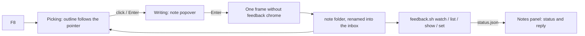

# Live feedback mode (`--features feedback`)

Click any element of the running app, type a note, press Enter. The note lands in a local inbox
folder that the lead's session watches (`tools/desktop-feedback/feedback.sh` in the workspace
repo); a panel in the app shows what happened to each note. Test builds only: a build without
the feature contains none of this (`scripts/check-feedback-absent.sh`).

## Using it
| Key | What it does |
| --- | --- |
| `F8` or `Ctrl+Shift+/` | Comment mode on / off |
| move the pointer | outlines the element under it, with the end of its key path |
| `Alt+Up` / `Alt+Down` | outline the parent / go back toward the child |
| click or `Enter` | pick the outlined element: the note popover opens |
| `Enter` / `Shift+Enter` / `Esc` | save / new line / cancel (Esc again leaves comment mode) |
| `Shift+F8`, or the "Feedback" entry (Tab reaches it) | the notes panel |

`Ctrl+/` (the board's shortcut list) is untouched; `F8` is on no board frame (`design/desktop-v2/frames.json`).

## Where notes go
`--feedback-dir <path>`, else `BEEBEEB_FEEDBACK_DIR`, else `%LOCALAPPDATA%\<app id>\feedback\inbox`
(Linux/macOS: the app's data folder). The app id is `BEEBEEB_APP_ID` at run time, else the
`BEEBEEB_APP_ID` the build was compiled with, else `io.beebeeb.app`. One folder per note,
`<UTC timestamp>-<short id>/`, written as `.tmp-<id>/` and renamed when complete:

| File | Content |
| --- | --- |
| `note.json` | schema below |
| `window.png` | the window's own render of that frame (never a desktop screenshot), without feedback chrome |
| `element.png` | the picked element's visible box, cropped from `window.png` (box × scale pixels) |
| `tree.json` | `element`, its `ancestors` (nearest first) and its `subtree`: key path, key, role, label, text, boxes, fill, text colour, radius, opacity |
| `status.json` | written later by the lead's tool |

### `note.json` (`schema: "beebeeb-feedback-note/1"`)
`schema`, `id`, `created_at` (UTC, RFC 3339), `app` {`name`, `version`, `commit`, `build_kind`},
`platform` {`os`, `scale`, `theme`, `window_size` {`w`, `h`}}, `frame` {`id`, `route`, `state` {…}},
`element` {`key_path`, `key`, `role`, `label`, `text`, `secure`, `box` {`x`,`y`,`w`,`h`}, `visible_box`, `fill`, `text_colour`, `radius`, `opacity`, `focused`},
`comment`, `tags` (of "Looks wrong", "Does not work", "Text", "Idea"), `files` {`window_png`, `element_png`, `tree_json`}.
Boxes are window points. `app.commit` comes from `build.rs` (`BEEBEEB_BUILD_COMMIT`, else `git rev-parse HEAD`).

### `status.json`
`state` (`new` | `seen` | `fixing` | `fixed` | `wontfix`), `reply`, `fixed_in_commit`, `updated_at`, `by`.
The panel reads the folder again at most every 2 s, and only while it is open.

## Privacy
- Screenshots show decrypted file names. That is acceptable only because notes stay on this PC, in
  the user's own profile; the panel says so. The module has no network code (a test greps for it).
- An element Rune reports as secure (`El::secure`: password, recovery phrase, key fields) never has
  its text in `note.json` or `tree.json` (`"[redacted: secure field]"`, label dropped) and its box is
  painted flat grey in both PNGs. After painting, every secure box is checked; if one cannot be
  proven blank, or a secure field is drawn scaled, the note is refused and nothing is written.
- No key material, token or password is read by this module: it sees only the element tree.

## Hook-up outside this folder
`main.rs`: `mod feedback`, the `State.feedback` field and its `init` line, `feedback::hook_spec(spec)`,
`feedback::install(app)` (all `#[cfg(feature = "feedback")]`). `Cargo.toml`: the feature and the
optional `png`. `build.rs`: the commit stamp. `frame_summary` in `mod.rs` reads `State`; a new
frame adds its id and state there.

## Rune limitations (rev c92e462)
- **No capture of a live window.** Running handlers and views hold no `Runtime`
  (`crates/rune/src/runtime/elements.rs:491`), and `App::on_frame_drawn` gives only `&Runtime`
  (`crates/rune/src/app.rs:532`) while `Renderer::prepare` needs `&mut` the glyph atlas
  (`crates/rune/src/render/upload.rs:187`). Used instead: a `Compositor` (`crates/rune/src/compose.rs:35`),
  whose frame has `&mut Runtime`, the window's device and its renderer; the frame is drawn a
  second time into an `Offscreen` and read back. It is the window's own render, on its own device.
- **No font per element.** `ElementInfo` (`crates/rune/src/runtime/elements.rs:7`) has fill, text
  colour and radius but no text style; `tree.json` names the two families only.
- **No rotation in the element dump.** `ElementInfo` has `scale` but not an ancestor's turn, so a
  secure field inside a rotated element is not detected as unblankable (none exists in the app).
- **New elements fade in.** The overlay appears over a short entrance transition; the capture frame
  uses `Tx::settle()` so none of it is in the picture (a test compares it pixel for pixel).
