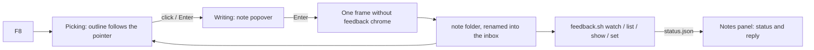

# Live feedback mode (`--features feedback`)

Click any element of the running app, type a note, press Enter. The note lands in a local inbox
folder that the lead's session watches (`tools/desktop-feedback/feedback.sh` in the workspace
repo); a panel in the app shows what happened to each note. Test builds only: a build without
the feature contains none of this (`scripts/check-feedback-absent.sh`).

## Using it
| Key | What it does |
| --- | --- |
| `F8` | Comment mode on / off (only on frames that opted in) |
| move the pointer | outlines the element under it; its key path shows in the bar in the caption |
| `Alt+Up` / `Alt+Down` | outline the parent / go back toward the child |
| click or `Enter` | pick the outlined element: the note popover opens |
| `Enter` / `Shift+Enter` / `Esc` | save / new line / cancel (Esc again leaves comment mode) |
| `Shift+F8`, or the "Feedback" entry (Tab reaches it) | the notes panel |

`F8` is on no board frame (`design/desktop-v2/frames.json`) and is none of the shell's shortcuts
(Alt+Left, Alt+Right, Ctrl+, , Ctrl+/, Esc). The two hotkeys are `COMMENT_KEY` and `PANEL_KEY` in
`mod.rs`: one place. Keys reach the mode through the shell's `host::on_key`, before the shell's
own shortcuts: while comment mode is on it owns the keyboard, so none of them moves the app
under it; while it is off, every key but the two hotkeys goes on unchanged
(`the_hotkeys_and_the_shells_shortcuts_do_not_collide`).

## Where notes go
`--feedback-dir <path>`, else `BEEBEEB_FEEDBACK_DIR`, else `%LOCALAPPDATA%\<app id>\feedback\inbox`
(Linux/macOS: that id's data folder). `--feedback-dir` is a development flag under the rule of the
shell's other tooling flags (`shell/instance.rs`: a debug build, or the `dev-tools` feature); any
other build ignores it, and a command line that carries a link honours nothing else. The app id
is the shell's (`shell/identity.rs`, `AppIdentity::feedback_dir_id`): the TEST identity
`io.beebeeb.app.test`, also in a build that has the real identifier, so a note never lands in the
real app's data folder by default. One folder per note, `<UTC timestamp>-<short id>/`,
written as `.tmp-<id>/` and renamed when complete. The folder's name is the note's id.

The inbox holds at most 200 notes and 1 GB. A new note over the cap removes the oldest notes
marked `fixed`, and only those; with none left to remove, the note is refused and says so. The
panel shows "N of 200". Temp folders a crash left behind are removed after ten minutes.

| File | Content |
| --- | --- |
| `note.json` | schema below |
| `window.png` | the window's own render of that frame (never a desktop screenshot), without feedback chrome |
| `element.png` | the picked element's visible box, cropped from `window.png` (box × scale pixels) |
| `tree.json` | `element`, its `ancestors` (nearest first) and its `subtree`: key path, key, role, label, text, boxes, fill, text colour, radius, opacity |
| `status.json` | written later by the lead's tool |

### `note.json` (`schema: "beebeeb-feedback-note/1"`)
`schema`, `id`, `created_at` (UTC, RFC 3339), `app` {`name`, `id`, `version`, `commit`, `build_kind`} (name and id: the shell's identity),
`platform` {`os`, `scale`, `theme`, `window_size` {`w`, `h`}}, `frame` {`id`, `route`, `state` {`group`, …}},
`element` {`key_path`, `key`, `role`, `label`, `text`, `secure`, `box` {`x`,`y`,`w`,`h`}, `visible_box`, `fill`, `text_colour`, `radius`, `opacity`, `focused`},
`comment`, `tags` (of "Looks wrong", "Does not work", "Text", "Idea"), `files` {`window_png`, `element_png`, `tree_json`}.
Boxes are window points. `app.commit` comes from `build.rs` (`BEEBEEB_BUILD_COMMIT`, else `git rev-parse HEAD`).

### `status.json`
`state` (`new` | `seen` | `fixing` | `fixed` | `wontfix`), `reply`, `fixed_in_commit`, `updated_at`, `by`.
The panel reads the folder again at most every 2 s, and only while it is open.

## Privacy
- **What is true:** the app sends a note nowhere; this module has no network code (a test greps
  for it). Notes are files on this PC, in the user's own profile. When the lead's AI session
  opens a note, its text is sent to the AI provider, and its screenshots only if the session
  opens them (`feedback.sh show <id> --with-screenshots`). The panel says this.
- Screenshots show decrypted file names and the account email.
- **Default deny.** Comment mode runs only on a frame group whose ONE line in the shell's frame
  registry says `feedback: FeedbackPolicy::Allowed` (`shell/registry.rs`; today: Files). Any other
  frame shows "Comment mode is off on this screen: <reason>": a group with no line, a group whose
  line says `Denied("…")`, and any dialog in front that has not opted in itself. Sign-in, first
  run, the locked screen and the recovery phrase are denied with a reason that names the secret.
- A secure element never has its text in `note.json` or `tree.json` (`"[redacted: secure field]"`,
  label dropped) and its box is painted flat grey in both PNGs. Secure means: Rune says so
  (`El::secure`, a secure `TextEdit`), or its key starts with `secure-`, or any ancestor is secure.
  After painting, every secure box is checked; if one cannot be proven blank, or a secure
  element is drawn scaled, the note is refused and nothing is written.
- A capture is refused while any element is moving or leaving (a flight, a layout spring, an
  exit), and when the picked element no longer says what it said when it was picked.
- Everything read back from the inbox (`note.json`, `status.json`, the PNGs) is treated as hostile:
  size caps, exact types, a hex SHA or nothing, control and bidi characters stripped, lengths capped.

## For frame lanes
A frame gets comment mode only by opting in, and opting in is a promise:
1. **Mark every secret.** Each text node that can show a password, a recovery phrase word, a key,
   a token, a pairing or one-time code gets `.secure()`. A group of them (the 12 words, a QR code
   with its caption, a "copy code" line) sits in ONE element keyed `secure-<name>`: its whole
   subtree is redacted and its whole box blanked. A secret in a tooltip, a toast or a flying
   shared element is still a secret: mark it, or keep the frame denied.
2. **Prove it.** A test in the frame's own module seeds a recognisable secret, saves a note on the
   frame, and searches `note.json`, `tree.json`, `window.png` and `element.png` for it (the JSON
   as text; the PNGs by checking the secure boxes are flat `BLANK_RGBA`). The test must also show
   the secret IS found when the marker is removed. `tests.rs` has both patterns
   (`a_secure_field_is_redacted…`, `a_secure_container_redacts…`).
3. **Keep secrets still.** Do not animate, scale, rotate or blur an element that holds a secret;
   a capture is refused while anything moves, and a scaled secure element refuses every note.

Then say so in your group's registry line: `feedback: FeedbackPolicy::Allowed` (until then:
`FeedbackPolicy::Denied("why, in the person's words")`), and add your group to the list in
`shell_tests.rs` (`sign_in_and_first_run_are_denied…`), which counts the allowed lines. The frame
id and the route in a note come from the shell (`frame.rs`: `FrameGroup::frame_id`, and the
route machine's section or pane; never the id or name of a folder or file). Sign-in,
recovery-phrase, pairing and app-lock frames stay denied unless all three duties are met and
reviewed.

## Packaging
Run `scripts/check-feedback-absent.sh --artifact <exe>` on the EXACT file that ships (the signed
exe in the installer, not a build folder). The gate mode (`--release`) builds its feedback probe
in a separate target dir and never touches the binary a release would pick up.

## Hook-up outside this folder
All `#[cfg(feature = "feedback")]`, or data a build without the feature does not read:
- `main.rs`: `mod feedback`.
- `shell/state.rs`: the `State.feedback` field and its line in `init_from`.
- `shell/mod.rs` (`run`): `paths::set_flag_dir`, `feedback::hook_spec(main_spec)` (the main
  window's view and poll) and `feedback::install(main_app)` (the capture's compositor).
- `shell/host.rs`: `on_key` hands every key to `feedback::on_key` first.
- `shell/registry.rs`: `FeedbackPolicy`, the `feedback` field of `Frame` and `DialogFrame`, and
  `FrameGroup::frame_id`. `shell/identity.rs`: `feedback_dir_id`. `shell/instance.rs`:
  `--feedback-dir` and `Launch::feedback_dir`.
- `Cargo.toml`: the feature and the optional `wgpu` (already in the tree through rune).
  `build.rs`: the commit stamp. `frame_summary` in `mod.rs` adds what `State` holds.

## Rune limitations (rev c92e462)
- **No capture of a live window.** Running handlers and views hold no `Runtime`
  (`crates/rune/src/runtime/elements.rs:491`), and `App::on_frame_drawn` gives only `&Runtime`
  (`crates/rune/src/app.rs:532`) while `Renderer::prepare` needs `&mut` the glyph atlas
  (`crates/rune/src/render/upload.rs:187`). Used instead: a `Compositor` (`crates/rune/src/compose.rs:35`),
  whose frame has `&mut Runtime`, the window's device and its renderer; the frame is drawn a
  second time into an `Offscreen` and read back. It is the window's own render, on its own device.
- **No font per element.** `ElementInfo` (`crates/rune/src/runtime/elements.rs:7`) has fill, text
  colour and radius but no text style; `tree.json` names the two families only.
- **No rotation in the element dump.** `ElementInfo` has `scale` but not an ancestor's turn, so a
  secure field inside a rotated element is not detected as unblankable (none exists in the app).
- **Rows are keyed by position** (`row-{i}`), so a key can hold another item later. A note is
  refused when its element's content changed since it was picked.
- **New elements fade in.** The overlay appears over a short entrance transition; the capture frame
  uses `Tx::settle()` so none of it is in the picture (a test compares it pixel for pixel).
