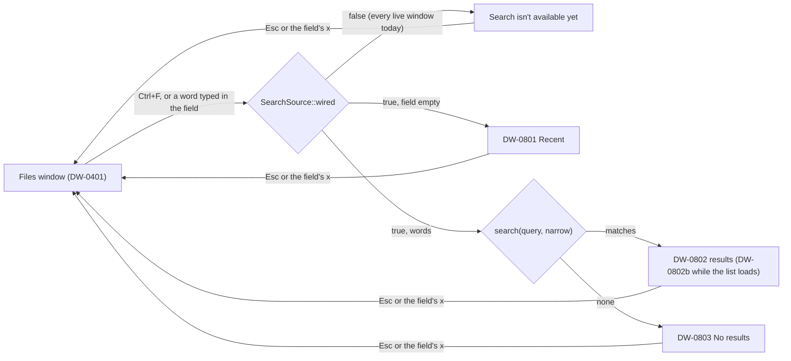

# Search frames: the group's checklist (package B12)

The checklist for `src/frames/search`. Source: `design/desktop-v2/FRAMES.md` and `frames.json`
(group "Shared, Search and Trash"). Status is `built` (gated light and dark, the truth line at 0
failing in both) or `not built`. State on 2026-11-12: 4 of 4 built.

`src/frames/shared/FRAMES.md` still lists these four frames as not built: that file is another
lane's while this one is open, so its Search section stays until the integrator drops it (a pure
move would also have to change its header and the statuses).

| Frame | What it is | Status |
| --- | --- | --- |
| DW-0801 | Search opened: Recent (contract, lisbon, invoice 2026), Clear, what search covers | built (light and dark: geometry 93, pixels 93, text 32, icons 26, fills 17, frame tiles 63481 checked, 0 failing) |
| DW-0802 | Results for "Contr": pills All / Folders / Photos / Documents, three rows with Where, the first one's details | built (light and dark: geometry 169, pixels 169, text 71, icons 34, fills 41, frame tiles 63481 checked, 0 failing) |
| DW-0802b | Results during a first sign-in: the "Still getting your files ready" note with the live count | built (light and dark: geometry 120, pixels 120, text 48, icons 29, fills 21, frame tiles 63481 checked, 0 failing) |
| DW-0803 | No results for "harbr" | built (light and dark: geometry 93, pixels 93, text 33, icons 24, fills 18, frame tiles 63481 checked, 0 failing) |

## How it works

Search is a state of the Files window. The registry's Files line (`shell/files_frame.rs`) asks
`search::over_files` first: while search is open, this group draws the window and
`search::files_key` takes its keys, so no key reaches the Files list behind the results.

- **Data:** `source::SearchSource` (`recent`, `clear_recent`, `remember`, `search(query, narrow)`
  returning `Answer::{Unavailable, Found { hits, loading }}`, `details(id)`). A window starts on
  `source::Unwired` (`SearchUi::default`); only a board frame's scene sets the board's sample
  (`source::BoardSearch`). The wiring lane implements the trait on the engine and sets it in
  `state::init_on_engine`.
- **Keys:** Ctrl+F opens search (the field focused) and from inside it goes back to the field;
  Esc or × ends it. In the field, Down goes into the results (DW-0802) or the recent searches
  (DW-0801), Enter keeps the search as a recent one. On the pills Left, Right, Home and End
  narrow, Down goes into the results. In the results the arrows, Home and End select, Up from the
  first goes back to the field, Enter opens (`Intent::OpenItem`), the Menu key or Shift+F10 asks
  for the file menu (`Intent::About("DW-0402")`), Alt+Enter for Details (`DW-0411`). In the
  recent searches the arrows move and Enter or Space runs one. Alt+Shift+P shows or hides the
  details panel.
- **Pointer:** a click selects a result, a double-click opens it, a right-click asks for its
  menu; a recent search runs on a click; Clear forgets them. The panel's Share… (`DW-0407`),
  Version history (`DW-0413`) and Available offline (`Do("keep-offline")`) ask for the selected
  result. The toolbar's Sort (`DW-0406`), New (`DW-0415`), grid view (`DW-1102`) and the status
  line (`DW-1201`) ask for their frames.

## Not built here

- The engine behind `SearchSource` (the wiring package), and a cap or a virtual list for a long
  answer: the results list builds every row it is given.
- The file menu of a result with Show in enclosing folder (DW-0402's menu, asked for by intent).
- Ctrl+F with focus inside the Files window: Files' own key handler puts the cursor in the field
  without opening search (the recent searches show once a word is typed or Ctrl+F is pressed with
  nothing focused). One line in `frames/files/keys.rs` (`frames::search::open`) closes it.
- The goldens (captured 2026-11-11) name these frames' pills, lists and buttons in the Shared and
  Trash scheme (`seg-0`, `label-recent`, `list-0`, `item-0-*`, `btn-share`, ...): they were keyed
  before `scripts/keymap.js` gave each group only its own names (`groupOf`, 2026-11-12). The board
  draws Search in Files, so a recapture today would key these frames as the `files` group. The view
  keeps the goldens' names; `keymap.js` needs a `search` group (not this package's file), and
  `check-keymap-scope.sh` was not run here (a capture needs the network).
