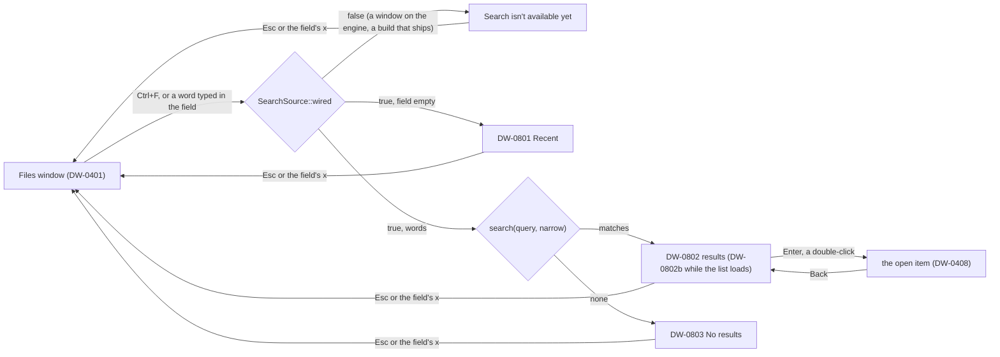

# Search frames: the group's checklist (package B12)

The checklist for `src/frames/search`. Source: `design/desktop-v2/FRAMES.md` and `frames.json`
(group "Shared, Search and Trash"). Status is `built` (gated light and dark, the truth line at 0
failing in both) or `not built`. State on 2026-11-12: 4 of 4 built (#332), and linked: typing, opening a result, Back, Esc.

`src/frames/shared/FRAMES.md` still lists these four frames as not built: that file is another
lane's while this one is open, so its Search section stays until the integrator drops it (a pure
move would also have to change its header and the statuses).

| Frame | What it is | Status |
| --- | --- | --- |
| DW-0801 | Search opened: Recent (contract, lisbon, invoice 2026), Clear, what search covers | built (light and dark: geometry 95, pixels 95, text 32, icons 27, fills 17, frame tiles 63481 checked, 0 failing) |
| DW-0802 | Results for "Contr": pills All / Folders / Photos / Documents, three rows with Where, the first one's details | built (light and dark: geometry 171, pixels 171, text 71, icons 35, fills 41, frame tiles 63481 checked, 0 failing) |
| DW-0802b | Results during a first sign-in: the "Still getting your files ready" note with the live count | built (light and dark: geometry 122, pixels 122, text 48, icons 30, fills 21, frame tiles 63481 checked, 0 failing) |
| DW-0803 | No results for "harbr" | built (light and dark: geometry 96, pixels 96, text 33, icons 25, fills 18, frame tiles 63481 checked, 0 failing) |

## How it works

Search is a state of the Files window. The registry's Files line (`shell/files_frame.rs`) asks
`search::over_files` first: while search is open, this group draws the window and
`search::files_key` takes its keys, so no key reaches the Files list behind the results.

- **Data:** `source::SearchSource` (`recent`, `clear_recent`, `remember`, `search(query, narrow)`
  returning `Answer::{Unavailable, Found { hits, loading }}`, `details(id)`). `wired()` is `false`
  unless a source says otherwise. A window without an engine starts on `source::first(dev_build)`:
  the board's sample (`source::BoardSearch`) in a development build, `Unwired` in a build that
  ships. A window on the engine is `Unwired` whatever the build (`state::init_on_engine` sets
  `SearchUi::default`). The wiring lane implements the trait on the engine and sets it in
  `state::init_on_engine`.
- **Keys:** Ctrl+F opens search (the field focused) and from inside it goes back to the field;
  Esc or × ends it. In the field, Down goes into the results (DW-0802) or the recent searches
  (DW-0801), Enter keeps the search as a recent one. On the pills Left, Right, Home and End
  narrow, Down goes into the results. In the results the arrows, Home and End select, Up from the
  first goes back to the field, Enter opens (`host::dispatch(Event::OpenItem)`, the one call site in `open_result`; Back shows
  the results again), the Menu key or Shift+F10 asks
  for the file menu (`Intent::About("DW-0402")`), Alt+Enter for Details (`DW-0411`). In the
  recent searches the arrows move and Enter or Space runs one. Alt+Shift+P shows or hides the
  details panel. Alt+Left and Alt+Right are not Back and Forward while search shows (the board
  draws both off): `holds_back`, which `shell::host` asks before it takes the two keys.
- **Pointer:** a click selects a result, a double-click opens it, a right-click asks for its
  menu; a recent search runs on a click; Clear forgets them. The panel's Share… (`DW-0407`),
  Version history (`DW-0413`) and Available offline (`Do("keep-offline")`) ask for the selected
  result. The toolbar's Sort (`DW-0406`), New (`DW-0415`), grid view (`DW-1102`) and the status
  line (`DW-1201`) ask for their frames (intents nothing drains yet; the status line is linked by
  the tray lane).

## Not built here

- The engine behind `SearchSource` (the wiring package), and a cap or a virtual list for a long
  answer: the results list builds every row it is given.
- The file menu of a result with Show in enclosing folder (DW-0402's menu, asked for by intent).
- The keys: the Files window's own (`keymap.js`, `keymap-files.js`, the empty state of DW-0803
  among them: `empty`, `-tile`, `-icon`, `-title`, `-text`, drawn with `ui::empty`), plus what
  `scripts/keymap-search.js` adds in a Files frame with the field focused, in the Shared and Trash
  scheme (`seg-0`, `label-recent`, `list-0`, `item-0-*`, `btn-share`, ...). The goldens are the
  board lane's of 2026-11-12 with those keys' records added (nothing removed, nothing changed).
  `scripts/check-keymap-scope.sh DW-0401 DW-0801 DW-0802 DW-0802b DW-0803`: 10 frames checked, 0
  differing.
- The toolbar is Search's own (`view.rs`): the Files toolbar with "Search" and the count for a
  title, Back and Forward off, and the field focused; Open in File Explorer asks the shell.
- After Esc the field keeps the keyboard (as before): Alt+Left is then the field's own key until
  focus leaves it.
