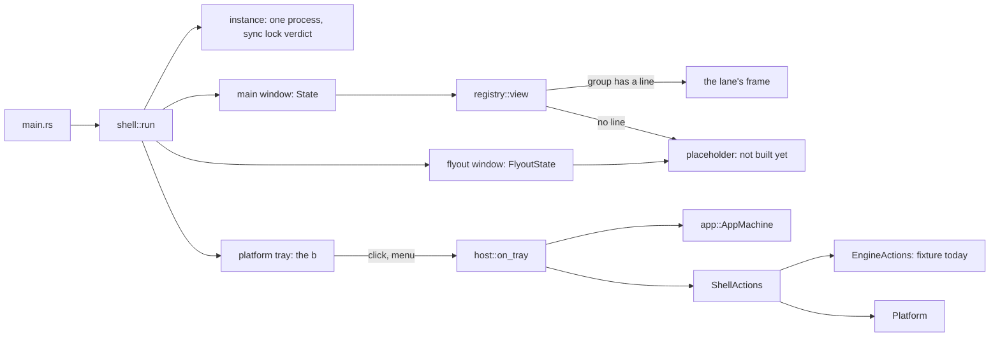

# The shell

Lifetime, windows, the b in the notification area, single instance, start at login, deep links and
routing for the native app. Windows first; macOS and Linux compile and say "not built yet" where the
OS half is missing (`platform/`).



## The board's window rule

Two surfaces, never more: **the one window and the flyout** (DW-1201: "At most two Beebeeb surfaces").
Settings is a mode of the main window (DW-0701: "never a separate window"); sign-in, the locked and
no-plan screens, the viewer and the conflict choice are states of it too. So there are two window
kinds (`surfaces::WindowKind::{Main, Flyout}`) and the rest is `app::Screen` / `app::Dialog`.

| window | size (points) | minimum | notes |
|---|---|---|---|
| main | 1280 x 800 (DW-0401) | 960 x 640 (0.8.x's; the board states none) | place and size restored (`window_state.rs`) |
| flyout | 340 x 520, fixed (DW-1201) | same | borderless, topmost, hidden until the b is clicked; closes on Esc and on losing focus |

## Register a frame group: one line

In `registry.rs`, add your group to `FRAMES`:

```rust
Frame { group: FrameGroup::Section(Section::Shared), view: crate::frames::shared::view, on_key: None },
```

`view` is `fn(&State, &mut Cx<State>) -> El` and draws the WHOLE window for that state (caption
included, as `files_frame::view` does). `on_key` is optional: it gets the keys the shell does not take.
The tray lane sets `registry::FLYOUT = Some(crate::frames::tray::view)` instead
(`fn(&FlyoutState, &mut Cx<FlyoutState>) -> El`).

That line, one `mod` line in `main.rs`, and (only if your frames need state) one field in
`state::State` with its default in `state::init_with` are everything a frame lane touches outside its
own directory. A group without a line draws `placeholder.rs`: its name, its board section, one
sentence, and no data.

Render your group before any navigation exists with a scene: `--scene shared`, `photos`, `backups`,
`trash`, `sync-history`, `available-offline`, `settings`, `shortcuts`, `signed-out`, `locked`,
`no-plan` (`--list-scenes`); the flyout with `--window flyout --size 340x520`.

## Navigate

Read where the window is from `s.shell.app` (`screen()`, `route()`, `dialog()`, `can_go_back()`,
`can_go_forward()`). Change it only through:

- `host::dispatch(s, Event::…)` from inside the main window: `Navigate(Route)`, `OpenItem(id)`,
  `Back`, `Forward`, `OpenSettings(pane)`, `OpenDialog(dialog)`, `Escape`.
- `host::request(s, Intent::…)` from outside it (the flyout, the tray, a link): it is kept while the
  session gate is closed and brings the window forward. From the flyout:
  `main.update(|s, _| { host::request(s, Intent::Settings(SettingsPane::General)); })`.

The shell already handles Alt+Left / Alt+Right, Ctrl+, , Ctrl+/ and Esc (`host::on_key`).
`ui::sidebar` selects by writing `State::sidebar_section`; `host::poll` turns that into a navigation,
so the sidebar routes today.

The gate (`app::GateState`, the names of `auth_v2/gate.rs`) is an input: signed out shows only
sign-in and forgets the place, the history and any waiting request that names account data; locked
and the other not-ready states hide the account and return to the same place.

## Actions

`s.shell.actions` is an `Arc<dyn ShellActions>`: `pause_sync`, `resume_sync`, `open_in_file_explorer`,
`autostart_enabled`, `set_autostart`, `gate_state`, `tray_inputs`. Engine-dependent ones go to
`EngineActions`, which the engine/session lane implements and passes in `shell::run` (one line:
`let engine = …`); today that is `FixtureEngine` (in memory, nothing leaves the process). After a
state change the engine calls `handle.update(|s, _| { s.shell.refresh(); })` so the gate, the b and
the flyout follow.

## The b

`tray::tray_model(&TrayInputs)` gives the icon state, tooltip and menu (DW-1230, DW-1231);
`tray_icon::render` draws each state for a light or dark taskbar at any size;
`platform::windows` shows it. A left click toggles the flyout (signed out: opens the window on
sign-in); a right click or Shift+F10 opens the menu. Closing the window leaves the b running; Quit is
only in the b's menu. Without a b (the stubs), closing the window quits.

## Starting

`instance.rs`: Rune tooling flags (`--snap`, …) make the run a renderer (no instance claim, no tray,
no saved state). Otherwise `rune::single_instance("io.beebeeb.app")` hands a second launch's
arguments to the first over a per-user named pipe; `EngineActions::profile_holder` (the sync lock of
`lockfile.rs`, once the engine is linked) refuses a start beside a running 0.8.x app. `--autostart`
(what the Run value passes) starts in the notification area.

`deeplink.rs`: `beebeeb://open[/<section>[?folder=<id>]]` and `beebeeb://settings[/<pane>]`, nothing
else; a link can only show a place. The scheme is not registered by the app (0.8.x has none):
`deeplink::scheme_registration` lists the registry values for the installer.

`autostart.rs`: `HKCU\…\CurrentVersion\Run`, value `Beebeeb`, the value 0.8.x's autostart plugin
writes, so the setting carries over; ours is `"<exe>" --autostart`, and a value 0.8.x left is
rewritten at start (`Platform::adopt_autostart`).

## Stubbed or not here

- The engine and the session: `FixtureEngine`. No sync, no account, no network.
- `platform/macos.rs`, `platform/linux.rs`: every call returns `NotBuilt`.
- The flyout's content and every frame group but Files: the placeholder.
- The mouse's back and forward buttons: Rune delivers only the left and right buttons
  (`crates/rune/src/window/events.rs:461,489` at c92e462); `Event::Back` / `Forward` are ready.
- The sidebar's highlight for Sync history and Available offline: `ui::sidebar::SidebarSection` has
  no value for them (the route is right; the highlight stays where it was).
- Windows code is type-checked from Linux (`cargo check --target x86_64-pc-windows-msvc`) but has
  not run: the native checks are in the PR body.
