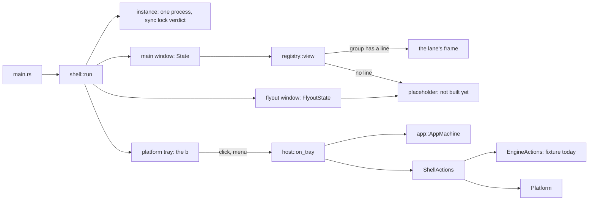

# The shell

Lifetime, windows, the b in the notification area, single instance, start at login, deep links and
routing for the native app. Windows first; macOS and Linux compile and say "not built yet" where the
OS half is missing (`platform/`).



## The board's window rule

Two surfaces, never more: **the one window and the flyout** (DW-1201: "At most two Beebeeb surfaces").
Settings is a mode of the main window (DW-0701: "never a separate window"); sign-in, the locked and
no-plan screens, the viewer and the conflict choice are states of it too. So there are two window
kinds (`surfaces::WindowKind::{Main, Flyout}`) and the rest is `app::Screen` / `app::Dialog`.

| window | size (points) | minimum | notes |
|---|---|---|---|
| main | 1280 x 800 (DW-0401) | 960 x 640 (0.8.x's; the board states none) | place and size restored (`window_state.rs`) |
| flyout | 340 x 520, fixed (DW-1201) | same | borderless, topmost, hidden until the b is clicked; closes on Esc and on losing focus |

## Register a frame group: one line

In `registry.rs`, add your group to `FRAMES`:

```rust
Frame { group: FrameGroup::Section(Section::Shared), view: crate::frames::shared::view, on_key: None, feedback: FeedbackPolicy::Denied("its lane has not opted in yet") },
```

`feedback` is whether the live feedback mode of test builds (`src/feedback/README.md`) may run on
your frames: `Denied("reason")` until you have met its three duties ("For frame lanes": mark every
secret, prove it with a test, keep secrets still), then `Allowed`. A build without the `feedback`
feature does not read it.

`view` is `fn(&State, &mut Cx<State>) -> El` and draws the WHOLE window for that state (caption
included, as `files_frame::view` does). `on_key` is optional: it gets the keys the shell does not take.
The tray lane sets `registry::FLYOUT = Some(crate::frames::tray::view)` instead
(`fn(&FlyoutState, &mut Cx<FlyoutState>) -> El`).

That line, one `mod` line in `main.rs`, and (only if your frames need state) one field in
`state::State` with its default in `state::init_with` are everything a frame lane touches outside its
own directory. A group without a line draws `placeholder.rs`: its name, its board section, one
sentence, and no data.

Render your group before any navigation exists with a scene: `--scene shared`, `photos`, `backups`,
`trash`, `sync-history`, `available-offline`, `settings`, `shortcuts`, `signed-out`, `locked`,
`no-plan` (`--list-scenes`); the flyout with `--window flyout --size 340x520`.

## Navigate

Read where the window is from `s.shell.app` (`screen()`, `route()`, `dialog()`, `can_go_back()`,
`can_go_forward()`). Change it only through:

- `host::dispatch(s, Event::…)` from inside the main window: `Navigate(Route)`, `OpenItem(id)`,
  `Back`, `Forward`, `OpenSettings(pane)`, `OpenDialog(dialog)`, `Escape`.
- `host::request(s, Intent::…)` from outside it (the flyout, the tray, a link): it is kept while the
  session gate is closed and brings the window forward. From the flyout:
  `main.update(|s, _| { host::request(s, Intent::Settings(SettingsPane::General)); })`.

The shell already handles Alt+Left / Alt+Right, Ctrl+, , Ctrl+/ and Esc (`host::on_key`). In a
build with the `feedback` feature, F8 and Shift+F8 are the feedback mode's and it sees every key
first (`feedback::on_key`).
`ui::sidebar` selects by writing `State::sidebar_section`; `host::poll` turns that into a navigation,
so the sidebar routes today. It can only see a CHANGE of that value: a click on the row that is
already highlighted (to leave a folder, or from Sync history, which has no highlight of its own) does
nothing until the sidebar calls `host::dispatch` itself.

The gate (`app::GateState`, the names of `auth_v2/gate.rs`) is an input: signed out shows only
sign-in and forgets the place, the history and any waiting request that names account data; locked
and the other not-ready states hide the account and return to the same place.

## Actions

`s.shell.actions` is an `Arc<dyn ShellActions>`: `pause_sync`, `resume_sync`, `open_in_file_explorer`,
`autostart_enabled`, `set_autostart`, `session`, `tray_inputs`, `start_sync`, `stop_for_quit`,
`resume_after_cancelled_quit`. Engine-dependent ones go to `EngineActions`, which the engine/session
lane implements and passes in `shell::run` (one line: `let engine = …`); today that is
`FixtureEngine` (in memory, nothing leaves the process). After a state change the engine calls
`handle.update(|s, _| { s.shell.refresh(); })` so the gate, the b and the flyout follow.

**The session lane's contract:** `EngineActions::session()` returns `Session { gate, account }`:
the gate AND the user id, read together. The shell samples it, so the account is what lets it see
a change of account it never saw a sign-out for (`Ready(A)` then `Ready(B)`): another account
clears the route, the history, the settings pane, the dialog and every waiting intent.
`GateState::FirstRun` is new (setup on this PC not finished): the first-run lane adds it to
`gate.rs`.

**The engine lane's contract:** `start_sync` is only reached through `ShellActions::start_sync`,
which refuses while `profile_holder()` names another agent (a Tauri 0.8.x app of the same identity,
`bb watch`): the native app never syncs beside it. `stop_for_quit` is the ONE engine hook of the
quit path (the b's menu, the installer's `quit-for-update`, a Windows shutdown); it must return
promptly and be safe to call twice. Rune runs the quit hook when Windows only ASKS to shut down, so
`resume_after_cancelled_quit` undoes it when another app refuses the shutdown.

## Dialogs: over the frame behind them

A dialog is not a screen. The shell draws the state's own frame, then the scrim (the board's
`--kit-scrim`: black at 28 % in light, 55 % in dark), then the dialog's card, centred; the window
behind is inert and gets no keys. A dialog lane writes ONE function and ONE line in
`registry::DIALOGS`:

```rust
pub fn card(dialog: &Dialog, s: &State, cx: &mut Cx<State>) -> El   // registry::DialogFn
// DialogFrame { group: FrameGroup::ConflictDialog, view: crate::frames::conflict::card, on_key: None, feedback: FeedbackPolicy::Denied("its lane has not opted in yet") },
```

It returns its card and nothing else: no scrim, no window chrome, no copy of what is behind it.
Open one with `host::dispatch(s, Event::OpenDialog(..))`; Esc closes it (and only it).

## Windows: the main window, the first-run window, the flyout

`surfaces::WindowKind` is `Main` (1280 x 800, at least 960 x 640), `FirstRun` (960 x 640) and
`Flyout` (340 x 520). The board draws sign-in and the first-run steps in the first-run window
(DW-A01 "First-run window 960 × 640 with the brand panel"; DW-A02 "Window with the brand panel";
DW-0201 "A window of its own between sign-in and the main window (960 × 640, like the shared
first-run window)"). It comes before the main window, never beside it, so the shell keeps ONE
native window and gives it the kind's size when `surfaces::kind_for(&screen)` changes
(`host::poll`). `Screen::SignIn` and `Screen::Gate(GateState::FirstRun)` are first-run screens
(`FrameGroup::SignIn`, `FrameGroup::FirstRun`); every other screen is the main window's. The main
window's place is not saved while it is the first-run window.

The main window's place is in `native-window-state.json` in this identity's state folder. With no
such file yet, the 0.8.x app's `main-window-frame.json` (its config folder) is read ONCE as the
first position; it is never written.

## Identity

`identity.rs` is the one place a per-app name comes from. Which app a binary is, is decided by
`build.rs` when it is built and by nothing else:

| `BEEBEEB_APP_IDENTIFIER` | `BEEBEEB_RELEASE_VERSION` | `AppIdentity::CURRENT` |
|---|---|---|
| `io.beebeeb.app` | set or unset | `Real` ("Beebeeb") |
| `io.beebeeb.app.test` | unset | `Test` ("Beebeeb Test") |
| unset | unset | `Test`: plain `cargo build`, `cargo run`, `cargo test` |
| `io.beebeeb.app.test` or unset | set | the build stops: a release is the real app and says so |
| anything else | any | the build stops |

The profile (`debug_assertions`), run-time environment variables and arguments decide nothing. The
control channel, the state folder, the Run value's name, the window titles, the tray window's class,
the tooltip and the link scheme all derive from it, and a test asserts each differs between the two.
Never write one of those names anywhere else. Every name the ENGINE owns (credential service,
settings folder, suggested sync folder, Cloud Files provider name, GUID and class ids, backup device,
daemon socket) is in the engine's one identity file (`crates/beebeeb-engine/src/identity.rs`),
reached through `AppIdentity::engine()`: the host hands that value to `Engine::open`, and no engine
entry works without one. The tests name the identity they mean (`deeplink::link` builds a link for
this build), so `cargo test` passes as either app. The test build does not start on macOS
(`AppIdentity::start_refusal`, asked first thing in `main`). The binary carries one mark,
`beebeeb-app-identity=<identifier>;` (`BUILD_MARK`), which the packager and the release workflow
read. To run the real app from source: `BEEBEEB_APP_IDENTIFIER=io.beebeeb.app cargo run`.

## The b

`tray::tray_model(&TrayInputs)` gives the icon state, tooltip and menu (DW-1230, DW-1231), in the
board's order (DW-1201); `tray_icon::render` draws each state for a light or dark taskbar at any
size; `platform/windows_tray.rs` shows it (its pure decisions are `tray_win.rs`). A left click
toggles the flyout (no account on this PC: opens the window on sign-in; signed out after 90 days:
the flyout, DW-1219); a right click or Shift+F10 opens the menu. Closing the window leaves the b
running; Quit is only in the b's menu. **`Shell::has_tray()` is whether the icon is IN the
notification area right now**, not whether a tray object exists: with no icon (Explorer not running,
a failed add, the stubs) closing the window quits, and an icon that goes while the window is closed
opens the window. `platform/windows_tray.rs` starts with the aliasing rule of its window procedure:
read it before touching that file.

## Starting

`instance::parse_args` reads the command line, which is untrusted when the OS starts the app for a
link: the app takes a link ONLY as `--open-link <link>`, and a command line that has it honours no
other flag. `--autostart` (what the Run value passes) starts in the notification area;
`--quit-for-update` (the installer) asks the running instance to quit and exits 0 once that is
acknowledged, exits 0 at once when nothing runs, and exits 1 when the instance did not answer.
Development and diagnostic flags (Rune's `--snap`, `--out`, `--html`, `--script`, …, and `--db`) are
read only in a dev build (`instance::DEV_BUILD`: a debug build, or the `dev-tools` feature); a
shipped build ignores every one, and Rune is handed an empty argument list (`App::args`).

One instance per identity, user AND Windows session (exclusivity across sessions comes from the
engine/profile lock, which is not linked yet): `control.rs` is the protocol and `platform/windows_control.rs`
the named pipe (ACL: the current user only). Serving the pipe IS being the instance. A later launch
hands over one request (`show`, `open <link>`, `quit-for-update`), waits for `ok` and exits; if the
first instance does not answer in 5 seconds, or the channel is unusable, it says so in a native
message box and exits 1: it never starts a second instance. Rune's `single_instance` is not used.
`EngineActions::profile_holder` (the sync lock of `lockfile.rs`, once the engine is linked) refuses a
start beside a running 0.8.x app.

`deeplink.rs`: `beebeeb://open[/<section>[?folder=<id>]]` and `beebeeb://settings[/<pane>]`, nothing
else; a link can only show a place. **The scheme is not registered in 0.9.0**;
`deeplink::scheme_registration` lists the registry values for the installer
(`"<exe>" --open-link "%1"`).

`autostart.rs`: `HKCU\…\CurrentVersion\Run`, value `Beebeeb` (this identity's), the value 0.8.x's autostart plugin
writes, so the setting carries over; ours is `"<exe>" --autostart`. A value 0.8.x left for this same
program path is rewritten at start (`Platform::adopt_autostart`); a value for another path (another
install, a development build) is never touched, so an installer that moves the program updates it.
`autostart::plan(wish, existing, exe)` is the one decision (enable, disable, adopt): whatever the
wish, a value that starts a program at another path is never written over and never deleted, and
turning the switch on then fails with "set for another copy of this app".

## Stubbed or not here

- The engine and the session: `FixtureEngine`. No sync, no account, no network.
- `platform/macos.rs`, `platform/linux.rs`: every call returns `NotBuilt`.
- Every frame group without a line in `registry.rs`: the placeholder (the flyout's content is `frames/tray`).
- The mouse's back and forward buttons: Rune delivers only the left and right buttons
  (`crates/rune/src/window/events.rs:461,489` at c92e462); `Event::Back` / `Forward` are ready.
- The sidebar's highlight for Sync history and Available offline: `ui::sidebar::SidebarSection` has
  no value for them (the route is right; the highlight stays where it was).
- Files does not follow the route yet: `files_frame` draws `State::listing` whatever
  `Route::folder` says, and its Enter-into-folder does not dispatch `Navigate` (the Files lane's).
- Windows code is compiled and its tests run on the Windows build VM
  (`scripts/coord/remote-build.sh win desktop <branch> --dir native/beebeeb-drive-rune -- …`):
  `platform/windows_tray_tests.rs` drives the real window procedure through a hidden window, and
  `platform/windows_control.rs` round-trips real named pipes. What needs a desktop session (the
  icon in a real notification area, the menu, Explorer restarting) is in the PR body.
- A real-desktop check of the first-run window's resize, and a non-resizable first-run window
  (Rune sets resizability at creation only).
