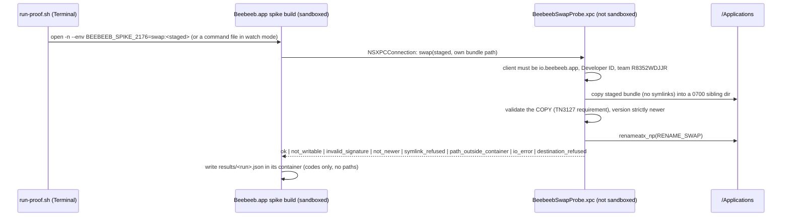

# Spike 2176: XPC swap device proof (P1-P5)

**Throwaway.** Branch `spike/2176-xpc-swap-proof`, draft PR, **never merged.** It answers the device
questions P1-P5 of `docs/specs/2026-10-25-macos-sandboxed-updater.md` §8 for the decision of
2026-11-01 (option A: a bundled, non-sandboxed XPC service swaps the app) before any production code
is written. Built on desktop `origin/main` `d6ba563`.

Guus's two extra rules (2026-11-01), and where the code applies them:

| Rule | Where |
| --- | --- |
| 1. Never install an older or equal version | `SwapCore.isStrictlyNewer`, read from the signed Info.plist of the service's own copy |
| 2. Only a staged path inside the app's own container | `SwapCore.performSwap` step 2 (component-wise prefix, `..` refused, not resolved) |
| 2. Open it with O_NOFOLLOW | `openDirectoryChain`: container root with `O_NOFOLLOW_ANY`, every component below with `O_NOFOLLOW` |
| 2. Refuse any symlink anywhere in the staged bundle | `copyTree`: `fstatat(AT_SYMLINK_NOFOLLOW)` on every entry, `symlink_refused` |
| 2. Stage into a 0700 sibling directory next to the destination | `mkdtemp("<parent>/.beebeeb-update-XXXXXX")`, mode and owner asserted |
| 2. Delete that directory on any refusal | `refuse()` in `performSwap`; the harness checks it after every refusal |

## What is here



| Path | What |
| --- | --- |
| `BeebeebSwapProbe/SwapCore.swift` | The policy: paths, copy, signature, version, swap. No XPC, unit-tested. |
| `BeebeebSwapProbe/SwapProbeService.swift`, `main.swift`, `Info.plist` | The XPC service (`CFBundlePackageType` `XPC!`, `XPCService` dict, NO entitlements). The listener accepts only a client satisfying the Developer ID requirement for `io.beebeeb.app` (`setCodeSigningRequirement`, macOS 13+). |
| `build-swap-probe.sh` | Compiles the service; signs it hardened + timestamped with no entitlements when given an identity. |
| `client/Spike2176SwapProbeClient.m` | The app-side trigger (Objective-C, `NSXPCConnection`), compiled only with `--features spike-2176` by `src-tauri/build.rs`. |
| `tauri.spike-2176.conf.json` | Config overlay that embeds the service at `Contents/XPCServices/` (`bundle.macOS.files`), passed only by the spike build. |
| `run-proof.sh` | The proof, step by step. `DRY_RUN=1` prints every command. |
| `tests/run-core-tests.sh`, `tests/run-mutations.sh` | The policy's unit harness (no signing needed) and its red-proof. |

**Service protocol:** `ping`; `writeProbe(path)` (spike only: restricted to `~/beebeeb-spike-2176/`);
`swap(stagedPath, destinationPath)`; `swapAfterClientExit(...)` (spike only, P3 quit-first);
`removeStaleUpdates(destinationPath)`. Codes are the seven of the brief plus `destination_refused`
(lane decision: without it the app could ask the service to swap any user-writable directory; the
destination must be the app bundle that contains the service).

**The trigger.** No Rust file changes. `build.rs` compiles the Objective-C client only when
`CARGO_FEATURE_SPIKE_2176` is set, links it, and passes `-Wl,-u,_beebeeb_spike_2176_anchor` so the
linker keeps the object although nothing calls it; a load-time constructor reads `BEEBEEB_SPIKE_2176`
and acts 3 s after launch, or polls a command file in `watch` mode. It never writes `lifecycle.log`.

**The normal build is unchanged** (shown with `cargo check` only, see the PR body): without the
feature, `src-tauri/src`, the Tauri configs, the entitlements and `Cargo.lock` are untouched; the
build script's output is byte-identical to `origin/main`'s; and the rustc invocations differ only in
the `--check-cfg` list of declared features (a lint input), with identical `-C metadata`. Not
measured on a linked binary (no full build was run for this PR).

## Before you start

- **A Mac with your Developer ID identity** in the login keychain and the two Developer ID
  provisioning profiles the release uses (`~/.private_keys/macos-developer-id-profiles/`).
- **Isolation (recommended).** The spike build is a real Beebeeb (main `d6ba563`, versions
  `0.0.2176`/`0.0.2177`): it opens the macOS user's own Beebeeb container, Keychain items and Finder
  location, and P4 signs in and uploads. Running unreleased code against your real container may move
  its local state forward, which the restored release then has to open. Run every step in a separate
  **administrator** macOS user, and P2's second half in a **standard** user. `/Applications` is shared
  between users, which is why the script saves and restores `/Applications/Beebeeb.app`.
- **Prompts you will see:** "Terminal would like to access data from other apps" (the script stages
  bundles into the app's container): allow, or give Terminal Full Disk Access. "Terminal wants to
  control Beebeeb" (the `osascript` quit): allow. If moving `/Applications/Beebeeb.app` fails with
  "Operation not permitted", give Terminal **App Management** (System Settings › Privacy & Security).
- **No notarization.** It is not needed for a local proof: files built and copied locally carry no
  quarantine attribute, so Gatekeeper does not assess them, and the service validates the Developer
  ID signature itself. The build removes every `APPLE_*` notary variable, so nothing is uploaded.

## The steps (copy-paste)

```sh
cd <your checkout of spike/2176-xpc-swap-proof>      # e.g. git worktree add ~/code/bb-worktrees/desktop-2176-proof spike/2176-xpc-swap-proof
export APPLE_SIGNING_IDENTITY='Developer ID Application: Devidee B.V. (R8352WDJJR)'   # or its SHA-1
export BB_WITH_LOCK=<workspace>/scripts/coord/with-lock.sh                          # optional: build under the cargo-build lock
P=spikes/2176-xpc-swap-proof/run-proof.sh
```

Every step ends with `RESULT <step>: PASS (n of n checks)` or `FAIL`, appended to
`~/beebeeb-spike-2176/logs/summary.txt`. Each step installs the build it needs; the first time it
replaces a non-spike `/Applications/Beebeeb.app` it MOVES it to `~/beebeeb-spike-2176/backup/` and
prints the one-line restore command first. Quit Beebeeb before each step.

| # | Command | Pass line | What it proves |
| --- | --- | --- | --- |
| 0 | `$P preflight` | no `STOP` | tools, identity (Developer ID, team R8352WDJJR), profiles |
| 1 | `$P build` (about 2 × a release build) | `RESULT build: PASS (22 of 22 checks)` | N=`0.0.2176` and N+1=`0.0.2177`: app and appex carry the version, the service is embedded with **no** sandbox entitlement, the app **is** sandboxed, hardened runtime + Developer ID on both, `codesign --verify --deep --strict`, the client is linked, the release preflight passes |
| 2 | `$P p1` | `RESULT p1: PASS (7 of 7 checks)` | **P1**: the sandboxed app reaches the service; the service is not sandboxed (its home is the real home) and writes `~/beebeeb-spike-2176/p1-probe.txt`; `log show --predicate 'eventMessage CONTAINS "Sandbox"'` has no denial for `beebeeb-desktop` or `BeebeebSwapProbe` |
| 3 | `$P p2-admin` | `RESULT p2-admin: PASS (6 of 6 checks)` | **P2, admin**: `/Applications/Beebeeb.app` N → N+1 while N runs; the installed CDHash is N+1's; it verifies; the old bundle waits in one 0700 sibling dir, which the service's cleanup then removes |
| 4 | `$P p2-share`, then switch to the standard user and run `bash /Users/Shared/beebeeb-spike-2176/run-proof.sh p2-standard` | `RESULT p2-standard: PASS (2 of 2 checks)` (in the standard user's `~/beebeeb-spike-2176/logs/summary.txt`) | **P2, standard user**: `not_writable`, and version, CDHash and sibling count of `/Applications/Beebeeb.app` unchanged. Switch back to the admin user. |
| 5 | `$P p3-running` (one y/n question) | `RESULT p3-running: PASS (6 of 6 checks)` | **P3, swap while running**: swap, then the app opens a new instance through LaunchServices and quits; the old pid exits; a new pid runs N+1's CDHash; it verifies |
| 6 | `$P p3-quit-first` | `RESULT p3-quit-first: PASS (7 of 7 checks)` **or** a FAIL that says the marker stops before the swap | **P3, quit first**: the service holds an XPC transaction, waits for the app to exit, swaps and relaunches. Its own log is `~/beebeeb-spike-2176/after-exit-<run>.log` |
| 7 | `$P p4-start`; sign in with a **test account**; wait for Beebeeb in Finder's sidebar; `$P p4-swap` (Enter once the popover shows the upload in progress); let it finish; `$P p4-check` (two y/n questions) | `RESULT p4-swap: PASS (2 of 2 checks)` and `RESULT p4-check: PASS (5 of 5 checks)` | **P4**: a 1 GB Finder upload in flight across an N → N+1 swap + relaunch: the domain is still registered (`BeebeebFileProviderCtl status`), the running extension's CDHash is N+1's appex, the local bytes are unchanged, the web app lists the file with the exact byte size, no pending badge |
| 8 | `$P p5` (two Enter prompts) | `RESULT p5: PASS (2 of 2 checks)` | **P5**: `osascript -e 'tell application "Beebeeb" to quit'` ends the process with the window open and with it closed (menu-bar only) |
| 9 | `$P negative` | `RESULT negative: PASS (19 of 19 checks)` | symlink inside the bundle, staged path a symlink, a symlinked directory on the path → `symlink_refused`; outside the container, `..` → `path_outside_container`; ad-hoc signed → `invalid_signature`; equal and older version → `not_newer`; another destination → `destination_refused`. Each leaves `/Applications` untouched (version, CDHash, no sibling dir) |
| 10 | `$P restore` | `RESULT restore: PASS (3 of 3 checks)` (2 of 2 if no Beebeeb was installed before) | your original Beebeeb is back and verifies; no spike build or sibling dir left |

**What to send back:** `~/beebeeb-spike-2176/logs/` (the `summary.txt`, `answers.txt` and one
folder per step with the JSON results, the sandbox log and the service markers), the standard
user's `~/beebeeb-spike-2176/logs/summary.txt`, and any macOS prompt or notification you saw
(especially "Beebeeb was prevented from modifying apps on your Mac").

`$P status` shows what is installed and running and the summary so far. `DRY_RUN=1 $P all` prints
every command of every step without running anything.

## Reading the results

| Outcome | Meaning for option A |
| --- | --- |
| P1 PASS | The pattern works from the sandbox with no new entitlement. P1 FAIL with a `mach-lookup` denial: the service needs an app-group name (spec §3); any other P1 FAIL sends the work to option B. |
| P2-admin `not_writable` with `stage: swap`, `err: 1` (EPERM) | macOS **App Management** blocked the service from replacing the app. This is the most important negative finding possible; send the notification text. |
| P3 quit-first FAIL, marker ends at `armed` or `client_exited` | launchd ends the service with its app: the order is swap-while-running (p3-running), or the SMAppService agent of spec §4.8. |
| P4 extension CDHash still N's | The old extension process survived the relaunch: the production updater must stop/restart the extension, or swap quit-first. |
| P5 FAIL | An external quit does not end the app; a quit-first updater would hang on it. |

Result codes in the JSON: `code` is the service's (or `xpc_error` / `timeout` from the client),
`stage` names the step that decided (`paths`, `staged_open`, `destination`, `writable`, `sibling`,
`copy`, `signature`, `version`, `swap`, `cleanup`, `done`), `err` is an errno, or the Security
OSStatus at stage `signature` (`-67062` unsigned, `-67054` a sealed resource changed, `-67050`
requirement not satisfied).

## What the proof cannot tell you

- Revocation: the service does not ask Apple about revoked certificates (it would need the network).
- Notarization of a build containing the service: the release adds it at step 4 of
  `release-macos-local.sh`; nothing here notarizes. The service is hardened, timestamped and has no
  entitlements, which is what notarization requires of nested code.
- A second process of another team calling the service: a bundled XPC service is reachable only from
  its own app, so the listener's requirement is not exercised by a foreign client here.

## Local evidence (no signing needed)

```sh
spikes/2176-xpc-swap-proof/tests/run-core-tests.sh     # swapcore-tests: N passed, 0 failed, K skipped
spikes/2176-xpc-swap-proof/tests/run-mutations.sh      # mutations: 4 of 4 went red
```

The harness copies `/System/Applications/TextEdit.app` for the refusals decided before the
signature check, and the installed release `/Applications/Beebeeb.app` (read-only) for the
signature, version and ok-path tests under the production requirement. Without an installed release
those tests are skipped, not passed.
